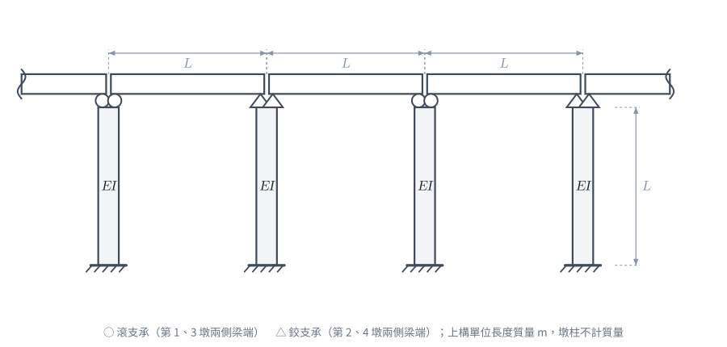
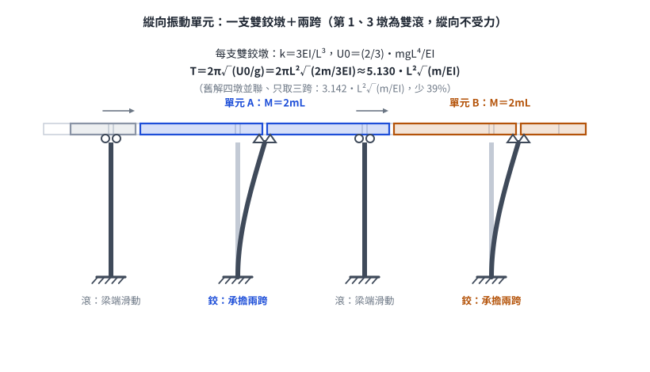

# 考題編號：SD-2010-3

**主分類：** `SD-U2-3` 橋梁耐震設計規範
**副分類：** `SD-U1-3` 單自由度、多自由度系統之動態分析及應用
**分析方法：** 橋梁耐震規範 Rayleigh 法（靜力位移函數法）：依墩頂滾／鉸支承選取縱向振動單元＋積分求橋梁基本周期
**標籤：** `橋梁耐震規範` `Rayleigh法` `振動單元` `靜力位移法` `縱向振動` `滾支承與鉸支承` `剛性橋面版假設` `懸臂橋墩` `均布質量` `橋梁基本周期` `積分公式` `Stodola法`

---

## 1. 題目（考卷原文見題目正本）

> 考卷原文、公式／附表、附圖與判讀清單（已確認）見 [`SD-2010-3-problem.md`](SD-2010-3-problem.md)。本節只列解題時最容易讀錯的地方與本解使用的記號；題意以題目正本為準。

*重繪自考卷附圖，依題目正本判讀清單；本圖攔下的判讀錯誤：第 1、3 墩頂是雙滾支承、第 2、4 墩頂是雙鉸支承，並非四墩都與梁銷接；考卷也沒有指定橫向。*

### 常見誤讀

| 項目 | 正確判讀 | 常見誤讀 |
|------|---------|---------|
| 計算方向 | 橋軸向（縱向）（判讀 #1，使用者授權依建議確認） | 加字成「$U(x)$ 為橋梁橫向變形」（考卷只寫「橋梁變形」；本庫舊解 §1，2026-11-16 已勘誤） |
| 墩頂支承 | 第 1、3 墩兩側梁端皆滾支承，第 2、4 墩兩側梁端皆鉸支承；每跨一端滾、一端鉸（判讀 #2、#3） | 四墩都與梁銷接、整座橋 4 墩一起側移，得 $T=\pi L^2\sqrt{m/EI}$（本庫舊解，2026-11-16 已勘誤） |
| 振動單元範圍 | 橋梁向兩端延續（波浪折斷線），不是只有三跨（判讀 #10） | 全橋只有 $3L$、質量 $3mL$ |
| 柱高 | $L$，由墩頂支承下緣量到柱底（判讀 #7） | — |
| 墩柱 | 不計質量、不計軸向變形（題文） | — |

**本解記號：** $m$ 上構單位長度質量、$w=mg$；$U(x)$ 在 $w(x)$ 作用下的靜變形；墩柱側向勁度依支承條件判定。

---

## 2. 考題核心精神與出題者意圖（Core Concepts & Examiner's Intent）

**核心觀念：** 橋梁耐震設計規範的週期公式 $T=2\pi\sqrt{\gamma/(\beta g)}$ 是 Rayleigh 法：把上構重量 $w(x)$ 沿計算方向當靜力施加，得到的靜變形 $U(x)$ 當作振態形狀。本題的關鍵在**「選取橋梁振動單元」**——簡支橋梁各跨由支承分開，哪些墩柱、哪些跨會一起動，要由墩頂支承的滾／鉸配置決定。

**出題者意圖：**
1. 能否從圖上的支承符號判斷縱向力的傳遞：滾支承不傳縱向力，鉸支承傳縱向力（題目正本判讀 #2、#3）。
2. 能否選出振動單元：第 2、4 墩頂兩側梁端都是鉸支承，每支這種墩柱承擔兩跨上構；第 1、3 墩兩側都是滾支承，縱向不受力。
3. 墩頂經支承與梁相連、不受梁的轉動束制 → 墩柱是懸臂，$k=3EI/L^3$。
4. 規範積分在剛體平移下化成乘法。

**關鍵判斷：** 計算方向取橋軸向（縱向）（判讀 #1）。振動單元＝一支雙鉸墩柱＋其上兩跨上構（質量 $2mL$）；兩跨在此墩縱向一起平移，$U(x)=U_0$（常數）。

---

## 3. 解題戰略地圖與陷阱分析（Strategic Roadmap & Trap Analysis）

**作戰計畫：**
1. 由墩頂支承符號判斷縱向傳力路徑，選出振動單元（一支雙鉸墩＋兩跨）
2. 墩柱邊界：底固定、頂經鉸支承 → 懸臂 $k=3EI/L^3$
3. 把振動單元的上構重量 $w=mg$ 沿縱向施加，求 $U_0$
4. 代入規範式求 $\beta$、$\gamma$、$T$

**關鍵陷阱：**

| # | 陷阱 | 說明 | 應對策略 |
|---|------|------|---------|
| ❶ | **沒看墩頂支承符號** | 第 1、3 墩頂是兩個小圓（滾），第 2、4 墩頂是兩個小三角（鉸）。把四墩都當成與梁銷接、四墩並聯，週期少算約 39%（舊解 $\pi L^2\sqrt{m/EI}$） | 每支墩柱先問：它頂上的梁端能不能傳縱向力 |
| ❷ | **振動單元只取「三跨」** | 圖兩端有波浪折斷線，橋梁向兩側延續；不能把全橋當成 $3L$、4 墩 | 以重複出現的「一支雙鉸墩＋兩跨」為單元 |
| ❸ | **墩柱邊界條件用錯** | 墩頂經支承連接、上構不束制墩頂轉動 → 懸臂 $3EI/L^3$；誤用雙固定 $12EI/L^3$ 會差 4 倍 | 看支承：鉸支承不傳彎矩 |
| ❹ | **公式漏掉 $g$** | $T=2\pi\sqrt{\gamma/(\beta g)}$，$\gamma/\beta$ 是長度，除以 $g$ 才是時間平方 | 化簡到 $T=2\pi\sqrt{U_0/g}$ 檢查量綱 |

---

## 3.5 變數層次分析（Variable Hierarchy Analysis）

> 複習提示：第一次解題後，在每個卡住的知識點旁標記 `⚠`；第二次複習時只看有 `⚠` 的項目。

### 最終目標
`橋梁縱向基本振動周期 T`

### 本題關鍵公式（依計算順序）

> $\boxed{\cdot}$ = 需由前步驟推導，非題目直接給定的變數

$$\text{Step 1（振動單元）: } \text{1 支雙鉸墩（第 2 或第 4 墩）＋兩跨上構},\quad M=2mL$$

$$\text{Step 2（墩柱懸臂勁度）: } k = \frac{3EI}{L^3}$$

$$\text{Step 3（縱向靜變形）: } U_0 = \frac{mg\cdot 2L}{\boxed{k}} = \frac{2mgL^4}{3EI}$$

$$\text{Step 4（積分化簡）: } \beta = mg\,\boxed{U_0}\cdot 2L,\quad \gamma = mg\,\boxed{U_0}^2\cdot 2L$$

$$\text{Step 5（周期）: } T = 2\pi\sqrt{\frac{\gamma}{\beta g}} = 2\pi\sqrt{\frac{\boxed{U_0}}{g}} = 2\pi L^2\sqrt{\frac{2m}{3EI}}$$

### L1：題目直接給定

| 符號 | 數值 | 說明 |
|------|------|------|
| $m$ | — | 上構單位長度質量 |
| $EI$ | 常數 | 墩柱抗彎勁度，不計墩柱質量、不計軸向變形 |
| $L$ | — | 跨長，也是墩柱高（判讀 #6、#7） |
| 支承 | 圖上符號 | 第 1、3 墩雙滾；第 2、4 墩雙鉸（判讀 #2） |

### L2：需知識點推導

**Step 1：振動單元**

| 項目 | 公式／來源 | 卡關? |
|------|----------|:-----:|
| 傳縱向力的墩 | 只有第 2、4 墩（鉸支承）；第 1、3 墩為滾支承，縱向不受力 | |
| 每支雙鉸墩承擔 | 兩側各一跨（每跨在此墩是鉸端、在另一墩是滾端）→ $2L$ 上構，$M=2mL$ | |

**Step 2：墩柱勁度**

| 符號 | 公式／來源 | 卡關? |
|------|----------|:-----:|
| $k$ | $3EI/L^3$（底固定、頂經鉸支承＝懸臂） | |

**Step 3：靜變形與積分**

| 符號 | 公式／來源 | 卡關? |
|------|----------|:-----:|
| $U_0$ | $mg\cdot2L/k = 2mgL^4/(3EI)$（兩跨縱向剛體平移，$U(x)$ 為常數） | |
| $\beta$ | $\int w U\,dx = 2mgLU_0$ | |
| $\gamma$ | $\int w U^2dx = 2mgLU_0^2$ | |
| $\gamma/(\beta g)$ | $U_0/g = 2mL^4/(3EI)$ | |

### L3：深層知識（不懂就卡住）

| 知識點 | 說明 | 卡關? |
|--------|------|:-----:|
| 滾支承與鉸支承的傳力 | 滾支承只傳垂直力，縱向可自由滑動；鉸支承傳垂直與水平力、不傳彎矩。簡支橋梁的縱向地震力只經鉸支承（固定支承）傳到墩柱 | |
| 振動單元 | 規範式要以「會一起振動的部分」為單元。各跨簡支、由支承分開時，振動單元由支承配置決定，不一定是整座橋 | |
| 規範式＝Rayleigh 法 | 以重量當靜力得到的變形當振態，令最大動能＝最大位能：$\omega^2=g\int wU\,dx/\int wU^2dx$ | |
| 懸臂柱 vs 雙固定柱 | 墩頂經支承連接，上構不束制墩頂轉動 → $3EI/L^3$；若墩頂與上構剛接 → $12EI/L^3$（差 4 倍） | |

---

## 4. 步驟化詳細計算過程（Step-by-Step Detailed Calculation）

### Step 1：選取振動單元

計算方向取橋軸向（縱向）（題目正本判讀 #1）。由圖三墩頂支承符號（判讀 #2、#3）：

- 第 1、3 墩：兩側梁端都是滾支承 → 縱向不傳力，這兩支墩柱縱向不參與。
- 第 2、4 墩：兩側梁端都是鉸支承 → 第一跨（左滾右鉸）與第二跨（左鉸右滾）的縱向慣性力都傳到第 2 墩；第三跨與右側延續段傳到第 4 墩。

> **振動單元：一支雙鉸墩柱（第 2 或第 4 墩）＋其上兩跨上構，上構質量 $M=m\cdot2L=2mL$。**
> 兩跨在該墩一起縱向平移，梁不計軸向變形 → 振動單元內 $U(x)=U_0$（常數）。

*圖解：縱向振動單元（位移放大示意）。本圖攔下的錯誤：把四墩都當成與梁銷接、四墩並聯、全橋只取三跨（舊解 T＝3.142 L²√(m/EI)）；滾支承的墩縱向不受力，每支雙鉸墩承擔兩跨，T＝5.130 L²√(m/EI)。*

### Step 2：墩柱縱向勁度

墩柱底固定；頂端經鉸支承與梁相連，上構不束制墩頂轉動 → 懸臂柱：

$$k = \frac{3EI}{L^3}$$

### Step 3：縱向靜變形 $U(x)$

把振動單元上構的單位長度靜載重 $w(x)=mg$ 沿縱向施加，總力 $mg\cdot2L$ 全部由該墩承受：

$$U_0 = \frac{mg\cdot2L}{3EI/L^3} = \frac{2mgL^4}{3EI}$$

### Step 4：計算 $\beta$、$\gamma$

$$\beta = \int_{2L} w(x)\,U(x)\,dx = mg\cdot U_0\cdot 2L = 2mgLU_0$$

$$\gamma = \int_{2L} w(x)\,[U(x)]^2\,dx = mg\cdot U_0^2\cdot 2L = 2mgLU_0^2$$

### Step 5：計算周期

$$\frac{\gamma}{\beta g} = \frac{U_0}{g} = \frac{2mL^4}{3EI}$$

$$\boxed{T = 2\pi\sqrt{\frac{\gamma}{\beta g}} = 2\pi L^2\sqrt{\frac{2m}{3EI}} \approx 5.130\,L^2\sqrt{\frac{m}{EI}}}$$

---

## 5. 關鍵爭議點與進階探討（Critical Issues & Advanced Discussion）

### 5.1 直接驗算（SDOF 等效法）

振動單元等效為單自由度：質量 $M=2mL$（墩柱不計質量）、勁度 $k=3EI/L^3$：

$$T = 2\pi\sqrt{\frac{M}{k}} = 2\pi\sqrt{\frac{2mL\cdot L^3}{3EI}} = 2\pi L^2\sqrt{\frac{2m}{3EI}} \checkmark$$

與規範式結果一致。剛體平移時 $U(x)$ 為常數，規範式恰好等於單自由度精確解（驗算腳本另以有限元素懸臂墩求頂端勁度 $3.000EI/L^3$、特徵值週期係數 5.130，一致）。

### 5.2 為何 $\gamma/(\beta g)=U_0/g$

$U(x)=U_0$ 為常數時：

$$\frac{\gamma}{\beta g} = \frac{U_0^2\int w\,dx}{U_0\,g\int w\,dx} = \frac{U_0}{g}$$

即 $T=2\pi\sqrt{U_0/g}$：週期只由「重量當水平力時的位移」決定。這也是規範式量綱的檢查方式。

### 5.3 若計算方向取橫向（對照）

考卷沒有指定方向（判讀 #1 定案縱向）。若取橫向，一般滾、鉸支承都束制橫向位移，每跨兩端各由一支墩柱承擔一半，橋梁向兩端延續 → 每支墩柱分擔 $mL$：

$$T_{\text{橫}} = 2\pi\sqrt{\frac{mL\cdot L^3}{3EI}} = 2\pi L^2\sqrt{\frac{m}{3EI}} \approx 3.628\,L^2\sqrt{\frac{m}{EI}}$$

縱向週期是橫向的 $\sqrt2$ 倍，因為縱向只有一半的墩柱在受力。

### 5.4 舊解對照（2026-11-16 勘誤前）

舊解把四墩都當成與梁銷接、全橋只取三跨 $3L$、四墩並聯（$K=4\times3EI/L^3$、$M=3mL$），並寫成橫向：

$$T_{\text{舊}} = \pi L^2\sqrt{m/EI} \approx 3.142\,L^2\sqrt{m/EI}$$

比本解 $5.130\,L^2\sqrt{m/EI}$ 少約 39%（本解為舊解的 1.633 倍）。錯誤來源：沒看圖上墩頂的滾／鉸支承符號，也忽略兩端的延續段；即使改取橫向，也應是 $3.628\,L^2\sqrt{m/EI}$，舊解在兩種讀法下都不對。

### 5.5 規範版本

本題只用到考卷給的週期公式；現行公路橋梁耐震設計規範的週期公式仍是同一形式（2024 年考卷 SD-2024-4 引作規範（2-6）式，記號 $\zeta=\int wu^2dx$），不影響答案。

### 5.6 考場最佳策略

1. **先看支承符號**：標出哪些墩頂是鉸（傳縱向力）、哪些是滾。
2. **寫出振動單元**：一支雙鉸墩＋兩跨，$M=2mL$、$k=3EI/L^3$。
3. **代公式**：$U_0=2mgL^4/(3EI)$，$T=2\pi\sqrt{U_0/g}=2\pi L^2\sqrt{2m/(3EI)}$。

*修正日期：2026-11-16（§1 改為指向題目正本，重繪附圖 figs/SD-2010-3-fig-1-problem.svg）*

*修正日期：2026-11-16（勘誤：判讀（墩頂支承配置）＋觀念模型（振動單元）。考卷圖三第 1、3 墩雙滾、第 2、4 墩雙鉸，橋梁向兩端延續；振動單元由「全橋 3 跨、4 墩並聯」改為「1 支雙鉸墩＋兩跨」，T 由 πL²√(m/EI)（3.142）改為 2πL²√(2m/(3EI))（5.130 L²√(m/EI)）；改 §2、§3、§3.5、§4、§5（舊值留 §5.4 對照），分析方法與標籤補字。驗證：scripts/fixes/2026-11-16_verify_SD-2010-3.py 符號推導與 FE 特徵值一致，MISMATCHES: 0）*

*修正日期：2026-11-16（非勘誤）圖解補繪：§4 Step 1 補縱向振動單元圖 figs/SD-2010-3-fig-3-unit.svg（腳本 gen_SD-2010-3.py，可重跑）*
