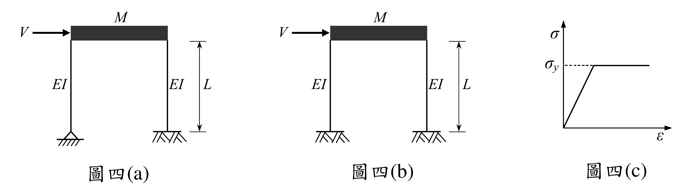

# SD-2010-4 題目正本

> 本檔只記錄考卷上寫了什麼、圖上畫了什麼，不含任何解法。解析見同資料夾 `SD-2010-4.md`。
> 判讀清單經使用者確認前，狀態為「待確認」；確認後本檔原則上不再修改（改動須回考卷原圖並記 log）。

| 項目 | 內容 |
|---|---|
| 考卷 | `raw/exams/SD-2010_結構動力分析與耐震設計.pdf`，第 2 頁（背面），第四題 |
| 考年 | 2010（民國99年）專技高考結構工程技師「結構動力分析與耐震設計」 |
| 配分 | 25 分（㈠8、㈡8、㈢9） |
| 附圖 | `SD-2010-4-fig-1.png`（舊擷取，圖四(a) 右柱底旁有游標）、`SD-2010-4-fig-2.png`（2026-11-16 由考卷 500 dpi 重擷取） |
| 判讀狀態 | **已確認**（2026-11-16，使用者授權依 Claude 建議。原轉錄：2026-11-16 轉錄；PyMuPDF 110 dpi 整頁＋500 dpi 局部放大，PDF 文字層核對原文；盲讀於開啟解析前完成） |

## 1. 考卷原文（逐字）

四、圖四(a)及圖四(b)皆為剛性樓版構成的剪力房屋，剛性樓版總質量為 $M$，柱為鋼柱，材料性質如圖四(c)所示，柱斷面為邊長 $b$ 的正方形，$EI$ 值為常數，不考慮柱的質量。試分析：

㈠比較圖四(a)及圖四(b)之剪力房屋之振動頻率。（8 分）

㈡比較圖四(a)及圖四(b)之剪力房屋崩塌時之側力 $V$。（8 分）

㈢參考前述之分析結果、塑鉸（plastic hinge）發展情形、柱剪力、可能的變位等，從耐震設計觀點比較圖四(a)及圖四(b)兩者之優劣。（9 分）

## 2. 考卷給的公式、附表與參數

- 考卷沒有給參考公式。
- 給定：剛性樓版總質量 $M$；兩柱 $EI$ 相同且為常數、柱高 $L$；柱斷面為邊長 $b$ 的實心正方形；鋼材應力–應變為彈性–完全塑性（圖四(c)，降伏應力 $\sigma_y$）；柱質量不計。
- 考卷沒有給：$E$、$b$、$L$、$\sigma_y$ 的數值（全部以符號作答）；阻尼；軸力與 P-Δ 效應。
- 卷首注意事項：㈠可以使用電子計算器。㈡不必抄題，作答時請將試題題號及答案依照順序寫在試卷上，於本試題上作答者，不予計分。考試時間：2 小時。

## 3. 附圖

*證據圖 SD-2010-4-fig-2.png（500 dpi 重擷取；舊圖 SD-2010-4-fig-1.png 內容相同，圖四(a) 右柱底旁有游標）*

圖面文字照錄：M、V、EI、EI、L、圖四(a)、M、V、EI、EI、L、圖四(b)、σ、σy、ε、圖四(c)

## 4. 判讀清單

| # | 項目 | 判讀 | 圖上／題文依據 | 把握 |
|---|---|---|---|---|
| 1 | 柱頂與樓版的接合 | 剛接（剛性樓版、剪力房屋：柱頂不轉動、只隨樓版平移） | 題文「剛性樓版構成的剪力房屋」；圖上柱線直接接入塗黑樓版 | 確定（解讀） |
| 2 | 「崩塌時之側力 V」 | 形成塑性機構（崩塌機構）時的側力，即以全塑性彎矩 $M_p$（實心正方形斷面）求極限側力；定案：主線用 $M_p$，以 $M_y$ 表示的初始降伏側力可作補充對照 | 題文「崩塌時」；圖四(c) 彈性–完全塑性 | 不確定（解讀）；定案如左 |
| 3 | 圖四(a) 支承 | 左柱底鉸支（三角形支承）、右柱底固定 | 500 dpi：左柱底三角形＋短斜線地線；右柱底寬地線＋交叉斜線 | 確定 |
| 4 | 圖四(b) 支承 | 兩柱底皆固定 | 500 dpi：兩柱底同 (a) 右柱符號 | 確定 |
| 5 | 柱高 | $L$，尺寸線上端對齊樓版底面、下端對齊柱底 | 500 dpi：上延伸線與樓版下緣同高 | 確定 |
| 6 | M 的意義 | 樓版總質量（不是彎矩） | 題文「剛性樓版總質量為 $M$」；圖上 M 標在樓版上方 | 確定 |
| 7 | 側力 V | 作用在樓版高度、水平向右（兩圖相同） | 圖上箭頭 | 確定 |
| 8 | 材料 | 彈性–完全塑性，降伏應力 $\sigma_y$，無應變硬化 | 圖四(c) | 確定 |
| 9 | 柱斷面 | 邊長 $b$ 實心正方形，兩柱相同 | 題文 | 確定（解讀） |
| 10 | 所求 | ㈠兩者頻率比較；㈡兩者崩塌側力比較；㈢耐震觀點優劣論述 | 題文 | 確定 |
| 11 | 考卷沒有給 | 數值、阻尼、軸力／P-Δ | 題文 | 確定 |

---
*轉錄：2026-11-16（SD-U3-1 題目正本推廣・組 U3-1-G1）*
*確認：2026-11-16 使用者授權依 Claude 建議確認（SD-U3-1 題目正本推廣・組 U3-1-G1，關卡一）*
