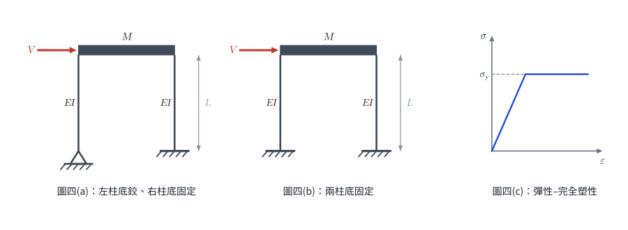
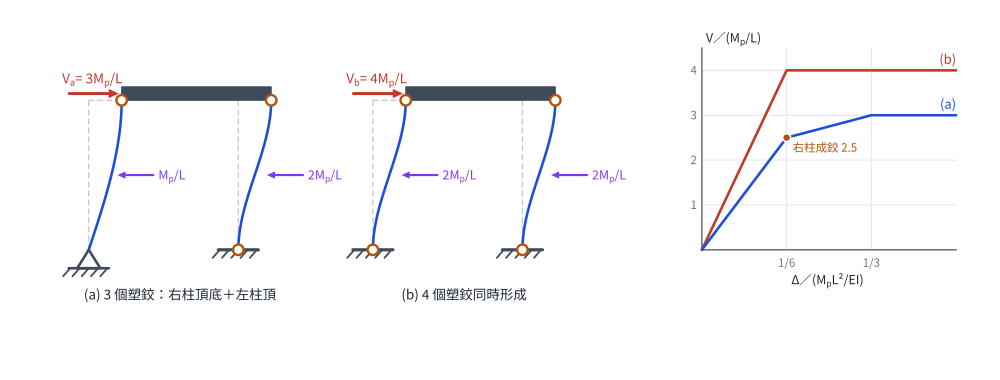

# 考題編號：SD-2010-4

**主分類：** `SD-U3-1` 結構耐震設計（含RC結構與鋼結構）
**副分類：** `SD-U1-3` 單自由度、多自由度系統之動態分析及應用
**分析方法：** 概念題（含計算）——雙柱剪力房屋邊界條件比較（固定-固定 vs 鉸接-固定）：頻率比、崩塌側力、塑鉸機制與耐震性能
**標籤：** `剪力房屋` `SDOF` `固定固定柱` `鉸接固定柱` `側向勁度` `振動頻率比` `塑鉸` `崩塌機制` `容量設計` `鋼柱彈塑性` `塑性截面模數` `耐震性能比較` `雙曲率` `單曲率`

---

## 1. 題目（考卷原文見題目正本）

> 考卷原文、公式／附表、附圖與判讀清單（已確認）見 [`SD-2010-4-problem.md`](SD-2010-4-problem.md)。本節只列解題時最容易讀錯的地方與本解使用的記號；題意以題目正本為準。

*重繪自考卷附圖，依題目正本判讀清單；本圖攔下的判讀錯誤：圖四(a) 只有左柱底為鉸、右柱底固定，(b) 才是兩柱底固定（本庫舊解把 (a)(b) 對調，並把鉸接那一圖的兩柱都當鉸接）。*

### 常見誤讀

| 項目 | 正確判讀 | 常見誤讀 |
|------|---------|---------|
| 圖四(a) 支承 | **左柱底鉸、右柱底固定**（判讀 #3） | 兩柱都鉸接；或與 (b) 對調（2026-11-16 前本庫舊解的讀法，得 ω_a/ω_b＝2、V_a＝2V_b） |
| 圖四(b) 支承 | **兩柱底皆固定**（判讀 #4） | 兩柱鉸接 |
| 柱頂 | 剛接於剛性樓版，只平移不轉動（判讀 #1） | 柱頂鉸接 |
| 崩塌側力 | 以實心正方形斷面的 $M_p$ 形成機構時的側力（判讀 #2） | 用 $M_y$（初始降伏）當崩塌 |

**本解記號：** $M$ 為樓版質量；$M_p=\sigma_y Z$ 為柱全塑性彎矩；$K$ 為樓層側向勁度。

---

## 2. 考題核心精神與出題者意圖（Core Concepts & Examiner's Intent）

**核心觀念：** 柱底邊界條件對結構**側向勁度**、**崩塌強度**、**塑鉸發展順序**與**柱剪力分配**的影響——這幾者的差異直接反映耐震設計中「勁度、強度、贅餘度與韌性」的取捨。

**出題者意圖：**
1. 測驗頂端剛接、底端鉸接柱（$k = 3EI/L^3$）與兩端固定柱（$k = 12EI/L^3$）勁度公式，以及並聯柱的組合：(a) $3+12=15$、(b) $12+12=24$（$\times EI/L^3$）
2. 測驗塑性彎矩（實心正方形 $Z = b^3/4$）及崩塌機構分析（(a) 3 個塑鉸、(b) 4 個塑鉸）
3. 測驗耐震設計的整合判斷能力（勁度、強度、塑鉸發展、柱剪力不均、變位）

---

## 3. 解題戰略地圖與陷阱分析（Strategic Roadmap & Trap Analysis）

**作戰計畫：**
1. 讀圖確認邊界條件：(a) 左柱底鉸、右柱底固定；(b) 兩柱底固定；柱頂皆剛接剛性樓版
2. 各柱側向勁度 → 系統勁度 → 頻率（SDOF：$\omega = \sqrt{K/M}$）
3. 計算塑性彎矩 $M_p$（正方形截面）
4. 分析崩塌機構，推導崩塌側力 $V$（虛功法），並以逐步塑鉸法交叉驗證
5. 比較耐震性能（勁度、強度、塑鉸數量與順序、柱剪力、變位）

**關鍵陷阱：**

| # | 陷阱 | 說明 | 應對策略 |
|---|------|------|---------|
| ❶ | **看錯支承** | 圖四(a) 只有**左柱底**是三角形鉸支，右柱底是固定；圖四(b) 兩柱底都固定 | 逐柱看柱底符號；本庫舊解曾把 (a)(b) 對調，並把鉸接那一圖的兩柱都當鉸接 |
| ❷ | **邊界條件勁度公式混淆** | 兩端固定：$k = 12EI/L^3$；頂固底鉸：$k = 3EI/L^3$（差 4 倍） | 鉸接端去掉轉動束制，勁度降為 $1/4$ |
| ❸ | **塑性截面模數 vs 彈性截面模數** | 崩塌用 $M_p = \sigma_y Z$，$Z = b^3/4$；勿與 $S = b^3/6$ 混淆 | 崩塌題用 $Z$；初始降伏才用 $S$ |
| ❹ | **(a) 崩塌塑鉸數算錯** | (a) 右柱頂、底各一＋左柱頂一，共 3 個；(b) 每柱頂底各一，共 4 個 | 鉸接柱底本身就是鉸，不再出現塑鉸 |
| ❺ | **頻率比方向寫反** | $\omega_a/\omega_b = \sqrt{15/24} = 0.791$；$\omega_b/\omega_a = 1.265$ | 寫比值時標明分子分母 |

---

## 3.5 變數層次分析（Variable Hierarchy Analysis）

> 複習提示：第一次解題後，在每個卡住的知識點旁標記 `⚠`；第二次複習時只看有 `⚠` 的項目。

### 最終目標
`(一) ω_a vs ω_b；(二) V_a vs V_b；(三) 耐震性能比較`

### 本題關鍵公式（依計算順序）

> $\boxed{\cdot}$ = 需由前步驟推導，非題目直接給定的變數

$$\text{Step 1（各柱勁度）: } k_{\text{鉸-固}} = \frac{3EI}{L^3},\; k_{\text{固-固}} = \frac{12EI}{L^3}$$

$$\text{Step 2（系統勁度）: } K_{(a)} = \frac{3EI}{L^3}+\frac{12EI}{L^3} = \frac{15EI}{L^3},\; K_{(b)} = 2\times\frac{12EI}{L^3} = \frac{24EI}{L^3}$$

$$\text{Step 3（頻率比）: } \frac{\omega_a}{\omega_b} = \sqrt{\frac{\boxed{K_{(a)}}}{\boxed{K_{(b)}}}} = \sqrt{\frac{15}{24}} = 0.791 \quad\left(\frac{\omega_b}{\omega_a} = 1.265\right)$$

$$\text{Step 4（塑性彎矩）: } M_p = \sigma_y Z = \sigma_y \cdot \frac{b^3}{4}$$

$$\text{Step 5a（(a)崩塌側力）: } V_a = \frac{2\boxed{M_p}}{L} + \frac{\boxed{M_p}}{L} = \frac{3M_p}{L}$$

$$\text{Step 5b（(b)崩塌側力）: } V_b = 2\times\frac{2\boxed{M_p}}{L} = \frac{4M_p}{L}$$

### L1：題目直接給定

| 符號 | 數值 | 說明 |
|------|------|------|
| $M$ | — | 剛性樓版總質量 |
| $EI$ | 常數 | 鋼柱抗彎勁度（兩柱相同） |
| $L$ | — | 柱高度 |
| $b$ | — | 正方形截面邊長 |
| $\sigma_y$ | — | 鋼材降伏應力（彈性–完全塑性） |
| 支承 | (a) 左鉸右固；(b) 兩固 | 題目正本判讀 #3、#4 |

### L2：需知識點推導

**Step 1–2：側向勁度**

| 符號 | 公式／來源 | 卡關? |
|------|----------|:-----:|
| $k_{\text{固-固}}$ | $12EI/L^3$（柱頂剛接剛性樓版、柱底固定） | |
| $k_{\text{鉸-固}}$ | $3EI/L^3$（柱頂剛接、柱底鉸） | |
| $K_{(a)}$ | $3+12 = 15\,EI/L^3$ | |
| $K_{(b)}$ | $2 \times 12 = 24\,EI/L^3$ | |
| $\omega_a/\omega_b$ | $\sqrt{15/24} = 0.791$；$T_a/T_b = 1.265$ | |

**Step 3：塑性彎矩**

| 符號 | 公式／來源 | 卡關? |
|------|----------|:-----:|
| $Z$ | $b^3/4$（正方形實心截面塑性截面模數） | |
| $M_p$ | $\sigma_y b^3/4$ | |

**Step 4：崩塌側力**

| 符號 | 公式／來源 | 卡關? |
|------|----------|:-----:|
| $V_a$ | 右柱（固-固）頂底成鉸 $Q_R = 2M_p/L$；左柱（鉸-固）頂端成鉸 $Q_L = M_p/L$；$V_a = 3M_p/L$ | |
| $V_b$ | 每柱頂底成鉸 $Q = 2M_p/L$；$V_b = 4M_p/L$ | |

### L3：深層知識（不懂就卡住）

| 知識點 | 說明 | 卡關? |
|--------|------|:-----:|
| 剛接 vs 鉸接邊界對勁度的影響 | 兩端固定柱 $k = 12EI/L^3$；一端固定一端鉸 $k = 3EI/L^3$；差 4 倍 | |
| 正方形截面塑性截面模數 | $Z = (b^2/2)(b/4)\times 2 = b^3/4$；$Z/S = 1.5$（形狀因子） | |
| 虛功法求崩塌載重 | 側移 $\Delta = L\theta$，外功 $V L\theta$ = 內功 $\sum M_p\theta$ | |
| 並聯柱剪力分配 | 彈性階段剪力依勁度分配：(a) 右柱 $12/15 = 80\%$、左柱 $20\%$，右柱先降伏 | |
| 雙曲率 vs 單曲率柱 | 兩端固定：雙曲率，最大彎矩 $QL/2$；頂固底鉸：單曲率，最大彎矩 $QL$（在柱頂） | |

---

## 4. 步驟化詳細計算過程（Step-by-Step Detailed Calculation）

### Step 1：各柱側向勁度

**兩端固定柱（圖四(a) 右柱、圖四(b) 兩柱）：** 剛性樓版使柱頂不轉動，柱底固定：

$$k_{\text{固-固}} = \frac{12EI}{L^3}$$

**頂固底鉸柱（圖四(a) 左柱）：** 柱底鉸可自由轉動，柱頂剛接剛性樓版：

$$k_{\text{鉸-固}} = \frac{3EI}{L^3}$$

---

### （一）振動頻率比較

系統側向勁度（兩柱並聯）：

$$K_{(a)} = \frac{3EI}{L^3} + \frac{12EI}{L^3} = \frac{15EI}{L^3}, \qquad K_{(b)} = 2 \times \frac{12EI}{L^3} = \frac{24EI}{L^3}$$

自然頻率（SDOF，$M$ 為樓版質量）：

$$\omega_a = \sqrt{\frac{15EI}{ML^3}}, \qquad \omega_b = \sqrt{\frac{24EI}{ML^3}}$$

$$\boxed{\frac{\omega_a}{\omega_b} = \sqrt{\frac{15}{24}} = 0.791 \qquad\text{（即 } \omega_b/\omega_a = 1.265\text{）}}$$

> **結論：圖四(b) 的振動頻率是圖四(a) 的 1.265 倍；圖四(a) 的週期是圖四(b) 的 1.265 倍。**

---

### （二）崩塌側力比較

**塑性彎矩 $M_p$（正方形截面 $b \times b$）：**

$$Z = \frac{b^2}{2} \times \frac{b}{4} + \frac{b^2}{2} \times \frac{b}{4} = \frac{b^3}{4}, \qquad M_p = \sigma_y Z = \frac{\sigma_y b^3}{4}$$

---

**圖四(a) — 左柱鉸底、右柱固底：**

崩塌機構：右柱頂、底各一個塑鉸，左柱頂一個塑鉸（左柱底本為鉸），共 3 個。

- 右柱（雙曲率）：$Q_R L = 2M_p \Rightarrow Q_R = 2M_p/L$
- 左柱（單曲率，對底鉸取矩）：$Q_L L = M_p \Rightarrow Q_L = M_p/L$

$$V_a = Q_R + Q_L = \frac{3M_p}{L}$$

虛功驗證：$V_a L\theta = 3M_p\theta \Rightarrow V_a = 3M_p/L$ ✔

$$\boxed{V_a = \frac{3M_p}{L} = \frac{3\sigma_y b^3}{4L} = 0.75\,\frac{\sigma_y b^3}{L}}$$

**塑鉸發展順序（逐步塑鉸法）：**
1. 彈性階段剪力依勁度分配：右柱 $12/15 = 80\%$，柱端彎矩 $0.8V\cdot L/2 = 0.4VL$；左柱 $20\%$，柱頂彎矩 $0.2VL$
2. 右柱頂、底同時於 $0.4VL = M_p$ 成鉸：$V_1 = 2.5M_p/L$，$\Delta_1 = V_1/K_{(a)} = M_pL^2/(6EI)$（此時左柱頂彎矩 $0.5M_p$）
3. 之後右柱剪力固定在 $2M_p/L$，只剩左柱勁度 $3EI/L^3$；左柱頂達 $M_p$ 時 $\Delta_u = M_pL^2/(3EI) = 2\Delta_1$，$V = 3M_p/L$，形成機構

---

**圖四(b) — 兩柱固底：**

每柱雙曲率，反曲點在柱中點，$Q = V/2$，$M_{\text{頂}} = M_{\text{底}} = QL/2 = VL/4$。

崩塌條件（頂底同時達 $M_p$）：

$$\frac{V_b L}{4} = M_p \quad\Rightarrow\quad \boxed{V_b = \frac{4M_p}{L} = \frac{\sigma_y b^3}{L}}$$

4 個塑鉸同時形成，崩塌位移 $\Delta_u = V_b/K_{(b)} = M_pL^2/(6EI)$。虛功驗證：$V_b L\theta = 4M_p\theta$ ✔

---

**比較：**

$$\boxed{\frac{V_a}{V_b} = \frac{3}{4} = 0.75} \quad\Rightarrow\quad \text{圖四(b) 崩塌側力為圖四(a) 的 4/3 倍}$$

（以初始降伏表示時：$V_{y,a} = 2.5M_y/L$、$V_{y,b} = 4M_y/L$，$M_y = \sigma_y b^3/6$。）

*圖 3　崩塌機構與推覆曲線（數值取自本節 K_a＝15、K_b＝24 EI/L³ 與逐步塑鉸法）。本圖攔下的錯誤：把圖四(a) 當成兩柱固定或兩柱鉸底——(a) 只有 3 個塑鉸、崩塌側力是 (b) 的 3/4，且右柱先降伏、崩塌位移為 (b) 的 2 倍。*

---

### （三）耐震設計觀點比較

| 比較項目 | 圖四(a) 左鉸右固 | 圖四(b) 兩柱固定 |
|---------|:----------------:|:----------------:|
| 側向勁度 $K$ | $15EI/L^3$（較小） | $24EI/L^3$ **（較大，1.6 倍）** |
| 自然週期 $T$ | 較長（$T_a = 1.265T_b$） | 較短 |
| 崩塌側力 $V$ | $3M_p/L$（較小） | $4M_p/L$ **（較大，4/3 倍）** |
| 塑鉸數量 | 3 個（右柱頂底＋左柱頂） | **4 個**（每柱頂底各一） |
| 塑鉸發展 | 依序：右柱先在 $2.5M_p/L$ 雙端成鉸，再到左柱頂 | 4 個同時形成，塑性變形分布均勻 |
| 彈性期柱剪力分配 | 不均：右柱 80%、左柱 20% | 均勻：各 50% |
| 崩塌時柱剪力 | 右柱 $2M_p/L$、左柱 $M_p/L$ | 兩柱各 $2M_p/L$ |
| 崩塌時位移 $\Delta_u$ | $M_pL^2/(3EI)$（(b) 的 2 倍） | $M_pL^2/(6EI)$ |
| 基礎彎矩 | 左柱底 0、右柱底 $M_p$ | 兩柱底各 $M_p$ |

**綜合耐震設計評估：**

**圖四(b) 優點：**
1. **勁度與強度較高：** 勁度 1.6 倍、崩塌側力 4/3 倍
2. **塑鉸多且同時形成：** 4 個塑鉸，相同塑性轉角下消散能量 $4M_p\theta_p$，(a) 只有 $3M_p\theta_p$；贅餘度較高
3. **柱剪力均勻：** 兩柱各分擔一半，沒有單一柱先降伏、受力集中的問題
4. **變位小：** 崩塌位移只有 (a) 的一半，層間變位角、$P$-$\Delta$ 效應與非結構損害較小

**圖四(b) 缺點：**
1. 勁度大 → 週期短 → 在設計反應譜加速度平台段吸引較大地震力
2. 兩柱底都要承受 $M_p$，基礎須能抗彎、費用較高

**圖四(a) 優點：**
1. 週期較長，位於反應譜下降段時，引致地震力可能較小
2. 左柱底鉸接，該基礎無彎矩需求

**圖四(a) 缺點：**
1. 勁度、強度都較低（$0.625$ 倍、$0.75$ 倍）
2. 兩柱勁度相差 4 倍，彈性期右柱承擔 80% 剪力而先降伏，塑性變形集中在右柱；右柱剪力需求高，須以容量設計檢核剪力
3. 塑鉸僅 3 個，能量消散與贅餘度較差
4. 崩塌位移為 (b) 的 2 倍，$P$-$\Delta$ 效應與變位相關損害較大；若整棟建築多處採此配置，勁度不對稱還會造成平面上的勁度偏心

**總結：** 從耐震設計觀點，**圖四(b)（兩柱固定）較優**：勁度、強度、贅餘度較高，柱剪力均勻、塑鉸同時形成，變位較小。圖四(a) 只在基礎彎矩上較省，但勁度與強度低、受力集中於固定柱、變位大。

---

## 5. 關鍵爭議點與進階探討（Critical Issues & Advanced Discussion）

### 5.1 強柱弱梁（Strong Column-Weak Beam）原則的應用

本題樓版為剛體、沒有可降伏的梁，塑鉸只能出現在柱端，屬「軟層」型機構。實際建築依容量設計應讓塑鉸形成在梁端、柱保持彈性；本題是單純比較柱底邊界條件的模型。

### 5.2 彈性區間吸收的地震力比較

$K_{(a)} = 0.625K_{(b)}$，$T_a = 1.265T_b$。在相同地震下：
- 圖四(a) 的地震力 $\propto M\,S_a(T_a)$，圖四(b) 的地震力 $\propto M\,S_a(T_b)$
- 若兩者都在反應譜加速度平台段，地震力相同；若 $T_a$ 落在下降段，(a) 的地震力較小，但位移 $S_d = S_a/\omega^2$ 較大

(b) 的崩塌強度仍為 (a) 的 4/3 倍，整體安全餘裕較大。

### 5.3 $P$-$\Delta$ 效應

圖四(a) 勁度較低、崩塌位移為 (b) 的 2 倍，更容易受到 $P$-$\Delta$ 效應（幾何非線性）的不利影響；穩定性指標 $\theta = P\Delta/(VL)$ 過大時須修正設計地震力。

### 5.4 本庫舊解的讀圖錯誤（對照）

2026-11-16 前的舊解把圖四(a) 當成兩柱固定、圖四(b) 當成兩柱都鉸底，得 $K_{(a)} = 24$、$K_{(b)} = 6\,EI/L^3$，$\omega_a/\omega_b = 2$，$V_a = 4M_p/L$、$V_b = 2M_p/L$（比值 2），並據此判定 (a) 較優。考卷第 2 頁圖四(a) 只有左柱底為鉸、右柱底固定，(b) 兩柱底固定（題目正本判讀 #3、#4），結論方向相反。

*修正日期：2026-11-16（§1 改為指向題目正本，重繪附圖 figs/SD-2010-4-fig-1-problem.svg）*
*修正日期：2026-11-16（勘誤：圖四(a) 為左柱底鉸、右柱底固定，(b) 為兩柱底固定（舊解對調且把兩柱都當鉸底）；頻率由 ω_a/ω_b＝2 改為 ω_a/ω_b＝√(15/24)＝0.791（ω_b/ω_a＝1.265）；崩塌側力由 V_a＝4M_p/L、V_b＝2M_p/L 改為 V_a＝3M_p/L、V_b＝4M_p/L（V_a/V_b＝0.75）；㈢ 結論改為 (b) 較優；§2–§5 全部改寫；驗證：scripts/fixes/2026-11-16_verify_SD-2010-4.py 直接勁度法數值凝縮＋虛功法＋逐步塑鉸法，MISMATCHES: 0）*
*修正日期：2026-11-16（非勘誤）圖解補繪：figs/SD-2010-4-fig-3-mechanism.svg（崩塌機構＋推覆曲線，§4（二））*
