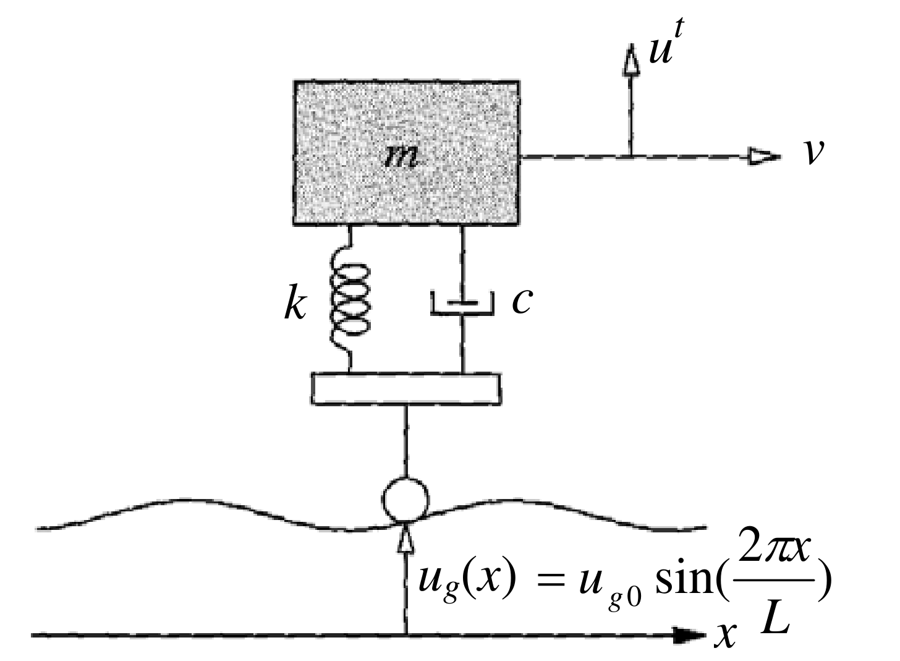

# SD-2011-2 題目正本

> 本檔只記錄考卷上寫了什麼、圖上畫了什麼，不含任何解法。解析見同資料夾 `SD-2011-2.md`。
> 判讀清單經使用者確認前，狀態為「待確認」；確認後本檔原則上不再修改（改動須回考卷原圖並記 log）。

| 項目 | 內容 |
|---|---|
| 考卷 | `raw/exams/SD-2011_結構動力分析與耐震設計.pdf`，第 1 頁（正面），第二題 |
| 考年 | 2011（民國100年）專技高考結構工程技師「結構動力分析與耐震設計」 |
| 配分 | 25 分（10／5／10） |
| 附圖 | `SD-2011-2-fig-1.png`（舊擷取，上方有游標）、`SD-2011-2-fig-2.png`（2026-11-15 由考卷 500 dpi 重擷取） |
| 判讀狀態 | **已確認**（2026-11-15 使用者授權依 Claude 建議確認。原轉錄：2026-11-15 轉錄；PyMuPDF 110 dpi 整頁＋400–500 dpi 局部放大，PDF 文字層核對原文；盲讀於開啟解析前完成） |

## 1. 考卷原文（逐字）

二、將一輛汽車模擬成單自由度之彈簧-阻尼-質塊系統如下圖所示，若該汽車以 $v$ 等速行駛，道路鋪面的粗糙度為 $u_g(x)=u_{g0}\sin\left(\dfrac{2\pi x}{L}\right)$：

㈠試建立其運動方程式（10 分）

㈡求共振車速。（5 分）

㈢若忽略阻尼，求在非共振車速時之穩態反應（10 分）

## 2. 考卷給的公式、附表與參數

- 考卷沒有給參考公式或附表；只給路面函數 $u_g(x)=u_{g0}\sin(2\pi x/L)$。
- 給定（符號）：質量 $m$、彈簧 $k$、阻尼 $c$、車速 $v$（等速）、路面振幅 $u_{g0}$、波長 $L$。
- 考卷沒有給：輪胎勁度與質量（圖上車輪以小圓表示）、初始條件。
- 卷首注意事項：㈠可以使用電子計算器。㈡不必抄題，作答時請將試題題號及答案依照順序寫在試卷上，於本試題上作答者，不予計分。㈢本試題之相關符號、公式、物理常數及設計參數未提及時，請依規範自行合理推斷或假設。考試時間：2 小時。

## 3. 附圖

*證據圖 SD-2011-2-fig-2.png（500 dpi 重擷取；舊圖 SD-2011-2-fig-1.png 內容相同，上方有游標）*

圖面文字照錄：m、$u^t$、v、k、c、$u_g(x)=u_{g0}\sin(2\pi x/L)$、x

## 4. 判讀清單

| # | 項目 | 判讀 | 圖上／題文依據 | 把握 |
|---|---|---|---|---|
| 1 | 自由度 | 質塊的**垂直總位移** $u^t$（自地面基準量起），向上為正 | 圖上 $u^t$ 箭頭垂直向上，上標 t | 確定 |
| 2 | 支承激振 | 彈簧與阻尼器下端隨路面高程 $u_g$ 上下運動；車輪視為剛性、始終貼地（輪胎勁度不計） | 圖上平板－桿－小圓直接連到路面；考卷沒有給輪胎參數 | 確定（解讀） |
| 3 | 位置與時間 | 等速 $v$ 行駛，$x=vt$（設 $t=0$ 時 $x=0$） | 題文「以 v 等速行駛」；圖上 v 水平箭頭 | 確定（解讀） |
| 4 | 彈簧與阻尼器 | $k$、$c$ 並聯，介於質塊與車輪平板之間 | 圖面 | 確定 |
| 5 | 路面 | $u_g(x)=u_{g0}\sin(2\pi x/L)$，$L$ 為路面波長 | 題文與圖註 | 確定 |
| 6 | ㈢條件 | 忽略阻尼（$c=0$），只求穩態，且車速不等於共振車速 | 題文 | 確定 |
| 7 | 所求 | ㈠運動方程式 ㈡共振車速 ㈢無阻尼、非共振車速之穩態反應（以 $u^t$ 表示） | 題文 | 確定 |

---
*轉錄：2026-11-15（SD-U1-3 題目正本推廣・批 2）*
*確認：2026-11-15 使用者授權依 Claude 建議確認（SD-U1-3 題目正本推廣・批 2，關卡一）*
