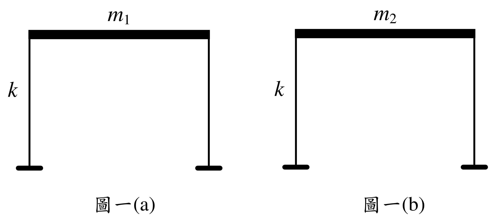

# SD-2012-1 題目正本

> 本檔只記錄考卷上寫了什麼、圖上畫了什麼，不含任何解法。解析見同資料夾 `SD-2012-1.md`。
> 判讀清單經使用者確認前，狀態為「待確認」；確認後本檔原則上不再修改（改動須回考卷原圖並記 log）。

| 項目 | 內容 |
|---|---|
| 考卷 | `raw/exams/SD-2012_結構動力分析與耐震設計.pdf`，第 1 頁（正面），第一題 |
| 考年 | 2012（民國101年）專技高考結構工程技師「結構動力分析與耐震設計」 |
| 配分 | 30 分（5／5／10／5／5） |
| 附圖 | `SD-2012-1-fig-1.png`（圖一(a)）、`SD-2012-1-fig-2.png`（圖一(b)，左上有游標）、`SD-2012-1-fig-3.png`（2026-11-15 由考卷 500 dpi 重擷取，兩圖並列） |
| 判讀狀態 | **已確認**（2026-11-15 使用者授權依 Claude 建議確認。原轉錄：2026-11-15 轉錄；PyMuPDF 110 dpi 整頁＋400–500 dpi 局部放大，PDF 文字層核對原文；盲讀於開啟解析前完成） |

## 1. 考卷原文（逐字）

一、某一鋼筋混凝土建築結構（阻尼比為 5%）被模擬為「單層剪力屋架」如圖一(a)所示，樓層的側向總勁度為 $k$，質量為 $m_1$，振動週期為 1.2 sec。假設樓板上有其他固定加載物，使其樓層質量增加為 $m_2=m_1+1806$ kg（樓層的側向總勁度 $k$ 及阻尼比皆不變），此時其振動週期為 1.4 sec，所相應之單層剪力屋架如圖一(b)所示。假設此兩屋架承受某一地震（5%阻尼比所相應之水平加速度反應譜係數為 $S_a$）作用下能維持在線彈性，請回答下列問題：

$$S_a=\begin{cases}0.2, & T\le 0.6\ \text{sec}\\ 0.12/T, & T\ge 0.6\ \text{sec}\end{cases}$$

㈠樓層質量 $m_1$（以 kg 表示）為何？（5 分）

㈡樓層側向總勁度 $k$（以 N/m 表示）為何？（5 分）

㈢樓層質量分別為 $m_1$ 及 $m_2$ 的屋架結構受震後所相應之彈性地震力（以 N 表示）為何？（10 分）

㈣樓層質量分別為 $m_1$ 及 $m_2$ 的屋架結構受震後之樓層相對地面的最大位移（以 cm 表示）為何？（5 分）

㈤根據上述計算之結果，可以獲得何種結論？（5 分）

## 2. 考卷給的公式、附表與參數

- 考卷給的反應譜：$S_a=0.2$（$T\le0.6$ s）、$S_a=0.12/T$（$T\ge0.6$ s），5% 阻尼比。
- 給定：$T_1=1.2$ s（質量 $m_1$）、$T_2=1.4$ s（質量 $m_2=m_1+1806$ kg）、$k$ 不變、阻尼比 5% 不變、線彈性。
- 考卷沒有給：$S_a$ 的單位（係數，未寫 g）、$g$ 的數值。
- 卷首注意事項：㈠可以使用電子計算器。㈡不必抄題，作答時請將試題題號及答案依照順序寫在試卷上，於本試題上作答者，不予計分。㈢本試題之相關公式、物理常數、符號意義及設計參數未提及時，請自行合理推斷與假設。考試時間：2 小時。

## 3. 附圖

*證據圖 SD-2012-1-fig-3.png（500 dpi 重擷取；舊圖 fig-1、fig-2 內容相同，fig-2 左上有游標）*

圖面文字照錄：m1、k、圖一(a)、m2、k、圖一(b)

## 4. 判讀清單

| # | 項目 | 判讀 | 圖上／題文依據 | 把握 |
|---|---|---|---|---|
| 1 | $S_a$ 單位 | 無因次反應譜係數，乘重量（$mg$）得彈性地震力（即以 g 為單位的譜加速度） | 題文「水平加速度反應譜係數為 $S_a$」，數值 0.2 量級 | 確定（解讀） |
| 2 | 質量關係 | $m_2=m_1+1806$ kg，$k$ 與阻尼比不變 | 題文 | 確定 |
| 3 | 週期 | 圖(a) $T=1.2$ s、圖(b) $T=1.4$ s | 題文 | 確定 |
| 4 | 反應譜分段 | $T\le0.6$ s 取 0.2；$T\ge0.6$ s 取 $0.12/T$（兩段在 0.6 s 連續） | 題文公式 | 確定 |
| 5 | 柱底 | 固定（短水平粗線）；屋架為剪力屋架（樓版剛性） | 圖面＋題文「單層剪力屋架」 | 確定（解讀） |
| 6 | 「彈性地震力」 | 線彈性反應下的最大側力（未折減） | 題文「能維持在線彈性」 | 確定（解讀） |
| 7 | 單位要求 | ㈠ kg ㈡ N/m ㈢ N ㈣ cm | 題文 | 確定 |
| 8 | 考卷沒有給 | $g$ 的數值 | 題文 | 確定 |

---
*轉錄：2026-11-15（SD-U1-3 題目正本推廣・批 2）*
*確認：2026-11-15 使用者授權依 Claude 建議確認（SD-U1-3 題目正本推廣・批 2，關卡一）*
