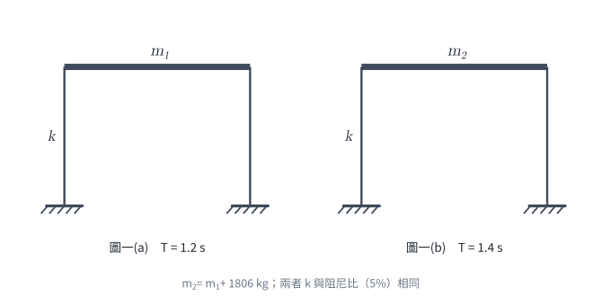
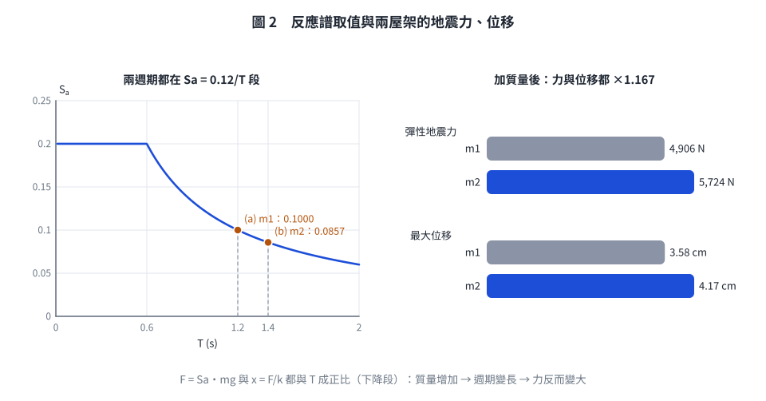

# SD-2012-1｜SDOF 剪力屋架：反推質量與勁度，求彈性地震力與最大位移

## 題目資訊

| 欄位 | 內容 |
|------|------|
| 題號 | SD-2012-1 |
| 考年 | 2012（民國101年） |
| 科目分類 | SD-U1-3（單自由度、多自由度系統之動態分析及應用） |
| 副分類 | SD-U2-1（地震力之設計規範） |
| 關鍵詞 | SDOF、自然週期、側向勁度、質量反推、反應譜、彈性地震力、最大位移 |
| verificationStatus | `unverified` |

---

## 1. 題目（考卷原文見題目正本）

> 考卷原文、公式／附表、附圖與判讀清單（已確認）見 [`SD-2012-1-problem.md`](SD-2012-1-problem.md)。本節只列解題時最容易讀錯的地方與本解使用的記號；題意以題目正本為準。

*重繪自考卷附圖，依題目正本判讀清單；本圖攔下的判讀錯誤：兩屋架 k 與阻尼比相同，只差質量 1806 kg。*

### 常見誤讀

| 項目 | 正確判讀 | 常見誤讀 |
|------|---------|---------|
| $S_a$ | 無因次係數（以 g 計），彈性地震力 $=S_a\,m g$（判讀 #1） | 直接當 m/s² |
| 質量關係 | $m_2=m_1+1806$ kg，$k$、阻尼比不變（判讀 #2） | — |
| 譜分段 | $T=1.2$、$1.4$ s 都落在 $S_a=0.12/T$ 段 | 套用 0.2 平台 |
| 單位 | ㈠ kg ㈡ N/m ㈢ N ㈣ cm | — |

**本解記號：** $T=2\pi\sqrt{m/k}$；$F=S_a\,mg$；$x_{max}=F/k$。

---

## 解題步驟

### 步驟一：求 m₁

SDOF 自然週期：$T = 2\pi\sqrt{m/k}$，故 $T^2 = \frac{4\pi^2 m}{k}$

$$\frac{T_2^2}{T_1^2} = \frac{m_2}{m_1} = \frac{m_1 + 1806}{m_1}$$

$$\left(\frac{1.4}{1.2}\right)^2 = 1 + \frac{1806}{m_1}$$

$$\frac{49}{36} - 1 = \frac{1806}{m_1} \implies \frac{13}{36} = \frac{1806}{m_1}$$

$$\boxed{m_1 = 1806 \times \frac{36}{13} \approx 5001 \text{ kg}}$$

（驗核：m₂ = 5001 + 1806 = 6807 kg，T₂ = 1.2 × √(6807/5001) = 1.2 × 1.1667 = 1.400 sec ✓）

---

### 步驟二：求 k

兩式相減可得（不需先算 m₁）：

$$T_2^2 - T_1^2 = \frac{4\pi^2}{k} \cdot (m_2 - m_1) = \frac{4\pi^2}{k} \times 1806$$

$$k = \frac{4\pi^2 \times 1806}{T_2^2 - T_1^2} = \frac{4\pi^2 \times 1806}{1.96 - 1.44} = \frac{4\pi^2 \times 1806}{0.52}$$

$$\boxed{k = \frac{39.478 \times 1806}{0.52} \approx 137{,}100 \text{ N/m} \approx 1.371 \times 10^5 \text{ N/m}}$$

驗核：$T_1 = 2\pi\sqrt{5001/137100} = 2\pi\sqrt{0.03648} = 2\pi \times 0.191 = 1.200 \text{ sec}$ ✓

---

### 步驟三：彈性地震力

兩週期均 > 0.6 sec，採用 $S_a = 0.12/T$：

| 結構 | T (sec) | Sa | 質量 m (kg) | 重量 W = mg (N) | 彈性地震力 F = Sa × W |
|-----|---------|-----|------------|----------------|----------------------|
| m₁ 結構 | 1.2 | 0.12/1.2 = **0.10** | 5001 | 49,060 | **4,906 N** |
| m₂ 結構 | 1.4 | 0.12/1.4 ≈ **0.0857** | 6807 | 66,777 | **5,724 N** |

$$F_1 = S_a(T_1) \cdot m_1 g = 0.10 \times 5001 \times 9.81 = 4{,}906 \text{ N}$$

$$F_2 = S_a(T_2) \cdot m_2 g = \frac{0.12}{1.4} \times 6807 \times 9.81 = 5{,}724 \text{ N}$$

---

### 步驟四：最大相對位移

彈性系統樓層最大位移 = 彈性地震力 / 勁度：

$$x_{max} = \frac{F}{k}$$

| 結構 | F (N) | k (N/m) | x_max (m) | x_max (cm) |
|-----|-------|---------|-----------|-----------|
| m₁ 結構 | 4,906 | 137,100 | 0.03578 | **3.58 cm** |
| m₂ 結構 | 5,724 | 137,100 | 0.04174 | **4.17 cm** |

驗核（以譜位移公式）：
$$S_d = S_a \cdot \frac{T^2}{4\pi^2} \cdot g = 0.10 \times \frac{1.44}{39.48} \times 9.81 = 0.03578 \text{ m} \checkmark$$

---

### 步驟五：結論

| 比較項目 | m₁ 結構 | m₂ 結構 | 變化 |
|--------|--------|--------|------|
| 自然週期 T | 1.2 sec | 1.4 sec | +16.7%（延長）|
| Sa | 0.100 | 0.0857 | −14.3%（降低）|
| 質量 m | 5001 kg | 6807 kg | +36.1%（增大）|
| **彈性地震力 F** | 4,906 N | 5,724 N | **+16.7%（增大）** |
| **最大位移 x** | 3.58 cm | 4.17 cm | **+16.5%（增大）** |

**關鍵結論：**

> **在速度敏感區（T > T_c，即 Sa ∝ 1/T 之常速度區），增加質量並不會降低地震需求，反而使地震力與位移均增大。**

原因分析：

- 增加質量使週期延長（T₁ → T₂），Sa 降低（從 0.10 → 0.0857，降幅 14.3%）
- 但質量增加幅度（36.1%）遠大於 Sa 降低幅度（14.3%）
- 淨結果：$F_2/F_1 = (S_{a2}/S_{a1}) \times (m_2/m_1) = (T_1/T_2) \times (m_2/m_1) = (1.2/1.4) \times (6807/5001) = 0.857 \times 1.361 = 1.167$

所以地震力增加 16.7%，最大位移也增加相同比例（勁度 k 不變）。

**實務意涵：** 若結構原本週期已落在速度敏感區（如本題 T > 0.6 sec），增設固定載重（如設備、覆土）會**同步增大地震力與側向位移**，不可忽視其耐震影響。

*圖 2　兩個週期都落在 $S_a=0.12/T$ 段，$F=S_a mg$ 與 $x=F/k$ 都與 $T$ 成正比：質量增加、週期變長，地震力反而增加 16.7%。*

---

## 計算彙整

| 參數 | 數值 |
|-----|------|
| m₁ | 5001 kg |
| m₂ | 6807 kg |
| k | 1.371 × 10⁵ N/m |
| Sa(T₁ = 1.2 s) | 0.10 |
| Sa(T₂ = 1.4 s) | 0.0857 |
| F₁（m₁ 結構地震力） | 4,906 N |
| F₂（m₂ 結構地震力） | 5,724 N |
| x₁（m₁ 結構最大位移） | 3.58 cm |
| x₂（m₂ 結構最大位移） | 4.17 cm |

---

## 題型診斷

**題型**：SDOF 週期反推→勁度→反應譜地震力→位移→概念比較

**解題路徑**：
1. 利用兩週期比值求 m₁（不需先知道 k）
2. 利用週期差（T₂² − T₁²）與質量差求 k（比 k = 4π²m/T² 更直接）
3. 確認兩個週期均在哪個反應譜段（都 > 0.6 s，故 Sa = 0.12/T）
4. F = Sa × mg，x = F/k
5. 比較兩結構結果，歸納速度敏感區增質量的影響

**常見陷阱：**
- ❌ 忘記確認兩個週期是否均在同一反應譜段（1.2 s 和 1.4 s 都 > 0.6 s ✓）
- ❌ 誤用 F = Sa × m（未乘 g）；Sa 是無因次係數，力 = Sa × W = Sa × mg
- ❌ 誤認增加質量→延長週期→Sa 降低→地震力變小（忽略質量增大對地震力的直接影響）

*修正日期：2026-11-15（§1 改為指向題目正本，重繪附圖 figs/SD-2012-1-fig-1-problem.svg）*

*圖解補繪：2026-11-15（向量圖，腳本 `gen_SD-2012-1.py`，可重跑；非勘誤、答案不變）*
