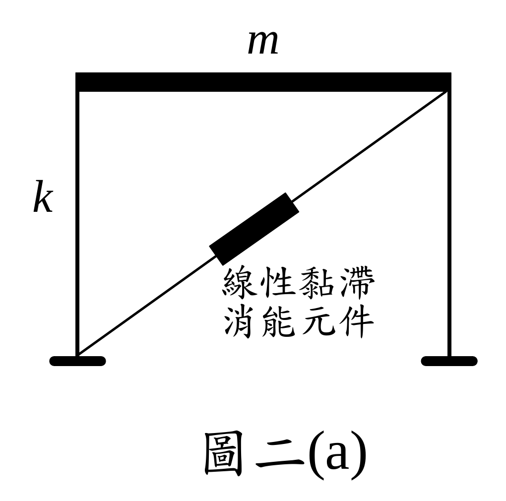
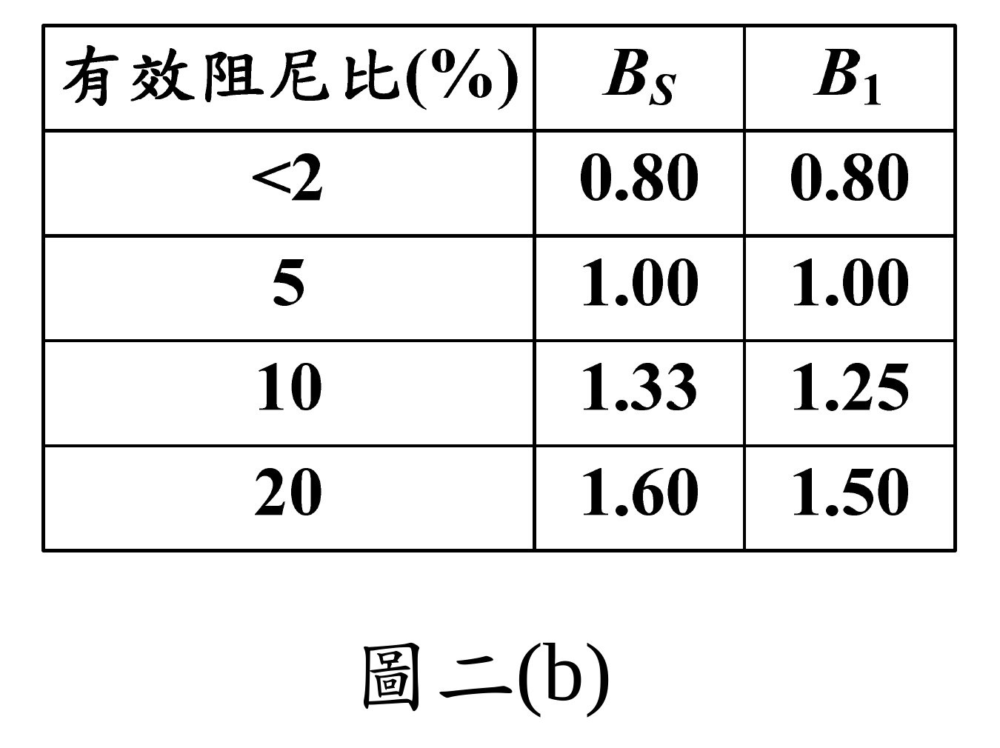

# SD-2012-2 題目正本

> 本檔只記錄考卷上寫了什麼、圖上畫了什麼，不含任何解法。解析見同資料夾 `SD-2012-2.md`。
> 判讀清單經使用者確認前，狀態為「待確認」；確認後本檔原則上不再修改（改動須回考卷原圖並記 log）。

| 項目 | 內容 |
|---|---|
| 考卷 | `raw/exams/SD-2012_結構動力分析與耐震設計.pdf`，第 2 頁（背面），第二題（地震作用引用第 1 頁第一題的 $S_a$） |
| 考年 | 2012（民國101年）專技高考結構工程技師（第2次）「結構動力分析與耐震設計」 |
| 配分 | 30 分（不分小題） |
| 附圖 | `SD-2012-2-fig-1.png`（圖二(a)，舊擷取，右下有游標）、`SD-2012-2-fig-2.png`（圖二(b)，舊擷取，左上有游標）、`SD-2012-2-fig-3.png`（圖二(a)）、`SD-2012-2-fig-4.png`（圖二(b)）（fig-3、fig-4 於 2026-11-16 由考卷 500 dpi 重擷取） |
| 判讀狀態 | **已確認**（2026-11-16，使用者授權依 Claude 建議；定案：#1 $c$ 為消能元件沿其軸向的阻尼係數；#2 斜撐角度以題文 30° 為準（附圖畫約 35.5°）。原轉錄：2026-11-16 轉錄；pdftoppm 110 dpi 整頁＋450–500 dpi 局部放大，PDF 文字層核對原文；盲讀於開啟解析前完成） |

## 1. 考卷原文（逐字）

二、如圖二(a)所示，單層剪力屋架（樓層的側向總勁度 $k$ 為 $8\times10^4$ N/m，質量 $m$ 為 2000 kg，阻尼比為 5%）以對角斜撐方式（與水平方向之夾角為 30°）置入一線性黏滯消能元件（阻尼係數 $c$ 為 $4\times10^3\ \text{N}\cdot\text{sec/m}$，並假設與線性黏滯消能元件相接之斜撐勁度夠大而可忽略其軸向變形），並承受同第一題所述之地震作用（屋架結構能維持在線彈性），而短週期與長週期結構之阻尼比修正係數 $B_S$ 與 $B_1$ 如圖二(b)所示。請以等值線性靜力分析法，計算結構受震後樓層相對地面的最大位移（以 cm 表示）。（30 分）

（提示：$\beta_{eff}=\beta+\dfrac{\sum_j W_{Vj}+\sum_i W_{Fi}}{4\pi W_k}$，$W_{Vj}=\dfrac{2\pi^2}{T}C_j\delta_{rj}^2$）

## 2. 考卷給的公式、附表與參數

- 給定：$k=8\times10^4$ N/m（樓層側向總勁度）、$m=2000$ kg、結構阻尼比 5%；斜撐與水平夾角 30°；線性黏滯消能元件 $c=4\times10^3$ N·sec/m；斜撐軸向變形可忽略；線彈性。
- 地震作用「同第一題所述」：第一題（同卷第 1 頁）給 5% 阻尼比之水平加速度反應譜係數
  $$S_a=\begin{cases}0.2, & T\le 0.6\ \text{sec}\\ 0.12/T, & T\ge 0.6\ \text{sec}\end{cases}$$
- 提示式照錄於 §1（$\beta_{eff}$、$W_{Vj}$）。
- 圖二(b) 阻尼比修正係數表（照錄）：

| 有效阻尼比(%) | $B_S$ | $B_1$ |
|:---:|:---:|:---:|
| <2 | 0.80 | 0.80 |
| 5 | 1.00 | 1.00 |
| 10 | 1.33 | 1.25 |
| 20 | 1.60 | 1.50 |

- 考卷沒有給：結構週期 $T$（須自 $k$、$m$ 求）、提示式中 $W_k$、$W_{Fi}$、$\delta_{rj}$ 的文字定義、短週期／長週期的分界週期、表列以外阻尼比的取值方式、$g$ 的數值、樓高與跨度。
- 卷首注意事項：㈠可以使用電子計算器。㈡不必抄題，作答時請將試題題號及答案依照順序寫在試卷上，於本試題上作答者，不予計分。㈢本試題之相關公式、物理常數、符號意義及設計參數未提及時，請自行合理推斷與假設。考試時間：2 小時。

## 3. 附圖

*證據圖 SD-2012-2-fig-3.png（圖二(a)，500 dpi 重擷取；舊圖 SD-2012-2-fig-1.png 內容相同，右下有游標）*

*證據圖 SD-2012-2-fig-4.png（圖二(b)，500 dpi 重擷取；舊圖 SD-2012-2-fig-2.png 內容相同，左上有游標）*

圖面文字照錄：m、k、線性黏滯消能元件、圖二(a)；有效阻尼比(%)、B_S、B_1、<2、5、10、20、0.80、1.00、1.33、1.60、0.80、1.00、1.25、1.50、圖二(b)

## 4. 判讀清單

| # | 項目 | 判讀 | 圖上／題文依據 | 把握 |
|---|---|---|---|---|
| 1 | 阻尼係數 $c$ 的方向 | 消能元件本身沿其軸向（斜撐方向）的阻尼係數，不是已換算成水平向的值 | 題文「置入一線性黏滯消能元件（阻尼係數 $c$ 為…）」，$c$ 描述的是元件；提示式 $C_j$、$\delta_{rj}$ 以元件 $j$ 編號 | 不確定（解讀）；定案採軸向，理由如左（使用者授權依 Claude 建議確認） |
| 2 | 斜撐夾角 | 與水平夾 30° | 題文明寫 30°；附圖斜撐端點 (155,715)→(905,180)（fig-3 像素）量得約 35.5°，附圖為示意，以題文為準 | 不確定（解讀）；定案 30°（使用者授權依 Claude 建議確認） |
| 3 | 斜撐端點 | 由左柱底（支承處）連到右柱頂梁柱接頭 | fig-3：斜線下端與左柱底同點、上端止於右梁柱接頭 | 確定 |
| 4 | 斜撐勁度 | 斜撐軸向變形忽略（剛性），元件兩端相對位移全來自樓層側移 | 題文「斜撐勁度夠大而可忽略其軸向變形」 | 確定（解讀） |
| 5 | 結構參數 | $k=8\times10^4$ N/m 為整層側向總勁度；$m=2000$ kg 為質量；固有阻尼比 $\beta=5\%$ | 題文；圖上 m、k 只標一次 | 確定 |
| 6 | 樓版 | 剪力屋架（樓版剛性、只平移） | 題文「單層剪力屋架」；圖上粗橫線 | 確定（解讀） |
| 7 | 柱底 | 短水平粗線，判為固定；剪力屋架側向勁度已由 $k$ 給定，柱底條件不影響答案 | fig-3 柱底短粗線（同卷圖一同畫法） | 確定（解讀） |
| 8 | 地震作用 | 第一題的 $S_a$（5% 阻尼比，以 $g$ 計的係數）；有效阻尼比不是 5% 時以圖二(b) 的 $B_S$／$B_1$ 修正 | 題文「同第一題所述之地震作用」「阻尼比修正係數 $B_S$ 與 $B_1$ 如圖二(b)」 | 確定（解讀） |
| 9 | 提示式符號 | $\beta$ 為結構固有阻尼比、$W_{Vj}$ 為第 $j$ 個黏滯元件一週期消散能量、$W_{Fi}$ 為第 $i$ 個摩擦（位移型）元件消散能量、$W_k$ 為結構應變能、$\delta_{rj}$ 為第 $j$ 個元件兩端相對位移；本題只有一個黏滯元件，無 $W_{Fi}$ | 提示式；考卷未逐字定義 | 確定（解讀） |
| 10 | 圖二(b) 表 | 四列：<2、5、10、20%；粗體表格 | fig-4 | 確定 |
| 11 | 所求 | 樓層相對地面的最大位移，以 cm 表示；指定「等值線性靜力分析法」 | 題文 | 確定 |
| 12 | 規範版本 | 反應譜、$B_S$／$B_1$ 表、提示式皆由考卷直接給定，屬題意資料，照用 | 題文 | 確定（解讀） |
| 13 | 考卷沒有給 | 週期 $T$、短／長週期分界、表列以外阻尼比的取值方式（內插與否）、$g$ 的數值、樓高與跨度 | 題文 | 確定 |

---
*轉錄：2026-11-16（SD-U3-2 題目正本推廣・組 U3-2-G2）*
*確認：2026-11-16 使用者授權依 Claude 建議確認（SD-U3-2 題目正本推廣・組 U3-2-G2，關卡一）*
