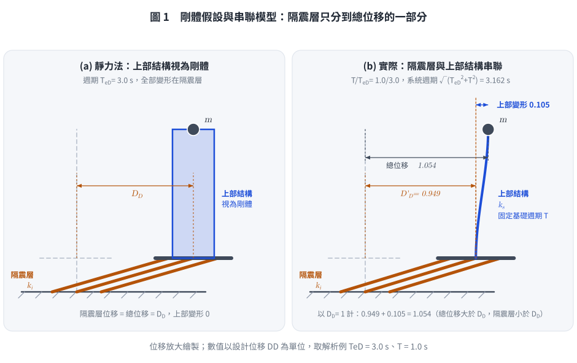
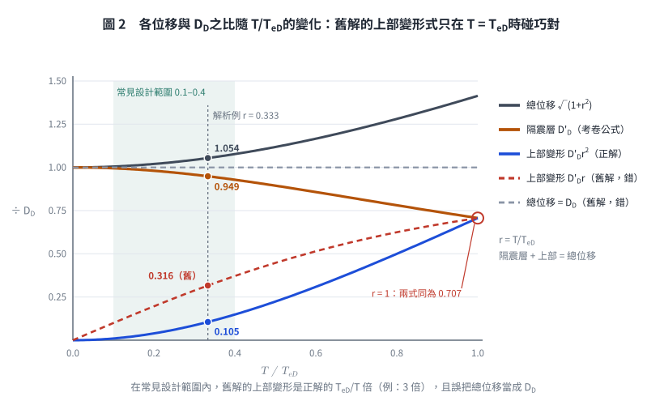

# SD-2012-4｜隔震建築物設計：設計位移 DD、最大總位移 DTM 與動力分析修正 D'D

## 題目資訊

| 欄位 | 內容 |
|------|------|
| 題號 | SD-2012-4 |
| 考年 | 2012（民國101年） |
| 科目分類 | SD-U3-2（隔減震原理） |
| 副分類 | SD-U2-2（建築耐震設計規範） |
| 關鍵詞 | 基礎隔震、設計位移、最大總位移、有效週期、剛體假設、上部結構柔性修正、2DOF 系統 |
| verificationStatus | `unverified` |

---

## 1. 題目（考卷原文見題目正本）

> 考卷原文、公式／附表、附圖與判讀清單（已確認）見 [`SD-2012-4-problem.md`](SD-2012-4-problem.md)。本節只列解題時最容易讀錯的地方與本解使用的記號；題意以題目正本為準。

### 常見誤讀

| 項目 | 正確判讀 | 常見誤讀 |
|------|---------|---------|
| ㈡ 公式 | $D'_D=D_D/\sqrt{1+(T/T_{eD})^2}$，根號涵蓋 1 與平方項；$T$ 是固定基礎上部結構基本週期，$T_{eD}$ 是設計位移下隔震結構有效週期（判讀 #3） | $T$ 與 $T_{eD}$ 對調 |
| ㈡ 所問 | 說明修正的理由；公式考卷已給（判讀 #2） | 只抄公式不說明 |
| 規範版本 | 題文未指明版本；本庫政策以現行台灣規範說明，差異於 §5 註明（判讀 #4） | — |
| 修正的目的 | 規範 9.3.4：動力分析所得位移有下限（設計總位移不小於靜力 $D_{TD}$ 的 90%、最大總位移不小於 $D_{TM}$ 的 80%），計算下限時可用 $D'_D$ 代替 $D_D$ | 把 $D'_D$ 當成動力分析的「目標位移」，並稱上部結構變形 $=D'_D\,T/T_{eD}$、總位移 $=D_D$（本庫 2026-11-16 前舊解） |

**本解記號：** $D_D$ 設計位移、$D_{TM}$ 最大總位移、$D'_D$ 動力分析用修正設計位移；$T$、$T_{eD}$ 同考卷定義。

---

## 解答

### (一) 設計位移 DD 與最大總位移 DTM 的意義

#### DD — 設計位移（Design Displacement）

**定義：**
設計位移 DD 係指隔震系統在**設計地震（Design Basis Earthquake, DBE）**作用下，**隔震系統剛心相對於基面**之側向位移（規範 9.2.3.1：「隔震系統之剛心相對於基面之位移」）。

**計算基礎：**
以等值靜力分析法（規範 9.2.3.1，(9-1) 式），DD 由隔震系統的有效週期 TeD 和有效阻尼比決定：

$$D_D = \frac{S_{aD}\, g\, T_{eD}^2}{4\pi^2 B}$$

$S_{aD}$ 為設計水平譜加速度係數，$B$ 為對應隔震系統有效阻尼比的阻尼比修正係數（符號以規範原文為準）。

**用途：**
1. 設計各隔震支承（LRB、FPS 等）的**最大剪切變形量**（確保支承不破壞）
2. 設計隔震層的有效勁度與阻尼
3. 計算上部結構的等值設計地震力

**特性：**
- DD 為隔震系統剛心的**平移位移**，不含扭轉貢獻（含實際與意外扭轉者為設計總位移 DTD）
- 對應設計地震（通常為 50 年超越機率 10%，回歸期約 475 年）

---

#### DTM — 最大總位移（Maximum Total Displacement）

**定義：**
最大總位移 DTM 係指在**最大考量地震（Maximum Considered Earthquake, MCE）**作用下，同時考慮**平移位移**與**扭轉位移**，隔震層最不利角落點的最大側向位移。

$$D_{TM} = D_M \left[1 + y\,\frac{12e}{b^2 + d^2}\right]$$

其中 DM 為最大考量位移（隔震系統剛心相對於基面），y 為隔震元件與隔震系統剛心沿垂直於地震方向的距離，e 為實際偏心與意外偏心之和，b、d 為結構最短、最長平面尺寸（規範 (9-3b) 式）。

**用途：**
1. **隔震元件穩定性**：隔震元件之穩定性試驗以 DTM 為準（規範 9.2.3.2），原型試驗的循環側向位移也取 DTM（9.5.2.1.5）——支承在 DTM 下仍須承受垂直載重而不失穩
2. **隔震間隙**：建築物與周遭擋土壁或其他阻礙物的最小間距須大於 DTM（規範 9.2.10.2），避免碰撞
3. 穿越隔震層的管線系統（自來水、電力、瓦斯）柔性接頭的變位容量

**特性：**
- DTM 必然 ≥ DTD ≥ DD（包含更大地震與扭轉效應）
- 控制**隔震間隙**與**隔震元件在極限位移下的穩定性**（垂直承載）；一般設計地震下的支承設計以 DD、DTD 為準

---

#### DD 與 DTM 的對比

| 比較項目 | DD（設計位移） | DTM（最大總位移） |
|--------|--------------|----------------|
| 地震等級 | 設計地震（DBE，回歸期 475 年） | 最大考量地震（MCE，回歸期 2500 年） |
| 量測位置 | 隔震系統**剛心** | **最不利位置**的隔震元件 |
| 是否含扭轉 | 否（純平移） | 是（含扭轉貢獻） |
| 主要用途 | 隔震系統設計（有效勁度、阻尼、設計地震力） | **隔震元件穩定性與原型試驗**、**隔震間隙**、管線柔性接頭 |

---

### (二) 動力分析時設計位移 DD 須修正為 D'D 的原因

#### 問題根源：等值靜力分析法的「剛體假設」

等值靜力分析法計算 DD 時，隱含一個重要假設：

> **上部結構為剛體（Rigid Superstructure）**

在此假設下，整體隔震結構等效為一個**單自由度系統（SDOF）**：
- 唯一的變形自由度 = 隔震層位移
- 所有樓層的加速度均相同（剛體運動）
- 設計位移 DD 即等於**隔震層位移 = 上部結構最頂層位移**（兩者相同，因為上部結構不變形）

#### 現實狀況：上部結構具有彈性柔度

實際建築物的上部結構並非剛體，固定基礎時有自身基本週期 $T$。最簡單的模型是把上部結構（勁度 $k_s$）與隔震層（勁度 $k_i$）**串聯**、質量 $m$ 集中在上部：

```
      [上部結構質量 m] ← 上部勁度 k_s（單獨固定基礎時週期 T）
           │
      [隔震層] ← 隔震勁度 k_i（剛體上部時週期 T_eD）
      [地面]
```

**① 系統週期變長**：串聯勁度 $1/k=1/k_i+1/k_s$，所以

$$T_{sys}^2 = 4\pi^2 m\left(\frac{1}{k_i}+\frac{1}{k_s}\right) = T_{eD}^2 + T^2$$

**② 總位移變大**：隔震週期落在反應譜等速度段（$S_{aD}\propto 1/T$，阻尼修正係數視為不變），譜位移 $S_d=S_{aD}gT^2/4\pi^2\propto T$。剛體假設下總位移就是 $D_D$（週期 $T_{eD}$），柔性時

$$D_{tot} = D_D\,\frac{T_{sys}}{T_{eD}} = D_D\sqrt{1+\left(\frac{T}{T_{eD}}\right)^2} \;>\; D_D$$

**③ 隔震層只分到一部分**：串聯彈簧的變形依柔度分配，隔震層分得 $\dfrac{1/k_i}{1/k_i+1/k_s}=\dfrac{T_{eD}^2}{T_{eD}^2+T^2}$：

$$D'_D = D_{tot}\,\frac{T_{eD}^2}{T_{eD}^2+T^2} = \frac{D_D\sqrt{1+(T/T_{eD})^2}}{1+(T/T_{eD})^2}$$

$$\boxed{D'_D = \frac{D_D}{\sqrt{1+(T/T_{eD})^2}}}$$

上部結構分得的變形為 $D_{tot}-D'_D = D'_D\left(\dfrac{T}{T_{eD}}\right)^2$。

> 數值核對（$T_{eD}=3.0$ s、$T=1.0$ s，$D_D$ 取 1）：總位移 1.054、隔震層 0.949（＝公式）、上部變形 0.105（＝$D'_D(T/T_{eD})^2$）；以兩質量 2DOF（基礎層質量取上部的 0.1%）振態疊加交叉驗算得 0.949、0.105、1.054，一致（`SD/scripts/fixes/2026-11-16_verify_SD-2012-4.py`）。



*圖 1　剛體假設與串聯模型。攔下兩個觀念錯：把總位移當成 $D_D$（實際為 $D_D\sqrt{1+(T/T_{eD})^2}$，較大），以及以為上部柔性會讓隔震層位移變大（實際隔震層只分到 $D'_D<D_D$）。*

#### 物理意義解釋

D'D < DD（當 T > 0 時），原因：

- 靜力法假設**所有變形都在隔震層**，DD 等於隔震層位移
- 上部結構有柔性時，整體週期由 $T_{eD}$ 拉長到 $\sqrt{T_{eD}^2+T^2}$，總位移略增為 $D_D\sqrt{1+(T/T_{eD})^2}$；但其中上部結構分走 $D'_D(T/T_{eD})^2$
- 兩者相抵，隔震層實際位移 $D'_D$ 小於靜力法的 $D_D$

#### 兩個極端情況的驗核

| 情況 | T/TeD | D'D | 物理含意 |
|------|-------|-----|---------|
| 上部結構為剛體 | T → 0 | D'D → DD | 無修正，靜力假設成立 |
| 上部結構與隔震同週期 | T = TeD | D'D = DD/√2 ≈ 0.71 DD | 顯著修正 |
| 隔震效果極佳（TeD >> T） | T/TeD << 1 | D'D ≈ DD | 修正量可忽略（典型設計） |

實際隔震設計中，TeD ≈ 2.5～4 s，T ≈ 0.3～1 s，故 T/TeD ≈ 0.1～0.4，修正約 0.5～7%，較小但仍需考慮。



*圖 2　各位移比隨 $T/T_{eD}$ 的變化。攔下「上部變形 $=D'_D\,T/T_{eD}$」這種只在 $T=T_{eD}$ 碰巧成立的式子：常見設計範圍內它把上部變形高估為正解的 $T_{eD}/T$ 倍。*

#### 修正的工程意義（規範 9.3.4）

規範要求動力分析（反應譜法或非線性歷時分析）所得的隔震系統位移不得低於靜力分析的一定比例：**設計總位移不得小於 (9-3a) 式 $D_{TD}$ 的 90%，最大總位移不得小於 (9-3b) 式 $D_{TM}$ 的 80%**。解說說明理由是動力分析所得位移通常小於靜力分析，為增加安全性而設下限。

但上部結構柔性本來就會讓隔震層位移小於剛體假設的 $D_D$（上式），若仍以 $D_D$ 算下限，等於要求動力分析位移不得小於一個本來就偏大的值。因此規範允許計算這些下限時以 $D'_D$（及 $D'_M$）代替 $D_D$（及 $D_M$）。

- $D'_D$ 是**下限比較基準**的修正，不是動力分析要「調到」的目標位移；動力分析結果若大於下限，照分析結果設計
- 修正只放寬下限中「上部柔性」這一項合理折減，其他（扭轉、阻尼）仍依原式

---

## 題型診斷

**題型**：隔震建築物規範概念論述題

**(一) 答題要點：**
- DD：設計地震（DBE），隔震系統剛心相對基面，平移位移（不含扭轉），用於隔震系統設計
- DTM：最大考量地震（MCE），最不利隔震元件，含實際與意外扭轉，控制隔震元件穩定性與原型試驗位移、隔震間隙
- 兩者差異：地震等級不同、位置不同、用途不同

**（二）答題要點：**
- 靜力法的「剛體假設」 → SDOF → DD = 隔震層位移
- 實際上部有柔性 → 串聯：系統週期 √(TeD²+T²)，總位移 DD√(1+(T/TeD)²)，隔震層分得 TeD²/(TeD²+T²) → D'D = DD/√(1+(T/TeD)²)
- 上部變形 = D'D(T/TeD)²；D'D < DD
- 規範 9.3.4：動力分析位移下限（DTD 的 90%、DTM 的 80%）計算時可用 D'D 代替 DD——D'D 是下限比較基準

**常見失分：**
- ❌ (一) 誤以為 DD 和 DTM 只差在地震等級，忽略了 DTM 還包含**扭轉貢獻**
- ❌ (二) 只說「靜力法不準確需修正」，未說明修正方向（D'D < DD）及原因（剛體假設的偏差）
- ❌ (二) 誤認 D'D > DD（實際上 D'D < DD，上部結構分擔了部分位移）
- ❌ (二) 把 D'D 說成動力分析的「目標位移」、或寫上部變形 = D'D·T/TeD、總位移 = DD（只有 T = TeD 時數值巧合）
- ❌ (一) 把 DD 寫成質量中心位移（規範定義為隔震系統剛心相對基面）；只寫 DTM 管間隙而漏掉隔震元件穩定性

## 規範版本註記

- 本解依現行《建築物耐震設計規範及解說》第九章「隔震建築物設計」（國土管理署網站公告之第九章原文；頁面未標示版本年份，以 SUBJECT.md §7 所列 111 年版為準）。下列條號與內容已於 2026-11-16 以該原文核對：DD 定義（隔震系統之剛心相對於基面之位移）9.2.3.1、(9-1) 式；DTM (9-3b) 式與隔震元件穩定性試驗以 DTM 驗證 9.2.3.2；原型試驗穩定性循環側向位移取 DTM 9.5.2.1.5；與擋土壁或其他阻礙物之最小間距須大於 DTM 9.2.10.2；動力分析位移下限（設計總位移不小於 $D_{TD}$ 之 90%、最大總位移不小於 $D_{TM}$ 之 80%，估算時得以 $D'_D$、$D'_M$ 代替 $D_D$、$D_M$，$D'_D$ 為 (9-11a) 式）9.3.4，解說理由為動力分析位移通常小於靜力分析、為安全設下限。
- 考卷（民國 101 年）未指明版本；題給 $D'_D$ 公式與現行 9.3.4 的用途一致。
- 舊解（2026-11-16 前）把修正目的寫成「以 $D'_D$ 作動力分析目標位移」，並以 $D_{tot}^2=D_D'^2+(D'_DT/T_{eD})^2$、$D_{tot}=D_D$ 推導；最終公式碰巧正確，但上部變形（$D'_DT/T_{eD}$，例題 0.316 對正解 0.105）與總位移（$=D_D$，正解 $D_D\sqrt{1+(T/T_{eD})^2}$）都錯，僅 $T=T_{eD}$ 時巧合相同。

*修正日期：2026-11-16（§1 改為指向題目正本）*

*修正日期：2026-11-16（勘誤：㈡ 改以串聯模型推導——系統週期 √(TeD²+T²)、總位移 DD√(1+(T/TeD)²)、上部變形 D'D(T/TeD)²（舊：D'D·T/TeD、總位移＝DD），修正目的改為規範 9.3.4 動力分析位移下限的比較基準（舊：動力分析目標位移）；㈠ DD 改為剛心相對基面、DTM 補隔震元件穩定性與原型試驗、式中 L 改 d；改依現行台灣規範（建築物耐震設計規範及解說第九章）；驗證 2026-11-16_verify_SD-2012-4.py MISMATCHES: 0，串聯閉合解與 2DOF 振態疊加雙路徑）*

*修正日期：2026-11-16（非勘誤）圖解補繪：圖 1 剛體假設與串聯模型位移分配、圖 2 位移比隨 T/TeD 變化（向量圖，腳本 `gen_SD-2012-4.py`，可重跑）*
