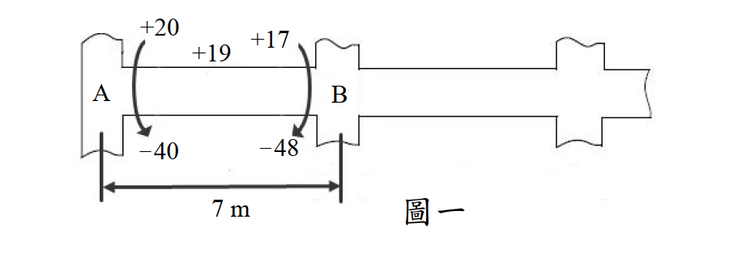

# SD-2013-2 題目正本

> 本檔只記錄考卷上寫了什麼、圖上畫了什麼，不含任何解法。解析見同資料夾 `SD-2013-2.md`。
> 判讀清單經使用者確認前，狀態為「待確認」；確認後本檔原則上不再修改（改動須回考卷原圖並記 log）。

| 項目 | 內容 |
|---|---|
| 考卷 | `raw/exams/SD-2013_結構動力分析與耐震設計.pdf`，第 1 頁（正面），第二題 |
| 考年 | 2013（民國102年）專技高考結構工程技師「結構動力分析與耐震設計」 |
| 配分 | 20 分（㈠10、㈡10） |
| 附圖 | `SD-2013-2-fig-1.png`（舊擷取，完整、無游標；考卷附圖為內嵌點陣影像，500 dpi 重擷取不增加資訊，未重擷取） |
| 判讀狀態 | **已確認**（2026-11-16，使用者授權依 Claude 建議。原轉錄：2026-11-16 轉錄；PyMuPDF 110 dpi 整頁＋500 dpi 局部放大，PDF 文字層核對原文；盲讀於開啟解析前完成） |

## 1. 考卷原文（逐字）

二、某建築結構經地震反應分析得到圖一所示 AB 大梁桿件承受之內力為：A 端承受之 +M=20 Tf-m，-M=-40 Tf-m，B 端承受之 +M=17 Tf-m，-M=-48 Tf-m，梁中點承受之 +M=19 Tf-m，若此梁之跨長 L=7 m，承受之均勻靜載重 $W_D$=2.7 Tf/m，均勻活載重 $W_L$=1.4 Tf/m，梁尺寸為 b=40 cm，h=60 cm，d=53 cm，d'=7 cm，柱尺寸為 b=60 cm，h=60 cm，材料強度 $f_c'$=280 kgf/cm²，$f_y$=4200 kgf/cm²，請依我國建築物耐震設計規定：

㈠設計此大梁之正、負彎矩鋼筋。（10 分）

㈡設計此大梁之剪力箍筋。（10 分）

## 2. 考卷給的公式、附表與參數

- 考卷沒有給參考公式。
- 給定：彎矩（Tf-m）A 端 +20／−40、B 端 +17／−48、梁中點 +19；跨長 $L=7$ m；$W_D=2.7$、$W_L=1.4$ Tf/m；梁 $b=40$、$h=60$、$d=53$、$d'=7$ cm；柱 60×60 cm；$f'_c=280$、$f_y=4200$ kgf/cm²。
- 考卷沒有給：彎矩是否已含載重因數（是否為設計彎矩 $M_u$）、剪力值、地震剪力；鋼筋號數、箍筋號數與 $f_{yt}$（只給一個 $f_y$）；保護層；構架韌性類別；載重組合與 $\phi$。
- 卷首注意事項：㈠可以使用電子計算器。㈡不必抄題，作答時請將試題題號及答案依照順序寫在試卷上，於本試題上作答者，不予計分。考試時間：2 小時。

## 3. 附圖

*證據圖 SD-2013-2-fig-1.png*

圖面文字照錄：+20、+19、+17、A、B、−40、−48、7 m、圖一

## 4. 判讀清單

| # | 項目 | 判讀 | 圖上／題文依據 | 把握 |
|---|---|---|---|---|
| 1 | 給定彎矩是否為設計彎矩 | 考卷寫「經地震反應分析得到之內力」，未說明是否已含載重組合；定案：視為各斷面的設計（因數化）彎矩包絡值 $M_u$，直接用於撓曲設計 | 題文 | 不確定（解讀）；定案如左 |
| 2 | 跨長 7 m 的量測基準 | 柱中心至柱中心；兩延伸線落在柱 A、柱 B 寬度中央（500 dpi：柱 A 約 78–210 px、延伸線 140 px；柱 B 約 830–965 px、延伸線 908 px）→ 淨跨 $\ell_n = 7-0.6 = 6.4$ m（柱寬 60 cm） | 500 dpi 像素位置；題文柱寬 60 cm | 確定（解讀） |
| 3 | 「依我國建築物耐震設計規定」 | 依現行規範的韌性（特殊）抗彎構架梁規定：撓曲筋上下限與正負彎矩強度比、剪力以容量設計（梁端機率強度 $M_{pr}$＋重力載重）且地震剪力過半時 $V_c=0$、塑鉸區箍筋間距；細節由解析依現行台灣規範 | 題文；根目錄 CLAUDE.md「規範版本」 | 確定（解讀） |
| 4 | +M、−M 的意義 | +M 正彎矩（下緣受拉）、−M 負彎矩（上緣受拉）；圖上弧形箭頭只表示兩方向地震造成的正負交替 | 圖上 +／− 分列梁上下 | 確定（解讀） |
| 5 | 剪力設計用的重力載重 | 只給 $W_D$、$W_L$ 未給組合；依現行規範組合（解析寫明所用組合） | 題文 | 確定（解讀） |
| 6 | 箍筋強度 | 只給一個 $f_y=4200$，箍筋亦取 4200 | 題文 | 確定（解讀） |
| 7 | 斷面 | 梁 $b=40$、$h=60$、$d=53$、$d'=7$ cm；柱 60×60 cm | 題文 | 確定 |
| 8 | 所求 | ㈠正、負彎矩鋼筋（A 端、B 端、跨中）；㈡剪力箍筋 | 題文 | 確定 |
| 9 | 考卷沒有給 | 鋼筋號數、保護層、$\phi$、載重組合、地震剪力 | 題文 | 確定 |

---
*轉錄：2026-11-16（SD-U3-1 題目正本推廣・組 U3-1-G1）*
*確認：2026-11-16 使用者授權依 Claude 建議確認（SD-U3-1 題目正本推廣・組 U3-1-G1，關卡一）*
