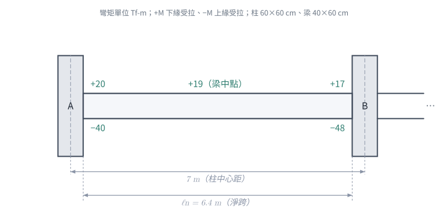
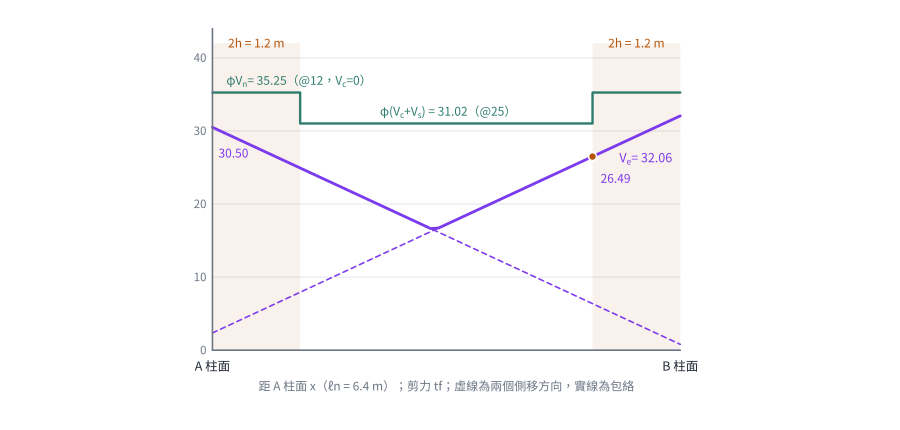

# 考題編號：SD-2013-2

**主分類：** `SD-U3-1` 結構耐震設計（含RC結構與鋼結構）
**副分類：** `SD-U2-2` 建築耐震設計規範
**分析方法：** 耐震梁設計（彎矩鋼筋 + 容量設計法剪力箍筋）
**標籤：** `RC耐震設計` `特殊抗彎矩構架` `梁彎矩鋼筋` `正鋼筋比例要求` `容量設計法` `剪力設計` `Vc=0` `Mpr` `推算剪力` `耐震箍筋間距` `塑鉸區` `約束箍筋`

---

## 1. 題目（考卷原文見題目正本）

> 考卷原文、公式／附表、附圖與判讀清單（已確認）見 [`SD-2013-2-problem.md`](SD-2013-2-problem.md)。本節只列解題時最容易讀錯的地方與本解使用的記號；題意以題目正本為準。

*重繪自考卷附圖，依題目正本判讀清單；本圖攔下的判讀錯誤：7 m 是柱中心距，容量設計剪力要用淨跨 6.4 m。*

### 常見誤讀

| 項目 | 正確判讀 | 常見誤讀 |
|------|---------|---------|
| 跨長 7 m | 柱中心距；淨跨 $\ell_n=7-0.6=6.4$ m（判讀 #2） | 用 7 m 算容量設計剪力 |
| 給定彎矩 | 視為設計彎矩包絡值 $M_u$ 直接用於撓曲設計（判讀 #1） | 再乘載重因數 |
| +M／−M | +M 下緣受拉、−M 上緣受拉（判讀 #4） | — |
| 耐震規定 | 依現行規範韌性抗彎構架梁：正負彎矩強度比、容量設計剪力、$V_c=0$ 條件、塑鉸區箍筋間距（判讀 #3） | 直接用分析剪力設計箍筋 |
| $M_{pr}$ 的鋼筋量 | 以實際配置鋼筋計算（本解 5-D25、6-D25、3-D25） | 用需求 As 計算（2026-11-16 前本庫舊解，$V_e$ 低估為 29.44 Tf） |

**本解記號：** $M_{pr}$ 為機率彎矩強度（$1.25f_y$、$\phi=1$）；$V_e$ 為容量設計剪力；$\ell_n$ 為淨跨。

---

## 2. 考題核心精神與出題者意圖 (Core Concepts & Examiner's Intent)

**核心觀念：**
- 這是一道 RC 特殊抗彎矩構架（韌性構架）梁的耐震設計題，依現行台灣《混凝土結構設計規範》（112 年版，第十八章）
- 題(一)重點：算出需求 As 後要**選實際鋼筋**，並檢核韌性梁的撓曲規定（柱面正彎矩強度 ≥ ½ 負彎矩強度、任一斷面強度 ≥ ¼ 柱面最大強度、上下各至少 2 根連續筋、ρ ≤ 0.025）
- 題(二)重點：以**容量設計**推算剪力——梁端機率彎矩強度 $M_{pr}$ 要用**實際配置的鋼筋**計算，再加重力剪力；地震剪力過半時塑鉸區 $V_c=0$

**出題者意圖：**
測驗考生是否理解「耐震設計」和「一般設計」的差異——正負彎矩強度比例要求（地震反覆作用）、容量設計剪力（以梁端可能達到的彎矩強度推算剪力，避免剪力破壞先於撓曲降伏）、塑鉸區箍筋間距加密。

---

## 3. 解題戰略地圖與陷阱分析 (Strategic Roadmap & Trap Analysis)

**主要陷阱：**

1. **正彎矩強度比例**：B 端正彎矩由分析只需 8.81 cm²，但柱面正彎矩強度須 ≥ ½ 負彎矩強度（第 18.3.3.2 節），以強度而非面積檢核。

2. **$M_{pr}$ 用理論 As**：$M_{pr}$ 是「實際配置」鋼筋以 $1.25f_y$、$\phi=1$ 算出的可能強度；用需求 As 會低估 $V_e$（對照見 §5.4）。

3. **剪力設計未用容量設計法**：直接用分析剪力設計箍筋是錯誤的（第 18.3.5.1 節）。

4. **$V_c$ 的取值**：塑鉸區內地震引致剪力 ≥ ½ 最大設計剪力、且軸力 < $A_g f'_c/20$ 時，$V_c = 0$（第 18.3.5.2 節）。

5. **塑鉸區間距上限用舊規範**：現行規範（第 18.3.4.4 節）為 $\min(d/4,\ 15\text{ cm},\ 6d_b)$（$f_y=4200$）；舊式 $\min(d/4, 8d_b, 24d_h, 30\text{ cm})$ 已不適用。

6. **2h 外剪力取錯位置**：2h 外的箍筋應以距柱面 2h 處的 $V_u$ 設計（此處可計 $V_c$），不是取跨中剪力。

---

## 3.5 變數層次分析 (Variable Hierarchy Analysis)

### 最終目標

**題(一)：** 各控制斷面的需求 As 與實際配筋，並檢核韌性梁撓曲規定
**題(二)：** 塑鉸區與 2h 外的箍筋配置

### 本題關鍵公式

$$R_n = \frac{M_u}{\phi b d^2} \quad \Rightarrow \quad \rho = \frac{0.85 f_c'}{f_y}\left[1 - \sqrt{1 - \frac{2R_n}{0.85f_c'}}\right] \quad \Rightarrow \quad A_s = \rho \cdot b \cdot d$$

$$M_n^+ \geq \frac{1}{2} M_n^- \ \text{（柱面）}, \qquad M_n^{\pm} \geq \frac{1}{4} M_{n,\max} \ \text{（任一斷面）}$$

$$M_{pr} = A_{s,\text{實配}} \cdot 1.25 f_y \cdot \left(d - \frac{a_{pr}}{2}\right), \quad a_{pr} = \frac{1.25 A_{s,\text{實配}} f_y}{0.85 f_c' b}$$

$$V_e = \frac{M_{pr,1} + M_{pr,2}}{\ell_n} + \frac{w_u \ell_n}{2}$$

$$\text{塑鉸區：} V_c = 0 \Rightarrow s \leq \frac{A_v f_{yt} d}{V_e/\phi}, \quad s \leq \min\left(\frac{d}{4},\ 15\text{ cm},\ 6d_b\right)$$

### L1：題目直接給定

| 符號 | 數值 | 說明 |
|------|------|------|
| b | 40 cm | 梁寬 |
| h | 60 cm | 梁高 |
| d | 53 cm | 有效深度 |
| d' | 7 cm | 壓力鋼筋深度 |
| fc' | 280 kgf/cm² | 混凝土強度 |
| fy | 4200 kgf/cm² | 鋼筋降伏強度（箍筋亦同，題目正本判讀 #6） |
| L | 7 m | 柱中心距（題目正本判讀 #2） |
| WD | 2.7 Tf/m | 靜載重 |
| WL | 1.4 Tf/m | 活載重 |

### L2：需計算的中間值

| 符號 | 公式 | 卡關? |
|------|------|-------|
| φ | 撓曲 0.90（張力控制）、剪力 0.75（第 21.2 節） | |
| β₁ | 0.85（fc' = 280 kgf/cm²） | |
| As,min | max(14/fy, 0.8√fc'/fy)×b×d = 7.07 cm² | |
| As,max（耐震） | 0.025×b×d = 53 cm² | |
| ℓn | 700 − 60 = 640 cm | |
| wu | 1.2WD + 1.0WL = 4.64 Tf/m（第 5.3.1 節式 5.3.1e；L 因數依 5.3.3 可減為 0.5，見 §5） | |
| 0.85fc'b | 0.85×280×40 = 9,520 kgf/cm | |
| D25 | $d_b$ = 2.54 cm，$A_b$ = 5.067 cm² | |
| D13 | $d_b$ = 1.27 cm，$A_b$ = 1.267 cm² | |

---

## 4. 步驟化詳細計算過程

### 題(一)（10分）：彎矩鋼筋設計

**設計方法（疊代法）：**

$$A_s = \frac{M_u}{\phi f_y (d - a/2)}, \quad a = \frac{A_s f_y}{0.85 f_c' b} = \frac{A_s \times 4200}{9520}$$

---

#### Step 1：最小、最大鋼筋量

$$A_{s,\min} = \max\!\left(\frac{14}{f_y},\; \frac{0.8\sqrt{f_c'}}{f_y}\right) \times b \times d = \max(0.00333,\; 0.00319) \times 2120 = 7.07 \text{ cm}^2$$

$$A_{s,\max} = 0.025\,b\,d = 53 \text{ cm}^2 \quad\text{（韌性梁，第 18.3.3.1 節）}$$

---

#### Step 2：各斷面需求 As

以 A 端負彎矩為例（$M_u$ = 40 Tf-m = 4,000,000 kgf-cm）：

試 a₁ = 10 cm：$A_s = \dfrac{4{,}000{,}000}{0.9 \times 4200 \times 48} = 22.05$ cm²，$a = 9.73$ cm；疊代 → $A_s = 21.98$ cm²，$a = 9.70$ cm ✓

其餘斷面同法：

| 位置 | 方向 | Mu (Tf-m) | 需求 As (cm²) |
|------|------|-----------|--------------|
| A端 | 負筋（頂部） | 40 | 21.98 |
| A端 | 正筋（底部） | 20 | 10.44 |
| 跨中 | 正筋（底部） | 19 | 9.89 |
| B端 | 正筋（底部） | 17 | 8.81 |
| B端 | 負筋（頂部） | 48 | 26.99 |

---

#### Step 3：選配鋼筋（D25）並檢核強度

| 位置 | 配筋 | As (cm²) | a (cm) | εt | φMn (Tf-m) | 檢核 |
|------|------|---------|--------|-----|-----------|------|
| A端頂 | **5-D25** | 25.34 | 11.18 | 0.0091 | 45.40 | ≥ 40 ✓ |
| B端頂 | **6-D25** | 30.40 | 13.41 | 0.0071 | 53.20 | ≥ 48 ✓ |
| 底筋全長 | **3-D25** | 15.20 | 6.71 | 0.0172 | 28.53 | ≥ 20、19、17 ✓ |
| 跨中頂（連續筋） | **2-D25** | 10.13 | 4.47 | 0.0272 | 19.45 | 構造用 |

- εt 皆 ≥ 0.005，張力控制，φ = 0.90 ✓
- B 端頂 6-D25 單層淨距（保護層 4 cm、D13 箍筋）：$(40 - 8 - 2.54 - 6\times2.54)/5 = 2.84$ cm ≥ max(2.5 cm, $d_b$) ✓
- ρ（B 端頂）= 30.40/(40×53) = 0.0143 ≤ 0.025 ✓；各斷面 As ≥ 7.07 cm² ✓

---

#### Step 4：韌性梁撓曲規定（第 18.3.3 節）

| 規定 | 檢核 | 結果 |
|------|------|------|
| 上下各至少 2 根連續筋 | 頂 2-D25、底 3-D25 全長 | ✓ |
| 柱面 $M_n^+ \geq \frac{1}{2}M_n^-$ | A：31.70 ≥ ½×50.45 = 25.2；B：31.70 ≥ ½×59.11 = 29.6 | ✓ |
| 任一斷面 $M_n^{\pm} \geq \frac{1}{4}M_{n,\max}$ | ¼×59.11 = 14.8；頂連續 2-D25 $M_n$ = 21.61、底 3-D25 $M_n$ = 31.70 | ✓ |

（$M_n$ 為標稱強度＝φMn/0.9。B 端底筋若只照分析需求 8.81 cm²（2-D25），$M_n^+$ = 21.61 < 29.6，不符合；以 3-D25 全長滿足。）

---

#### 彎矩鋼筋設計匯總

| 位置 | 頂筋 | 底筋 |
|------|------|------|
| A端 | **5-D25**（φMn 45.40 ≥ 40） | **3-D25**（φMn 28.53 ≥ 20） |
| 跨中 | **2-D25** 連續 | **3-D25**（≥ 19） |
| B端 | **6-D25**（φMn 53.20 ≥ 48） | **3-D25**（≥ 17；≥ ½ 負彎矩強度） |

---

### 題(二)（10分）：剪力箍筋設計

#### Step 1：機率彎矩強度 $M_{pr}$（實配鋼筋，$1.25f_y$，$\phi=1.0$，不計壓力筋）

$$M_{pr} = A_s \cdot 1.25 f_y \cdot \left(d - \frac{a_{pr}}{2}\right), \quad a_{pr} = \frac{1.25 A_s \times 4200}{9520}$$

| 斷面 | 配筋 | As (cm²) | $a_{pr}$ (cm) | $M_{pr}$ (Tf-m) |
|------|------|---------|---------|-----------|
| A端 負（頂部受拉） | 5-D25 | 25.34 | 13.97 | **61.20** |
| B端 負（頂部受拉） | 6-D25 | 30.40 | 16.77 | **71.21** |
| A端、B端 正（底部受拉） | 3-D25 | 15.20 | 8.38 | **38.95** |

---

#### Step 2：容量設計剪力 $V_e$

**淨跨度：** $\ell_n = 700 - 60 = 640$ cm = 6.40 m

**地震引致剪力（兩個側移方向）：**

$$V_{eq,1} = \frac{M_{pr,A-} + M_{pr,B+}}{\ell_n} = \frac{61.20 + 38.95}{6.40} = 15.65 \text{ Tf}$$

$$V_{eq,2} = \frac{M_{pr,A+} + M_{pr,B-}}{\ell_n} = \frac{38.95 + 71.21}{6.40} = 17.21 \text{ Tf} \quad \leftarrow \text{控制}$$

**重力剪力：**
$$w_u = 1.2 W_D + 1.0 W_L = 4.64 \text{ Tf/m}, \qquad V_g = \frac{w_u \ell_n}{2} = \frac{4.64 \times 6.40}{2} = 14.85 \text{ Tf}$$

**柱面設計剪力：**
$$V_e = 17.21 + 14.85 = \mathbf{32.06 \text{ Tf}}$$

（交叉：對 A 端取彎矩，$V_B = (M_{pr,A+} + M_{pr,B-} + w_u\ell_n^2/2)/\ell_n = 32.06$ Tf ✓）

塑鉸區以柱面剪力 32.06 Tf 設計（保守，不折減到距柱面 d 處）。

---

#### Step 3：判斷 $V_c$ 是否為零（第 18.3.5.2 節）

$$\frac{V_{eq}}{V_e} = \frac{17.21}{32.06} = 0.537 \geq 0.5$$

且梁軸力甚小（< $A_g f'_c/20$）→ **塑鉸區 $V_c = 0$**，剪力全由箍筋承擔。

---

#### Step 4：塑鉸區箍筋（柱面起 2h = 120 cm）

使用 **D13 兩肢閉合箍**：$A_v = 2 \times 1.267 = 2.534$ cm²

$$V_s = \frac{V_e}{\phi} = \frac{32.06}{0.75} = 42.75 \text{ Tf} \leq 2.12\sqrt{f'_c}\,b\,d = 75.2 \text{ Tf} \ \checkmark$$

$$s \leq \frac{A_v f_{yt} d}{V_s} = \frac{2.534 \times 4200 \times 53}{42{,}750} = 13.2 \text{ cm}$$

**耐震間距上限（第 18.3.4.4 節，$f_y = 4200$）：**
$$s_{\max} = \min\!\left(\frac{d}{4},\; 15\text{ cm},\; 6 d_b\right) = \min(13.25,\; 15,\; 6\times2.54=15.24) = 13.25 \text{ cm}$$

$$\boxed{s_{\text{塑鉸區}} = 12 \text{ cm}}$$

驗核：$\phi V_s = 0.75 \times \dfrac{2.534 \times 4200 \times 53}{12} = 35.25$ Tf ≥ 32.06 Tf ✓；第一支閉合箍距柱面 ≤ 5 cm。

---

#### Step 5：2h 外箍筋

距柱面 2h = 1.2 m 處：
$$V_u = 32.06 - 4.64 \times 1.2 = 26.49 \text{ Tf}$$

此區可計 $V_c$：
$$V_c = 0.53\sqrt{f'_c}\,b\,d = 0.53 \times 16.73 \times 40 \times 53 = 18.80 \text{ Tf}$$

$$V_s = \frac{26.49}{0.75} - 18.80 = 16.52 \text{ Tf} \quad\Rightarrow\quad s \leq \frac{2.534 \times 4200 \times 53}{16{,}520} = 34.1 \text{ cm}$$

上限 $d/2 = 26.5$ cm（第 18.3.4.6 節）→

$$\boxed{s_{2h\text{ 外}} = 25 \text{ cm}}$$

最少剪力筋：$A_{v,\min} = \max(0.2\sqrt{f'_c}\,b\,s/f_{yt},\ 3.5\,b\,s/f_{yt}) = 0.83$ cm² ≤ 2.534 cm² ✓

*圖 2　容量設計剪力包絡與箍筋設計強度（數值由腳本依本節 M_pr、w_u 重算）。本圖攔下的錯誤：用需求 As 算 M_pr、把設計剪力折減到距柱面 d 處、2h 外取跨中剪力——設計剪力在柱面最大，2h 外以 2h 處剪力設計並可計 V_c。*

---

#### 剪力箍筋設計匯總

| 區域 | 範圍（距柱面） | 設計剪力 (Tf) | $V_c$ | 箍筋 |
|------|--------------|-------------|------|------|
| 塑鉸區（兩端） | 0 ~ 120 cm | 32.06 | 0 | **D13 兩肢閉合箍 @12 cm** |
| 2h 外 | 120 cm ~ 跨中 | 26.49 | 18.80 | **D13 兩肢 @25 cm** |

> **耐震箍筋特別規定：**
> 1. 塑鉸區採閉合箍，彎鉤為耐震彎鉤（135°）
> 2. 第一支閉合箍距柱面不超過 5 cm
> 3. 塑鉸區箍筋兼具圍束與防止主筋挫屈的功能

$$\boxed{\text{塑鉸區 D13 兩肢閉合箍 @12 cm；2h 外 D13 @25 cm；塑鉸區 } V_c = 0\ (V_{eq}/V_e = 0.537)}$$

---

## 5. 關鍵爭議點與進階探討 (Critical Issues & Advanced Discussion)

### 5.1 正彎矩強度比例規定的工程意義

韌性梁要求柱面正彎矩強度 ≥ 負彎矩強度之半：
- 地震反覆作用下，梁端會交替承受正、負彎矩
- 底筋不足時，正彎矩方向先降伏、韌性不足
- 規定以「強度」表示，因此要以實配鋼筋的 $M_n$ 檢核，不是只比面積

### 5.2 $V_c = 0$ 的物理意義

塑鉸區在反覆載重下產生往復斜裂縫，混凝土抗剪能力顯著降低；地震剪力過半時不再依賴 $V_c$，全由箍筋承受，確保韌性。

### 5.3 $M_{pr}$ 中的 1.25 倍係數

1.25 倍係數涵蓋鋼筋實際降伏強度高於規定值與應變硬化。$M_{pr}$ 必須以實際配置的鋼筋計算——配筋越多，$M_{pr}$ 越大、設計剪力越大。

### 5.4 本庫舊解對照（2026-11-16 前）

| 項目 | 舊解 | 本解（現行規範） |
|------|------|----------------|
| 撓曲配筋 | 只列需求 As（21.98、10.99、9.90、13.5、27.0 cm²），未選鋼筋 | 實配 5-D25、6-D25、底 3-D25 |
| $M_{pr}$ | 以需求 As 計：54.17、28.83、64.57、34.93 Tf-m | 以實配計：61.20、71.21、38.95 Tf-m |
| 設計剪力 | 29.44 Tf，再折減到距柱面 d 處 26.98 Tf | 32.06 Tf（柱面） |
| 塑鉸區間距上限 | min(d/4, 8db, 24dh, 30 cm)（舊規範） | min(d/4, 15 cm, 6db)（第 18.3.4.4 節） |
| 塑鉸區箍筋 | D13@13 cm | D13@12 cm（舊配 @13 的 φVs = 32.54 Tf 仍 ≥ 32.06，量級相同） |
| 2h 外 | 取跨中剪力 14.59 Tf、Vc = 0 → @26 cm | 取 2h 處 26.49 Tf、計 Vc → @25 cm |

### 5.5 活載重因數

第 5.3.3 節允許式 (5.3.1e) 中 L 的因數減為 0.5（停車場、集會場所及 L > 500 kgf/m² 者除外）。題目未給用途，本解保守取 1.0；若取 0.5，$w_u = 3.94$ Tf/m、$V_e = 29.82$ Tf、$V_{eq}/V_e = 0.577$，仍為 $V_c = 0$，箍筋配置不變。

### 5.6 考場答題建議

- 題(一)：列 As,min、As,max → 各斷面需求 As → 選筋並檢核 φMn → 韌性梁正負強度比例
- 題(二)：① 實配筋 $M_{pr}$ → ② $V_e$（地震＋重力）→ ③ 判斷 $V_c = 0$ → ④ 塑鉸區箍筋與耐震間距 → ⑤ 2h 外箍筋
- 容量設計（$M_{pr}/\ell_n$）是得分關鍵，必須明確說明

---

## 6. 附圖清單 (Figure List)

| 檔案 | 內容 | 狀態 |
|------|------|------|
| SD-2013-2-fig-1.png | 考卷圖一（AB 梁端彎矩與跨長） | 證據圖，已有 |
| figs/SD-2013-2-fig-1-problem.svg | 重繪題目附圖 | 已有 |

*修正日期：2026-11-16（§1 改為指向題目正本，重繪附圖 figs/SD-2013-2-fig-1-problem.svg）*
*修正日期：2026-11-16（勘誤：改依現行台灣規範（混凝土結構設計規範 112 年版第十八章、第 5.3 節）；題(一) 補選筋（A 頂 5-D25、B 頂 6-D25、底 3-D25 全長）與 φMn、韌性梁正負強度比例檢核；題(二) M_pr 改以實配鋼筋計（54.17/28.83/64.57/34.93 → 61.20/71.21/38.95 Tf-m），設計剪力 29.44（取 d 處 26.98）→ 32.06 Tf（柱面），塑鉸區間距上限改為 min(d/4, 15 cm, 6db)，箍筋 D13@13 → D13@12；2h 外改取 2h 處剪力並計 Vc，D13@26 → @25；舊解答案降為 §5.4 對照；驗證：scripts/fixes/2026-11-16_verify_SD-2013-2.py 疊代法與二次式兩路徑、對 A 端取彎矩交叉驗算 V_e，MISMATCHES: 0）*
*修正日期：2026-11-16（非勘誤）圖解補繪：figs/SD-2013-2-fig-2-shear.svg（剪力包絡與箍筋強度，§4 題(二) Step 5）*
