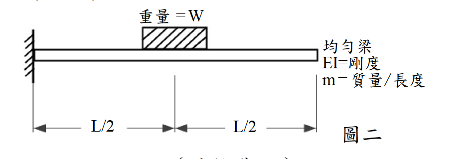

# SD-2013-3 題目正本

> 本檔只記錄考卷上寫了什麼、圖上畫了什麼，不含任何解法。解析見同資料夾 `SD-2013-3.md`。
> 判讀清單經使用者確認前，狀態為「待確認」；確認後本檔原則上不再修改（改動須回考卷原圖並記 log）。

| 項目 | 內容 |
|---|---|
| 考卷 | `raw/exams/SD-2013_結構動力分析與耐震設計.pdf`，第 1 頁（正面），第三題（附圖為「圖二」） |
| 考年 | 2013（民國102年）專技高考結構工程技師「結構動力分析與耐震設計」 |
| 配分 | 20 分（不分小題） |
| 附圖 | `SD-2013-3-fig-1.png`（舊擷取，完整、無游標；2026-11-16 以 500 dpi 局部放大核對，內容一致，未重擷取） |
| 判讀狀態 | **已確認**（2026-11-16，使用者授權依 Claude 建議。原轉錄：2026-11-16 轉錄；PyMuPDF 110 dpi 整頁＋500 dpi 局部放大，PDF 文字層核對原文；盲讀於開啟解析前完成） |

## 1. 考卷原文（逐字）

三、圖二所示為一重量為 W 的重量塊，附加在一懸臂均勻梁桿件的中點，若此梁桿件的每單位長度之均佈質量為 m、均佈剛度為 EI、長度為 L，試推求此結構系統之基本振動頻率 ω。（20 分）

## 2. 考卷給的公式、附表與參數

- 考卷沒有給參考公式。
- 給定（符號）：重量塊重量 $W$（重量，非質量）；梁單位長度質量 $m$、撓曲剛度 $EI$（均勻）、長度 $L$；重量塊位於梁中點（$L/2$）。
- 考卷沒有給：重力加速度 $g$ 的數值、指定的分析方法（精確解或 Rayleigh 法等）、假設形狀函數、阻尼、任何數值。
- 卷首注意事項：㈠可以使用電子計算器。㈡不必抄題，作答時請將試題題號及答案依照順序寫在試卷上，於本試題上作答者，不予計分。考試時間：2 小時。

## 3. 附圖

*證據圖 SD-2013-3-fig-1.png（舊擷取；500 dpi 局部放大核對無差異）*

圖面文字照錄：重量 =W、均匀梁（圖面字形「匀」，題文「均勻」）、EI=剛度、m＝質量/長度、L/2、L/2、圖二

## 4. 判讀清單

| # | 項目 | 判讀 | 圖上／題文依據 | 把握 |
|---|---|---|---|---|
| 1 | 分析方法 | 考卷只說「推求」基本振動頻率，未指定方法；定案：可用 Rayleigh 法（假設形狀）或其他近似／精確方法，答案為 $\omega$ 的符號式，近似法須註明所用形狀函數 | 題文「試推求此結構系統之基本振動頻率 ω」 | 不確定（解讀）；使用者授權依建議確認 |
| 2 | 重量塊 | 視為位於中點的集中質量 $W/g$，不計其轉動慣量與寬度（圖上畫成有寬度的方塊，寬約 $0.23L$，中心對齊中點） | 題文「中點」；500 dpi 量測方塊左右緣像素 627–930、中點尺寸界線 778 | 確定（解讀） |
| 3 | $W$ 與 $m$ 的單位 | $W$ 為重量（力），$m$ 為單位長度質量；兩者差 $g$ | 題文「重量為 W」「每單位長度之均佈質量為 m」 | 確定 |
| 4 | 支承 | 左端固定（牆面剖線），右端自由 | 圖上左端鉛垂剖線；題文「懸臂」 | 確定 |
| 5 | 尺寸 | 固定端至重量塊中心 $L/2$，重量塊中心至自由端 $L/2$；全長 $L$ | 圖上兩段尺寸線，中間界線在方塊中心 | 確定 |
| 6 | 梁 | 均勻斷面，$EI$、$m$ 沿全長為常數；計入梁本身質量 | 圖面文字「均勻梁、EI=剛度、m＝質量/長度」 | 確定 |
| 7 | 振動方向 | 梁的橫向（鉛垂）撓曲振動 | 圖上水平懸臂、重量塊置於梁上 | 確定（解讀） |
| 8 | 所求 | 基本（第一）振動圓頻率 $\omega$ | 題文 | 確定 |
| 9 | 考卷沒有給 | $g$ 數值、阻尼、形狀函數、任何數值 | 題文 | 確定 |

---
*轉錄：2026-11-16（SD-U1-2 題目正本推廣・組 U1-2-G2）*
*確認：2026-11-16 使用者授權依 Claude 建議確認（SD-U1-2 題目正本推廣・組 U1-2-G2，關卡一）*
