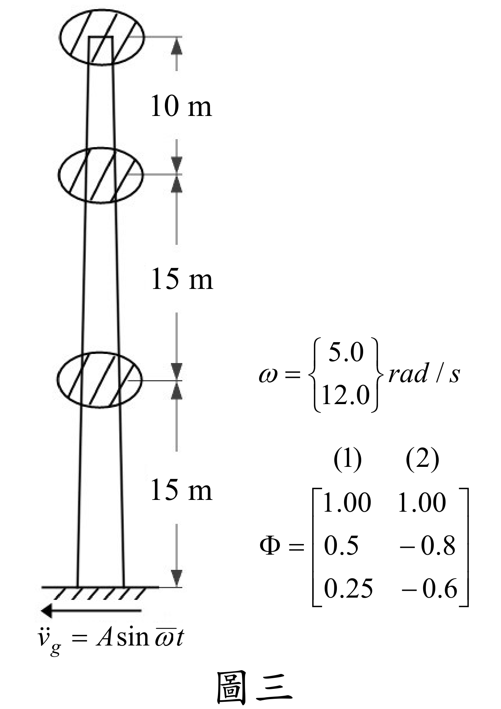

# SD-2013-4 題目正本

> 本檔只記錄考卷上寫了什麼、圖上畫了什麼，不含任何解法。解析見同資料夾 `SD-2013-4.md`。
> 判讀清單經使用者確認前，狀態為「待確認」；確認後本檔原則上不再修改（改動須回考卷原圖並記 log）。

| 項目 | 內容 |
|---|---|
| 考卷 | `raw/exams/SD-2013_結構動力分析與耐震設計.pdf`，第 2 頁（背面），第四題 |
| 考年 | 2013（民國102年）專技高考結構工程技師「結構動力分析與耐震設計」 |
| 配分 | 20 分 |
| 附圖 | `SD-2013-4-fig-1.png`（舊擷取，右上有游標）、`SD-2013-4-fig-2.png`（2026-11-15 由考卷 500 dpi 重擷取） |
| 判讀狀態 | **已確認**（2026-11-15 使用者授權依 Claude 建議確認；影響答案項目定案：#1 集中質量依從屬長度分配（頂 50、中 125、下 150 tf）。原轉錄：2026-11-15 轉錄；PyMuPDF 110 dpi 整頁＋400–500 dpi 局部放大，PDF 文字層核對原文；盲讀於開啟解析前完成） |

## 1. 考卷原文（逐字）

四、圖三所示為一由太空火箭塔台所簡化而成的集中質量結構系統，其前面兩個振態之振動頻率 $\omega$ 及振態（Mode Shapes）$\Phi$ 如圖所示。在忽略結構阻尼且僅考慮前面兩個振態之穩態反應（Steady-state Response）情況下，試推求此結構系統底部在遭到水平振動加速度 $\ddot v_g=A\sin\bar\omega t$ 之地表振動時，此結構系統底端產生之最大彎矩，其中 $A=1.5\,m/s^2$，$\bar\omega=8\,rad/s$，塔台單位長度之重量為 10 Tf/m。（20 分）

## 2. 考卷給的公式、附表與參數

- 圖上給：$\omega=\{5.0,\ 12.0\}^T$ rad/s；
  $\Phi=\begin{bmatrix}1.00&1.00\\0.5&-0.8\\0.25&-0.6\end{bmatrix}$（第 (1)、(2) 欄為第一、二振態）。
- 題文給：$A=1.5$ m/s²、$\bar\omega=8$ rad/s、塔台單位長度重量 10 Tf/m、忽略阻尼、只取前兩振態的穩態反應。
- 考卷沒有給：各集中質量的數值（只給單位長度重量）、$g$ 的數值、塔身 $EI$。
- 卷首注意事項：㈠可以使用電子計算器。㈡不必抄題，作答時請將試題題號及答案依照順序寫在試卷上，於本試題上作答者，不予計分。考試時間：2 小時。

## 3. 附圖

*證據圖 SD-2013-4-fig-2.png（500 dpi 重擷取；舊圖 SD-2013-4-fig-1.png 內容相同，右上有游標）*

圖面文字照錄：10 m、15 m、15 m、$\omega=\{5.0;\,12.0\}\,rad/s$、(1)、(2)、$\Phi=[1.00\ 1.00;\ 0.5\ -0.8;\ 0.25\ -0.6]$、$\ddot v_g=A\sin\bar\omega t$、圖三

## 4. 判讀清單

| # | 項目 | 判讀 | 圖上／題文依據 | 把握 |
|---|---|---|---|---|
| 1 | 集中質量的大小 | 考卷只給單位長度重量 10 Tf/m，沒有給各節點質量；以塔身重量依從屬長度分配到三個節點：頂 $10/2=5$ m（50 tf）、中 $(10+15)/2=12.5$ m（125 tf）、下 $(15+15)/2=15$ m（150 tf），基底以下 7.5 m 那段歸地面 | 圖上三個集中質量橢圓＋題文「集中質量結構系統」「單位長度之重量為 10 Tf/m」 | 不確定（影響答案）；使用者授權依建議確認 |
| 2 | 節點高度 | 由地面量起：下節點 15 m、中節點 30 m、頂節點 40 m | 尺寸線 15＋15＋10 m，上端對齊頂端橢圓中心（塔頂） | 確定 |
| 3 | 振態列序 | $\Phi$ 第 1 列對頂節點、第 2 列中節點、第 3 列下節點（頂點正規化為 1.00） | 矩陣第一列 1.00、1.00；與塔頂最大位移一致 | 確定（解讀） |
| 4 | 振態欄序 | 第 (1) 欄 $\omega_1=5.0$ rad/s、第 (2) 欄 $\omega_2=12.0$ rad/s | 圖上 (1)(2) 欄標與 $\omega$ 向量順序 | 確定 |
| 5 | 激振 | 地表水平加速度 $\ddot v_g=A\sin\bar\omega t$，$A=1.5$ m/s²、$\bar\omega=8$ rad/s（介於 $\omega_1$、$\omega_2$ 之間） | 題文與圖下標註 | 確定 |
| 6 | 底部 | 固定 | 圖上地面線加斜線 | 確定 |
| 7 | 阻尼 | 忽略 | 題文 | 確定 |
| 8 | 所求 | 只取前兩振態的穩態反應，求底端最大彎矩（單一數值） | 題文 | 確定 |
| 9 | 考卷沒有給 | 各節點質量、$g$ 數值、塔身 $EI$ | 題文 | 確定 |

---
*轉錄：2026-11-15（SD-U1-3 題目正本推廣・批 2）*
*確認：2026-11-15 使用者授權依 Claude 建議確認（SD-U1-3 題目正本推廣・批 2，關卡一）*
