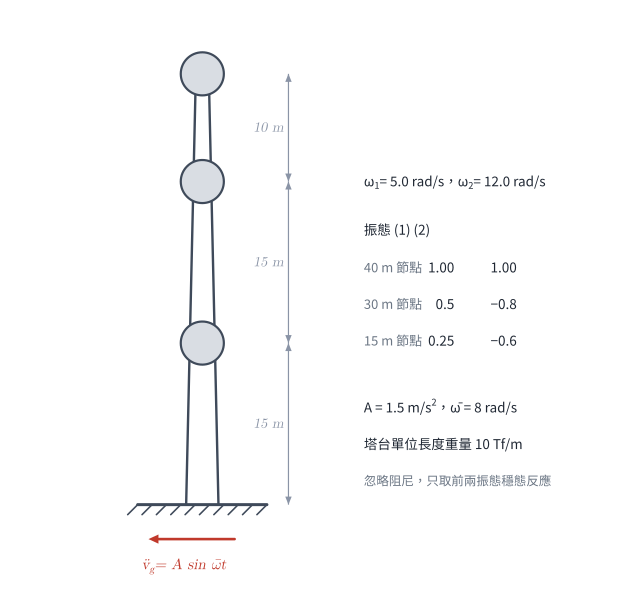
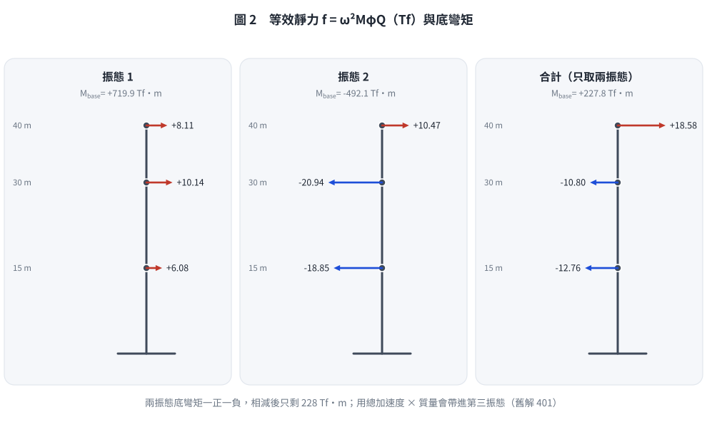

# SD-2013-4｜太空火箭塔台（3DOF MDOF）穩態諧和反應與最大基底彎矩

## 題目資訊

| 欄位 | 內容 |
|------|------|
| 題號 | SD-2013-4 |
| 考年 | 2013 |
| 科目分類 | SD-U1-3（多自由度系統動態分析） |
| 副分類 | SD-U1-2（運動方程式推導） |
| 關鍵詞 | MDOF、模態疊加法、穩態諧和反應、振態等效靜力、基底彎矩、模態參與因子 |
| verificationStatus | `unverified` |

---

## 1. 題目（考卷原文見題目正本）

> 考卷原文、公式／附表、附圖與判讀清單（已確認）見 [`SD-2013-4-problem.md`](SD-2013-4-problem.md)。本節只列解題時最容易讀錯的地方與本解使用的記號；題意以題目正本為準。

*重繪自考卷附圖，依題目正本判讀清單；本圖攔下的判讀錯誤：Φ 第一列是塔頂；考卷沒有給各節點質量。*

### 常見誤讀

| 項目 | 正確判讀 | 常見誤讀 |
|------|---------|---------|
| 集中質量 | 考卷只給 10 Tf/m；依從屬長度分配：頂 50、中 125、下 150 tf（判讀 #1，使用者授權依建議確認） | 全部塔重平分或只算到頂節點 |
| 節點高度 | 由地面量起 15、30、40 m（判讀 #2） | 由塔頂量起 |
| 振態列序 | $\Phi$ 第一列為塔頂（判讀 #3） | 第一列當底部 |
| 激振頻率 | $\bar\omega=8$ rad/s 介於 $\omega_1$、$\omega_2$ 之間；只取穩態、無阻尼 | — |

**本解記號：** DOF 1、2、3 依序為頂、中、下節點；$M_{base}=\sum F_j h_j$。

---

## 解題步驟

### 步驟一：集中質量計算（均分法）

塔台各 DOF 之集中質量採鄰近段各半之方式分配，g = 9.81 m/s²：

| DOF 位置 | 高度 | 分配段長 | 重量 W | 質量 m = W/g |
|---------|------|--------|-------|------------|
| 頂（DOF 1） | 40 m | 頂段上半 5 m | 50 Tf | 50/9.81 = 5.097 Tf·s²/m |
| 中（DOF 2） | 30 m | 頂段下半 5 m＋中段上半 7.5 m | 125 Tf | 125/9.81 = 12.742 Tf·s²/m |
| 底（DOF 3） | 15 m | 中段下半 7.5 m＋底段上半 7.5 m | 150 Tf | 150/9.81 = 15.290 Tf·s²/m |

> 底段下半 7.5 m 重量歸入固定端反力，不計入 DOF 質量。

質量矩陣（以 DOF 由頂至底排列）：
$$[M] = \frac{1}{9.81} \begin{bmatrix} 50 & 0 & 0 \\ 0 & 125 & 0 \\ 0 & 0 & 150 \end{bmatrix} \text{ Tf}\cdot\text{s²/m}$$

---

### 步驟二：模態參與因子（Modal Participation Factor）

對地盤激振 ẍg，影響向量 {ι} = {1, 1, 1}ᵀ。

**模態廣義質量** $M_i^* = \{\phi_i\}^T [M] \{\phi_i\}$

**模態廣義力係數** $L_i = \{\phi_i\}^T [M] \{\iota\}$

**模態參與因子** $\Gamma_i = L_i / M_i^*$

#### 第 1 振態 {φ₁} = {1.00, 0.50, 0.25}ᵀ

$$L_1 = \frac{1}{g}(50 \times 1.00 + 125 \times 0.50 + 150 \times 0.25) = \frac{150}{g}$$

$$M_1^* = \frac{1}{g}(50 \times 1.00^2 + 125 \times 0.50^2 + 150 \times 0.25^2) = \frac{50 + 31.25 + 9.375}{g} = \frac{90.625}{g}$$

$$\boxed{\Gamma_1 = \frac{150}{90.625} = \frac{48}{29} \approx 1.655}$$

#### 第 2 振態 {φ₂} = {1.00, −0.80, −0.60}ᵀ

$$L_2 = \frac{1}{g}(50 \times 1.00 + 125 \times (-0.80) + 150 \times (-0.60)) = \frac{50 - 100 - 90}{g} = \frac{-140}{g}$$

$$M_2^* = \frac{1}{g}(50 \times 1.00^2 + 125 \times 0.80^2 + 150 \times 0.60^2) = \frac{50 + 80 + 54}{g} = \frac{184}{g}$$

$$\boxed{\Gamma_2 = \frac{-140}{184} = -\frac{35}{46} \approx -0.761}$$

---

### 步驟三：穩態模態振幅

激振頻率 ω̄ = 8 rad/s，ω̄² = 64 rad²/s²  
（注意：ω₁ = 5 < ω̄ < ω₂ = 12，無共振。無阻尼時兩振態均在相位 sin ω̄ t。）

$$Q_i = \frac{\Gamma_i \cdot A}{\bar{\omega}^2 - \omega_i^2}$$

$$Q_1 = \frac{1.655 \times 1.5}{64 - 25} = \frac{2.483}{39} = 0.06366 \text{ m}$$

$$Q_2 = \frac{(-0.761) \times 1.5}{64 - 144} = \frac{-1.141}{-80} = 0.01427 \text{ m}$$

> 兩振態 Q 值均為正（同相於 sin ω̄ t），可直接代數疊加。

---

### 步驟四：各 DOF 相對位移最大值

$$X_j = \sum_i \phi_{ji} Q_i \quad (\text{各振態同相，取 sin}\bar\omega t = 1)$$

| DOF | 振態 1 貢獻 | 振態 2 貢獻 | 總相對位移 Xⱼ |
|-----|-----------|-----------|------------|
| 頂（j=1） | 1.00 × 0.06366 = 0.06366 m | 1.00 × 0.01427 = 0.01427 m | **0.07793 m** |
| 中（j=2） | 0.50 × 0.06366 = 0.03183 m | −0.80 × 0.01427 = −0.01142 m | **0.02041 m** |
| 底（j=3） | 0.25 × 0.06366 = 0.01592 m | −0.60 × 0.01427 = −0.00856 m | **0.00736 m** |

---

### 步驟五：各振態的等效靜力（彈性恢復力）

題目要求「僅考慮前面兩個振態之穩態反應」，所以內力只能由這兩個振態的反應組成。第 $n$ 振態的彈性恢復力（等效靜力）：

$$\{f_n\} = [K]\{\phi_n\}Q_n = \omega_n^2[M]\{\phi_n\}Q_n$$

（第二個等號由特徵方程 $[K]\{\phi_n\}=\omega_n^2[M]\{\phi_n\}$；本題沒給 $[K]$，只能這樣算。）

| DOF | $m_j$ (Tf·s²/m) | 振態 1：$25\times0.06366\,m_j\phi_{j1}$ | 振態 2：$144\times0.01427\,m_j\phi_{j2}$ | 合計 $f_j$ (Tf) |
|-----|------------|------------|------------|------------|
| 頂（h=40 m） | 5.097 | +8.112 | +10.471 | **+18.58** |
| 中（h=30 m） | 12.742 | +10.140 | −20.941 | **−10.80** |
| 底（h=15 m） | 15.290 | +6.084 | −18.847 | **−12.76** |

基底剪力：$\sum f_j = 18.58-10.80-12.76 = -4.98$ Tf。

---

### 步驟六：最大基底彎矩

兩振態同以 $\sin\bar\omega t$ 穩態振動（$Q_1$、$Q_2$ 同號、無阻尼無相位差），對固定端取矩後**代數相加**：

$$M_{base,1} = 8.112(40)+10.140(30)+6.084(15) = +719.9\ \text{Tf}\cdot\text{m}$$

$$M_{base,2} = 10.471(40)-20.941(30)-18.847(15) = -492.1\ \text{Tf}\cdot\text{m}$$

$$M_{base} = 719.9-492.1 = 227.8\ \text{Tf}\cdot\text{m}$$

閉合式驗算：$M_{base}=\sum_n\omega_n^2Q_n\,\{h\}^T[M]\{\phi_n\}$，結果相同。

$$\boxed{|M_{base}|_{max} \approx \textbf{228 Tf}\cdot\textbf{m}}\ (\approx 2235\ \text{kN}\cdot\text{m})$$

*圖 2　振態等效靜力與底彎矩。兩振態底彎矩一正一負、大幅抵消；內力只能由取用的兩個振態組成，用總加速度乘質量會帶進第三振態。*

---

## 計算彙整

| 參數 | 數值 |
|-----|------|
| Γ₁ | 1.655 |
| Γ₂ | −0.761 |
| Q₁ | 0.06366 m |
| Q₂ | 0.01427 m |
| X_top | 0.07793 m |
| X_mid | 0.02041 m |
| X_bot | 0.00736 m |
| f_top | +18.58 Tf |
| f_mid | −10.80 Tf |
| f_bot | −12.76 Tf |
| M_base,1／M_base,2 | +719.9／−492.1 Tf·m |
| **M_base,max** | **≈ 228 Tf·m** |

---

## 解題關鍵觀念

### 1. 諧和激振的模態疊加—可直接代數和（非 SRSS）

本題為確定性諧和地震輸入（sin ω̄ t），兩振態均以相同頻率 ω̄ 穩態振動，且均為同相（兩 Q 值同號）。因此**各 DOF 位移與內力可直接代數相加**，無需 SRSS；最大值在 sin ω̄ t = 1 時出現。

若為隨機或反應譜問題，則需 SRSS 或 CQC 組合。

### 2. ω̄ 介於 ω₁ 與 ω₂ 之間——重要的動力放大特性

- 振態 1（ω₁ = 5 < ω̄ = 8）：在共振頻率之上運作 → 1/(ω̄²−ω₁²) > 0
- 振態 2（ω₂ = 12 > ω̄ = 8）：在共振頻率之下運作 → 分母 (ω̄²−ω₂²) < 0，但 Γ₂ < 0 → Q₂ > 0
- 兩振態**同相疊加**，頂部位移 X_top = 0.0779 m 為最大

### 3. 「只取兩個振態」要用振態等效靜力，不要用總加速度

內力（剪力、彎矩）由彈性恢復力 $\{f\}=[K]\{u\}$ 決定。截取前兩振態時，$\{f\}=\sum_{n=1}^{2}\omega_n^2[M]\{\phi_n\}Q_n$。
若改用「總加速度 × 質量」$-m_j(\ddot u_j+\ddot v_g)$ 當慣性力，其中 $[M]\{1\}\ddot v_g$ 一項等於**全部**振態（含第三振態）的擬靜態貢獻，已不是「只取兩個振態」。兩種算法只有在振態取完整、且振態與質量矩陣自洽時才相同。

### 4. 基底彎矩是兩個大數相減

振態 1 貢獻 +720、振態 2 貢獻 −492 Tf·m，兩者大幅抵消，答案只剩 228 Tf·m。這類題目的答案對振態數值與質量分配非常敏感（見下方「延伸思考」），計算時中間值要多留位數。

---

## 題型診斷

**題型**：MDOF 穩態諧和地震反應—模態疊加→振態等效靜力→基底彎矩

**解題路徑**：
1. 集中質量（從屬長度分配） → [M]
2. 模態廣義質量 M*ᵢ 與參與因子 Γᵢ
3. 穩態模態振幅 Qᵢ = ΓᵢA/(ω̄²−ωᵢ²)
4. 代數疊加相對位移 Xⱼ（諧和激振，同頻同相可代數疊加）
5. 振態等效靜力 fⱼ = Σ ωᵢ² mⱼ φⱼᵢ Qᵢ
6. 基底彎矩 M = Σ fⱼ hⱼ

**常見陷阱**：
- ❌ 誤將諧和激振的兩振態用 SRSS 組合（SRSS 只用於反應譜）
- ❌ 用總加速度 $\ddot u_j+\ddot v_g$ 乘質量求內力——$\ddot v_g$ 項帶進未取的第三振態（本庫 2026-11-15 前的舊解即如此，得 401 Tf·m）
- ❌ 相對加速度用 −ωᵢ² xᵢ 而非 −ω̄² xᵢ（穩態時振動頻率為 ω̄，非 ωᵢ）
- ❌ 質量分配未扣除底段下半歸入固定端的重量

---

## 延伸思考

### 題給振態與質量不自洽

以從屬長度質量 diag(50, 125, 150)/g 檢查：$\{\phi_1\}^T[M]\{\phi_2\} = (50-50-22.5)/g \ne 0$，題給振態對此質量矩陣**不正交**；$\sum\Gamma_n\{\phi_n\}=\{0.894,1.436,0.870\}$ 與 $\{1\}$ 差很多。可見題給 Φ 是示意值。因此不同但都合理的算法會得到差很多的答案：

| 算法／假設 | 底彎矩 (Tf·m) |
|---|---|
| **本解：兩振態等效靜力（從屬長度質量 50／125／150 Tf）** | **227.8** |
| 總加速度慣性力 $-m_j(\ddot u_j+\ddot v_g)$（舊解，含第三振態擬靜態項） | 401.0 |
| 兩振態等效靜力，質量改為「節點至上一節點」分配 100／150／150 Tf | 851.0 |

考場上寫清楚採用的質量分配與「只取兩振態」的算法即可；數值以本解為準。

### 反應譜版本

若改為反應譜分析（ω̄ → 隨機地震），則需對各模態求 Sₐ(ωᵢ, ξ)，再以 SRSS 組合各振態之基底彎矩貢獻：

$$M_{base,SRSS} = \sqrt{M_{base,1}^2 + M_{base,2}^2}$$

其中各振態之貢獻為：

$$M_{base,i} = \Gamma_i \cdot S_a(\omega_i) \cdot \sum_j \phi_{ji} \cdot m_j \cdot h_j$$

*修正日期：2026-11-15（§1 改為指向題目正本，重繪附圖 figs/SD-2013-4-fig-1-problem.svg）*

*修正日期：2026-11-15（FIX-SD-U1-3-B2 解析勘誤（觀念）：題目要求只取前兩振態，底彎矩改由兩振態等效靜力 f = ω²MφQ 計算，401 → 228 Tf·m（舊法以總加速度乘質量，含第三振態擬靜態項）；改寫步驟五～六、計算彙整、解題關鍵觀念 3–4、題型診斷，延伸思考補題給振態不正交與算法敏感度。驗證：scripts/fixes/2026-11-15_verify_SD-2013-4.py 逐振態取矩與閉合式兩路一致，MISMATCHES: 0；與盲解比對紀錄 227.8 Tf·m 一致）*

*圖解補繪：2026-11-15（向量圖，腳本 `gen_SD-2013-4.py`，可重跑；非勘誤、答案不變）*
