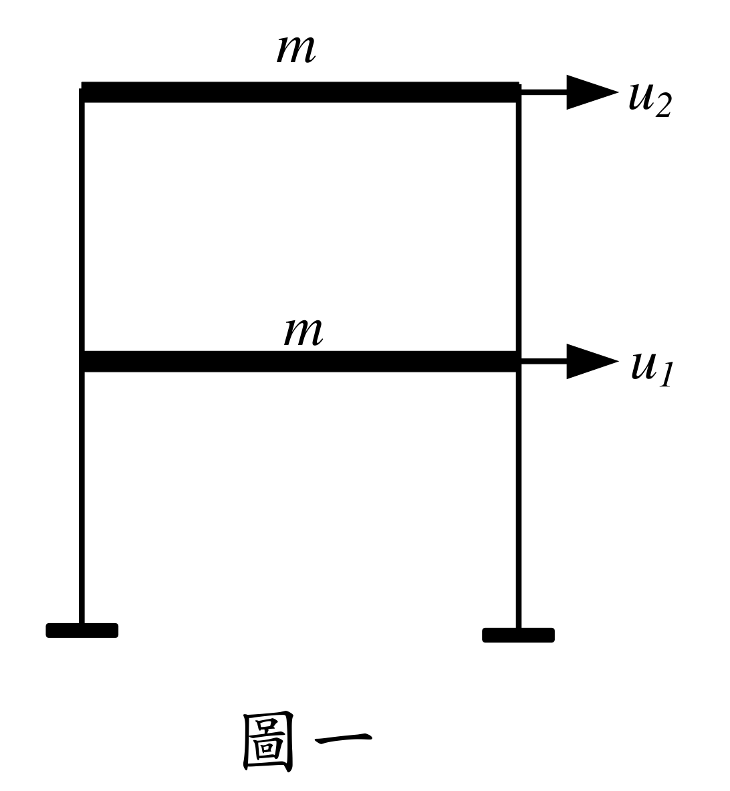

# SD-2014-1 題目正本

> 本檔只記錄考卷上寫了什麼、圖上畫了什麼，不含任何解法。解析見同資料夾 `SD-2014-1.md`。
> 判讀清單經使用者確認前，狀態為「待確認」；確認後本檔原則上不再修改（改動須回考卷原圖並記 log）。

| 項目 | 內容 |
|---|---|
| 考卷 | `raw/exams/SD-2014_結構動力分析與耐震設計.pdf`，第 1 頁（正面），第一題 |
| 考年 | 2014（民國103年）專技高考結構工程技師「結構動力分析與耐震設計」 |
| 配分 | 30 分（10／10／10） |
| 附圖 | `SD-2014-1-fig-1.png`（舊擷取，左下有游標）、`SD-2014-1-fig-2.png`（2026-11-15 由考卷 500 dpi 重擷取） |
| 判讀狀態 | **已確認**（2026-11-15 使用者授權依 Claude 建議確認。原轉錄：2026-11-15 轉錄；PyMuPDF 110 dpi 整頁＋400–500 dpi 局部放大，PDF 文字層核對原文；盲讀於開啟解析前完成） |

## 1. 考卷原文（逐字）

一、設兩層樓之平面剪力樓房結構及其位移自由度設定如圖一所示，其中各樓層質量皆相同為 $m=1500\,kg$，而各振態之相關參數如下：$T_1=0.20\sec$，$T_2=0.075\sec$，$\xi_1=\xi_2=0.05$，$\boldsymbol\phi_1=\{0.62\ \ 1.00\}^T$，$\boldsymbol\phi_2=\{-1.62\ \ 1.00\}^T$。假設此一樓房結構承受某一地震（5%阻尼比所相應之水平加速度反應譜係數為 $S_a$）作用下能維持在線彈性。

$$S_a=\begin{cases}0.2\left(0.4+\dfrac{T}{0.2}\right), & T\le 0.12\ \text{sec}\\ 0.2, & 0.12\ \text{sec}\le T\le 0.6\ \text{sec}\\ \dfrac{0.12}{T}, & T\ge 0.6\ \text{sec}\end{cases}$$

請回答下列問題：

㈠計算各振態所相應之有效振態質量比，並說明其所代表的意義。（10 分）

㈡以 SRSS 振態組合律計算該結構受此地震作用下之基底剪力 $V_b$，以 $Tf$ 表示。（10 分）

㈢以 SRSS 振態組合律計算該結構受此地震作用下之屋頂加速度 $\ddot u_2$，以 $m/\sec^2$ 表示。（10 分）

## 2. 考卷給的公式、附表與參數

- 考卷給的反應譜：三段式 $S_a$（見上）。
- 給定：$m=1500$ kg（每層）、$T_1=0.20$ s、$T_2=0.075$ s、$\xi_1=\xi_2=0.05$、$\phi_1=\{0.62,\ 1.00\}^T$、$\phi_2=\{-1.62,\ 1.00\}^T$。
- 考卷沒有給：樓層勁度、$S_a$ 的單位（係數）、$g$ 數值。
- 卷首注意事項：㈠可以使用電子計算器。㈡不必抄題，作答時請將試題題號及答案依照順序寫在試卷上，於本試題上作答者，不予計分。考試時間：2 小時。

## 3. 附圖

*證據圖 SD-2014-1-fig-2.png（500 dpi 重擷取；舊圖 SD-2014-1-fig-1.png 內容相同，左下有游標）*

圖面文字照錄：m、u2、m、u1、圖一

## 4. 判讀清單

| # | 項目 | 判讀 | 圖上／題文依據 | 把握 |
|---|---|---|---|---|
| 1 | ㈢「屋頂加速度 $\ddot u_2$」 | 考卷記號 $u_2$ 是相對位移；用反應譜時屋頂加速度一般取各振態擬加速度（絕對加速度近似）再 SRSS | 題文「屋頂加速度 $\ddot u_2$」；反應譜給的是擬加速度係數 | 確定（解讀） |
| 2 | 自由度編號 | $u_1$ 在二樓（下層）、$u_2$ 在屋頂（上層），由下往上 | 圖上箭頭標籤位置 | 確定 |
| 3 | 振態分量順序 | $\phi=\{\phi_{u1},\ \phi_{u2}\}$，屋頂分量正規化為 1.00 | 題文 $\phi_1=\{0.62\ 1.00\}$ 與 #2 | 確定 |
| 4 | 質量 | 兩層皆 $m=1500$ kg | 題文 | 確定 |
| 5 | $S_a$ 單位 | 無因次係數（以 g 為單位） | 題文「水平加速度反應譜係數」，數值 0.2 量級 | 確定（解讀） |
| 6 | 反應譜分段 | $T\le0.12$：$0.2(0.4+T/0.2)$；$0.12\le T\le0.6$：0.2；$T\ge0.6$：$0.12/T$；三段在分界點連續 | 題文公式 | 確定 |
| 7 | 柱底 | 固定（短水平粗線） | 圖面 | 確定（解讀） |
| 8 | 所求 | ㈠兩振態有效質量比與意義 ㈡SRSS 基底剪力（Tf） ㈢SRSS 屋頂加速度（m/s²） | 題文 | 確定 |

---
*轉錄：2026-11-15（SD-U1-3 題目正本推廣・批 2）*
*確認：2026-11-15 使用者授權依 Claude 建議確認（SD-U1-3 題目正本推廣・批 2，關卡一）*
