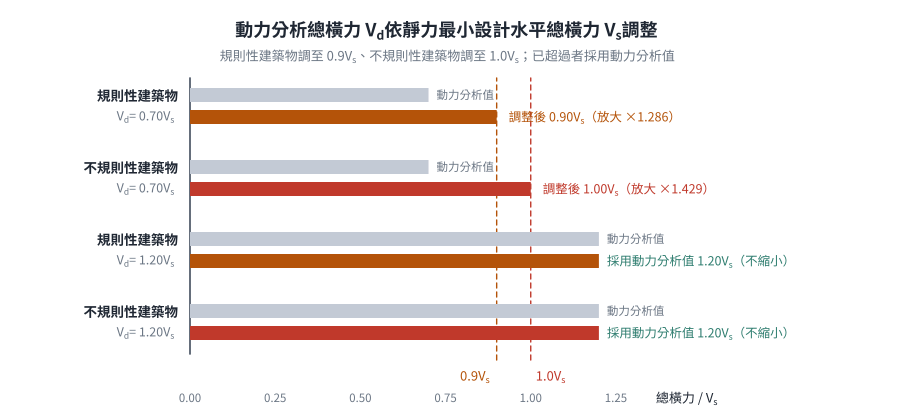

# 考題編號：SD-2014-3

**主分類：** `SD-U2-2` 建築耐震設計規範
**副分類：** `SD-U3-2` 隔減震原理
**分析方法：** 概念題（規範論述）
**標籤：** `耐震設計規範` `動力分析` `靜力下限` `最小設計水平總橫力` `基底剪力調整` `隔震建築` `SaD下限` `0.4SDS` `長週期` `反應譜下限` `模態截斷` `SRSS組合` `規範哲學`

---

## 1. 題目（考卷原文見題目正本）

> 考卷原文、公式／附表、附圖與判讀清單（已確認）見 [`SD-2014-3-problem.md`](SD-2014-3-problem.md)。本節只列解題時最容易讀錯的地方與本解使用的記號；題意以題目正本為準。

本題為純文字論述題，考卷無附圖。

### 常見誤讀

| 項目 | 正確判讀 | 常見誤讀 |
|------|---------|---------|
| ㈡斷句 | 考卷原文「不受不得小於 $0.4S_{DS}$ 之限制」讀作「不受『不得小於 $0.4S_{DS}$』這項限制」：一般建築設計譜長週期有此下限，隔震建築設計譜不設（判讀 #1，使用者授權依建議確認） | 讀成隔震設計譜也須受下限，或把「不得小於」當衍字 |
| ㈠「不同方式的調整」 | 規範依結構條件（如規則／不規則）對動力分析總橫力採不同調整方式；問原因，不要求數值（判讀 #3） | 只列調整比例而不說原因 |
| 規範版本 | 考卷未指定版本，依本庫規則以現行《建築物耐震設計規範及解說》（111 年版）作答，考試當年版本差異放 §5（判讀 #2） | 照考試當年版本作答而未註明 |
| 考卷沒有給 | 調整比例、長週期界限皆須自行依規範作答（判讀 #6） | — |
| ㈠調整比例 | 現行規範 3.3 節：規則性建築物調整至靜力最小設計水平總橫力的 90%，不規則性建築物調整至 100%；動力分析值已超過者用動力分析值 | 不分規則／不規則，一律放大到靜力值的 100%（本庫舊解 2026-11-16 前的寫法） |

**本解記號：** $S_{aD}$：設計地震之設計譜加速度係數；$S_{DS}$：短週期設計水平譜加速度係數（判讀 #4）。

---

## 2. 考題核心精神與出題者意圖 (Core Concepts & Examiner's Intent)

**核心觀念：**
- 動力分析（振態疊加反應譜法）有其理論假設與模型簡化，可能低估實際力量
- 等效靜力法代表歷史驗證的保守下限，動力分析結果不得任意低於此下限
- 下限的嚴格程度依建築物規則與否而不同（規則 90%、不規則 100%，規範 3.3 節），反映動力分析與靜力分配各自的可信度
- 隔震建築的長週期是**刻意設計的結果**，與一般建築的長週期（可能是不確定性或錯誤）性質不同

**出題者意圖：**
- 測驗考生對「動力分析限制」的理解（不是萬能的）
- 測驗考生對「隔震建築反應譜下限豁免」背後邏輯的理解

---

## 3. 解題戰略地圖與陷阱分析 (Strategic Roadmap & Trap Analysis)

**題(一)答題策略：**
先寫出「不同方式」是什麼（規則性建築物調整至靜力值 90%、不規則性建築物調整至 100%），再分層說明原因：
1. 為何要調整：動力分析振態疊加所得總橫力通常小於靜力分析（規範 3.3 解說）——分析方法的近似性（SRSS 統計組合、振態截斷）、模型與反應譜的不確定性、靜力法是歷史驗證的下限
2. 為何方式不同：規則與不規則建築物在模型可信度與受震行為不確定性上的差別

**題(二)答題策略：**
分兩個層次說明：
1. 一般建築加此限制的**原因**（為何存在 0.4$S_{DS}$ 下限）
2. 隔震建築**豁免**此限制的理由（長週期是設計目標，非不確定性）

**關鍵陷阱：**
- 題(一)不能只說「規範這樣規定」，必須說明背後的**工程理由**；而且題目問的是「不同方式」，只寫一種放大方式答不到重點
- 題(二)需先理解「0.4$S_{DS}$」對一般建築的作用，才能解釋隔震建築豁免的邏輯

---

## 3.5 變數層次分析 (Variable Hierarchy Analysis)

### 最終目標

題(一)：寫出規則／不規則建築物的不同調整比例（90%／100%），並解釋需調整及比例不同的工程理由。

題(二)：解釋隔震建築 $S_{aD}$ 長週期不設 $0.4S_{DS}$ 下限的原因（3～4條）。

### L3：深層知識（不懂就卡住）

| 知識點 | 說明 | 卡關? |
|--------|------|-------|
| SRSS 統計組合 | 各模態最大反應不同時發生，統計組合可能低估「確定性」下限 | |
| 振態截斷誤差 | 有限模態數量不能捕捉 100% 有效質量 | |
| 等效靜力法地位 | 數十年工程實踐驗證的設計基準，具有不確定性緩衝 | |
| 規則與不規則的調整比例 | 規則性建築物 90%、不規則性建築物 100%（3.3 節）；不規則者模型與反應的不確定性較大，故下限較嚴 | |
| $0.4S_{DS}$ 下限對一般建築的意義 | 靜力分析時工址設計譜加速度係數不得低於 $0.4S_{DS}$，避免長週期建築物設計地震力過低（2.2 節）；也是週期計算偏長的保守緩衝 | |
| 隔震建築長週期的特殊性 | 長週期是**主動設計結果**（by design），不是週期計算不確定性的副作用 | |

---

## 4. 步驟化詳細計算過程（論述題）

### 題(一)（10分）：動力分析總橫力為何需依靜力最小值調整？

動力分析（振態疊加反應譜法）雖比等效靜力法更精確地反映結構的動態特性，但仍存在下列**固有限制與不確定性**，導致其計算所得基底剪力可能低於靜力法結果：

---

**理由一：振態截斷誤差（Mode Truncation）**

動力分析只納入有限個振態（通常至有效振態質量 ≥ 90% 為止），未納入的高階振態仍對結構反應有貢獻，特別是：
- 對加速度敏感的高頻振態（短週期效應）
- 局部質量集中位置的反應

若截斷不足，動力分析的基底剪力會被低估。

---

**理由二：SRSS / CQC 組合規則的統計近似性**

SRSS（平方和開根號）與 CQC 組合規則是基於**統計平均**的概率方法，假設各振態峰值不同時出現，因此：
- 組合後的基底剪力通常小於各振態基底剪力之算術和
- 對於特殊地震波形（如近斷層脈衝型地震），各振態反應可能高度相關，SRSS 組合會低估

相比之下，等效靜力法隱含較保守的確定性設計基準。

---

**理由三：設計反應譜的不確定性與平滑化處理**

設計反應譜是由多條地震記錄統計平均後**平滑化**的曲線，代表的是「平均」而非「最壞情況」。真實地震：
- 局部頻率峰值（谷值）可能被平滑掉
- 特定場址效應（場址共振）可能使某些週期的實際加速度高於設計譜值
- 近斷層地震的長週期能量往往高於一般設計譜

---

**理由四：規範等效靜力法是工程實踐驗證的設計基準**

等效靜力法（(2-1) 式最小設計水平總橫力，並受 2.10 節 $V^*$、$V_M$ 下限控制）是過去數十年無數建築的設計依據，其保守性已獲工程實踐驗證。若動力分析結果低於此下限，可能是：
- 分析模型過於理想化
- 週期計算偏長（偏向柔性）導致設計地震力偏小

規範要求調整的目的是確保即使使用動力分析，結構仍具備靜力方法所提供的**最低保護水準**。

---

**規範調整原則——「不同方式」是什麼（現行規範 3.3 節「總橫力之調整」）：**

| 建築物 | 調整目標 | 動力分析值 $V_d$ 低於目標時 | $V_d$ 已超過目標時 |
|------|---------|------------------|----------------|
| 規則性建築物 | $0.9V_s$ | 動力分析結果乘以 $0.9V_s/V_d$ | 採用動力分析值 |
| 不規則性建築物 | $1.0V_s$ | 動力分析結果乘以 $V_s/V_d$ | 採用動力分析值 |

其中 $V_s$ 為第二章靜力分析所得最小設計水平總橫力，$V_d$ 為動力分析所得總橫力（基底剪力）。
例：若 $V_d=0.70V_s$，規則性建築物放大係數 $0.9/0.70=1.286$，不規則性建築物 $1.0/0.70=1.429$。

*圖 1　「不同方式的調整」：同樣 $V_d=0.70V_s$，規則性建築物只需放大到 $0.9V_s$，不規則性建築物要放大到 $1.0V_s$；$V_d$ 已超過目標時一律採用動力分析值。本圖攔的是「不分規則與否一律放大到 $V_s$」與「動力分析值大於靜力值時縮回靜力值」兩種錯誤。*

**為什麼規則與不規則用不同方式？**（規範 3.3 解說只說明「為增加須進行動力分析建築物之安全性，因此將總橫力調高」，比例不同的理由以下為本解推論）

1. **規則性建築物**：質量、勁度分布均勻，第一振態主導，靜力豎向分配與動力分析的差異主要來自前述理由一～四的近似性；動力分析結果可信度較高，因此容許比靜力值低 10%，作為採用較精細分析方法的合理反映。
2. **不規則性建築物**：扭轉、軟層、質量或幾何不規則使高振態與平移–扭轉耦合明顯，模型（勁度、偏心、樓板剛性假設）與受震行為的不確定性都大，且這類建築物本來就是規範要求必須做動力分析的對象（3.1 節）；動力分析在這裡是用來找出靜力法抓不到的力量分布，不是用來把總力打折，所以總橫力要保持在靜力值的 100%。
3. 兩種方式都只「調高」不「調低」：動力分析值已超過目標時就用動力分析值，避免把動力分析找到的較大力量縮小。

---

### 題(二)（10分）：隔震建築 $S_{aD}$ 長週期不受 $0.4S_{DS}$ 下限限制——原因為何？

#### 背景：一般建築為何有 $0.4S_{DS}$ 下限？

台灣建築耐震規範對一般建築設定（靜力分析時，2.2 節）：

$$S_a(T) \geq 0.4 S_{DS}$$

此下限的設立理由：
1. **防止週期計算偏長**：若設計者使用偏長的週期（低估剛度），譜加速度 $S_a$ 會偏低，導致低估地震力
2. **確保最低設計地震力**：即使建築物週期很長，仍需具備一定的水平承載力，避免長週期建築物的設計地震力過低（2.2 節）
3. **週期不確定性的保守緩衝**：建築週期受填充牆、非結構元件影響，實際往往比分析週期短

---

#### 隔震建築豁免 $0.4S_{DS}$ 下限的理由：

**理由一：長週期是主動設計目標，非不確定性副產品**

對一般建築，長週期可能來自週期**計算誤差**（實際較短），此時使用 $S_a = 0.4S_{DS}$ 是保守的安全網。

對隔震建築，長等效週期 $T_{eD}$（通常 2～4 sec）是隔震設計的**工程目標**——透過低勁度隔震系統刻意將週期延長至遠超地盤卓越週期，使上部結構受到的加速度自然降低。隔震器的等效勁度 $K_{eD}$ 經過仔細計算，長週期是驗證過的結果，無需額外的保守下限。

**理由二：隔震建築的設計核心是「位移」而非「加速度」**

一般建築設計關注**加速度**（基底剪力 $V \propto S_a \cdot W$），$0.4S_{DS}$ 下限確保最低加速度需求。

隔震建築設計的控制參數是隔震層**設計位移** $D_D$，上部結構所承受的加速度（$K_{eD} D_D / W$）本來就低——這正是隔震的效益。若強制要求 $S_{aD} \geq 0.4S_{DS}$，等於要求上部結構仍按較高的加速度設計，違背隔震減力的初衷。

**理由三：隔震設計已有其他保守性措施**

隔震規範本身已包含多重保守設計要求，例如：
- 設計位移需考慮最大考量地震（MCE）下的最大位移（含扭轉效應）
- 隔震層以上的上部結構需以隔震層的最大剪力設計（非折減後的值）
- 隔震器需考慮老化、溫度、垂直載重等特殊效應

在這些保守措施已存在的情況下，再強加 $0.4S_{DS}$ 下限是**雙重保守**（double conservatism），在工程上無必要且不經濟。

**理由四：長週期確實對應低加速度（物理上合理）**

隔震建築在長週期 $T_{eD}$ 下，結構絕對加速度確實遠低於 $0.4S_{DS}$，這是真實的物理反應。若設計反應譜仍設 $0.4S_{DS}$ 下限，則上部結構必須設計成能承受這個虛高的地震力——強迫設計師忽略隔震效益，失去隔震的工程意義。

---

**結論對比：**

| 比較項目 | 一般建築 | 隔震建築 |
|---------|---------|---------|
| 長週期來源 | 可能是計算誤差或不確定性 | 刻意設計的工程目標 |
| $0.4S_{DS}$ 下限目的 | 防止因週期偏長而低估力量 | 不適用（長週期本已驗證） |
| 設計核心 | 加速度（地震力） | 位移（隔震層最大位移） |
| 保守性來源 | 反應譜下限 | 最大位移、最大剪力等規範要求 |
| 套用 $0.4S_{DS}$ 的效果 | 適當保守 | 反而破壞隔震效益 |

$$\boxed{\text{隔震建築長週期 }S_{aD}\text{ 無下限限制，因其長週期是刻意設計、驗證過的結果，而非不確定性}}$$

---

## 5. 關鍵爭議點與進階探討 (Critical Issues & Advanced Discussion)

### 5.1 動力分析何時不需縮放？本庫舊解的對照

規則性建築物 $V_d\ge0.9V_s$、不規則性建築物 $V_d\ge V_s$ 時無需縮放，直接採用動力分析值（3.3 節）。但各分析項目仍需符合規範的其他要求（如考慮意外扭矩）。

本庫舊解（2026-11-16 前）只寫「$V_d<V_s$ 時乘 $V_s/V_d$ 放大到 100%」一種方式，沒有回應題目問的「不同方式」，規則性建築物的 90% 也漏掉；描述靜力下限時用美式 $S_{DS}/R$、$0.4S_{DS}/R\times W$ 寫法，已改為台灣規範 (2-1) 式與 2.2 節的寫法。

### 5.2 $0.4S_{DS}$ 下限對不同結構類型的影響

此下限主要保護**軟柔結構**（長週期建築，如高層建築）：靜力分析時工址設計水平譜加速度係數不得低於 $0.4S_{DS}$，以避免長週期建築物的設計地震力過低（2.2 節）。注意 2.16.1 規定計算層間位移時 $S_{aD}$ 可不受此下限限制——下限是強度上的保守措施，不是位移上的。

### 5.3 近斷層效應與動力分析下限

近斷層區域的地震在長週期可能有特殊的脈衝型加速度，平滑化的設計譜可能低估。這是動力分析需有靜力下限的另一個重要理由，尤其對高週期結構（如高層建築）更顯重要。

### 5.4 考場答題建議

- 題(一)：先寫出規則 90%／不規則 100% 的不同調整方式，再列出 3～4 個需調整的理由（振態截斷、SRSS 組合、設計譜平滑化、歷史驗證），最後說明比例不同的原因（不規則者不確定性大）
- 題(二)：先說一般建築 $0.4S_{DS}$ 的意義，再說隔震豁免的理由，形成對比，邏輯清晰
- 兩題均為論述題，無需公式計算，但可引用公式輔助說明

*修正日期：2026-11-16（§1 改為指向題目正本；純文字題無附圖，不重繪）*

*修正日期：2026-11-16（勘誤（規範條文、答非所問）：題(一) 由「一律放大到靜力值 100%」改為現行規範 3.3 節「規則性建築物調整至 90%、不規則性建築物調整至 100%，動力分析值已超過者採用動力分析值」，並補比例不同的原因；靜力下限改用台灣規範 (2-1) 式與 2.2 節寫法（刪除美式 SDS/R 寫法）；§5.3 刪除「台北盆地邊緣屬近斷層」的不當舉例；全文依現行台灣規範（建築物耐震設計規範及解說，111 年版）。證據：規範原文 3.3 節及解說、3.1 節、2.2 節、2.16.1（國土管理署 PDF）；考卷 2014 第 2 頁第三題㈠「不同方式的調整」。驗證：scripts/fixes/2026-11-16_verify_SD-2014-3.py，MISMATCHES: 0）*

*修正日期：2026-11-16（非勘誤）圖解補繪：figs/SD-2014-3-fig-1-base-shear-scaling.svg（規則／不規則建築物動力分析總橫力調整；向量圖，腳本 `gen_SD-2014-3.py`，可重跑）*
