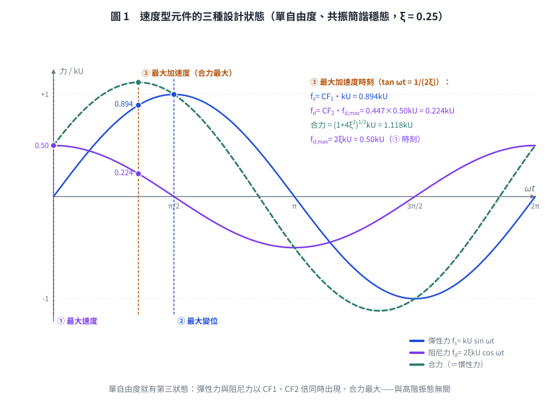

# 考題編號：SD-2014-4

**主分類：** `SD-U3-2` 隔減震原理
**副分類：** `SD-U3-1` 結構耐震設計、`SD-U2-2` 建築耐震設計規範
**分析方法：** 概念題（消能系統比較 + 規範論述）
**標籤：** `被動消能` `BRB` `挫屈束制支撐` `液態黏滯阻尼器` `速度型元件` `位移型元件` `耐震補強` `等值線性分析` `三種變位情況` `最大速度情況` `最大變位情況` `最大加速度情況` `消能減震設計規範`

---

## 1. 題目（考卷原文見題目正本）

> 考卷原文、公式／附表、附圖與判讀清單（已確認）見 [`SD-2014-4-problem.md`](SD-2014-4-problem.md)。本節只列解題時最容易讀錯的地方與本解使用的記號；題意以題目正本為準。

### 常見誤讀

| 項目 | 正確判讀 | 常見誤讀 |
|------|---------|---------|
| ㈡「規範」 | 建築物耐震設計規範「含被動消能系統建築物」設計規定，依現行版作答（判讀 #1，使用者授權依建議確認） | 依考試當年版本、未註明差異 |
| ㈡ 三種情況 | 考卷用語「三個不同變位情況」：最大變位、最大速度、最大加速度三個狀態（判讀 #2） | 以為是三個不同地震水準 |
| ㈠ 元件 | 挫屈束制消能元件＝BRB（位移型）、液態黏滯消能元件＝黏滯阻尼器（速度型）（判讀 #3） | 兩者都當速度型 |
| ㈠ 情境 | 既有建築「耐震補強」時的優缺點（判讀 #4） | 只談新建設計 |
| ㈡ 最大加速度情況 | 彈性力與阻尼力同時以部分值出現、兩者合力（＝慣性力）最大的狀態；規範以 $\mathrm{CF}_1\times$（最大變位情況之力）$+\mathrm{CF}_2\times$（最大速度情況之力）計算，單自由度就有此狀態 | 歸因於高階振態、只控制樓板與設備（本庫 2026-11-16 前舊解） |
| ㈡ 三情況的原因 | 等值線性／反應譜分析只得到峰值、沒有相位，用三個代表狀態重建彈性力與阻尼力的相位關係 | 說成補償等值線性「統計平均」的近似誤差（舊解） |
| ㈠ BRB 每循環消能 | 彈性–完全塑性理想化 $E=4F_y(\Delta-\delta_y)$，隨最大變形增加 | $\approx 4F_y\delta_y$ 固定值（舊解） |
| ㈠ 黏滯阻尼器與位移 | 附加阻尼同樣降低地震位移；缺點是不提供靜力勁度 | 「減小層間位移效果有限」（舊解） |

**本解記號：** $\Delta_D$、$V_D$、$A_D$ 為本解自訂的三種情況代號（最大變位、最大速度、最大加速度），考卷沒有這些記號；$f_s$、$f_d$ 為彈性力與阻尼力，$\mathrm{CF}_1$、$\mathrm{CF}_2$ 為最大加速度情況的狀態組合係數；$\alpha$ 在黏滯阻尼器式 $F_d=C|v|^\alpha$ 中為速度指數、在 BRB 雙線性模型中為降伏後勁度比；$\Delta$ 為 BRB 最大變形、$\delta_y$ 為降伏變形。

---

## 2. 考題核心精神與出題者意圖 (Core Concepts & Examiner's Intent)

**核心觀念：**

- BRB（位移型）：靠材料降伏消能，力學行為明確，但改變結構剛度與週期
- 液態黏滯阻尼器（速度型）：靠黏滯阻力消能，消能力與速度相關，不增加結構剛度
- 兩者消能機制不同 → 對結構的影響不同 → 各有適用場合
- 速度型元件在最大位移時阻尼力接近零、在最大速度時阻尼力最大 → 三種時刻的內力分佈差異顯著 → 不能只取一種情況設計

**出題者意圖：**
測驗考生對被動消能元件力學行為的深度理解，以及對規範「三種變位情況」規定背後物理邏輯的掌握。

---

## 3. 解題戰略地圖與陷阱分析 (Strategic Roadmap & Trap Analysis)

### 題(一)核心比較架構

| 面向 | BRB（位移型） | 液態黏滯阻尼器（速度型） |
|------|-------------|----------------------|
| 消能機制 | 鋼材受拉壓降伏（滯回面積） | 黏滯流體擠壓（F = Cv^α） |
| 力-位移 | 飽滿的雙線性（近平行四邊形）遲滯迴圈 | 橢圓形遲滯迴圈 |
| 相位關係 | 阻尼力與位移**同相** | 阻尼力與位移**差 90°** |
| 剛度貢獻 | 顯著增加側向剛度 | 不增加側向剛度 |

### 題(二)三種情況的物理根據

速度型阻尼器（F = Cv^α）的阻尼力與位移不同相：

- **最大位移時**：速度 ≈ 0 → 阻尼力 ≈ 0，但彈性變形力最大
- **最大速度時**：位移 ≈ 0 → 阻尼力最大，但彈性力較小
- **最大加速度時**：彈性力與阻尼力都以部分值同時出現，兩者合力最大；由運動方程式 $m\ddot u^t=-(f_s+f_d)$，此時絕對加速度（慣性力）也最大。單自由度系統就有這個狀態，與高階振態無關

因此，不同構材在不同時刻可能達到設計最大力 → 必須三種情況均檢核。

**關鍵陷阱：**
- 題(一)不能只列條文，需說明消能機制本身（降伏 vs. 黏滯）導致優缺點
- 題(二)不能只說「規範規定要這樣做」，需解釋**物理上**為何三個時刻的控制力不同

---

## 3.5 變數層次分析 (Variable Hierarchy Analysis)

### 最終目標

題(一)：BRB 與液態黏滯阻尼器各列優缺點 3～4 條，並說明消能機制差異。
題(二)：解釋三種變位情況在物理上對應不同的構材內力最大時刻，說明為何三者均需考慮。

### L3：深層知識

| 知識點 | 說明 |
|--------|------|
| BRB 力學行為 | 拉壓對稱降伏，飽滿的雙線性遲滯迴圈，同時增加剛度與阻尼；每循環消能 $4F_y(\Delta-\delta_y)$ |
| 液態黏滯阻尼器 | F = Cv^α（α 通常 0.3～1.0），90° 相位差，純阻尼效果 |
| 位移型 vs. 速度型 | 位移型：阻尼力與位移同相；速度型：阻尼力在速度最大時最大 |
| MDOF 多模態效應 | 各模態的最大位移、速度、加速度不同時發生 |
| 等值線性分析的相位資訊 | 等效阻尼比＋反應譜只得到各反應量的峰值、沒有相位；三種情況是用代表狀態重建彈性力與阻尼力的相位關係，最大加速度情況以 $\mathrm{CF}_1$、$\mathrm{CF}_2$ 組合 |

---

## 4. 步驟化詳細計算過程（論述題）

### 題(一)（10分）：BRB 與液態黏滯消能元件的優缺點

---

#### (A) 挫屈束制支撐（BRB）

**消能機制：**
BRB 由芯材（鋼板）承受軸力，外包混凝土或鋼管作為挫屈束制裝置。在反覆地震荷載下，芯材**拉壓均能降伏**，產生飽滿的雙線性（近平行四邊形）遲滯迴圈。理想化為彈性–完全塑性時，最大變形 $\Delta$ 的對稱循環消散能量 $E=4F_y(\Delta-\delta_y)$：剛降伏（$\Delta=\delta_y$）時為 0，$\Delta=5\delta_y$ 時為 $16F_y\delta_y$，消能隨變形增加。

---

**優點：**

1. **拉壓對稱的穩定消能行為**
   傳統斜撐受壓時挫屈失效，只能受拉消能（軟化遲滯迴圈）。BRB 在拉壓方向均能充分降伏，遲滯迴圈飽滿穩定，消能效率高且行為可預測。

2. **同時增加剛度與消能能力**
   BRB 配置後顯著提升結構的側向剛度，減小層間位移（drift），對位移敏感的補強目標效果直接，適合需要增加整體勁度的既有建築補強。

3. **施工簡單、造價合理**
   以標準鋼材製造，加工製作技術成熟，不需特殊液壓或密封系統，施工精度要求相對較低，補強工期短。

4. **力學行為易於分析**
   遲滯模型為雙線性，參數（初始勁度 $k_o$、降伏力 $F_y$、後降伏勁度比 α）明確，可直接用靜力彈塑性分析（Pushover）或非線性時間歷時分析模擬，設計驗算可靠。

---

**缺點：**

1. **提高側向剛度 → 結構週期縮短 → 可能增加地震力**
   BRB 增加剛度的同時，可能使結構自然週期縮短，若週期落入設計反應譜的高加速度區間，反而增大作用於結構的地震力，需重新核核梁柱承載力。

2. **大地震後 BRB 可能需要更換**
   芯材降伏後累積的塑性應變有上限（低周疲勞），強震後需逐一檢查是否已損傷，必要時更換，震後恢復能力相對較差。

3. **震後可能留下殘餘變形**
   BRB 須降伏才消能，降伏後勁度大幅降低，強震後結構可能留下殘餘層間變形，需評估扶正或更換。

4. **增加相鄰構材的軸力**
   BRB 以斜撐形式安裝，其軸力需透過梁柱節點傳遞，可能造成既有梁柱的軸力大幅增加，需驗核承載力，補強工程較複雜。

---

#### (B) 液態黏滯消能元件（Viscous Fluid Damper）

**消能機制：**
液態黏滯阻尼器由活塞在充滿矽油的缸體中往復運動，阻尼力：

$$F_d = C \cdot |v|^\alpha \cdot \text{sgn}(v), \quad \alpha \approx 0.3 \sim 1.0$$

阻尼力在**速度最大時最大**，在位移最大時接近零（速度為零），力-位移關係為橢圓形遲滯迴圈。

---

**優點：**

1. **不增加結構側向剛度，不改變週期**
   阻尼力純粹依賴速度，不產生額外彈性勁度（線性黏滯阻尼的勁度貢獻為零），因此結構週期不縮短，不引入額外的地震慣性力。這是相對於 BRB 最顯著的優勢。

2. **大幅增加等效阻尼比，廣頻消能**
   液態黏滯阻尼器可在寬廣頻率範圍內有效消能，對各種週期的地震（包括高頻、低頻）均有效，特別適合高層建築（多個振態的影響都能抑制）。

3. **阻尼力與彈性力正交（差 90°），對梁柱的額外力需求低**
   在位移最大時，阻尼力接近零，梁柱的彈性恢復力已足夠；在速度最大時，阻尼力最大，但位移（和彈性力）較小。兩種力不同時達峰值，合力只比最大彈性力大 $\sqrt{1+4\xi^2}$ 倍（簡諧共振；$\xi=0.25$ 時約 1.12 倍），對梁柱的額外需求較低——這個合力最大的時刻正是題(二)的最大加速度情況。

4. **震後不需更換（不發生材料損傷）**
   黏滯阻尼器在正常使用條件下不發生材料降伏或疲勞，震後功能保全率高，適合需要「立即修復後使用（Immediate Occupancy）」的重要設施補強。

---

**缺點：**

1. **製造成本高**
   液壓缸、密封系統及特殊矽油的製造精度要求高，成本遠高於 BRB，補強預算壓力較大。

2. **需定期維護，密封件可能老化**
   液壓密封件（O 形環）隨時間老化可能發生洩漏，需定期檢查維護，對既有建築的長期維護管理增加負擔。

3. **溫度效應**
   矽油黏度隨溫度升高而降低，導致阻尼力減弱；規範設計需考慮溫度修正（最不利溫度下的阻尼係數），增加設計複雜度。

4. **分析複雜度高**
   速度型元件使結構分析從線性變為非線性（速度相依）或需要等值線性化處理，分析工作量增加；且需考慮「三種變位情況」包絡設計（詳見題(二)），設計驗算程序較繁複。

5. **不提供靜力側向勁度**
   附加阻尼同樣能降低地震時的位移與加速度（共振放大約 $1/(2\xi)$：$\xi$ 由 0.05 增至 0.20，放大由 10 降為 2.5；設計譜位移則除以阻尼修正係數），但對風力、常時載重等靜態或準靜態側向變位沒有幫助；結構本身勁度不足時仍需另補勁度（如剪力牆、斜撐）。

---

**總結對比（考場快速版）：**

| | BRB | 液態黏滯阻尼器 |
|--|-----|---------------|
| 消能機制 | 鋼材降伏（位移型） | 黏滯流體（速度型） |
| 剛度影響 | 顯著增加（縮短週期） | 無（週期不變） |
| 阻尼比提升 | 中等 | 高 |
| 成本 | 低～中 | 高 |
| 維護 | 低 | 定期檢查 |
| 震後恢復 | 需檢查更換 | 良好 |
| 適用目標 | 需增加剛度+消能 | 僅需增加阻尼 |

---

### 題(二)（10分）：為何速度型元件需考慮三種變位情況？

#### 核心物理原因：速度型阻尼器的力與位移不同相

對於位移型元件（如 BRB）：
$$F_{\text{BRB}} \propto u(t) \quad \Rightarrow \quad \text{阻尼力在最大位移時最大}$$

對於速度型元件（如液態黏滯阻尼器）：
$$F_d(t) = C|v(t)|^\alpha \propto |\dot{u}(t)|^\alpha$$

在諧和運動 $u(t) = U \sin(\omega t)$ 下：

$$\dot{u}(t) = U\omega \cos(\omega t)$$

位移與速度**相差 90°**，即：
- **位移最大時**（$\sin = 1$）→ $\cos = 0$ → **速度 = 0** → **阻尼力 = 0**
- **速度最大時**（$\cos = 1$）→ $\sin = 0$ → **位移 ≈ 0** → **彈性力 ≈ 0**

因此，**最大位移時刻**的結構內力組成 ≠ **最大速度時刻**的結構內力組成。

---

#### 三種情況的物理意義

**情況一：最大變位情況（Δ_D，Maximum Displacement State）**

| 量 | 狀態 |
|----|------|
| 層間位移 | 最大 |
| 速度 | 接近 0 |
| 阻尼器出力 | 接近 0（速度型阻尼器） |
| 構材彈性變形力 | 最大 |
| 控制構材 | 梁、柱的彈性變形相關力（彎矩、剪力） |

此情況控制對**位移（變形）敏感**的構材設計，尤其是梁柱接頭的彎矩需求。

---

**情況二：最大速度情況（V_D，Maximum Velocity State）**

| 量 | 狀態 |
|----|------|
| 層間位移 | 接近 0（或較小） |
| 速度 | 最大 |
| 阻尼器出力 | 最大 |
| 慣性力 | 中等 |
| 控制構材 | 阻尼器連接元件（連接板、錨定螺栓、局部梁柱） |

阻尼器的連接節點在**最大速度時受力最大**，若僅用最大位移情況設計，連接元件的設計力會嚴重低估——這是最常被忽略的設計控制情況。

---

**情況三：最大加速度情況（A_D，Maximum Acceleration State）**

| 量 | 狀態 |
|----|------|
| 絕對加速度、慣性力 | 最大（$m\ddot u^t=-(f_s+f_d)$，慣性力＝彈性力與阻尼力的合力） |
| 彈性力 | $\mathrm{CF}_1\times$ 最大變位情況之力 |
| 阻尼器出力 | $\mathrm{CF}_2\times$ 最大速度情況之力 |
| 控制構材 | 同時承受彈性力與阻尼力的構材：裝設阻尼器構架的柱軸力、斜撐與阻尼器銜接構材、接合、基礎 |

以單自由度線性黏滯阻尼系統在共振（$\omega=\omega_n$）下的簡諧穩態說明：$u=U\sin\omega t$，

$$f_s=kU\sin\omega t,\qquad f_d=c\dot u=2\xi kU\cos\omega t$$

兩者合力在 $\tan\omega t=1/(2\xi)$ 時最大，$|f_s+f_d|_{\max}=\sqrt{1+4\xi^2}\,kU$，此時

$$\frac{f_s}{f_{s,\max}}=\cos[\tan^{-1}(2\xi)]=\mathrm{CF}_1,\qquad \frac{f_d}{f_{d,\max}}=\sin[\tan^{-1}(2\xi)]=\mathrm{CF}_2$$

例：$\xi=0.25$ 時 $\mathrm{CF}_1=0.894$、$\mathrm{CF}_2=0.447$。規範（111 年版第十章 10.3.1）以狀態組合係數 $\mathrm{CF}_1$、$\mathrm{CF}_2$（依有效阻尼比計算）把最大變位情況與最大速度情況的作用力加權相加，作為最大加速度情況的設計力。**單自由度就有這個狀態**，它來自彈性力與阻尼力的相位差，不是高階振態。

*圖 1　速度型元件的三種設計狀態（單自由度、$\xi=0.25$）。①最大速度時彈性力為零、②最大變位時阻尼力為零、③合力（＝慣性力、絕對加速度）最大時兩力以 $\mathrm{CF}_1$、$\mathrm{CF}_2$ 倍同時出現。本圖攔下「最大加速度情況來自高階振態」的誤解：只有一個自由度，第三狀態照樣存在。*

#### MDOF 系統中三情況的必要性

對於多自由度（MDOF）結構加裝速度型阻尼器：

1. **各振態的相位不同**：第一振態的最大位移時刻，高階振態可能正處於速度最大或加速度最大的狀態
2. **非比例阻尼**：速度型阻尼器通常造成非比例阻尼矩陣（$[C]$ 不與 $[M]$、$[K]$ 共對角化），振態之間存在耦合，各模態的時域反應不能簡單疊加
3. **分析只有峰值、沒有相位**：等值線性分析（等效阻尼比＋反應譜）得到的是各反應量的峰值，失去時間與相位資訊。彈性力與阻尼力的峰值不同時發生：直接相加過於保守，只取其一又不保守；規範因此以三個代表狀態（最大變位、最大速度、兩者合力最大的最大加速度）重建相位關係，取最大值設計

---

**結論：**

$$\boxed{\text{速度型阻尼力與彈性力不同相（差 90°），三時刻的控制內力組成根本不同；}}$$
$$\boxed{\text{規範要求三情況包絡設計，確保所有構材在各控制時刻均不超出承載力}}$$

實務上，三種情況的關鍵控制對象：

| 情況 | 主要控制對象 |
|------|------------|
| 最大變位 | 梁柱彎矩、層間位移 |
| 最大速度 | 阻尼器接頭、連結板、錨定元件 |
| 最大加速度 | 同時承受彈性力與阻尼力的構材（裝阻尼器構架的柱軸力、斜撐、接合、基礎） |

三者取最大值進行設計，方能確保整體結構系統（含阻尼器連接節點）在地震全程的安全性。

---

## 5. 關鍵爭議點與進階探討 (Critical Issues & Advanced Discussion)

### 5.1 BRB 與液態黏滯阻尼器的組合使用

實務補強工程中，兩者可搭配使用：
- **液態黏滯阻尼器**：提供大量等效阻尼（同時降低位移與加速度反應，但不增加勁度）
- **BRB**：提供側向剛度（控制位移）

如此可在不過度縮短週期的前提下同時控制加速度與位移，達到最佳補強效果。台灣部分高層建築補強採此混合策略。

### 5.2 α 值對液態黏滯阻尼器三情況影響

當 $\alpha < 1$（非線性黏滯阻尼器）時：
$$F_d = C|v|^\alpha, \quad \alpha < 1$$

阻尼力對速度的增長率遞減，等效阻尼比隨振幅增大而減小——即**大地震時提供相對較少的額外阻尼力增量**（具有限力特性），可避免連接節點在大震下超載。但 $\alpha < 1$ 使動力分析更複雜，三種情況設計更不可或缺。

### 5.3 位移型元件（BRB）是否需要三種情況？

**不需要**。BRB 的阻尼力與位移同相（遲滯迴圈的寬度決定於位移），最大內力出現在最大位移時刻，等值線性化後可以單一情況設計。三種情況是速度型元件**特有**的規範要求，正因為其力-位移相位差造成的特殊複雜性。

### 5.4 規範條文對照（現行 111 年版）與舊解更正

- 現行《建築物耐震設計規範及解說》第十章「含被動消能系統建築物之設計」10.3.1：建築物內構材的設計力需考量三個不同變位情況並取最大值——最大變位情況、最大速度與零變位情況（考卷稱「最大速度情況」）、最大加速度情況；最大加速度情況的設計力＝最大變位情況之作用力乘 $\mathrm{CF}_1$ 加最大速度情況之作用力乘 $\mathrm{CF}_2$，兩係數依有效阻尼比計算（式 10-14、10-15）。
- 本解 $\mathrm{CF}_1=\cos[\tan^{-1}(2\xi)]$、$\mathrm{CF}_2=\sin[\tan^{-1}(2\xi)]$ 是由上面單自由度簡諧推導而得（與 FEMA 273／356 同形式）；規範式 10-14、10-15 的確切寫法**條文待核**，考場引用時寫「依有效阻尼比計算之狀態組合係數」即可。
- 2026-11-16 勘誤更正的舊說法：最大加速度情況「主要來自高階模態、控制樓板與設備」、三情況是補償「統計平均」誤差、BRB 每循環消能 $\approx4F_y\delta_y$、黏滯阻尼器「減小層間位移效果有限」、BRB「對速度脈衝型地震效果較有限」。

### 5.5 考場答題建議

- 題(一)：BRB 與液態黏滯阻尼器各列 3～4 條優缺點，並在開頭先說明消能機制差異（一句話），再進入優缺點分析
- 題(二)：用「速度型阻尼力與位移差 90°」這個物理核心展開，點出等值線性分析只有峰值、沒有相位，再對三種情況各說明其「控制什麼力、對應什麼構材」，並寫出最大加速度情況是兩者合力最大、以 $\mathrm{CF}_1$、$\mathrm{CF}_2$ 組合
- 兩題均為論述題，不需計算，但可引用 $F_d = Cv^\alpha$ 增加精準性

---

## 6. 附圖清單 (Figure List)

| 檔案 | 內容 | 狀態 |
|------|------|------|
| `figs/SD-2014-4-fig-1-three-states.svg`（＋.png） | 三種設計狀態：單自由度共振簡諧穩態的彈性力、阻尼力與合力（§4 題(二)） | 2026-11-16 圖解補繪，腳本 `gen_SD-2014-4.py` |

**verificationStatus:** `unverified`
**verifiedSolution:** （待人工驗算後填入）

*修正日期：2026-11-16（§1 改為指向題目正本；舊重述在三種情況後自加的記號 Δ_D、V_D、A_D 非考卷用語，改列為本解記號）*

*修正日期：2026-11-16（勘誤：題(二) 最大加速度情況改為彈性力與阻尼力合力最大的狀態、以 CF1、CF2 組合，刪除「高階模態」與「統計平均誤差補償」說法；題(一) BRB 每循環消能 4Fy·δy 改為 4Fy(Δ−δy)、黏滯阻尼器「減小層間位移效果有限」改為不提供靜力勁度、BRB 缺點 3 改為殘餘變形；§5.4 補現行規範 10.3.1 對照（CF 式條文待核）；標頭主副分類改與索引一致（非勘誤）；驗證：scripts/fixes/2026-11-16_verify_SD-2014-4.py，MISMATCHES: 0）*

*修正日期：2026-11-16（非勘誤）圖解補繪：§4 題(二) 補 figs/SD-2014-4-fig-1-three-states.svg（三種設計狀態，腳本 gen_SD-2014-4.py，可重跑）*
