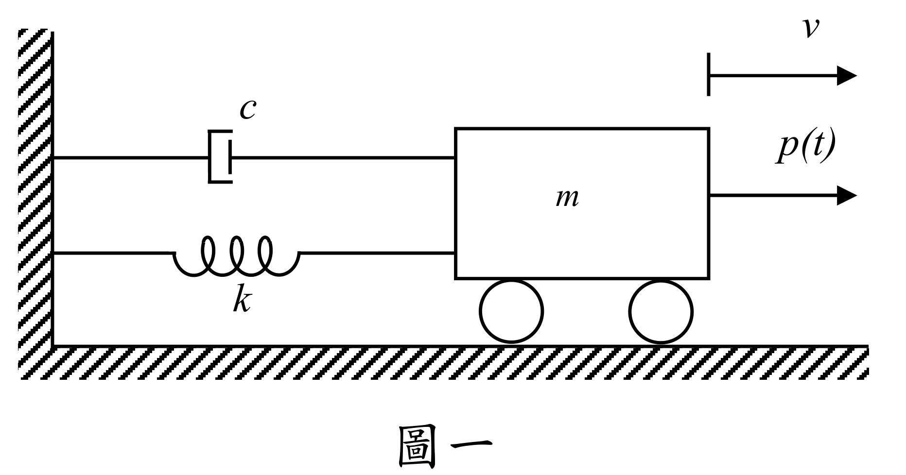

# SD-2015-1 題目正本

> 本檔只記錄考卷上寫了什麼、圖上畫了什麼，不含任何解法。解析見同資料夾 `SD-2015-1.md`。
> 判讀清單經使用者確認前，狀態為「待確認」；確認後本檔原則上不再修改（改動須回考卷原圖並記 log）。

| 項目 | 內容 |
|---|---|
| 考卷 | `raw/exams/SD-2015_結構動力分析與耐震設計.pdf`，第 1 頁（正面），第一題 |
| 考年 | 2015（民國104年）專技高考結構工程技師「結構動力分析與耐震設計」 |
| 配分 | 25 分 |
| 附圖 | `SD-2015-1-fig-1.png`（舊擷取，彈簧下方有游標）、`SD-2015-1-fig-2.png`（2026-11-15 由考卷 500 dpi 重擷取） |
| 判讀狀態 | **已確認**（2026-11-15 使用者授權依 Claude 建議確認。原轉錄：2026-11-15 轉錄；PyMuPDF 110 dpi 整頁＋400–500 dpi 局部放大，PDF 文字層核對原文；盲讀於開啟解析前完成） |

## 1. 考卷原文（逐字）

一、有一單自由度系統如圖一，其運動方程式為 $m\ddot v(t)+c\dot v(t)+kv(t)=P_0\sin\bar\omega t$。只考慮穩態振動（Steady state），忽略暫態振動（Transient state）。試求其解。（25 分）

## 2. 考卷給的公式、附表與參數

- 考卷給運動方程式 $m\ddot v+c\dot v+kv=P_0\sin\bar\omega t$。
- 給定（符號）：$m$、$c$、$k$、$P_0$、$\bar\omega$；全題無數值。
- 考卷沒有給：初始條件（只求穩態，不需要）。
- 卷首注意事項：㈠可以使用電子計算器。㈡不必抄題，作答時請將試題題號及答案依照順序寫在試卷上，於本試題上作答者，不予計分。考試時間：2 小時。

## 3. 附圖

*證據圖 SD-2015-1-fig-2.png（500 dpi 重擷取；舊圖 SD-2015-1-fig-1.png 內容相同，彈簧下方有游標）*

圖面文字照錄：c、k、m、v、p(t)、圖一

## 4. 判讀清單

| # | 項目 | 判讀 | 圖上／題文依據 | 把握 |
|---|---|---|---|---|
| 1 | 系統 | 質塊 $m$ 以彈簧 $k$、阻尼器 $c$ 並聯接固定牆，輪子在地面上無摩擦水平運動 | 圖面 | 確定 |
| 2 | 外力 | $p(t)=P_0\sin\bar\omega t$，水平作用於質塊 | 題文方程式＋圖上 p(t) 箭頭 | 確定 |
| 3 | 位移 | $v$ 水平向右為正 | 圖上 v 箭頭 | 確定 |
| 4 | 所求 | 穩態解 $v_p(t)$（符號解），不含暫態 | 題文 | 確定 |
| 5 | 考卷沒有給 | 任何數值；阻尼比大小（不限小阻尼） | 題文 | 確定 |

---
*轉錄：2026-11-15（SD-U1-3 題目正本推廣・批 2）*
*確認：2026-11-15 使用者授權依 Claude 建議確認（SD-U1-3 題目正本推廣・批 2，關卡一）*
