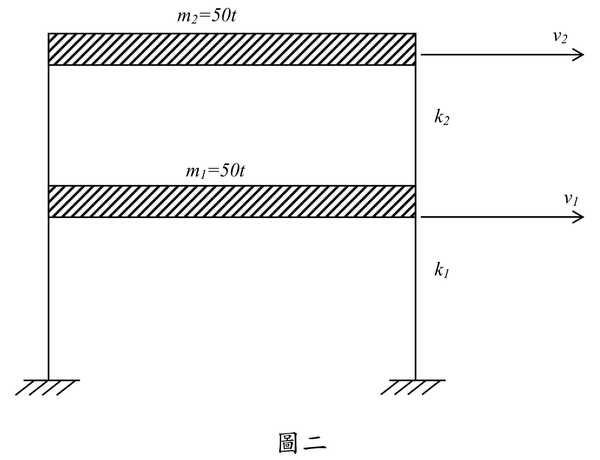

# SD-2015-2 題目正本

> 本檔只記錄考卷上寫了什麼、圖上畫了什麼，不含任何解法。解析見同資料夾 `SD-2015-2.md`。
> 判讀清單經使用者確認前，狀態為「待確認」；確認後本檔原則上不再修改（改動須回考卷原圖並記 log）。

| 項目 | 內容 |
|---|---|
| 考卷 | `raw/exams/SD-2015_結構動力分析與耐震設計.pdf`，第 1 頁（正面），第二題 |
| 考年 | 2015（民國104年）專技高考結構工程技師「結構動力分析與耐震設計」 |
| 配分 | 25 分 |
| 附圖 | `SD-2015-2-fig-1.png`（舊擷取，柱底附近有游標）、`SD-2015-2-fig-2.png`（2026-11-15 由考卷 500 dpi 重擷取） |
| 判讀狀態 | **已確認**（2026-11-15 使用者授權依 Claude 建議確認。原轉錄：2026-11-15 轉錄；PyMuPDF 110 dpi 整頁＋400–500 dpi 局部放大，PDF 文字層核對原文；盲讀於開啟解析前完成） |

## 1. 考卷原文（逐字）

二、二層結構如圖二，令梁為剛體（Rigid beam），柱之剛度（Stiffness）$k_1=k_2=50\ \mathrm{kN/cm}$，求此結構之頻率（Frequencies）及振態（Modal shapes）。（25 分）

## 2. 考卷給的公式、附表與參數

- 考卷沒有給參考公式。
- 給定：$m_1=m_2=50\,t$（圖上）、$k_1=k_2=50$ kN/cm（題文）；梁為剛體。
- 考卷沒有給：樓高、柱尺寸、阻尼；振態正規化方式。
- 卷首注意事項：㈠可以使用電子計算器。㈡不必抄題，作答時請將試題題號及答案依照順序寫在試卷上，於本試題上作答者，不予計分。考試時間：2 小時。

## 3. 附圖

*證據圖 SD-2015-2-fig-2.png（500 dpi 重擷取；舊圖 SD-2015-2-fig-1.png 內容相同，柱底附近有游標）*

圖面文字照錄：m2=50t、v2、k2、m1=50t、v1、k1、圖二

## 4. 判讀清單

| # | 項目 | 判讀 | 圖上／題文依據 | 把握 |
|---|---|---|---|---|
| 1 | 「50t」 | 公噸（50,000 kg 質量），不是時間 | 圖面「m1=50t」；質量記號 m | 確定（解讀） |
| 2 | $k_1$、$k_2$ 的意義 | 各樓層的層側向勁度（該層兩柱合計）$=50$ kN/cm，標在右柱旁代表整層 | 題文「柱之剛度 $k_1=k_2$」；圖上 k1、k2 只標一次 | 確定（解讀） |
| 3 | 自由度 | $v_1$ 二樓（下層）、$v_2$ 屋頂（上層），水平向右 | 圖上箭頭 | 確定 |
| 4 | 梁 | 剛體（樓版不轉動、只平移） | 題文＋圖上斜線厚板 | 確定 |
| 5 | 柱底 | 固定 | 圖上斜線 | 確定 |
| 6 | 所求 | 兩個自然頻率與對應振態 | 題文 | 確定 |
| 7 | 考卷沒有給 | 頻率要求 rad/s 或 Hz、振態正規化方式 | 題文 | 確定 |

---
*轉錄：2026-11-15（SD-U1-3 題目正本推廣・批 2）*
*確認：2026-11-15 使用者授權依 Claude 建議確認（SD-U1-3 題目正本推廣・批 2，關卡一）*
