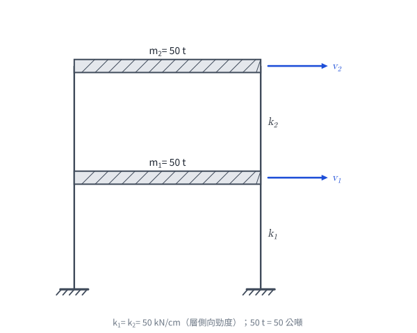
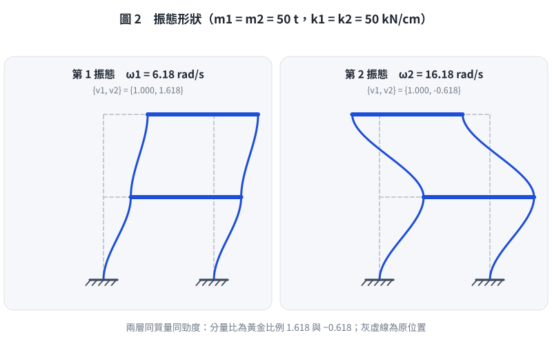

# 考題編號：SD-2015-2

**主分類：** `SD-U1-3` 單自由度、多自由度系統之動態分析及應用
**副分類：** `SD-U1-2` 結構系統之數學模型及運動方程式
**分析方法：** MDOF 特徵值分析
**標籤：** `MDOF`, `剪力屋架`, `質量矩陣`, `勁度矩陣`, `特徵值問題`, `自然頻率`, `振態向量`, `單位換算`

## 1. 題目（考卷原文見題目正本）

> 考卷原文、公式／附表、附圖與判讀清單（已確認）見 [`SD-2015-2-problem.md`](SD-2015-2-problem.md)。本節只列解題時最容易讀錯的地方與本解使用的記號；題意以題目正本為準。

*重繪自考卷附圖，依題目正本判讀清單；本圖攔下的判讀錯誤：兩層勁度都是 50 kN/cm（本庫舊解讀成 300、200 tf/cm）。*

### 常見誤讀

| 項目 | 正確判讀 | 常見誤讀 |
|------|---------|---------|
| 層勁度 | $k_1=k_2=50$ kN/cm（題文；判讀 #2） | $k_1=300$、$k_2=200$ tf/cm（本庫舊解 §1 虛構的數值） |
| 質量 | $m_1=m_2=50$ t（公噸；判讀 #1） | 50 t 當重量 tf |
| 小題 | 考卷只問頻率與振態（25 分，不分小題） | 另列「建立 M、K（5 分）」等考卷沒有的小題 |
| 自由度 | $v_1$ 二樓、$v_2$ 屋頂（判讀 #3） | — |

**本解記號：** $v_1$、$v_2$ 為二樓、屋頂側移；$\omega_n$ 為自然頻率（rad/s）。

---

## 2. 破題思路 (Problem Solving Strategy)

本題為雙自由度（2-DOF）剪力構架的自然頻率與振態分析，考卷只問「頻率及振態」（25 分，不分小題）：
1. **建立系統矩陣**：梁為剛體 → 剪力構架，質量集中在樓版，$\mathbf{M}$ 為對角矩陣；勁度矩陣由兩層的層勁度組裝。
2. **單位**：質量 50 t＝50,000 kg；層勁度 50 kN/cm＝5,000 kN/m＝$5\times10^6$ N/m。兩層相同，$k/m=100\ \text{s}^{-2}$。
3. **特徵值方程式**：$|\mathbf{K}-\omega^2\mathbf{M}|=0$，令 $\lambda=\omega^2 m/k$ 得 $\lambda^2-3\lambda+1=0$。
4. **回代求振態**：令二樓分量為 1，得到黃金比例 $1.618$、$-0.618$。

---

## 3. 解題戰略地圖與陷阱分析 (Strategic Roadmap & Trap Analysis)

**四大陷阱：**
| # | 陷阱 | 正確處理 |
|---|---|---|
| 1 | 單位換算錯誤 | 50 kN/cm 要換成 $5\times10^6$ N/m（不是 $5\times10^4$）；50 t 是質量 50,000 kg。$k/m=5\times10^6/5\times10^4=100\ \text{s}^{-2}$。 |
| 2 | 勁度矩陣元素組合錯誤 | $K_{11}$ 必須是 $k_1+k_2=2k$ 而非僅 $k_1$；$K_{22}$ 才是 $k_2$。 |
| 3 | 把題目數字讀錯或自行補數字 | 考卷是 $k_1=k_2=50$ kN/cm；本庫 2026-11-15 前的舊解誤寫成 300、200 tf/cm，頻率高了 7 倍。 |
| 4 | 振態向量正交性未檢查 | 解完後檢查 $\boldsymbol\phi_1^T\mathbf M\boldsymbol\phi_2=0$。 |

---

## 3.5 變數層次分析（Variable Hierarchy Analysis）

> 複習提示：第一次解題後，在每個卡住的知識點旁標記 `⚠`；第二次複習時只看有 `⚠` 的項目。

### 最終目標
`[建立 M、K → 解特徵方程式得 ω₁、ω₂ → 代回求振態 φ₁、φ₂]`

### 本題關鍵公式（依計算順序）

> $\boxed{\cdot}$ = 需由前步驟推導，非題目直接給定的變數

$$\text{Step 1: } \mathbf{K} = \begin{bmatrix} k_1+k_2 & -k_2 \\ -k_2 & k_2 \end{bmatrix}, \quad \mathbf{M} = \begin{bmatrix} m_1 & 0 \\ 0 & m_2 \end{bmatrix}$$

$$\text{Step 2: } \det(\boxed{\mathbf{K}} - \omega^2 \boxed{\mathbf{M}}) = 0 \implies \text{求得 } \omega_1^2, \omega_2^2$$

$$\text{Step 3: } (\boxed{\mathbf{K}} - \boxed{\omega_n^2} \boxed{\mathbf{M}})\boxed{\boldsymbol{\phi}_n} = \mathbf{0} \implies \text{求得 } \boldsymbol{\phi}_1, \boldsymbol{\phi}_2$$

### L1：題目直接給定
_看到題目就能讀出的數字或符號，不需要任何公式。_

| 符號 | 數值/參數 | 說明 |
|------|-----------|------|
| $m_1$ | 50 t | 二樓質量（圖上） |
| $m_2$ | 50 t | 屋頂質量（圖上） |
| $k_1$ | 50 kN/cm | 一樓層勁度（題文） |
| $k_2$ | 50 kN/cm | 二樓層勁度（題文） |

### L2：需知識點推導
_需要知道公式名稱與適用條件，套入 L1 即可算出。_

**Step 1：建立質量與勁度矩陣**

| 符號 | 公式/來源 | 卡關? |
|------|----------|:-----:|
| $\mathbf{M}$ | $\text{diag}(m_1, m_2)=m\,\mathbf I$ | |
| $\mathbf{K}$ | 剪力構架：主對角線為相鄰層勁度和，次對角線為負的層勁度 | |

**Step 2：求解特徵方程式**

| 符號 | 公式/來源 | 卡關? |
|------|----------|:-----:|
| $\lambda_n$ | $\lambda=\omega^2m/k$，解 $\lambda^2-3\lambda+1=0$ | |
| $\omega_n$ | $\sqrt{\lambda_n\,k/m}$ | |

**Step 3：求解振態向量**

| 符號 | 公式/來源 | 卡關? |
|------|----------|:-----:|
| $\boldsymbol{\phi}_n$ | 第二列 $-k\phi_1+(k-\omega^2m)\phi_2=0\Rightarrow\phi_2/\phi_1=1/(1-\lambda)$ | |

### L3：深層知識（不懂就卡住）
_L2 中某些公式本身需要背景概念才能正確應用的知識點。_

| 知識點 | 說明 | 卡關? |
|--------|------|:-----:|
| 黃金比例振態 | 兩層等質量、等勁度的剪力構架，特徵值為 $(3\mp\sqrt5)/2$，振態分量比為 $(1\pm\sqrt5)/2$，即 1.618 與 −0.618；記住這個結果可直接驗算。 | |

---

## 4. 核心推導與計算過程 (Core Derivations & Calculations)

### Step 1：建立質量與勁度矩陣

$$m = 50\ \text{t} = 5\times10^4\ \text{kg},\qquad k = 50\ \text{kN/cm} = 5\times10^{3}\ \text{kN/m} = 5\times10^6\ \text{N/m}$$

$$\mathbf{M} = \begin{bmatrix} m & 0 \\ 0 & m \end{bmatrix} = \begin{bmatrix} 5\times10^4 & 0 \\ 0 & 5\times10^4 \end{bmatrix}\ \text{kg},\qquad
\mathbf{K} = \begin{bmatrix} 2k & -k \\ -k & k \end{bmatrix} = \begin{bmatrix} 10^7 & -5\times10^6 \\ -5\times10^6 & 5\times10^6 \end{bmatrix}\ \text{N/m}$$

---

### Step 2：求解自然頻率（特徵值問題）

$$|\mathbf{K} - \omega^2\mathbf{M}| = 0,\qquad \text{令 } \lambda = \frac{\omega^2 m}{k}$$

$$\det \begin{bmatrix} 2 - \lambda & -1 \\ -1 & 1 - \lambda \end{bmatrix} = (2-\lambda)(1-\lambda) - 1 = \lambda^2 - 3\lambda + 1 = 0$$

$$\lambda_{1,2} = \frac{3 \mp \sqrt5}{2} = 0.38197,\ 2.61803$$

$$\frac{k}{m} = \frac{5\times10^6}{5\times10^4} = 100\ \text{s}^{-2}$$

- **第一振態：** $\omega_1^2 = 0.38197\times100 = 38.197 \implies \omega_1 = 6.180\ \text{rad/s}$（$f_1=0.984$ Hz，$T_1=1.017$ s）
- **第二振態：** $\omega_2^2 = 2.61803\times100 = 261.80 \implies \omega_2 = 16.180\ \text{rad/s}$（$f_2=2.575$ Hz，$T_2=0.388$ s）

閉合式：$\omega_{1,2} = \dfrac{\sqrt5 \mp 1}{2}\sqrt{\dfrac{k}{m}}$。

---

### Step 3：求解對應之振態向量

由第二列 $-\phi_{1n} + (1-\lambda_n)\phi_{2n} = 0 \Rightarrow \phi_{2n}/\phi_{1n} = 1/(1-\lambda_n)$，令二樓分量 $\phi_{1n}=1$：

**第一振態（$\lambda_1 = 0.38197$）：** $\phi_{21} = 1/0.61803 = 1.618$
$$\boldsymbol{\phi}_1 = \begin{Bmatrix} 1 \\ 1.618 \end{Bmatrix}$$

**第二振態（$\lambda_2 = 2.61803$）：** $\phi_{22} = 1/(-1.61803) = -0.618$
$$\boldsymbol{\phi}_2 = \begin{Bmatrix} 1 \\ -0.618 \end{Bmatrix}$$

（若令屋頂分量為 1：$\boldsymbol\phi_1=\{0.618,\ 1\}^T$、$\boldsymbol\phi_2=\{-1.618,\ 1\}^T$，同樣正確。）

*圖 2　振態形狀。兩層同質量、同層勁度時分量比為黃金比例；第二振態兩樓反向。用錯層勁度（舊解 300／200 tf/cm）會得到 {1,2}、{−2,1}。*

---

## 5. 結論與考點覆盤 (Conclusion & Review)

本題完整解答（$v_1$ 二樓、$v_2$ 屋頂）：
1. **自然頻率：**
   $$\omega_1 = 6.18\ \text{rad/s}\ (f_1=0.984\ \text{Hz}),\qquad \omega_2 = 16.18\ \text{rad/s}\ (f_2=2.575\ \text{Hz})$$
2. **振態向量：**
   $$\boldsymbol{\phi}_1 = \begin{Bmatrix} 1 \\ 1.618 \end{Bmatrix}, \quad \boldsymbol{\phi}_2 = \begin{Bmatrix} 1 \\ -0.618 \end{Bmatrix}$$

**正交性驗算 (Check)：**
$\boldsymbol{\phi}_1^T \mathbf{M} \boldsymbol{\phi}_2 = m\left[1\times1 + 1.618\times(-0.618)\right] = m(1-1.000) = 0$ ✓

**與舊解的差異（2026-11-15 勘誤）：** 舊解把層勁度寫成 $k_1=300$、$k_2=200$ tf/cm（考卷沒有這兩個數字），得 $\omega=44.29$、108.50 rad/s 與振態 $\{1,2\}$、$\{-2,1\}$，並自行加了「建立 M、K（5 分）」等考卷沒有的小題。考卷題文是 $k_1=k_2=50$ kN/cm，正確頻率約為舊值的 1/7。

**替代解讀（不採）：** 若把 50 kN/cm 當成每根柱的勁度（每層兩柱，層勁度 100 kN/cm），$\omega=8.740$、22.882 rad/s，振態不變。題文「柱之剛度 $k_1=k_2$」且圖上每層只標一次 $k_1$、$k_2$，本解採層勁度（題目正本判讀 #2）。

*修正日期：2026-11-15（§1 改為指向題目正本，重繪附圖 figs/SD-2015-2-fig-1-problem.svg；刪除 §1 虛構的層勁度 300／200 tf/cm 與考卷沒有的小題（題意勘誤見同日 FIX 行））*

*修正日期：2026-11-15（FIX-SD-U1-3-B2 解析勘誤（判讀，虛構條件）：考卷層勁度為 k1＝k2＝50 kN/cm（舊解虛構 300、200 tf/cm 與小題）；ω 由 44.29／108.50 改為 6.180／16.180 rad/s，振態 {1,2}／{−2,1} 改為 {1,1.618}／{1,−0.618}；全文改寫 §2–§5。證據：2015 年第 1 頁第二題題文（文字層與 500 dpi 影像）。驗證：scripts/fixes/2026-11-15_verify_SD-2015-2.py 閉合解、scipy eigh、kgf–cm 單位三路一致，MISMATCHES: 0；與盲解比對紀錄一致）*

*圖解補繪：2026-11-15（向量圖，腳本 `gen_SD-2015-2.py`，可重跑；非勘誤、答案不變）*
