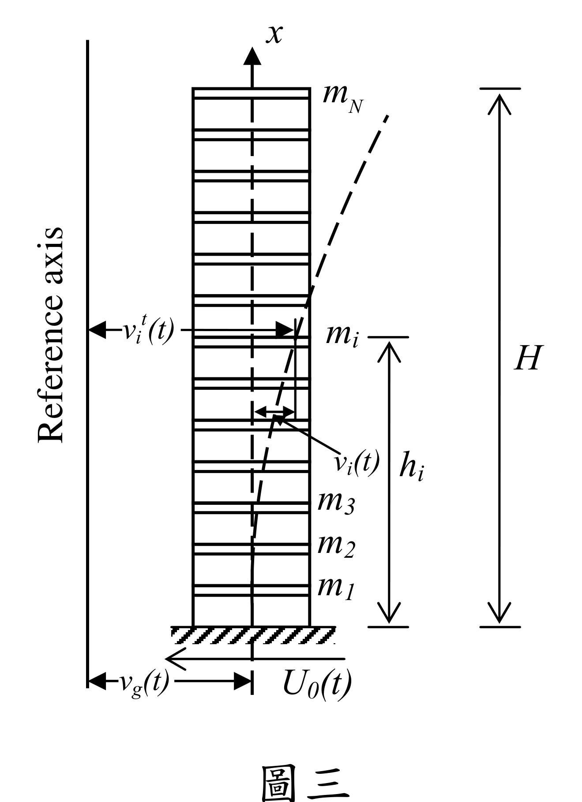

# SD-2015-3 題目正本

> 本檔只記錄考卷上寫了什麼、圖上畫了什麼，不含任何解法。解析見同資料夾 `SD-2015-3.md`。
> 判讀清單經使用者確認前，狀態為「待確認」；確認後本檔原則上不再修改（改動須回考卷原圖並記 log）。

| 項目 | 內容 |
|---|---|
| 考卷 | `raw/exams/SD-2015_結構動力分析與耐震設計.pdf`，第 2 頁（背面），第三題 |
| 考年 | 2015（民國104年）專技高考結構工程技師「結構動力分析與耐震設計」 |
| 配分 | 25 分（15／10） |
| 附圖 | `SD-2015-3-fig-1.png`（舊擷取，左下有游標）、`SD-2015-3-fig-2.png`（2026-11-15 由考卷 500 dpi 重擷取） |
| 判讀狀態 | **已確認**（2026-11-15 使用者授權依 Claude 建議確認。原轉錄：2026-11-15 轉錄；PyMuPDF 110 dpi 整頁＋400–500 dpi 局部放大，PDF 文字層核對原文；盲讀於開啟解析前完成） |

## 1. 考卷原文（逐字）

三、構架（Frame）如圖三，有 N 個自由度，且質量集中在樓層上。若分析時，只考慮第一振態（1st Mode）$\phi_1$

㈠證明此構架之基底剪力（Base Shear）$U_0(t)=\dfrac{L_1^2}{M_1}\omega_1V_1(t)$ 式中

$V_1(t)=-\int_0^t\ddot v_g(\tau)e^{-\xi_1\omega_1(t-\tau)}\sin\omega_1(t-\tau)d\tau$，$M_1=\phi_1^Tm\phi_1$，$L_1=\phi_1^Tm\{1\}$，m 為 N×N 質量矩陣，$\{1\}^T=[1,1,\ldots\ldots,1]$ 為 N×1 向量，$\omega_1$、$\xi_1$ 分別為第一模態之頻率及阻尼比（Damping ratio）。並假設 $\xi_1$ 很小。（15 分）

㈡令 $\phi_1^T=\left[\dfrac{h_1}{H},\ \ldots\ldots,\ \dfrac{h_i}{H},\ \ldots\ldots,\ \dfrac{h_n}{H}\right]$，證明最大基底剪力 $|U_0(t)|_{\max}$ 之豎向分配至各樓層之水平力 $f_{si}=\dfrac{m_ih_i}{\sum_{j=1}^{N}m_jh_j}|U_0(t)|_{\max}$（10 分）

## 2. 考卷給的公式、附表與參數

- 考卷給：$U_0(t)=\dfrac{L_1^2}{M_1}\omega_1V_1(t)$、$V_1(t)$ 的 Duhamel 積分式、$M_1$、$L_1$ 定義、$\phi_1^T=[h_1/H,\ldots,h_i/H,\ldots,h_n/H]$、$f_{si}$ 待證式。
- 考卷沒有給：任何數值（全為證明）。
- 卷首注意事項：㈠可以使用電子計算器。㈡不必抄題，作答時請將試題題號及答案依照順序寫在試卷上，於本試題上作答者，不予計分。考試時間：2 小時。

## 3. 附圖

*證據圖 SD-2015-3-fig-2.png（500 dpi 重擷取；舊圖 SD-2015-3-fig-1.png 內容相同，左下有游標）*

圖面文字照錄：x、$m_N$、Reference axis、$v_i^t(t)$、$m_i$、$v_i(t)$、$h_i$、$m_3$、$m_2$、$m_1$、H、$v_g(t)$、$U_0(t)$、圖三

## 4. 判讀清單

| # | 項目 | 判讀 | 圖上／題文依據 | 把握 |
|---|---|---|---|---|
| 1 | $V_1(t)$ 的物理意義 | 考卷定義 $V_1(t)=-\int_0^t\ddot v_g e^{-\xi\omega(t-\tau)}\sin\omega(t-\tau)d\tau$，即第一振態廣義座標乘 $\omega_1$ 的量（擬速度型 Duhamel 積分）；待證式 $U_0=\frac{L_1^2}{M_1}\omega_1V_1$ 照錄 | 題文 | 確定 |
| 2 | ㈡下標 | 振態向量最後一項寫 $h_n/H$（小寫 n），與總數 N 不同寫法，照考卷原文；視為 $h_N/H$ | 題文 | 確定（解讀） |
| 3 | $h_i$、$H$ | $h_i$ 由地面量到第 $i$ 層，$H$ 由地面量到頂層 | 圖上尺寸線端點 | 確定 |
| 4 | 位移記號 | $v_i$ 為相對地面位移、$v_i^t=v_i+v_g$ 為總位移（相對 Reference axis） | 圖上箭頭與標註 | 確定 |
| 5 | 底部 | 固定；$U_0(t)$ 為基底剪力 | 圖面＋題文 | 確定 |
| 6 | 阻尼 | 第一振態阻尼比 $\xi_1$ 很小（可用 $\omega_D\approx\omega_1$） | 題文「假設 ξ1 很小」 | 確定 |
| 7 | 所求 | ㈠證明 $U_0(t)$ 式 ㈡證明 $f_{si}$ 豎向分配式 | 題文 | 確定 |

---
*轉錄：2026-11-15（SD-U1-3 題目正本推廣・批 2）*
*確認：2026-11-15 使用者授權依 Claude 建議確認（SD-U1-3 題目正本推廣・批 2，關卡一）*
*修訂：2026-11-15 §3 圖說更正——v_g(t) 為參考軸至構架中心線的雙箭頭尺寸、向左單箭頭屬 U0(t)（盲解 G3 指出，考卷第 2 頁圖三底部 600 dpi 複核；判讀清單 #4 不變，不影響答案）*
