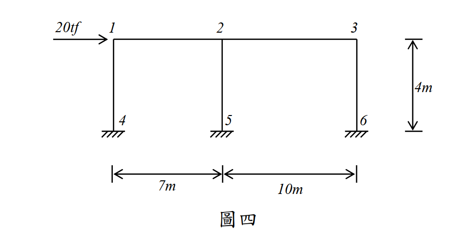

# SD-2015-4 題目正本

> 本檔只記錄考卷上寫了什麼、圖上畫了什麼，不含任何解法。解析見同資料夾 `SD-2015-4.md`。
> 判讀清單經使用者確認前，狀態為「待確認」；確認後本檔原則上不再修改（改動須回考卷原圖並記 log）。

| 項目 | 內容 |
|---|---|
| 考卷 | `raw/exams/SD-2015_結構動力分析與耐震設計.pdf`，第 2 頁（背面），第四題 |
| 考年 | 2015（民國104年）專技高考結構工程技師「結構動力分析與耐震設計」 |
| 配分 | 25 分 |
| 附圖 | `SD-2015-4-fig-1.png`（舊擷取，完整、無游標，未重擷取） |
| 判讀狀態 | **已確認**（2026-11-16，使用者授權依 Claude 建議。原轉錄：2026-11-16 轉錄；PyMuPDF 110 dpi 整頁＋500 dpi 局部放大，PDF 文字層核對原文；盲讀於開啟解析前完成） |

## 1. 考卷原文（逐字）

四、構架如圖四，以簡易懸臂梁法（Approximation of cantilever method）計算每一梁與柱之端點彎矩。令柱之斷面積皆 1 m²。（25 分）

## 2. 考卷給的公式、附表與參數

- 考卷沒有給參考公式。
- 給定（圖上）：單層兩跨構架，跨距 7 m、10 m，柱高 4 m；水平力 20 tf 作用於節點 1、向右；柱底 4、5、6 固定；題文：三柱斷面積皆 1 m²。
- 考卷沒有給：構件 $EI$、梁斷面、垂直載重；懸臂梁法的假設（反曲點位置等）由考生自行敘明。
- 卷首注意事項：㈠可以使用電子計算器。㈡不必抄題，作答時請將試題題號及答案依照順序寫在試卷上，於本試題上作答者，不予計分。考試時間：2 小時。

## 3. 附圖

*證據圖 SD-2015-4-fig-1.png*

圖面文字照錄：20tf、1、2、3、4、5、6、4m、7m、10m、圖四

## 4. 判讀清單

| # | 項目 | 判讀 | 圖上／題文依據 | 把握 |
|---|---|---|---|---|
| 1 | 懸臂梁法假設 | 考卷只寫方法名稱；定案採教科書標準假設：梁、柱反曲點在中點，柱軸力與柱至柱形心軸距離成正比（柱面積相同，形心由三柱位置求） | 題文「簡易懸臂梁法」「柱之斷面積皆 1 m²」 | 確定（解讀） |
| 2 | 柱底 | 三柱皆固定 | 500 dpi：柱底橫線＋斜線 | 確定 |
| 3 | 跨距 | 1–2 為 7 m、2–3 為 10 m（尺寸線端點對齊柱中心線；圖未依比例） | 500 dpi：延伸線與柱線同 x | 確定 |
| 4 | 柱高 | 4 m（尺寸線上端對齊梁線、下端對齊柱底） | 500 dpi | 確定 |
| 5 | 側力 | 20 tf，水平向右，作用於節點 1（梁高度） | 圖上箭頭 | 確定 |
| 6 | 節點編號 | 梁：1（左）、2（中）、3（右）；柱底：4、5、6 對應其下 | 圖面文字 | 確定 |
| 7 | 所求 | 每一梁（1-2、2-3）與每一柱（1-4、2-5、3-6）兩端彎矩 | 題文 | 確定 |
| 8 | 考卷沒有給 | $EI$、垂直載重 | 題文 | 確定 |

---
*轉錄：2026-11-16（SD-U3-1 題目正本推廣・組 U3-1-G1）*
*確認：2026-11-16 使用者授權依 Claude 建議確認（SD-U3-1 題目正本推廣・組 U3-1-G1，關卡一）*
