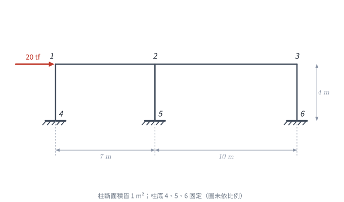
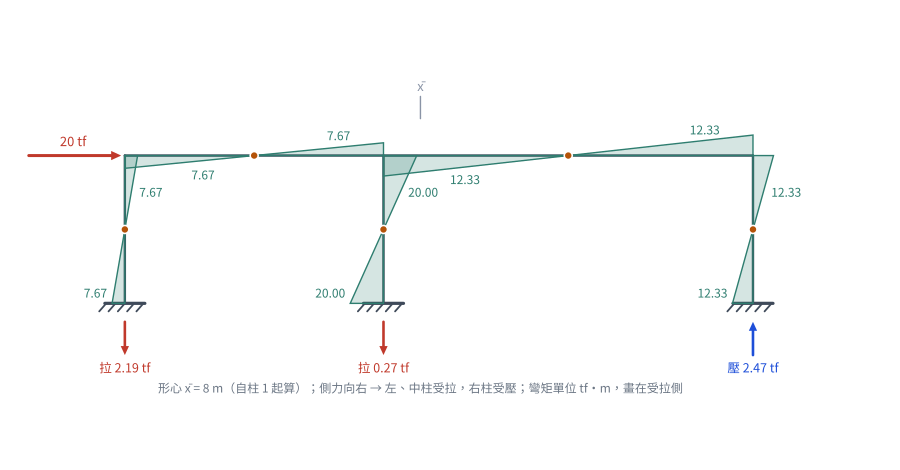

# 考題編號：SD-2015-4

**主分類：** `SD-U3-1` 結構耐震設計（含RC結構與鋼結構）
**副分類：** （無）
**分析方法：** 概念題（含計算）——簡易懸臂梁法（Approximate Cantilever Method）
**標籤：** `懸臂梁法` `側力分析` `端點彎矩` `近似法` `中性軸` `柱軸力` `梁剪力` `彎矩圖` `靜不定構架` `一層兩跨` `靜力近似法`

---

## 1. 題目（考卷原文見題目正本）

> 考卷原文、公式／附表、附圖與判讀清單（已確認）見 [`SD-2015-4-problem.md`](SD-2015-4-problem.md)。本節只列解題時最容易讀錯的地方與本解使用的記號；題意以題目正本為準。

*重繪自考卷附圖，依題目正本判讀清單；本圖攔下的判讀錯誤：跨距 7 m 在左、10 m 在右，三柱底皆固定。*

### 常見誤讀

| 項目 | 正確判讀 | 常見誤讀 |
|------|---------|---------|
| 懸臂梁法假設 | 梁、柱反曲點在中點；柱軸力與柱至形心距離成正比（柱面積皆 1 m²）（判讀 #1） | 用門架法（內柱剪力為外柱 2 倍） |
| 跨距 | 1–2 為 7 m、2–3 為 10 m（判讀 #3） | 左右對調 |
| 柱底 | 三柱皆固定（判讀 #2） | — |
| 側力 | 20 tf 向右作用於節點 1（判讀 #5） | — |

**本解記號：** $\bar x$ 為柱斷面形心位置（自柱 1-4 起算）；$d_i=x_i-\bar x$。

---

## 2. 考題核心精神與出題者意圖 (Core Concepts & Examiner's Intent)

**核心觀念：**
- 懸臂梁法把整體構架類比為「懸臂梁截面」，各柱視為截面纖維，用彎曲應力分布原理求柱軸力
- 從柱軸力→梁剪力→梁端彎矩→柱端彎矩→柱剪力，形成一個自洽的解析流程
- 本題測驗整個懸臂梁法的計算流程是否熟練

**出題者意圖：**
- 驗證考生能否正確計算中性軸（重心）位置
- 驗證考生能否由彎矩平衡推導柱端彎矩（非直接由剪力算，而是由梁端彎矩累加）
- 非對稱跨距（7m vs 10m）增加計算複雜度，測驗對分配邏輯的理解

**關鍵陷阱：**
1. 誤用門架法（Portal Method）的等剪力假設：懸臂梁法的柱剪力不相等
2. 忘記求中性軸（誤設中性軸在中柱）
3. 梁端彎矩應從柱軸力→節點垂直平衡→梁剪力→梁端彎矩，步驟不可跳過

---

## 3. 解題戰略地圖與陷阱分析 (Strategic Roadmap & Trap Analysis)

**懸臂梁法五步驟：**
1. 求柱群中性軸位置（所有柱面積加權重心）
2. 由傾覆力矩平衡，求各柱軸力 $N_i$（正比於柱距中性軸距離）
3. 由節點垂直平衡，求各梁垂直剪力 $V_\text{beam}$
4. 由梁剪力 × L/2 求梁端彎矩；由節點彎矩平衡求柱端彎矩
5. 由柱端彎矩求柱剪力，驗算 ΣV = P

**關鍵陷阱：**

| # | 陷阱 | 應對 |
|---|------|------|
| 1 | 中性軸誤設 | 中性軸 = Σ(A_i×x_i)/ΣA_i，非幾何中點 |
| 2 | 柱軸力方向 | P 向右 → 傾覆力矩順時針 → **左柱受拉、右柱受壓**（懸臂梁類比：受力側為拉側，背風側為壓側）；本庫舊解曾寫反 |
| 3 | 切割高度 | 固定端柱：在**中高**（h/2=2m）切割，此處傾覆力矩 = P×(h/2) |
| 4 | 梁端彎矩對稱性 | 梁端彎矩兩端相同大小（反曲點在跨中） |
| 5 | 柱端彎矩計算 | 中柱需加總左右兩梁的梁端彎矩 |

---

## 3.5 變數層次分析 (Variable Hierarchy Analysis)

### 最終目標

求各梁（beam 12、beam 23）與各柱（col 1、col 2、col 3）的端點彎矩。

### 本題關鍵公式（依計算順序）

$$\text{Step 1:}\quad \bar{x} = \frac{\sum A_i x_i}{\sum A_i}$$

$$\text{Step 2:}\quad N_i = k \cdot A_i \cdot d_i, \quad k = \frac{P \cdot h/2}{\sum A_i d_i^2}$$

$$\text{Step 3 (梁剪力):}\quad \sum F_y = 0 \text{ at each joint} \Rightarrow V_\text{beam}$$

$$\text{Step 4 (梁端彎矩):}\quad M_\text{beam,end} = V_\text{beam} \cdot \frac{L}{2}$$

$$\text{Step 5 (柱端彎矩):}\quad M_\text{col,top} = \sum M_\text{beam,ends at joint}$$

$$\text{Step 6 (柱剪力):}\quad V_\text{col} = \frac{2 M_\text{col,top}}{h} \quad \text{（反曲點在柱中高）}$$

### L1：題目直接給定

| 符號 | 數值 | 說明 |
|------|------|------|
| P | 20 tf | 側向荷載，向右 |
| L₁₂ | 7 m | 左跨跨距 |
| L₂₃ | 10 m | 右跨跨距 |
| h | 4 m | 層高 |
| A_i | 1 m²（所有柱） | 柱斷面積 |

### L2：需知識點推導

**求中性軸**

| 符號 | 公式／來源 | 卡關? |
|------|-----------|-------|
| x̄ | Σ(A_i×x_i)/ΣA_i，從左柱起算 | |
| d_i | x_i − x̄（帶符號） | |

**求柱軸力**

| 符號 | 公式／來源 | 卡關? |
|------|-----------|-------|
| M_OT | P×(h/2)，傾覆力矩取切割面（中高）處 | |
| k | M_OT / Σ(A_i d_i²) | |
| N_i | k·A_i·d_i（正值為壓；側力向右時 d_i>0 的右柱受壓） | |

**求梁剪力→端點彎矩→柱端彎矩**

| 符號 | 公式／來源 | 卡關? |
|------|-----------|-------|
| V_beam | 由各節點 ΣFy=0 遞推 | |
| M_beam | V_beam × L/2 | |
| M_col_top | ΣM_beam 在該節點（邊柱單梁；中柱兩梁之和） | |
| M_col_base | = M_col_top（反曲點在柱中高） | |

### L3：深層知識（不懂就卡住）

| 知識點 | 說明 | 卡關? |
|--------|------|-------|
| 懸臂梁法 vs 門架法 | 門架法假設等剪力，懸臂梁法從軸力推導，柱剪力不等 | |
| 固定端柱反曲點位置 | 固定端→反曲點在柱高中點（h/2）；鉸接端→反曲點在端部 | |
| 柱軸力方向 | P 向右：上方自由體的順時針傾覆力矩須由柱軸力的逆時針力矩抵抗 → 右柱向上推（受壓）、左柱向下拉（受拉） | |
| 梁端反曲點假設 | 梁中點為零彎矩點（反曲點），此假設使 M = V × L/2 成立 | |

---

## 4. 步驟化詳細計算過程 (Step-by-Step Detailed Calculation)

### Step 1：求柱群中性軸（Neutral Axis）位置

設各柱 x 坐標（從左柱起算）：

| 柱 | 節點 | $x_i$（m） | $A_i$（m²） |
|----|------|-----------|------------|
| Col-14（左柱） | 1–4 | 0 | 1 |
| Col-25（中柱） | 2–5 | 7 | 1 |
| Col-36（右柱） | 3–6 | 17 | 1 |

$$\bar{x} = \frac{1 \times 0 + 1 \times 7 + 1 \times 17}{1 + 1 + 1} = \frac{24}{3} = 8 \text{ m（從左柱起算）}$$

各柱距中性軸的距離（帶符號，右為正）：

$$d_1 = 0 - 8 = -8 \text{ m}, \quad d_2 = 7 - 8 = -1 \text{ m}, \quad d_3 = 17 - 8 = +9 \text{ m}$$

$$\sum A_i d_i^2 = 1 \times (-8)^2 + 1 \times (-1)^2 + 1 \times (9)^2 = 64 + 1 + 81 = 146 \text{ m}^4$$

---

### Step 2：求各柱軸力（Cantilever Analogy）

在柱中高（h/2 = 2m）處切割，取**上方自由體**（包含節點 1、2、3 及各柱上半段）：

傾覆力矩（取中性軸為矩心，CCW 為正）：

$$M_\text{OT} = P \times \frac{h}{2} = 20 \times 2 = 40 \text{ tf}\cdot\text{m（順時針）}$$

柱軸力假設 $N_i = k \cdot A_i \cdot d_i$（**正值為壓力**，即柱向上推上方自由體），由力矩平衡（ΣM_z = 0，柱軸力的逆時針力矩抵抗順時針傾覆力矩）：

$$\sum N_i d_i = M_\text{OT} \Rightarrow k \sum A_i d_i^2 = 40$$

$$k = \frac{40}{146} = \frac{20}{73} \approx 0.274 \text{ tf/m}^3$$

各柱軸力：

| 柱 | $N_i = k \cdot A_i \cdot d_i$ | 數值 | 受力狀態 |
|----|-------------------------------|------|---------|
| 左柱（Col-14） | $\frac{20}{73} \times 1 \times (-8)$ | $-\dfrac{160}{73} \approx -2.19$ tf | 拉力 |
| 中柱（Col-25） | $\frac{20}{73} \times 1 \times (-1)$ | $-\dfrac{20}{73} \approx -0.27$ tf | 拉力 |
| 右柱（Col-36） | $\frac{20}{73} \times 1 \times (+9)$ | $+\dfrac{180}{73} \approx +2.47$ tf | 壓力 |

> **策略註解：** P 向右時，構架像懸臂梁向右彎，受力側（左）伸長受拉、背風側（右）縮短受壓：左柱、中柱受拉，右柱受壓。方向可用 Step 6 的整體傾覆力矩驗算確認（右柱壓力對柱 1 底的力矩才能與 $P\times H$ 平衡）。

**驗算：** $N_1 + N_2 + N_3 = -\dfrac{160}{73} - \dfrac{20}{73} + \dfrac{180}{73} = 0$ ✓

---

### Step 3：求各梁垂直剪力（由節點垂直平衡）

對於壓力柱：柱壓縮，向上推節點；對於拉力柱：柱拉伸，向下拉節點。

**節點1（左端，只有一梁 Beam-12）：**

左柱受拉，向下拉節點 1：

$$\uparrow \sum F_y = 0: \quad -\frac{160}{73} + V_\text{b12,L} = 0 \Rightarrow V_\text{b12,L} = +\frac{160}{73} \text{ tf（梁向上推節點1）}$$

Beam-12 剪力 $= \dfrac{160}{73}$ tf（梁在節點 1 端向上推節點、在節點 2 端向下拉節點）

**節點2（中間節點，連接 Beam-12 右端與 Beam-23 左端）：**

節點2受到的合力：
- 中柱（拉力）向下拉：$-\dfrac{20}{73}$ tf
- Beam-12 右端向下拉：$-\dfrac{160}{73}$ tf（與節點 1 的方向相反）

$$\sum F_y = 0: \quad -\frac{20}{73} - \frac{160}{73} + V_\text{b23,L} = 0 \Rightarrow V_\text{b23,L} = +\frac{180}{73} \text{ tf（Beam-23 向上推節點2）}$$

Beam-23 剪力 $= \dfrac{180}{73}$ tf

**節點3（右端，驗算）：**

右柱（壓力）向上推節點 3：$+\dfrac{180}{73}$ tf；Beam-23 右端向下拉：$-\dfrac{180}{73}$ tf

$$\sum F_y = +\frac{180}{73} - \frac{180}{73} = 0 \checkmark$$

---

### Step 4：求梁端彎矩（Beam End Moments）

反曲點在梁跨中（L/2 處），因此兩端彎矩相同：

$$\boxed{M_\text{beam12} = V_\text{b12} \times \frac{L_{12}}{2} = \frac{160}{73} \times \frac{7}{2} = \frac{560}{73} \approx 7.67 \text{ tf}\cdot\text{m（兩端）}}$$

$$\boxed{M_\text{beam23} = V_\text{b23} \times \frac{L_{23}}{2} = \frac{180}{73} \times \frac{10}{2} = \frac{900}{73} \approx 12.33 \text{ tf}\cdot\text{m（兩端）}}$$

---

### Step 5：求柱端彎矩（Column End Moments，由節點彎矩平衡）

| 節點 | 相連梁端彎矩 | 柱頂彎矩 |
|------|------------|---------|
| 節點1（左） | Beam-12 左端 $= 560/73$ | $M_\text{col1,top} = \dfrac{560}{73} \approx 7.67$ tf·m |
| 節點2（中） | Beam-12 右端 + Beam-23 左端 $= 560/73 + 900/73$ | $M_\text{col2,top} = \dfrac{1460}{73} = \boxed{20}$ tf·m |
| 節點3（右） | Beam-23 右端 $= 900/73$ | $M_\text{col3,top} = \dfrac{900}{73} \approx 12.33$ tf·m |

固定基礎，反曲點在柱中高 → 柱底彎矩 = 柱頂彎矩：

$$\boxed{M_\text{col1,base} = \frac{560}{73} \approx 7.67 \text{ tf}\cdot\text{m}}$$

$$\boxed{M_\text{col2,base} = \frac{1460}{73} = 20 \text{ tf}\cdot\text{m}}$$

$$\boxed{M_\text{col3,base} = \frac{900}{73} \approx 12.33 \text{ tf}\cdot\text{m}}$$

---

### Step 6：求柱剪力並驗算（Column Shear Verification）

$$V_{\text{col},i} = \frac{M_{\text{col},i,\text{top}} + M_{\text{col},i,\text{base}}}{h} = \frac{2 M_{\text{col},i,\text{top}}}{h}$$

| 柱 | 柱端彎矩 | 柱剪力 |
|----|---------|-------|
| 左柱 | 560/73 tf·m | $V_1 = 2 \times (560/73) / 4 = \dfrac{280}{73} \approx 3.84$ tf |
| 中柱 | 20 tf·m | $V_2 = 2 \times 20 / 4 = 10$ tf |
| 右柱 | 900/73 tf·m | $V_3 = 2 \times (900/73) / 4 = \dfrac{450}{73} \approx 6.16$ tf |

**整體水平平衡驗算：**

$$\sum V_i = \frac{280}{73} + \frac{730}{73} + \frac{450}{73} = \frac{1460}{73} = \boxed{20 \text{ tf} = P} \checkmark$$

**整體傾覆力矩驗算（基底）：**

$$P \times H = 20 \times 4 = 80 \text{ tf}\cdot\text{m}$$

$$\sum M_\text{col,base} + \sum N_i x_i = \frac{2920}{73} + \frac{2920}{73} = 40 + 40 = 80 \text{ tf}\cdot\text{m} \checkmark$$

（$N_i$ 以壓力為正、$x_i$ 自柱 1 起算：$\sum N_i x_i = -\tfrac{160}{73}\times0 - \tfrac{20}{73}\times7 + \tfrac{180}{73}\times17 = \tfrac{2920}{73} = 40$ tf·m；若把拉壓寫反，這一項會變成 $-40$，傾覆力矩不閉合。）

*圖 2　懸臂梁法的反曲點、彎矩圖（受拉側）與柱軸力方向（數值由腳本依本節公式重算）。本圖攔下的錯誤：側力向右時把柱軸力拉壓寫反——左柱、中柱受拉，右柱受壓。*

---

### 最終答案匯整

**梁端彎矩（Beam End Moments）：**

| 梁 | 左端彎矩 | 右端彎矩 |
|----|---------|---------|
| Beam-12（7m） | $\dfrac{560}{73} \approx \mathbf{7.67}$ tf·m | $\dfrac{560}{73} \approx \mathbf{7.67}$ tf·m |
| Beam-23（10m） | $\dfrac{900}{73} \approx \mathbf{12.33}$ tf·m | $\dfrac{900}{73} \approx \mathbf{12.33}$ tf·m |

**柱端彎矩（Column End Moments，柱頂=柱底）：**

| 柱 | 柱頂彎矩 | 柱底彎矩 |
|----|---------|---------|
| 左柱 Col-14 | $\mathbf{7.67}$ tf·m | $\mathbf{7.67}$ tf·m |
| 中柱 Col-25 | $\mathbf{20.00}$ tf·m | $\mathbf{20.00}$ tf·m |
| 右柱 Col-36 | $\mathbf{12.33}$ tf·m | $\mathbf{12.33}$ tf·m |

---

## 5. 關鍵爭議點與進階探討 (Critical Issues & Advanced Discussion)

### 5.1 懸臂梁法 vs 門架法

| 比較項目 | 懸臂梁法（本題） | 門架法 |
|---------|---------------|-------|
| 柱軸力假設 | 正比於距中性軸距離 | 不明確（由剪力決定） |
| 柱剪力假設 | 由軸力逐步推導（不等） | 外柱V，內柱2V |
| 適用場景 | 高層細長構架（軸力主導） | 低層寬扁構架 |
| 計算結果 | $V_1:V_2:V_3 \approx 3.84:10.00:6.16$ | 等效 $6.67:6.67:6.67$ |

> 兩法的差異：本題懸臂梁法中，中柱承擔了最大剪力（10 tf）和最大彎矩（20 tf·m），因為它在幾何上居中且承受左右兩梁的合力。

### 5.2 中性軸位置對結果的影響

本題中性軸 $\bar{x} = 8$ m（偏向右跨），主要是因為右跨較寬（10m > 7m）但柱面積相同。若右柱面積更大（如高層建築的角柱），中性軸會進一步右移，右柱軸力會相對減小。

### 5.3 考場最安全的答題策略

1. 先畫示意圖標出各節點編號和尺寸
2. 中性軸計算寫清楚（3行公式）
3. 柱軸力表格列清楚（正負代表壓拉；側力向右時左柱受拉、右柱受壓）
4. 從節點1開始，逐節點求梁剪力（不要跳步）
5. 最後驗算 ΣV_col = P（必做，可能得分）

*修正日期：2026-11-16（§1 改為指向題目正本，重繪附圖 figs/SD-2015-4-fig-1-problem.svg）*
*修正日期：2026-11-16（勘誤：柱軸力方向更正為左柱、中柱受拉，右柱受壓（舊解寫反）；§3 陷阱表、§3.5 L3、§4 Step 2 軸力表與策略註解、Step 3 節點垂直平衡的推拉方向、Step 6 傾覆驗算註記、§5.3 一併更正；梁柱端彎矩數值不變（7.67、12.33、20 tf·m）；標頭主分類改為 SD-U3-1、無副分類（同索引）；驗證：scripts/fixes/2026-11-16_verify_SD-2015-4.py 懸臂梁法重算＋整體傾覆力矩閉合，MISMATCHES: 0）*
*修正日期：2026-11-16（非勘誤）圖解補繪：figs/SD-2015-4-fig-2-cantilever.svg（反曲點、彎矩圖、柱軸力方向，§4 Step 6）*
