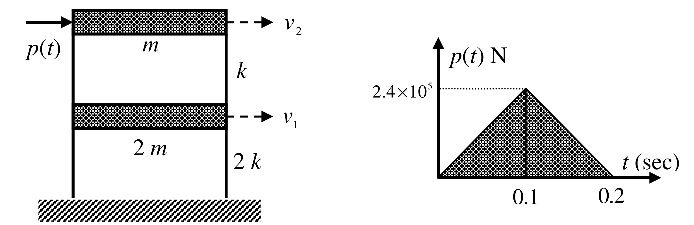

# SD-2016-1 題目正本

> 本檔只記錄考卷上寫了什麼、圖上畫了什麼，不含任何解法。解析見同資料夾 `SD-2016-1.md`。
> 判讀清單經使用者確認前，狀態為「待確認」；確認後本檔原則上不再修改（改動須回考卷原圖並記 log）。

| 項目 | 內容 |
|---|---|
| 考卷 | `raw/exams/SD-2016_結構動力分析與耐震設計.pdf`，第 1 頁（正面），第一題 |
| 考年 | 2016（民國105年）專技高考結構工程技師「結構動力分析與耐震設計」 |
| 配分 | 25 分（3／6／4／12） |
| 附圖 | `SD-2016-1-fig-1.png`（屋架）、`SD-2016-1-fig-2.png`（外力歷時，左上有游標）、`SD-2016-1-fig-3.png`（2026-11-15 由考卷 500 dpi 重擷取，屋架＋外力歷時） |
| 判讀狀態 | **已確認**（2026-11-15 使用者授權依 Claude 建議確認。原轉錄：2026-11-15 轉錄；PyMuPDF 110 dpi 整頁＋400–500 dpi 局部放大，PDF 文字層核對原文；盲讀於開啟解析前完成） |

## 1. 考卷原文（逐字）

一、有一兩層樓剪力屋架如下圖所示，已知 $m=2\times10^3$ kg 及 $k=10^5$ N/m，自由度之編號請由底層增加至頂層，如圖中之 $v_1$ 和 $v_2$ 所示，試回答以下問題：

㈠求出運動方程組。（3 分）

㈡求出振動頻率及所對應之振態。（6 分）

㈢利用振態疊加法分解完成後之兩個未耦合單自由度系統（uncoupled single degree of freedom system）之運動方程式。（4 分）

㈣假設此建築物原本靜止，隨後受外力作用，所受外力之大小如圖所示，試求位移反應，近似解即可，但需說明可以使用近似解的原因。（12 分）

## 2. 考卷給的公式、附表與參數

- 考卷沒有給參考公式。
- 給定：$m=2\times10^3$ kg、$k=10^5$ N/m；底層質量 $2m$、層勁度 $2k$；頂層質量 $m$、層勁度 $k$。
- 外力 $p(t)$（N）：三角形脈衝，0 s 由 0 線性增至 0.1 s 的 $2.4\times10^5$ N，再線性降至 0.2 s 的 0。
- 考卷沒有給：阻尼、「位移反應」要求的時間範圍（脈衝期間或之後）。
- 卷首注意事項：㈠可以使用電子計算器。㈡不必抄題，作答時請將試題題號及答案依照順序寫在試卷上，於本試題上作答者，不予計分。考試時間：2 小時。

## 3. 附圖

*證據圖 SD-2016-1-fig-3.png（500 dpi 重擷取；舊圖 fig-1、fig-2 內容相同，fig-2 左上有游標）*

圖面文字照錄：p(t)、m、k、v2、v1、2 m、2 k、p(t) N、2.4×10⁵、t (sec)、0.1、0.2

## 4. 判讀清單

| # | 項目 | 判讀 | 圖上／題文依據 | 把握 |
|---|---|---|---|---|
| 1 | 外力作用位置 | 只作用在頂層（$v_2$）樓版 | 圖上 p(t) 實線箭頭指向上層樓版左端 | 確定 |
| 2 | 樓層質量與勁度 | 底層：質量 $2m$、層勁度 $2k$；頂層：質量 $m$、層勁度 $k$ | 「2 m」標在下層樓版下方、「m」在上層樓版下方；「2 k」「k」標在對應柱段 | 確定 |
| 3 | 自由度 | $v_1$ 二樓（下層）、$v_2$ 屋頂，由底層往上編號 | 題文＋圖上虛線箭頭 | 確定 |
| 4 | 外力歷時 | 對稱三角形脈衝：$t_d=0.2$ s、峰值 $2.4\times10^5$ N 在 0.1 s | 圖上座標與標註 | 確定 |
| 5 | 阻尼 | 考卷沒有給，視為無阻尼 | 題文未提 | 確定（解讀） |
| 6 | ㈣「近似解」 | 考卷要求說明可用近似解的原因；所求為位移反應（未指定時刻），以最大位移或脈衝後自由振動為對象 | 題文 | 確定（解讀） |
| 7 | 柱底 | 固定（斜線地面） | 圖面 | 確定 |
| 8 | 所求 | ㈠運動方程組 ㈡頻率與振態 ㈢兩個解耦單自由度方程 ㈣位移反應（近似）與理由 | 題文 | 確定 |

---
*轉錄：2026-11-15（SD-U1-3 題目正本推廣・批 2）*
*確認：2026-11-15 使用者授權依 Claude 建議確認（SD-U1-3 題目正本推廣・批 2，關卡一）*
