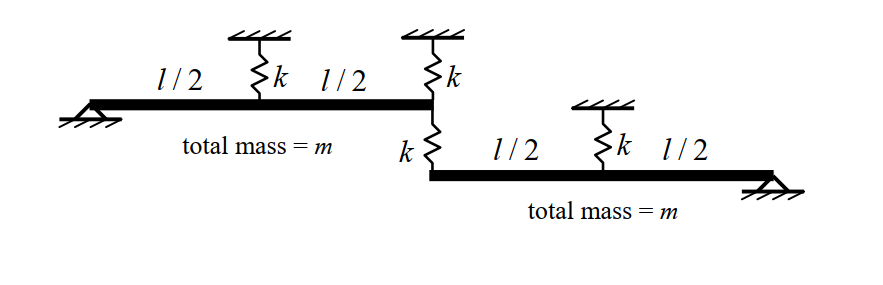

# SD-2016-2 題目正本

> 本檔只記錄考卷上寫了什麼、圖上畫了什麼，不含任何解法。解析見同資料夾 `SD-2016-2.md`。
> 判讀清單經使用者確認前，狀態為「待確認」；確認後本檔原則上不再修改（改動須回考卷原圖並記 log）。

| 項目 | 內容 |
|---|---|
| 考卷 | `raw/exams/SD-2016_結構動力分析與耐震設計.pdf`，第 1 頁（正面），第二題 |
| 考年 | 2016（民國105年）專技高考結構工程技師「結構動力分析與耐震設計」 |
| 配分 | 20 分（㈠6 分、㈡6 分、㈢8 分） |
| 附圖 | `SD-2016-2-fig-1.png`（舊擷取，完整、無游標；2026-11-16 以 500 dpi 局部放大核對，內容一致，未重擷取） |
| 判讀狀態 | **已確認**（2026-11-16，使用者授權依 Claude 建議。原轉錄：2026-11-16 轉錄；PyMuPDF 110 dpi 整頁＋500 dpi 局部放大，PDF 文字層核對原文；盲讀於開啟解析前完成） |

## 1. 考卷原文（逐字）

二、圖中之梁皆為質量均勻之剛性梁，且每支剛性梁的總質量皆為 $m$，試回答以下問題：

㈠質量矩陣。（6 分）

㈡勁度矩陣。（6 分）

㈢結構系統的自然振動頻率（直接以符號表示）。（8 分）

## 2. 考卷給的公式、附表與參數

- 考卷沒有給參考公式。
- 給定（符號，圖上）：兩支剛性梁，每支長 $l$（各分 $l/2$＋$l/2$）、總質量 $m$（均勻分布）；四根彈簧（三根接頂部固定面、一根連接兩梁），彈簧常數皆為 $k$。
- 考卷沒有給：自由度的選法、重力的處理、阻尼、任何數值；附圖沒有圖號。
- 卷首注意事項：㈠可以使用電子計算器。㈡不必抄題，作答時請將試題題號及答案依照順序寫在試卷上，於本試題上作答者，不予計分。考試時間：2 小時。

## 3. 附圖

*證據圖 SD-2016-2-fig-1.png（舊擷取；500 dpi 局部放大核對無差異）*

圖面文字照錄：l / 2（四處）、k（四處）、total mass = m（兩處）

## 4. 判讀清單

| # | 項目 | 判讀 | 圖上依據 | 把握 |
|---|---|---|---|---|
| 1 | 自由度 | 考卷未指定；兩剛性梁各繞其鉸支承轉動，共 2 個自由度。定案：取左梁繞左端鉸的轉角 $\theta_1$、右梁繞右端鉸的轉角 $\theta_2$（或等價的兩梁自由端鉛垂位移），質量、勁度矩陣隨所選自由度而異，頻率不變 | 圖上兩梁各只有一個鉸支承、其餘以彈簧連接 | 不確定（解讀）；使用者授權依建議確認 |
| 2 | 重力 | 振動以靜平衡位置為基準，重力不進入運動方程式（彈簧為鉛垂，梁小角度轉動） | 題文未提重力 | 確定（解讀） |
| 3 | 左梁 | 剛性、長 $l$、總質量 $m$ 均勻分布；左端鉸支承 | 圖上左梁 l/2＋l/2、三角形支承在左端、文字 total mass = m | 確定 |
| 4 | 右梁 | 剛性、長 $l$、總質量 $m$ 均勻分布；右端鉸支承；左端自由（只接彈簧） | 圖上右梁 l/2＋l/2、三角形支承在右端 | 確定 |
| 5 | 左梁中點彈簧 | $k$，下端接左梁中點（距鉸 $l/2$），上端接固定面 | 圖上彈簧位於兩個 l/2 之間，頂端剖線 | 確定 |
| 6 | 左梁右端上方彈簧 | $k$，下端接左梁右端（距鉸 $l$），上端接固定面 | 圖上左梁右端上方彈簧＋剖線 | 確定 |
| 7 | 連接彈簧 | $k$，上端接左梁右端、下端接右梁左端；兩端點在同一鉛垂線上 | 圖上左梁右端與右梁左端水平位置相同（500 dpi 像素 x≈1000），彈簧鉛垂 | 確定 |
| 8 | 右梁中點彈簧 | $k$，下端接右梁中點（距右端鉸 $l/2$），上端接固定面 | 圖上右梁兩個 l/2 之間，頂端剖線 | 確定 |
| 9 | 彈簧數量與常數 | 共四根彈簧（#5–#8），皆為 $k$；左梁右端「一點兩簧」（上方接固定面、下方接右梁） | 圖上四處標 k；PDF 文字層亦為 4 個 k | 確定 |
| 10 | 支承型式 | 兩處皆畫成三角形＋地面剖線（鉸支承）；梁水平方向運動與本題振動無關 | 圖上三角形符號 | 確定 |
| 11 | 所求 | ㈠質量矩陣、㈡勁度矩陣、㈢自然振動頻率（以 $k$、$m$ 符號表示） | 題文 | 確定 |
| 12 | 考卷沒有給 | 數值、阻尼、自由度選法、頻率以 rad/s 或 Hz 表示 | 題文 | 確定 |

---
*轉錄：2026-11-16（SD-U1-2 題目正本推廣・組 U1-2-G2）*
*確認：2026-11-16 使用者授權依 Claude 建議確認（SD-U1-2 題目正本推廣・組 U1-2-G2，關卡一）*
