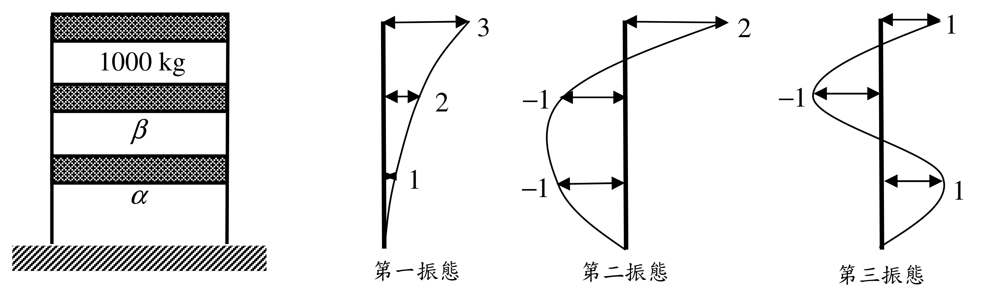

# SD-2016-3 題目正本

> 本檔只記錄考卷上寫了什麼、圖上畫了什麼，不含任何解法。解析見同資料夾 `SD-2016-3.md`。
> 判讀清單經使用者確認前，狀態為「待確認」；確認後本檔原則上不再修改（改動須回考卷原圖並記 log）。

| 項目 | 內容 |
|---|---|
| 考卷 | `raw/exams/SD-2016_結構動力分析與耐震設計.pdf`，第 1 頁（正面），第三題 |
| 考年 | 2016（民國105年）專技高考結構工程技師「結構動力分析與耐震設計」 |
| 配分 | 15 分（10／5） |
| 附圖 | `SD-2016-3-fig-1.png`（舊擷取，第二振態下方有游標）、`SD-2016-3-fig-2.png`（2026-11-15 由考卷 500 dpi 重擷取） |
| 判讀狀態 | **已確認**（2026-11-15 使用者授權依 Claude 建議確認；影響答案項目定案：#1 主解採第一振態分別與第二、第三振態質量正交的兩條方程；第二、第三振態之間的正交條件不成立，另於解析 §5 說明並列其他組合的結果。原轉錄：2026-11-15 轉錄；PyMuPDF 110 dpi 整頁＋400–500 dpi 局部放大，PDF 文字層核對原文；盲讀於開啟解析前完成） |

## 1. 考卷原文（逐字）

三、有一棟三層樓建築物，其三個振態的示意圖如圖所示，已知頂層的質量為 $m=10^3$ kg，試求第一層和第二層的質量為何，亦即 $\alpha=$？及 $\beta=$？（10 分）並請說明計算原理。（5 分）

## 2. 考卷給的公式、附表與參數

- 考卷沒有給參考公式。
- 圖上給：頂層質量 1000 kg、中間層 $\beta$、底層 $\alpha$；三個振態分量（由下往上）：
  - 第一振態：$1,\ 2,\ 3$
  - 第二振態：$-1,\ -1,\ 2$
  - 第三振態：$1,\ -1,\ 1$
- 考卷沒有給：樓層勁度、頻率。
- 卷首注意事項：㈠可以使用電子計算器。㈡不必抄題，作答時請將試題題號及答案依照順序寫在試卷上，於本試題上作答者，不予計分。考試時間：2 小時。

## 3. 附圖

*證據圖 SD-2016-3-fig-2.png（500 dpi 重擷取；舊圖 SD-2016-3-fig-1.png 內容相同，第二振態下方有游標）*

圖面文字照錄：1000 kg、β、α、3、2、1、第一振態、2、−1、−1、第二振態、1、−1、1、第三振態

## 4. 判讀清單

| # | 項目 | 判讀 | 圖上／題文依據 | 把握 |
|---|---|---|---|---|
| 1 | 振態數據的一致性 | 三個振態兩兩質量正交可列三條方程、只有 $\alpha$、$\beta$ 兩個未知數；照圖上數值，三條方程**不能同時成立**（考卷數據自相矛盾），取哪兩條會得到不同答案 | 圖上振態值（400 dpi）逐一核對無誤讀 | 不確定（影響答案）；使用者授權依建議確認 |
| 2 | 樓層對應 | 頂層 1000 kg、第二層 $\beta$、第一層 $\alpha$（題文「第一層和第二層的質量…$\alpha$？及 $\beta$？」與圖一致） | 圖上 1000 kg 在頂、β 在中、α 在底 | 確定 |
| 3 | 第一振態分量 | 由下往上 $\{1,2,3\}$ | 400 dpi：三個向右箭頭標 1、2、3 | 確定 |
| 4 | 第二振態分量 | 由下往上 $\{-1,-1,2\}$ | 400 dpi：下兩層箭頭向左標 −1、−1，頂層向右標 2 | 確定 |
| 5 | 第三振態分量 | 由下往上 $\{1,-1,1\}$ | 400 dpi：底層向右 1、中層向左 −1、頂層向右 1 | 確定 |
| 6 | 所求 | $\alpha$、$\beta$ 數值與計算原理 | 題文 | 確定 |

---
*轉錄：2026-11-15（SD-U1-3 題目正本推廣・批 2）*
*確認：2026-11-15 使用者授權依 Claude 建議確認（SD-U1-3 題目正本推廣・批 2，關卡一）*
