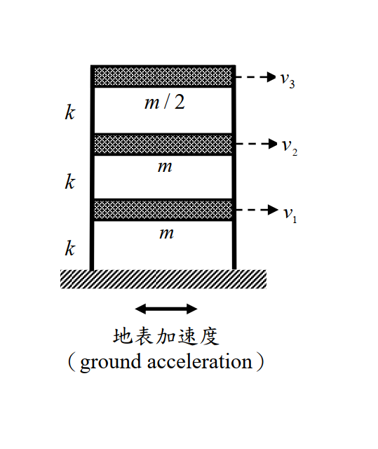
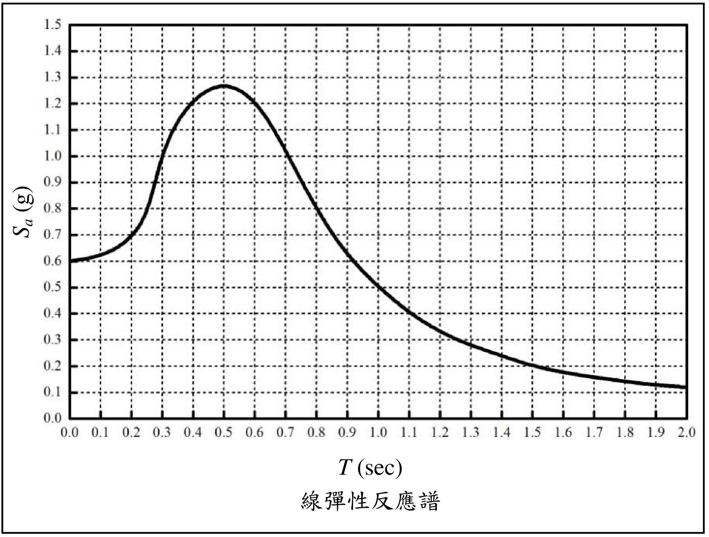

# SD-2016-4 題目正本

> 本檔只記錄考卷上寫了什麼、圖上畫了什麼，不含任何解法。解析見同資料夾 `SD-2016-4.md`。
> 判讀清單經使用者確認前，狀態為「待確認」；確認後本檔原則上不再修改（改動須回考卷原圖並記 log）。

| 項目 | 內容 |
|---|---|
| 考卷 | `raw/exams/SD-2016_結構動力分析與耐震設計.pdf`，第 2 頁（背面），第四題 |
| 考年 | 2016（民國105年）專技高考結構工程技師「結構動力分析與耐震設計」 |
| 配分 | 25 分（6／14／5） |
| 附圖 | `SD-2016-4-fig-1.png`（屋架）、`SD-2016-4-fig-2.png`（反應譜，左上有游標）、`SD-2016-4-fig-3.png`（2026-11-15 由考卷 500 dpi 重擷取反應譜） |
| 判讀狀態 | **已確認**（2026-11-15 使用者授權依 Claude 建議確認；影響答案項目定案：#1 反應譜讀值採本檔數位化表（線性內插）。原轉錄：2026-11-15 轉錄；PyMuPDF 110 dpi 整頁＋400–500 dpi 局部放大，PDF 文字層核對原文；盲讀於開啟解析前完成） |

## 1. 考卷原文（逐字）

四、有一棟三層樓剪力屋架，如下左圖所示，其中 $k=1.15\times10^6$ N/m 用來代表各樓層的總勁度，而質量 $m=5\times10^3$ kg。已知在某一地震力作用下，其加速度反應譜可簡化如下右圖所示。自由度之編號請由底層增加至頂層，如圖中之 $v_1$，$v_2$ 和 $v_3$ 所示，試回答以下問題：

㈠求出振動頻率及所對應之振態。（6 分）

㈡計算各樓層的側向位移，可採用 SRSS（Square Root of the Sum of the Squares）疊加法。（14 分）

㈢計算各樓層的層剪力，可採用 SRSS 疊加法。（5 分）

## 2. 考卷給的公式、附表與參數

- 考卷沒有給參考公式。
- 給定：各樓層總勁度 $k=1.15\times10^6$ N/m（三層相同）；質量由下往上 $m$、$m$、$m/2$，$m=5\times10^3$ kg。
- 反應譜：右圖曲線「線彈性反應譜」，縱軸 $S_a$ (g) 0–1.5、橫軸 $T$ (sec) 0–2.0，格線 0.1 g × 0.1 s；曲線為點陣影像（非向量），數值須由圖上格線讀取。
- 考卷沒有給：反應譜的阻尼比、$g$ 數值、樓高。
- 卷首注意事項：㈠可以使用電子計算器。㈡不必抄題，作答時請將試題題號及答案依照順序寫在試卷上，於本試題上作答者，不予計分。考試時間：2 小時。

## 3. 附圖

*證據圖 SD-2016-4-fig-1.png*

*證據圖 SD-2016-4-fig-3.png（500 dpi 重擷取；舊圖 SD-2016-4-fig-2.png 內容相同，左上有游標）*

圖面文字照錄：k、m/2、v3、k、m、v2、k、m、v1、地表加速度（ground acceleration）；Sa (g)、T (sec)、線彈性反應譜、刻度 0.0–1.5、0.0–2.0

**曲線讀值（2026-11-15 以考卷內嵌影像 856×561 px 依格線像素校準數位化，±0.02 g；陡升段 0.25–0.35 s 斜率約 4 g/s，週期差 0.01 s 即差約 0.04 g）：**

| T (s) | 0.05 | 0.10 | 0.15 | 0.20 | 0.25 | 0.30 | 0.35 | 0.40 | 0.45 | 0.50 | 0.60 | 0.70 | 0.80 | 0.90 | 1.00 | 1.20 | 1.50 | 2.00 |
|---|---|---|---|---|---|---|---|---|---|---|---|---|---|---|---|---|---|---|
| $S_a$ (g) | 0.61 | 0.62 | 0.65 | 0.70 | 0.80 | 1.00 | 1.13 | 1.21 | 1.25 | 1.27 | 1.20 | 1.02 | 0.80 | 0.63 | 0.50 | 0.33 | 0.20 | 0.12 |

## 4. 判讀清單

| # | 項目 | 判讀 | 圖上／題文依據 | 把握 |
|---|---|---|---|---|
| 1 | 反應譜讀值精度 | 曲線為點陣圖，只能依格線讀值；陡升段（0.25–0.35 s）讀值對週期很敏感，落在此段的振態 $S_a$ 有約 ±0.05 g 的不確定 | 上表數位化；目視與格線交點吻合 | 不確定（影響答案）；使用者授權依建議確認 |
| 2 | 樓層質量 | 由下往上 $m$、$m$、$m/2$（頂層為一半） | 圖上 m/2 在最上層樓版、兩個 m 在下兩層 | 確定 |
| 3 | 樓層勁度 | 三層皆 $k=1.15\times10^6$ N/m（層總勁度） | 題文＋圖上三個 k | 確定 |
| 4 | 自由度 | $v_1$、$v_2$、$v_3$ 由下往上 | 題文＋圖上箭頭 | 確定 |
| 5 | 縱軸單位 | $S_a$ 以 g 為單位 | 縱軸標「Sa (g)」 | 確定 |
| 6 | 反應譜阻尼比 | 考卷沒有給；圖名「線彈性反應譜」，直接取用不作阻尼修正 | 圖名 | 確定（解讀） |
| 7 | ㈡「側向位移」 | 各樓層相對地面的位移（SRSS） | 題文 | 確定（解讀） |
| 8 | 柱底 | 固定（斜線地面） | 圖面 | 確定 |
| 9 | 所求 | ㈠三個頻率與振態 ㈡SRSS 樓層位移 ㈢SRSS 層剪力 | 題文 | 確定 |

---
*轉錄：2026-11-15（SD-U1-3 題目正本推廣・批 2）*
*確認：2026-11-15 使用者授權依 Claude 建議確認（SD-U1-3 題目正本推廣・批 2，關卡一）*
