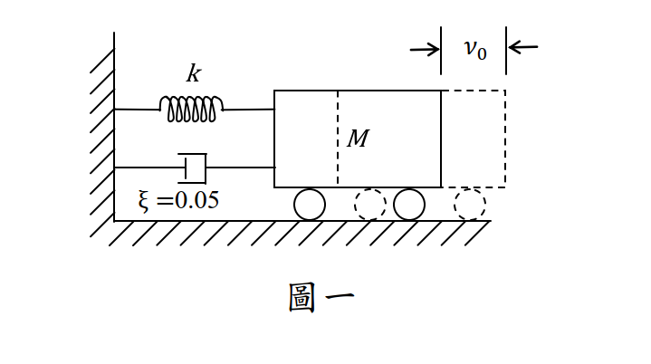

# SD-2017-1 題目正本

> 本檔只記錄考卷上寫了什麼、圖上畫了什麼，不含任何解法。解析見同資料夾 `SD-2017-1.md`。
> 判讀清單經使用者確認前，狀態為「待確認」；確認後本檔原則上不再修改（改動須回考卷原圖並記 log）。

| 項目 | 內容 |
|---|---|
| 考卷 | `raw/exams/SD-2017_結構動力分析與耐震設計.pdf`，第 1 頁（正面），第一題 |
| 考年 | 2017（民國106年）專技高考結構工程技師「結構動力分析與耐震設計」 |
| 配分 | 25 分 |
| 附圖 | `SD-2017-1-fig-1.png`（圖一，舊擷取，清晰、無雜訊） |
| 判讀狀態 | **已確認**（2026-11-15 使用者授權依 Claude 建議確認。原轉錄：2026-11-15 轉錄；PyMuPDF 110 dpi 整頁＋400–450 dpi 局部放大，PDF 文字層核對原文；盲讀於開啟解析前完成） |

## 1. 考卷原文（逐字）

一、單自由度系統如圖一，令阻尼比（Damping ratio）$\xi=0.05$，初始位移 $v_0$，初始速度 0，試求此系統來回震動 3 次後，振幅（Amplitude）為何？（25 分）

（設 $\omega=\dfrac{k}{M}$，$\omega_D=\sqrt{1-\xi^2}\,\omega\doteqdot\omega$，$\sqrt{1+\xi^2}\doteqdot1$，$\tan^{-1}\xi\doteqdot0$）

（「$\omega=\dfrac{k}{M}$」照考卷原文，少了根號，應為 $\omega=\sqrt{k/M}$；「震動」照考卷原文。）

## 2. 考卷給的公式、附表與參數

- 考卷在題文括號內給的設定（照錄）：$\omega=\dfrac{k}{M}$（照考卷，筆誤，見 §1）、$\omega_D=\sqrt{1-\xi^2}\,\omega\doteqdot\omega$、$\sqrt{1+\xi^2}\doteqdot1$、$\tan^{-1}\xi\doteqdot0$。
- 給定：$\xi=0.05$、初始位移 $v_0$（符號）、初始速度 0；$k$、$M$ 只有符號。
- 考卷沒有給：$k$、$M$、$v_0$ 的數值（答案為 $v_0$ 的倍數）；「振幅」的定義（峰值位移或包絡線）。
- 卷首注意事項：㈠可以使用電子計算器。㈡不必抄題，作答時請將試題題號及答案依照順序寫在試卷上，於本試題上作答者，不予計分。㈢本科目除專門名詞或數理公式外，應使用本國文字作答。考試時間：2 小時。

## 3. 附圖

*證據圖 SD-2017-1-fig-1.png（舊擷取；與考卷 450 dpi 局部核對內容一致）*

圖面文字照錄：k、M、ξ =0.05、v0、圖一

## 4. 判讀清單

| # | 項目 | 判讀 | 圖上／題文依據 | 把握 |
|---|---|---|---|---|
| 1 | 「來回震動 3 次」 | 完成 3 個完整週期（來回一次＝一週），所求為 $t=3T_D$ 時的振幅 | 題文「來回」；考卷給 $\omega_D\doteqdot\omega$ 供求 $T_D$ | 確定（解讀） |
| 2 | 「振幅」與題給近似 | 考卷給 $\sqrt{1+\xi^2}\doteqdot1$、$\tan^{-1}\xi\doteqdot0$，表示振幅包絡係數取 $v_0$、相位角取 0 | 題文括號 | 確定（解讀） |
| 3 | 考卷公式筆誤 | $\omega=\dfrac{k}{M}$ 少了根號，視為 $\omega=\sqrt{k/M}$；本題答案為 $v_0$ 的倍數，不受影響 | 題文括號（400 dpi 目視無根號） | 確定 |
| 4 | 系統 | 單自由度：彈簧 $k$ 與阻尼器並聯於固定牆與質塊 $M$ 之間，質塊在滾輪上水平移動 | 圖一 | 確定 |
| 5 | 初始條件 | 初始位移 $v_0$ 向右（虛線位置）、初始速度 0（自由振動，無外力） | 圖一尺寸線 $v_0$ 由實線質塊右緣量至虛線外框右緣；題文 | 確定 |
| 6 | 阻尼比 | $\xi=0.05$（阻尼器旁標示，題文同） | 圖一、題文 | 確定 |
| 7 | 考卷沒有給 | $k$、$M$、$v_0$ 數值；外力 | 題文 | 確定 |

---
*轉錄：2026-11-15（SD-U1-3 題目正本推廣・批 3）*
*確認：2026-11-15 使用者授權依 Claude 建議確認（SD-U1-3 題目正本推廣・批 3，關卡一）*
