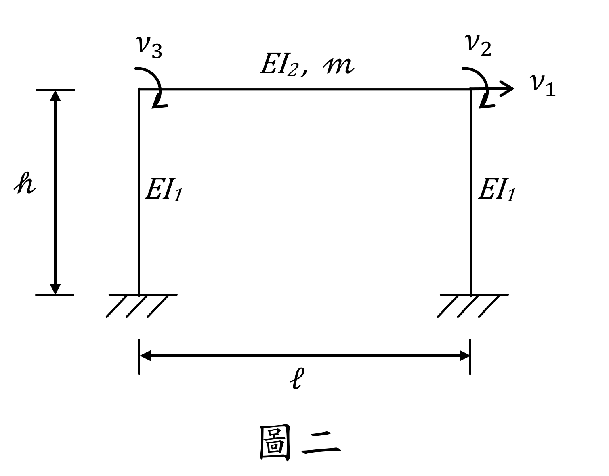

# SD-2017-2 題目正本

> 本檔只記錄考卷上寫了什麼、圖上畫了什麼，不含任何解法。解析見同資料夾 `SD-2017-2.md`。
> 判讀清單經使用者確認前，狀態為「待確認」；確認後本檔原則上不再修改（改動須回考卷原圖並記 log）。

| 項目 | 內容 |
|---|---|
| 考卷 | `raw/exams/SD-2017_結構動力分析與耐震設計.pdf`，第 1 頁（正面），第二題 |
| 考年 | 2017（民國106年）專技高考結構工程技師「結構動力分析與耐震設計」 |
| 配分 | 25 分 |
| 附圖 | `SD-2017-2-fig-1.png`（舊擷取，ℓ 尺寸線上有游標）、`SD-2017-2-fig-2.png`（2026-11-16 由考卷 500 dpi 重擷取） |
| 判讀狀態 | **已確認**（2026-11-16，使用者授權依 Claude 建議。原轉錄：2026-11-16；PyMuPDF 110 dpi 整頁＋300–500 dpi 局部放大，PDF 文字層核對原文；判讀於開啟解析前完成） |

## 1. 考卷原文（逐字）

二、三自由度門形結構如圖二，試建立此結構之運動方程式（無阻尼）。（25 分）
（不考慮 $m$ 對 $v_2, v_3$ 自由度之轉動慣量）

## 2. 考卷給的公式、附表與參數

- 考卷沒有給參考公式。
- 給定（圖上）：柱 $EI_1$（兩柱）、柱高 $h$；梁 $EI_2$、$m$、跨度 $\ell$；自由度 $v_1$、$v_2$、$v_3$。
- 考卷沒有給：$m$ 是梁總質量或單位長度質量（圖上只寫「$EI_2,\ m$」）；柱的質量；軸向變形的處理（題文只說三自由度）；數值。
- 卷首注意事項：㈠可以使用電子計算器。㈡不必抄題，作答時請將試題題號及答案依照順序寫在試卷上，於本試題上作答者，不予計分。㈢本科目除專門名詞或數理公式外，應使用本國文字作答。考試時間：2 小時。

## 3. 附圖

*證據圖 SD-2017-2-fig-2.png（500 dpi 重擷取；舊圖 SD-2017-2-fig-1.png 內容相同，ℓ 尺寸線上有手形游標）*

圖面文字照錄：v3、v2、v1、EI2, m、EI1、EI1、h、ℓ、圖二

## 4. 判讀清單

| # | 項目 | 判讀 | 圖上／題文依據 | 把握 |
|---|---|---|---|---|
| 1 | $m$ 的意義 | 梁的總質量（集中於梁層，只有 $v_1$ 方向有慣性）。**定案（使用者授權依建議）**：採總質量 $m$；若讀成單位長度質量，答案中 $m$ 換成 $m\ell$，質量矩陣形式不變 | 圖上「EI2, m」只寫在梁上；題文「不考慮 $m$ 對 $v_2,v_3$ 之轉動慣量」把 $m$ 當成一個質量 | 不確定（影響答案係數，已依建議定案） |
| 2 | $v_2$、$v_3$ 正向 | 兩者皆**順時針**為正（$v_2$ 右節點、$v_3$ 左節點） | 500 dpi：兩弧自節點左上起，經右側往下，箭頭在左下指向左 | 確定 |
| 3 | $v_1$ | 梁層水平側移，向右為正 | 右上節點水平箭頭 | 確定 |
| 4 | 柱 | 兩柱 $EI_1$、高 $h$，柱底固定 | 圖上 EI1 兩處、h 尺寸線端點對齊柱底與梁線、柱底斜線 | 確定 |
| 5 | 梁 | $EI_2$、跨度 $\ell$（柱中心線到柱中心線），兩端與柱剛接 | ℓ 尺寸線兩端延伸線對齊兩柱線；節點未畫鉸圈 | 確定 |
| 6 | 自由度數 | 只有 $v_1,v_2,v_3$ 三個（隱含忽略構件軸向變形，兩節點側移相同） | 題文「三自由度」 | 確定（解讀） |
| 7 | 阻尼、外力 | 無阻尼；未給外力，所求為自由振動運動方程式 | 題文「（無阻尼）」；圖上無載重 | 確定 |
| 8 | 轉動慣量 | $m$ 對 $v_2$、$v_3$ 無轉動慣量（質量矩陣對應旋轉的項為零） | 題文括號 | 確定 |
| 9 | 考卷沒有給 | 柱質量、數值、$m$ 是總量或單位長度 | — | 確定 |

---
*轉錄：2026-11-16（SD-U1-2 題目正本推廣・組 U1-2-G3）*
*確認：2026-11-16 使用者授權依 Claude 建議確認（SD-U1-2 組 U1-2-G3，關卡一）*
