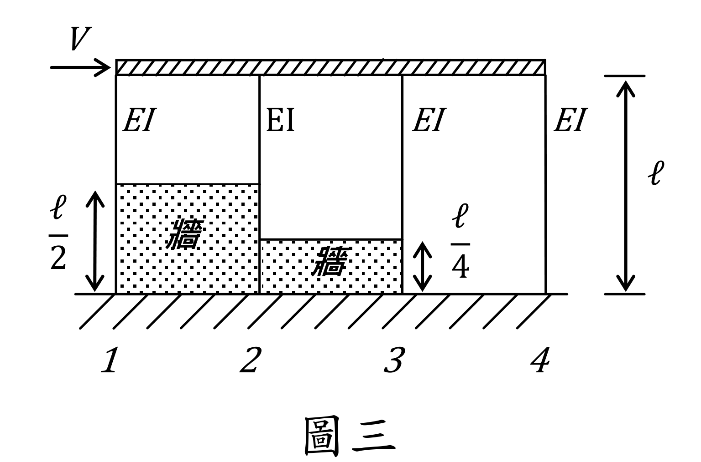

# SD-2017-3 題目正本

> 本檔只記錄考卷上寫了什麼、圖上畫了什麼，不含任何解法。解析見同資料夾 `SD-2017-3.md`。
> 判讀清單經使用者確認前，狀態為「待確認」；確認後本檔原則上不再修改（改動須回考卷原圖並記 log）。

| 項目 | 內容 |
|---|---|
| 考卷 | `raw/exams/SD-2017_結構動力分析與耐震設計.pdf`，第 1 頁（正面），第三題（頁面下方） |
| 考年 | 2017（民國106年）專技高考結構工程技師「結構動力分析與耐震設計」 |
| 配分 | 25 分 |
| 附圖 | `SD-2017-3-fig-1.png`（舊擷取，柱編號 3 下方有游標）、`SD-2017-3-fig-2.png`（2026-11-16 由考卷 500 dpi 重擷取） |
| 判讀狀態 | **已確認**（2026-11-16，使用者授權依 Claude 建議。原轉錄：2026-11-16 轉錄；PyMuPDF 110 dpi 整頁＋500 dpi 局部放大，PDF 文字層與向量座標核對；盲讀於開啟解析前完成） |

## 1. 考卷原文（逐字）

三、結構如圖三，令牆及梁為剛性（Rigid），試求編號 1、2、3、4 柱子所受的剪力。（25 分）

## 2. 考卷給的公式、附表與參數

- 考卷沒有給參考公式。
- 給定（圖上）：四根柱，皆標 $EI$；柱高（地面至剛性梁底）$\ell$；1–2 跨間有高 $\ell/2$ 的牆，2–3 跨間有高 $\ell/4$ 的牆，3–4 跨間無牆；頂部剛性梁受水平力 $V$ 向右。
- 考卷沒有給：柱距、牆厚、$E$、$I$ 數值；柱底支承形式只能由地面斜線判讀。
- 卷首注意事項：㈠可以使用電子計算器。㈡不必抄題，作答時請將試題題號及答案依照順序寫在試卷上，於本試題上作答者，不予計分。㈢本科目除專門名詞或數理公式外，應使用本國文字作答。考試時間：2 小時。

## 3. 附圖

*證據圖 SD-2017-3-fig-2.png（500 dpi 重擷取；舊圖 SD-2017-3-fig-1.png 內容相同，柱編號 3 下方有游標）*

圖面文字照錄：V、EI、EI、EI、EI、ℓ/2、牆、牆、ℓ/4、ℓ、1、2、3、4、圖三

## 4. 判讀清單

| # | 項目 | 判讀 | 圖上／題文依據 | 把握 |
|---|---|---|---|---|
| 1 | 柱 2 的有效（可變形）長度 | 柱 2 左側牆高 $\ell/2$、右側牆高 $\ell/4$，兩牆皆與柱 2 相接；剛性牆把柱束制到較高牆頂 → 柱 2 可變形段為上方 $\ell/2$ | 500 dpi：$\ell/2$ 牆右緣與 $\ell/4$ 牆左緣都在柱 2 線上（x≈568 px） | 確定（解讀） |
| 2 | 各柱可變形段長度 | 柱 1：$\ell/2$（牆頂至梁底）；柱 2：$\ell/2$；柱 3：$3\ell/4$；柱 4：$\ell$ | 500 dpi 像素：梁底 y=165、地面 645（480 px＝$\ell$）；牆頂 405（240 px＝$\ell/2$）、525（120 px＝$\ell/4$） | 確定（解讀） |
| 3 | 柱端條件 | 柱頂與剛性梁剛接、可變形段下端在剛性牆頂（或地面固定）視為固定 → 兩端固定、只平移 | 題文「牆及梁為剛性」；柱底斜線地面 | 確定（解讀） |
| 4 | 牆是否承受 $V$ | 牆不到梁底、與梁不接觸，只束制柱；$V$ 全部由四根柱的上段承受 | 圖上牆頂與梁之間留空 | 確定（解讀） |
| 5 | 柱斷面 | 四柱 $EI$ 相同（第 2 柱標「EI」字體為正體，視為同一記號） | 圖面文字 | 確定（解讀） |
| 6 | 柱高 $\ell$ | 自地面量至剛性梁底面 | 500 dpi：尺寸線上端對齊梁下緣 | 確定 |
| 7 | 側力 | $V$ 水平向右，作用於梁高度 | 圖上箭頭 | 確定 |
| 8 | 所求 | 柱 1、2、3、4 各自的剪力（以 $V$ 表示） | 題文 | 確定 |
| 9 | 考卷沒有給 | 柱距、軸向變形、牆厚 | 題文 | 確定 |

---
*轉錄：2026-11-16（SD-U3-1 題目正本推廣・組 U3-1-G1）*
*確認：2026-11-16 使用者授權依 Claude 建議確認（SD-U3-1 題目正本推廣・組 U3-1-G1，關卡一）*
