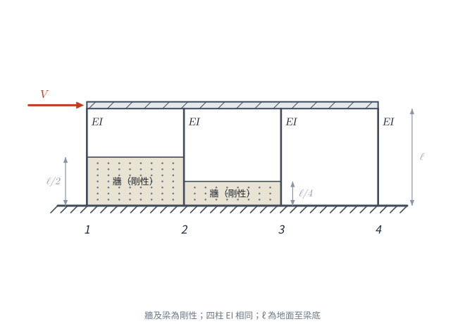
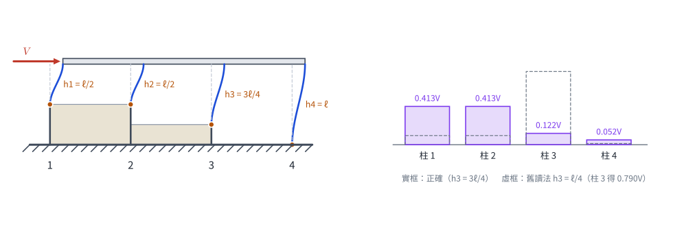

# 考題編號：SD-2017-3

**主分類：** `SD-U3-1` 結構耐震設計（含RC結構與鋼結構）
**副分類：** （無）
**分析方法：** 概念題（含計算）
**標籤：** `剛性梁` `剛性牆` `短柱效應` `有效柱高` `剛度分配` `水平剪力` `固定固定柱` `側移剛度`

---

## 1. 題目（考卷原文見題目正本）

> 考卷原文、公式／附表、附圖與判讀清單（已確認）見 [`SD-2017-3-problem.md`](SD-2017-3-problem.md)。本節只列解題時最容易讀錯的地方與本解使用的記號；題意以題目正本為準。


*重繪自考卷附圖，依題目正本判讀清單；本圖攔下的判讀錯誤：柱 3 旁的牆高 ℓ/4，柱 3 可變形段是 3ℓ/4（本庫舊解讀成 ℓ/4）；柱 2 兩側牆取較高的 ℓ/2。*

### 常見誤讀

| 項目 | 正確判讀 | 常見誤讀 |
|------|---------|---------|
| 柱 3 可變形長度 | **$3\ell/4$**：柱 3 左側牆高 $\ell/4$，牆頂以上至梁底 $3\ell/4$（判讀 #2） | $\ell/4$（2026-11-16 前本庫舊解的讀法，把牆高當柱淨高，得 $V_3=64/81\,V$） |
| 柱 2 可變形長度 | $\ell/2$：兩側牆分別高 $\ell/2$、$\ell/4$，取較高者束制（判讀 #1） | $3\ell/4$ |
| 柱 1、柱 4 | $\ell/2$、$\ell$（判讀 #2） | — |
| 柱端條件 | 兩端固定、只平移（剛性梁＋剛性牆／地面）（判讀 #3） | 柱頂鉸接 |

**本解記號：** $h_i$ 為第 $i$ 柱可變形段長度；$k_i=12EI/h_i^3$；$V_i$ 為柱剪力。

---

## 2. 考題核心精神與出題者意圖 (Core Concepts & Examiner's Intent)

### 核心觀念
- **短柱效應（Short Column Effect）：** 剛性牆把柱的可變形段縮短，柱側移勁度隨高度三次方放大（$k \propto 1/h^3$），因此吸走較大比例的側向剪力
- **剛度分配法：** 剛性頂梁使各柱頂有相同側移 $\Delta$，各柱剪力按側移勁度比例分配
- **兩端固定柱側移勁度：** $k = 12EI/h^3$
- **可變形段要量到哪裡：** 尺寸 $\ell/2$、$\ell/4$ 標的是**牆高**；柱的可變形段是牆頂到梁底，即 $\ell-$牆高；同一根柱兩側牆高不同時，由較高的牆束制

### 出題者意圖
1. 測驗考生能否從圖上正確讀出各柱可變形段（柱 1、2 為 $\ell/2$，柱 3 為 $3\ell/4$，柱 4 為 $\ell$）
2. 測驗剛度分配法的應用（剛性梁前提下）
3. 隱含考點：被矮牆夾住的柱（本題柱 1、2）變成短柱，吸收大部分剪力，地震時易剪力脆性破壞

---

## 3. 解題戰略地圖與陷阱分析 (Strategic Roadmap & Trap Analysis)

### 步驟作戰計畫
```
Step 1: 判斷各柱可變形段長度（牆頂至梁底；兩側牆取較高者）
Step 2: 計算各柱側移勁度 k_i = 12EI/h_i³
Step 3: 計算總勁度 K = Σk_i
Step 4: 各柱剪力 V_i = (k_i/K)×V
Step 5: 驗算 ΣV_i = V
```

### 關鍵陷阱

| # | 陷阱 | 錯誤做法 | 正確做法 |
|---|------|---------|---------|
| 1 | 把牆高當成柱可變形段 | 柱 3 旁牆高 $\ell/4$，就取 $h_3=\ell/4$ | $h_3=\ell-\ell/4=3\ell/4$；同理柱 1 為 $\ell-\ell/2=\ell/2$ |
| 2 | 柱 2 兩側牆高不同 | 取較矮的 $\ell/4$ 牆，$h_2=3\ell/4$ | 剛性牆把柱束制到較高的牆頂，$h_2=\ell/2$ |
| 3 | 忽略短柱效應 | 用全高 $\ell$ 計算所有柱的勁度 | 依圖三判斷各柱可變形段（$\ell/2$、$\ell/2$、$3\ell/4$、$\ell$） |
| 4 | 邊界條件錯誤 | 用固定端–自由端公式 $k=3EI/h^3$ | 剛性頂梁 → 柱頂不轉動，用 $k=12EI/h^3$ |
| 5 | 忘記三次方 | $k_1=12EI/(\ell/2)=24EI/\ell$ | $k_1=12EI/(\ell/2)^3=96EI/\ell^3$ |

---

## 3.5 變數層次分析 (Variable Hierarchy Analysis)

> 複習提示：第一次解題後，在每個卡住的知識點旁標記 `⚠`；第二次複習時只看有 `⚠` 的項目。

### 最終目標
`求各柱剪力 V₁、V₂、V₃、V₄（以 V 表示）`

### 本題關鍵公式（依計算順序）

> $\boxed{\cdot}$ = 由前步驟推導出的中間變數

$$\text{Step 1: 各柱側移勁度（兩端固定）}$$

$$k_i = \frac{12EI}{h_i^3}$$

$$\text{Step 2: 各柱具體勁度}$$

$$k_1 = k_2 = \frac{12EI}{(\ell/2)^3} = \frac{96EI}{\ell^3}, \quad k_3 = \frac{12EI}{(3\ell/4)^3} = \frac{256EI}{9\ell^3}, \quad k_4 = \frac{12EI}{\ell^3}$$

$$\text{Step 3: 總勁度}$$

$$K = k_1+k_2+k_3+k_4 = \frac{EI}{\ell^3}\left(96+96+\frac{256}{9}+12\right) = \frac{2092\,EI}{9\,\ell^3}$$

$$\text{Step 4: 各柱剪力（勁度分配）}$$

$$V_i = \frac{\boxed{k_i}}{\boxed{K}}\cdot V$$

### L1：題目直接給定

| 符號 | 數值 | 說明 |
|------|------|------|
| $V$ | 已知 | 水平施力 |
| $EI$ | 已知（4 柱相同） | 各柱抗彎勁度 |
| 牆高 | 1–2 間 $\ell/2$；2–3 間 $\ell/4$；3–4 間無牆 | 圖三尺寸（題目正本判讀 #2） |
| $\ell$ | 已知 | 地面至梁底 |

### L2：需知識點推導

**Step 1：各柱可變形段與側移勁度**

| 符號 | 公式/來源 | 卡關? |
|------|----------|:-----:|
| $h_1$ | $\ell-\ell/2=\ell/2$（左側牆高 $\ell/2$） | |
| $h_2$ | $\ell/2$（兩側牆高 $\ell/2$、$\ell/4$，取較高者） | |
| $h_3$ | $\ell-\ell/4=3\ell/4$（左側牆高 $\ell/4$） | |
| $h_4$ | $\ell$（無牆） | |
| $k_1=k_2$ | $12EI/(\ell/2)^3 = 96EI/\ell^3$ | |
| $k_3$ | $12EI/(3\ell/4)^3 = 12\times\frac{64}{27}\,EI/\ell^3 = 28.44EI/\ell^3$ | |
| $k_4$ | $12EI/\ell^3$ | |

**Step 2：勁度分配**

| 符號 | 公式/來源 | 卡關? |
|------|----------|:-----:|
| $K_{total}$ | $\sum k_i = 2092EI/(9\ell^3) = 232.44EI/\ell^3$ | |
| $V_i$ | $(k_i/K_{total})\times V$；勁度比 $1/h^3$ ＝ $8:8:\frac{64}{27}:1$ ＝ $216:216:64:27$ | |

### L3：深層知識（不懂就卡住）

| 知識點 | 說明 | 卡關? |
|--------|------|:-----:|
| 兩端固定柱側移勁度公式 | $k=12EI/h^3$（固定固定）vs. $k=3EI/h^3$（固定自由）；差 4 倍 | |
| 高度三次方的放大效應 | $h$ 減半 → $k$ 增加 $2^3=8$ 倍；$h$ 為 $3/4$ → $k$ 增加 $(4/3)^3=2.37$ 倍 | |
| 剛性牆的束制 | 牆頂以下柱不能變形；柱兩側牆高不同時，較高的牆決定可變形段 | |
| 剛性梁的意義 | 各柱頂有相同水平位移 $\Delta$，故剪力可按勁度比例分配 | |
| 短柱效應的耐震意義 | 短柱吸收過大剪力，地震時易脆性破壞（剪力破壞先於撓曲破壞） | |

---

## 4. 步驟化詳細計算過程 (Step-by-Step Detailed Calculation)

### Step 1：確認各柱可變形段長度

依圖三（題目正本判讀 #1、#2）：

| 柱號 | 可變形段 $h_i$ | 說明 |
|------|-------------|------|
| 柱 1 | $\ell/2$ | 右側牆高 $\ell/2$，牆頂至梁底 $\ell-\ell/2=\ell/2$ |
| 柱 2 | $\ell/2$ | 左側牆高 $\ell/2$、右側牆高 $\ell/4$，由較高的牆束制，$\ell/2$ |
| 柱 3 | $3\ell/4$ | 左側牆高 $\ell/4$、右側無牆，$\ell-\ell/4=3\ell/4$ |
| 柱 4 | $\ell$ | 無牆，全高 |

**邊界條件：**
- 剛性頂梁 → 柱頂不轉動
- 剛性牆頂或基礎 → 可變形段下端不轉動、不位移
- **各柱可變形段均為兩端固定（fixed-fixed）**

### Step 2：計算各柱側移勁度

$$k = \frac{12EI}{h^3}$$

$$k_1 = k_2 = \frac{12EI}{(\ell/2)^3} = \frac{96EI}{\ell^3}$$

$$k_3 = \frac{12EI}{(3\ell/4)^3} = \frac{12\times 64\,EI}{27\,\ell^3} = \frac{256EI}{9\ell^3} \approx \frac{28.44EI}{\ell^3}$$

$$k_4 = \frac{12EI}{\ell^3}$$

**策略註解：** 柱 1、2 只有 $\ell/2$ 可變形，勁度是柱 4 的 8 倍；柱 3 為 $3\ell/4$，勁度是柱 4 的 2.37 倍。剪力主要由柱 1、2 承擔。

### Step 3：計算總勁度

$$K_{total} = \frac{EI}{\ell^3}\left(96 + 96 + 28.44 + 12\right) = \frac{2092}{9}\cdot\frac{EI}{\ell^3} \approx \frac{232.44\,EI}{\ell^3}$$

### Step 4：剪力分配

$$V_i = \frac{k_i}{K_{total}}\cdot V$$

以 $1/h^3$ 比例（$\ell^3$ 為單位）：$8 : 8 : \frac{64}{27} : 1$，乘以 27 得 $216 : 216 : 64 : 27$，總和 523。

**柱 1、柱 2：**
$$V_1 = V_2 = \frac{216}{523}\,V \approx 0.413\,V$$

**柱 3：**
$$V_3 = \frac{64}{523}\,V \approx 0.122\,V$$

**柱 4：**
$$V_4 = \frac{27}{523}\,V \approx 0.052\,V$$

### Step 5：驗算

$$V_1 + V_2 + V_3 + V_4 = \frac{216+216+64+27}{523}\,V = V \quad \checkmark$$

### 最終答案

$$\boxed{V_1 = V_2 = \frac{216}{523}V \approx 0.413V, \quad V_3 = \frac{64}{523}V \approx 0.122V, \quad V_4 = \frac{27}{523}V \approx 0.052V}$$


*圖 3　各柱可變形段（牆頂至梁底）與剪力分配（數值由 V_i ∝ 1/h_i³ 算出）。本圖攔下的錯誤：把牆高 ℓ/4 當成柱 3 的淨高——柱 3 實為 3ℓ/4，短柱是被 ℓ/2 牆夾住的柱 1、2。*

---

## 5. 關鍵爭議點與進階探討 (Critical Issues & Advanced Discussion)

### 5.1 短柱效應的耐震危害

本題柱 1、2 被 $\ell/2$ 高的牆夾住，兩柱合計承受 $432/523 \approx 83\%$ 的剪力；柱 4（無牆）僅 $5.2\%$。柱 3 旁的牆只有 $\ell/4$，可變形段 $3\ell/4$，只分到 $12.2\%$。

這正是「**短柱效應**」造成耐震危害的根源：
- 剛性牆（如磚牆）若僅填充部分高度，會造成相鄰柱的可變形段大幅縮短
- 短柱因承受過大剪力，在地震時容易發生**剪力脆性破壞**（而非延性撓曲破壞）
- 此為台灣地震後常見的典型破壞模式

**讀圖提醒（本庫舊解錯誤）：** 2026-11-16 前的舊解把柱 3 的可變形段讀成 $\ell/4$（把牆高當柱淨高），得 $V_1=V_2=8/81\,V$、$V_3=64/81\,V$、$V_4=1/81\,V$，柱 3 剪力被高估約 6.5 倍、柱 1、2 被低估約 4 倍，結論（短柱是柱 3）也相反。

### 5.2 邊界條件的影響

若柱頂可轉動（例如頂梁並非剛性、改用固定–自由的 $k=3EI/h^3$），各柱勁度仍與 $1/h^3$ 成正比，比值 $216:216:64:27$ 不變，剪力分配結果不變。
但本題題目明確指出梁為剛性，故使用 $12EI/h^3$（固定–固定）。

### 5.3 實務建議：避免短柱設計

填充牆與柱若未隔開，設計時應考慮牆造成的短柱效應（柱剪力增大），並加強柱的圍束箍筋，以防止地震中發生脆性剪力破壞；具體條文依現行建築物耐震設計規範與混凝土結構設計規範（條文待核）。

*修正日期：2026-11-16（§1 改為指向題目正本，重繪附圖 figs/SD-2017-3-fig-1-problem.svg）*
*修正日期：2026-11-16（勘誤：柱 3 可變形段由 ℓ/4 改為 3ℓ/4（舊解把牆高當柱淨高），各柱剪力由 8/81、8/81、64/81、1/81 V 改為 216/523、216/523、64/523、27/523 V；§2–§5 全部改寫；標頭主分類改為 SD-U3-1、無副分類（同索引）；驗證：scripts/fixes/2026-11-16_verify_SD-2017-3.py 分數精確重算＋勁度法凝縮交叉驗算，MISMATCHES: 0）*
*修正日期：2026-11-16（非勘誤）圖解補繪：figs/SD-2017-3-fig-3-shear.svg（可變形段＋剪力分配，§4）*
