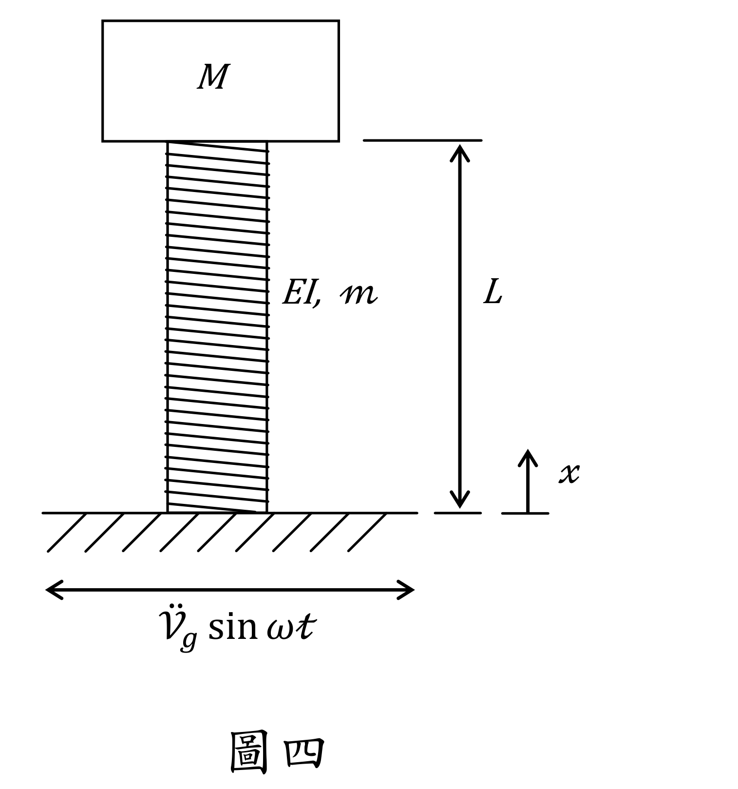

# SD-2017-4 題目正本

> 本檔只記錄考卷上寫了什麼、圖上畫了什麼，不含任何解法。解析見同資料夾 `SD-2017-4.md`。
> 判讀清單經使用者確認前，狀態為「待確認」；確認後本檔原則上不再修改（改動須回考卷原圖並記 log）。

| 項目 | 內容 |
|---|---|
| 考卷 | `raw/exams/SD-2017_結構動力分析與耐震設計.pdf`，第 2 頁（背面），第四題 |
| 考年 | 2017（民國106年）專技高考結構工程技師「結構動力分析與耐震設計」 |
| 配分 | 25 分（㈠20 分、㈡5 分） |
| 附圖 | `SD-2017-4-fig-1.png`（2026-11-16 由考卷 500 dpi 擷取；此前題目資料夾沒有證據圖，解析 §1 引用的檔名不存在） |
| 判讀狀態 | **已確認**（2026-11-16，使用者授權依 Claude 建議。原轉錄：2026-11-16；PyMuPDF 110 dpi 整頁＋300–500 dpi 局部放大，PDF 文字層核對原文；判讀於開啟解析前完成） |

## 1. 考卷原文（逐字）

四、橋柱結構承受水平地震如圖四，令橋柱振動之振態（Modal shape）$\phi(x)=\dfrac{x^2}{L^2}$，試求：

㈠此振態對應之頻率（Frequency）$\overline{\omega}$ 為何？（20 分）

㈡若此頻率 $\overline{\omega}$ 與地動之頻率 $\omega$ 相同時，會有什麼現象？（5 分）

## 2. 考卷給的公式、附表與參數

- 考卷給的式子：振態 $\phi(x)=x^2/L^2$（題文）；地動 $\ddot{V}_g\sin\omega t$（圖上，水平雙向箭頭）。
- 給定（圖上）：柱 $EI$、$m$，柱高 $L$，頂部質量塊 $M$，座標 $x$ 由柱底向上。
- 考卷沒有給：$M$ 的轉動慣量或尺寸；阻尼；數值；$m$ 的單位（未寫明單位長度質量）。
- 卷首注意事項：同第 1 頁（㈠可以使用電子計算器；㈡不必抄題…；㈢本科目除專門名詞或數理公式外，應使用本國文字作答）。

## 3. 附圖

*證據圖 SD-2017-4-fig-1.png（500 dpi 擷取，含圖名「圖四」）*

圖面文字照錄：M、EI, m、L、x、V̈g sin ωt、圖四

## 4. 判讀清單

| # | 項目 | 判讀 | 圖上／題文依據 | 把握 |
|---|---|---|---|---|
| 1 | $M$ 的轉動慣量 | 不計（$M$ 視為柱頂 $x=L$ 的集中質量，只有水平平移慣性）。**定案（使用者授權依建議）**：主解不計轉動慣量 | 考卷未給 $M$ 的尺寸或轉動慣量；質量塊畫在柱頂 | 不確定（解讀，已依建議定案） |
| 2 | $m$ 的意義 | 柱的單位長度質量（均勻分布） | 「EI, m」標在柱身旁，與頂部集中質量 $M$ 分開標示 | 確定（解讀） |
| 3 | 柱高 $L$ | 由地面（柱底）量到質量塊底面（柱頂） | 500 dpi：L 尺寸線上端延伸線與質量塊底邊同高，下端與地面線同高 | 確定 |
| 4 | 座標 $x$ | 由柱底（$x=0$）向上；$\phi(0)=0$、$\phi(L)=1$ | 圖上 x 箭頭起點在地面、向上 | 確定 |
| 5 | 柱底 | 固定 | 地面斜線，柱直接埋入地面 | 確定（解讀） |
| 6 | 地動 | 水平向地表加速度 $\ddot{V}_g\sin\omega t$，$\ddot V_g$ 為振幅、$\omega$ 為地動頻率 | 圖上雙向水平箭頭與標註；題文「地動之頻率 $\omega$」 | 確定 |
| 7 | 所求 | ㈠以給定振態求頻率 $\overline\omega$；㈡ $\overline\omega=\omega$ 時的現象（文字說明） | 題文 | 確定 |
| 8 | 考卷沒有給 | 阻尼、數值、$M$ 的轉動慣量、$\overline\omega$ 單位（rad/s 或 Hz） | — | 確定 |

---
*轉錄：2026-11-16（SD-U1-2 題目正本推廣・組 U1-2-G3）*
*確認：2026-11-16 使用者授權依 Claude 建議確認（SD-U1-2 組 U1-2-G3，關卡一）*
