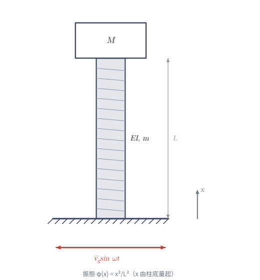
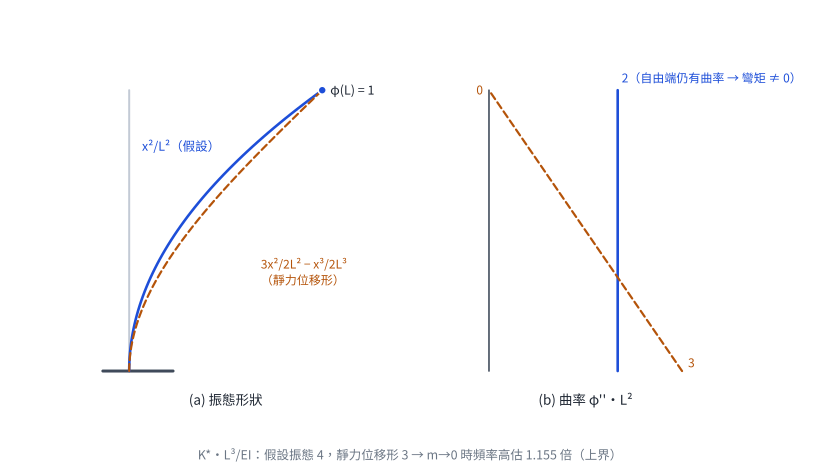

# 考題編號：SD-2017-4

**主分類：** `SD-U1-2` 運動方程式推導
**副分類：** `SD-U1-3` 單自由度、多自由度系統之動態分析及應用
**分析方法：** 概念題（含計算）
**標籤：** `連續體` `懸臂橋柱` `Rayleigh法` `Rayleigh商` `上界定理` `廣義質量` `廣義勁度` `自然頻率` `共振` `分布質量` `集中質量`

---

## 1. 題目（考卷原文見題目正本）

> 考卷原文、公式／附表、附圖與判讀清單（已確認）見 [`SD-2017-4-problem.md`](SD-2017-4-problem.md)。本節只列解題時最容易讀錯的地方與本解使用的記號；題意以題目正本為準。


*重繪自考卷附圖，依題目正本判讀清單；本圖攔下的判讀錯誤：L 量到柱頂（質量塊底面）而非質量塊中心；x 由柱底向上。*

### 常見誤讀

| 項目 | 正確判讀 | 常見誤讀 |
|------|---------|---------|
| 柱頂質量 $M$ | 位於 $x=L$ 的集中質量，只計水平平移慣性（判讀 #1，定案不計轉動慣量） | 加入 $M$ 的轉動慣量；把 $M$ 放在質量塊形心高度 |
| 柱質量 $m$ | 柱的單位長度質量，均勻分布（判讀 #2） | 當柱總質量 |
| 柱高 $L$ | 地面到柱頂（質量塊底面）（判讀 #3） | — |
| 座標 $x$ | 由柱底向上，$\phi(0)=0$、$\phi(L)=1$（判讀 #4） | 由柱頂向下量 |
| 頻率符號 | $\overline{\omega}$ 為結構（假設振態）頻率，$\omega$ 為地動頻率（判讀 #6、#7） | 兩者混用 |

**本解記號：** $\phi(x)=x^2/L^2$；$\overline{\omega}$ 為依假設振態求得的頻率（rad/s）；$\ddot v_g\sin\omega t$ 為地表加速度（考卷圖上寫作大寫 $\ddot V_g$）。

---

## 2. 考題核心精神與出題者意圖 (Core Concepts & Examiner's Intent)

### 核心觀念
- **Rayleigh 法（Rayleigh's Method）：** 利用能量守恆（最大應變能 = 最大動能），對**假設振態**求出對應頻率的**上界估計**
- **廣義座標系統：** 連續體（分布質量 $m$）的動能積分 + 集中質量 $M$ 的動能
- **上界定理（Upper Bound）：** Rayleigh 商計算出的 $\bar{\omega}$ 永遠 ≥ 真實基本頻率 $\omega_1$

### 出題者意圖
1. 測驗考生能否對連續體（分布質量 + 集中端部質量）應用 Rayleigh 法
2. 測驗對 Rayleigh 商分子（廣義勁度）與分母（廣義質量）的積分能力
3. 測驗對「共振條件」的概念理解（第二小題僅 5 分，為概念送分）

---

## 3. 解題戰略地圖與陷阱分析 (Strategic Roadmap & Trap Analysis)

### 步驟作戰計畫
```
Step 1: 對 φ(x) 求二階導數 φ''(x)
Step 2: 計算廣義勁度（Rayleigh商分子）= ∫EI[φ''(x)]²dx
Step 3: 計算廣義質量（Rayleigh商分母）= M[φ(L)]² + ∫m[φ(x)]²dx
Step 4: ω̄² = 廣義勁度 / 廣義質量
Step 5: 回答共振現象
```

### 關鍵陷阱

| # | 陷阱 | 錯誤做法 | 正確做法 |
|---|------|---------|---------|
| 1 | 分母忘記頂端集中質量 $M$ | 只算分布質量積分 | 分母 = $M[\phi(L)]^2 + \int_0^L m[\phi(x)]^2 dx$ |
| 2 | 使用 $\phi'(x)$ 而非 $\phi''(x)$ | 分子積分 $\int EI[\phi']^2 dx$（剪力應變） | 分子應用 $\phi''(x)$（曲率 = 彎矩相關） |
| 3 | 忘記 $\phi(L) = 1$ 代入 $M$ 項 | 漏算 $M \cdot 1^2 = M$ | $\phi(L) = L^2/L^2 = 1$，故 $M$ 項 = $M$ |
| 4 | 積分 $\int x^4 dx$ 算錯 | $\int_0^L x^4/L^4 dx = L/4$（錯）| $\int_0^L x^4/L^4 dx = x^5/(5L^4)\big|_0^L = L/5$ |

---

## 3.5 變數層次分析 (Variable Hierarchy Analysis)

> 複習提示：第一次解題後，在每個卡住的知識點旁標記 `⚠`；第二次複習時只看有 `⚠` 的項目。

### 最終目標
`利用 Rayleigh 法，求振態 φ(x)=x²/L² 對應之頻率 ω̄`

### 本題關鍵公式（依計算順序）

> $\boxed{\cdot}$ = 由前步驟推導出的中間變數

$$\text{Step 1: } \phi(x) = \frac{x^2}{L^2} \Rightarrow \phi'(x) = \frac{2x}{L^2} \Rightarrow \phi''(x) = \frac{2}{L^2}$$

$$\text{Step 2（廣義勁度）: } K^* = \int_0^L EI\,[\phi''(x)]^2\,dx = EI\cdot\frac{4}{L^4}\cdot L = \frac{4EI}{L^3}$$

$$\text{Step 3（廣義質量）: } M^* = M[\phi(L)]^2 + \int_0^L m\left[\phi(x)\right]^2 dx = M + \frac{mL}{5}$$

$$\text{Step 4（Rayleigh 商）: } \bar{\omega}^2 = \frac{\boxed{K^*}}{\boxed{M^*}} = \frac{4EI/L^3}{M + mL/5}$$

$$\text{Step 5（頻率）: } \bar{\omega} = 2\sqrt{\frac{EI}{L^3\!\left(M + \dfrac{mL}{5}\right)}}$$

### L1：題目直接給定

| 符號 | 數值 | 說明 |
|------|------|------|
| $\phi(x)$ | $x^2/L^2$ | 假設振態 |
| $EI$ | 已知 | 均勻柱抗彎勁度 |
| $m$ | 已知 | 柱分布質量（/m） |
| $M$ | 已知 | 頂端集中質量 |
| $L$ | 已知 | 柱高 |

### L2：需知識點推導

**Step 1：振態微分**

| 符號 | 公式/來源 | 卡關? |
|------|----------|:-----:|
| $\phi'(x)$ | $d/dx(x^2/L^2) = 2x/L^2$ | |
| $\phi''(x)$ | $d/dx(2x/L^2) = 2/L^2$（常數！） | |
| $\phi(L)$ | $L^2/L^2 = 1$ | |

**Step 2：廣義勁度（分子）**

| 符號 | 公式/來源 | 卡關? |
|------|----------|:-----:|
| $[\phi''(x)]^2$ | $(2/L^2)^2 = 4/L^4$ | |
| $K^*$ | $\int_0^L EI\cdot(4/L^4)dx = EI\cdot(4/L^4)\cdot L = 4EI/L^3$ | |

**Step 3：廣義質量（分母）**

| 符號 | 公式/來源 | 卡關? |
|------|----------|:-----:|
| $M[\phi(L)]^2$ | $M\cdot 1^2 = M$ | |
| $[\phi(x)]^2$ | $(x^2/L^2)^2 = x^4/L^4$ | |
| $\int_0^L m\cdot x^4/L^4\,dx$ | $m/L^4\cdot[x^5/5]_0^L = m\cdot L/5$ | |
| $M^*$ | $M + mL/5$ | |

**Step 4：Rayleigh 商**

| 符號 | 公式/來源 | 卡關? |
|------|----------|:-----:|
| $\bar{\omega}^2$ | $K^*/M^* = (4EI/L^3)/(M + mL/5)$ | |
| $\bar{\omega}$ | $2\sqrt{EI/[L^3(M+mL/5)]}$ | |

### L3：深層知識（不懂就卡住）

| 知識點 | 說明 | 卡關? |
|--------|------|:-----:|
| Rayleigh 法的能量守恆基礎 | 最大應變能 $U_{max}$ = 最大動能 $T_{max}$，由此得 $\bar{\omega}^2 = U_{max}/(T_{max}/\bar{\omega}^2)$ | |
| 廣義勁度用 $\phi''$ 不用 $\phi'$ | 梁的彎曲應變能 = $\frac{1}{2}\int EI(y'')^2 dx$；用曲率（二階導數），不是斜率（一階導數） | |
| 上界定理（Rayleigh's Theorem） | 任何假設振態所求出的 $\bar{\omega}$ ≥ 真實基本頻率 $\omega_1$；假設振態越接近真實，誤差越小 | |
| 頂端集中質量的廣義質量貢獻 | $M\cdot[\phi(L)]^2$，因頂部質量 $M$ 只在 $x=L$ 一點運動，位移幅值為 $\phi(L)$ | |
| 連續分布質量的廣義質量積分 | $\int_0^L m[\phi(x)]^2 dx$，沿整根柱積分每單位長度的動能貢獻 | |

---

## 4. 步驟化詳細計算過程 (Step-by-Step Detailed Calculation)

### （一）求頻率 $\bar{\omega}$

#### Step 1：對假設振態求導數

$$\phi(x) = \frac{x^2}{L^2}$$

一階導數（斜率）：
$$\phi'(x) = \frac{2x}{L^2}$$

二階導數（曲率）：
$$\phi''(x) = \frac{2}{L^2} \quad \text{（常數，與 } x \text{ 無關）}$$

邊界值驗證：
$$\phi(0) = 0 \quad (\text{柱底無位移，✓}) \quad ; \quad \phi'(0) = 0 \quad (\text{柱底無旋轉，✓})$$

$$\phi(L) = 1 \quad ; \quad \phi'(L) = \frac{2}{L} \quad (\text{頂端可旋轉，✓})$$

**策略註解：** $\phi(x) = x^2/L^2$ 滿足固定端的幾何邊界條件（位移=0、旋轉=0），但**不**滿足自然邊界條件（$\phi''(L)=0$、$\phi'''(L)=0$），故為近似振態，所得 $\bar{\omega}$ 為上界估計。

#### Step 2：計算廣義勁度（Rayleigh 商分子）

廣義勁度來自梁的彎曲應變能：

$$K^* = \int_0^L EI\left[\phi''(x)\right]^2 dx = EI\int_0^L \left(\frac{2}{L^2}\right)^2 dx = EI \cdot \frac{4}{L^4} \cdot \int_0^L dx$$

$$K^* = EI \cdot \frac{4}{L^4} \cdot L = \frac{4EI}{L^3}$$

#### Step 3：計算廣義質量（Rayleigh 商分母）

廣義質量包含兩部分：

**（i）頂端集中質量 $M$ 的貢獻：**
$$M^*_M = M\left[\phi(L)\right]^2 = M \cdot \left(\frac{L^2}{L^2}\right)^2 = M \cdot 1 = M$$

**（ii）柱分布質量 $m$ 的貢獻（沿柱長積分）：**

$$M^*_m = \int_0^L m\left[\phi(x)\right]^2 dx = m\int_0^L \left(\frac{x^2}{L^2}\right)^2 dx = \frac{m}{L^4}\int_0^L x^4\, dx$$

$$= \frac{m}{L^4} \cdot \left[\frac{x^5}{5}\right]_0^L = \frac{m}{L^4} \cdot \frac{L^5}{5} = \frac{mL}{5}$$

**廣義質量總和：**

$$M^* = M + \frac{mL}{5}$$

#### Step 4：應用 Rayleigh 商

$$\bar{\omega}^2 = \frac{K^*}{M^*} = \frac{\dfrac{4EI}{L^3}}{M + \dfrac{mL}{5}} = \frac{4EI}{L^3\!\left(M + \dfrac{mL}{5}\right)}$$

整理（通分消去 1/5）：

$$\bar{\omega}^2 = \frac{20EI}{L^3(5M + mL)}$$

$$\boxed{\bar{\omega} = \sqrt{\frac{20EI}{L^3(5M + mL)}} = 2\sqrt{\frac{EI}{L^3\!\left(M + \dfrac{mL}{5}\right)}}}$$

**策略註解：** 兩種寫法等價，後者清楚展示廣義質量結構（頂端質量 $M$ + 等效分布質量 $mL/5$）。

#### 物理意義驗算

特例一：若 $m \to 0$（無分布質量，僅頂端質量 $M$）：
$$\bar{\omega} = 2\sqrt{\frac{EI}{ML^3}} \quad (\text{對懸臂端質量 SDOF 系統，真實值為 } \sqrt{3EI/ML^3})$$

Rayleigh 法給出 $2\sqrt{EI/ML^3}$，而真實值為 $\sqrt{3EI/ML^3}$。
比值：$2/\sqrt{3} \approx 1.155$，即高估約 15.5%（確為上界 ✓）。

---

### （二）若 $\bar{\omega} = \omega$，會有什麼現象？

當結構自然頻率 $\bar{\omega}$ 等於地動激振頻率 $\omega$ 時，系統進入**共振（Resonance）**狀態。

**無阻尼系統（$\xi = 0$）：**
- 動力放大係數 $D = 1/|1 - r^2|$（其中 $r = \omega/\bar{\omega} = 1$）→ $D \to \infty$
- 振動振幅**隨時間線性增長，無限制地增大**
- 在有限時間後結構必然破壞

**有阻尼系統（$\xi > 0$）：**
- 穩態最大動力放大係數 $D_{max} \approx 1/(2\xi)$（輕阻尼近似）
- 對典型橋梁阻尼比 $\xi = 0.05$，$D_{max} = 10$（振幅放大 10 倍）
- 即使不立即破壞，過大的位移和應力可能導致疲勞破壞或功能喪失

$$\boxed{\text{現象：共振（Resonance）}\;—\;\text{振幅急劇增大，在無阻尼時趨於無限大，對結構造成嚴重危害}}$$

---

## 5. 關鍵爭議點與進階探討 (Critical Issues & Advanced Discussion)

### 5.1 振態 $\phi(x) = x^2/L^2$ 的適切性

此振態為二次拋物線，滿足固定端幾何邊界條件（$\phi(0)=0$，$\phi'(0)=0$），但不滿足懸臂柱自由端的自然邊界條件（$\phi''(L)=0$：自由端無彎矩；$\phi'''(L)=0$：自由端無剪力）。

真實基本振態（$m=0$ 時的靜力位移形）為三次多項式：
$$\phi_{exact}(x) = \frac{3x^2}{2L^2} - \frac{x^3}{2L^3}$$

相比之下，$x^2/L^2$ 缺少端部自由度修正，因此 Rayleigh 法高估了勁度（分子偏大），得出的 $\bar{\omega}$ 偏高（上界特性）。



*圖 2　假設振態與靜力位移形的形狀、曲率比較（靜力位移形的曲率由 §5.1 三次式微分兩次得 $3(1-x/L)/L^2$）。形狀幾乎重合，曲率卻差很多：$x^2/L^2$ 在自由端仍有曲率（彎矩不為零），廣義勁度 $K^*L^3/EI$ 為 4 而非 3，所以 $\bar\omega$ 是上界（$m\to0$ 時高估 $2/\sqrt3\approx1.155$ 倍）。本圖攔下兩種錯：分子誤用 $\phi'$，以及把 $x^2/L^2$ 當成真實振態。*

### 5.2 Rayleigh 法的上界定理

$$\bar{\omega} \geq \omega_1 \quad \text{（Rayleigh's Theorem）}$$

物理意義：假設振態中存在「隱藏的人為約束」（違反真實自然邊界條件），增加了結構的虛擬勁度，使得計算出的頻率偏高。

### 5.3 共振在橋梁耐震的意義

台灣橋梁耐震規範關注「近場地震」（near-fault）的長週期成分：若橋柱自然週期 $T = 2\pi/\bar{\omega}$ 恰好位於設計地震的能量集中頻段，即發生共振，橋柱需求大幅增加。台灣橋梁規範要求計算橋柱自然週期時須考慮土壤–結構互制（SSI），避免地盤卓越週期與橋柱週期接近。

*修正日期：2026-11-16（§1 改為指向題目正本，重繪附圖 figs/SD-2017-4-fig-1-problem.svg）*

*修正日期：2026-11-16（非勘誤）圖解補繪：§5.1 插入 figs/SD-2017-4-fig-2-shape.svg（假設振態與靜力位移形的形狀、曲率比較；腳本 gen_SD-2017-4.py，可重跑）*
