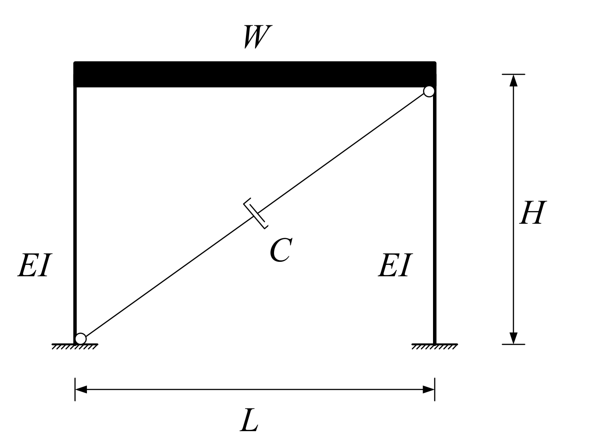

# SD-2018-1 題目正本

> 本檔只記錄考卷上寫了什麼、圖上畫了什麼，不含任何解法。解析見同資料夾 `SD-2018-1.md`。
> 判讀清單經使用者確認前，狀態為「待確認」；確認後本檔原則上不再修改（改動須回考卷原圖並記 log）。

| 項目 | 內容 |
|---|---|
| 考卷 | `raw/exams/SD-2018_結構動力分析與耐震設計.pdf`，第 1 頁（頁次 2－1），第一題 |
| 考年 | 2018（民國107年）專技高考結構工程技師「結構動力分析與耐震設計」 |
| 配分 | 25 分（㈠15 分、㈡10 分） |
| 附圖 | `SD-2018-1-fig-1.png`（舊擷取，圖外左下有手形游標，解析度低）、`SD-2018-1-fig-2.png`（2026-11-16 由考卷 500 dpi 重擷取） |
| 判讀狀態 | **已確認（2026-11-16，使用者授權依 Claude 建議）**（原轉錄：2026-11-16；PyMuPDF 110 dpi 整頁＋450–500 dpi 局部放大，PDF 文字層核對原文、PDF 向量座標核對附圖；盲讀於開啟解析前完成） |

## 1. 考卷原文（逐字）

一、下圖為一單層剪力屋（shear building），已知樓層總重 $W = 70$ kN，樓高 $H = 3$ m，跨距 $L = 6$ m，柱斷面之撓曲剛度 $EI = 5000$ kN-m²。此剪力屋架以對角斜稱方式裝設一線性黏性阻尼器，阻尼係數為 $C$（kN-sec/m）。假設此系統之阻尼完全由阻尼器提供（亦即忽略結構之固有阻尼）。

㈠假設線性黏性阻尼器所提供之系統阻尼比為 5%，試求 $C$ 值。（15 分）

㈡依㈠之假設，若此剪力屋受地震激發，其 5%阻尼比加速度彈性反應譜 $S_a$ 表為

$$S_a=\frac{0.15g}{T}\le 0.3g$$

上式中 $T$ 為結構週期（sec），$g$ = 9.8 m/sec²。試求單層剪力屋相對於地表之最大水平位移與阻尼器之最大出力。（10 分）

（「對角斜稱」照考卷原文，應為「對角斜撐」之誤植。）

## 2. 考卷給的公式、附表與參數

- 給定：$W=70$ kN（樓層總重）、$H=3$ m、$L=6$ m、$EI=5000$ kN·m²（每柱）、阻尼比 5%、$S_a=0.15g/T\le0.3g$、$g=9.8$ m/s²（㈡題文給出）。
- 考卷沒有給參考公式。
- 考卷沒有給：柱的端部條件文字說明（只能看圖）、梁的勁度（題文稱「剪力屋」）、柱軸向變形、阻尼器支撐桿的勁度、阻尼器最大速度的計算方式。
- 卷首注意事項：㈠可以使用電子計算器。㈡不必抄題，作答時請將試題題號及答案依照順序寫在試卷上，於本試題上作答者，不予計分。㈢本科目得以本國文字或英文作答。考試時間：2 小時。

## 3. 附圖

*證據圖 SD-2018-1-fig-2.png（500 dpi 重擷取；舊圖 SD-2018-1-fig-1.png 內容相同，圖外左下有手形游標）*

圖面文字照錄：W、EI、C、EI、H、L

## 4. 判讀清單

| # | 項目 | 判讀 | 圖上／題文依據 | 把握 |
|---|---|---|---|---|
| 1 | 阻尼器最大出力所用的速度 | 考卷沒有指定。**定案**：以反應譜位移換算的擬速度 $\omega_n u_{\max}$ 作為最大相對速度，阻尼器軸向速度＝水平速度 × $\cos\theta$（$\cos\theta=L/\sqrt{L^2+H^2}$），出力＝$C\times$軸向速度。理由：題目只給加速度反應譜，沒有速度譜，擬速度是唯一可由題目資料求得的速度量 | 題文「阻尼器之最大出力」；只給 $S_a$ | 不確定（影響答案；依 Claude 建議定案） |
| 2 | 梁 | 剛性梁（剪力屋，樓版只平移不轉動），柱頂與梁剛接 | 題文「剪力屋（shear building）」；圖上梁塗黑厚板（PDF 黑色填滿矩形 y＝495.96–503.16 pt） | 確定（解讀） |
| 3 | 柱底 | 兩柱底固定 | 兩柱底各有一段水平短線＋斜剖線（PDF 座標 y＝585.42 pt） | 確定 |
| 4 | 柱 | 左右兩柱各為 $EI=5000$ kN·m²，柱高 $H$ | 圖上兩柱各標 EI；題文「柱斷面之撓曲剛度」 | 確定 |
| 5 | 阻尼器位置 | 一支斜撐式阻尼器，由左柱底（鉸，小圓圈）連到右柱頂、梁下緣（鉸，小圓圈），阻尼器符號在斜線中段；兩端鉸接、只傳軸力 | PDF 向量：斜線 (247.5, 583.7)→(358.4, 504.9) pt，兩端白色小圓 | 確定 |
| 6 | 斜撐幾何 | 斜撐水平投影 $L$、垂直投影 $H$（兩端在柱中心線與柱底／柱頂） | 圖上斜線兩端分別在左柱底、右柱頂；尺寸線 L 量兩柱中心線（x＝245.76–360.12 pt），H 由柱底量到梁中心線（y＝585.42–499.56 pt） | 確定（解讀） |
| 7 | $W$ | 樓層總重（力），質量 $m=W/g$ | 題文「樓層總重 W = 70 kN」；$g=9.8$ m/s² | 確定 |
| 8 | 阻尼比 5% | 由阻尼器單獨提供的系統（單自由度、水平側移）阻尼比 $\xi=0.05$；㈡反應譜也是 5% 阻尼比，兩者一致 | 題文 | 確定 |
| 9 | 反應譜 | $S_a=0.15g/T$，上限 $0.3g$（平台段在 $T\le0.5$ s） | 題文式子 | 確定 |
| 10 | 所求 | ㈠ $C$（kN·s/m）；㈡相對地表最大水平位移、阻尼器最大出力 | 題文 | 確定 |
| 11 | 「對角斜稱」 | 照錄考卷原文，意為「對角斜撐」 | 題文 | 確定（解讀） |
| 12 | 考卷沒有給 | 柱軸向變形、斜撐桿彈性、結構固有阻尼（明言忽略）、速度反應譜 | 題文 | 確定 |

---
*轉錄：2026-11-16（SD-U3-2 題目正本推廣・組 U3-2-G4）*
*確認：2026-11-16 使用者授權依 Claude 建議確認（SD-U3-2 組 U3-2-G4，關卡一）*
