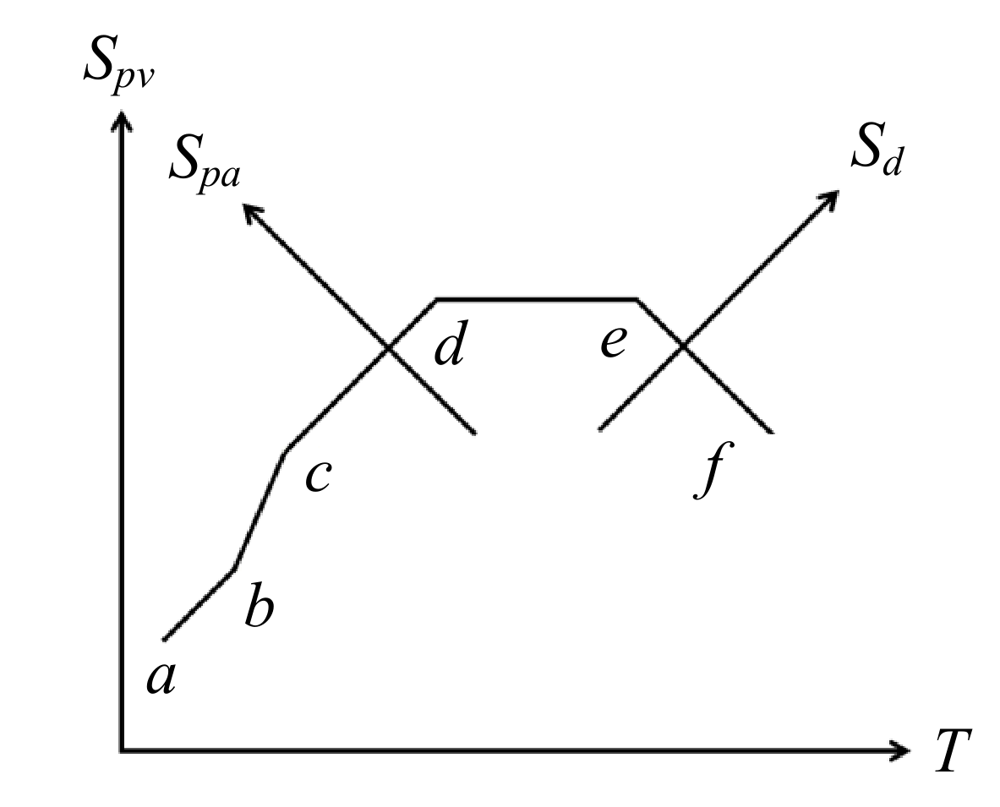
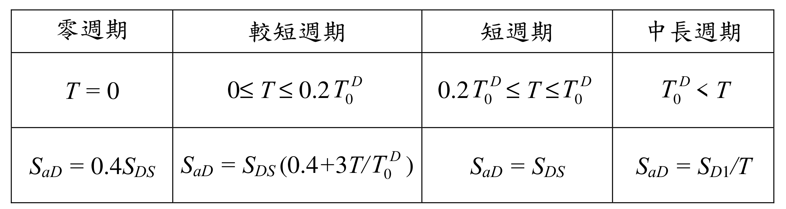

# SD-2018-2 題目正本

> 本檔只記錄考卷上寫了什麼、圖上畫了什麼，不含任何解法。解析見同資料夾 `SD-2018-2.md`。
> 判讀清單經使用者確認前，狀態為「待確認」；確認後本檔原則上不再修改（改動須回考卷原圖並記 log）。

| 項目 | 內容 |
|---|---|
| 考卷 | `raw/exams/SD-2018_結構動力分析與耐震設計.pdf`，第 1 頁下方第二題題文，圖與表在第 2 頁上方 |
| 考年 | 2018（民國107年）專技高考結構工程技師「結構動力分析與耐震設計」 |
| 配分 | 25 分（㈠15、㈡10） |
| 附圖 | `SD-2018-2-fig-1.png`（舊擷取三軸向譜示意圖，左側有游標）、`SD-2018-2-fig-2.png`（舊擷取表，左上角有游標）、`SD-2018-2-fig-3.png`（2026-11-16 由考卷 500 dpi 重擷取示意圖）、`SD-2018-2-fig-4.png`（2026-11-16 由考卷 500 dpi 重擷取表） |
| 判讀狀態 | **已確認**（2026-11-16，使用者授權依 Claude 建議）。原轉錄：2026-11-16；PyMuPDF 110 dpi 整頁＋500 dpi 局部放大，PDF 文字層核對原文；盲讀於開啟解析前完成 |

## 1. 考卷原文（逐字）

二、Newmark $S_{pa}-S_{pv}-S_d-T$ 三軸向地震設計反應譜（Tripartite Spectrum），如圖之 $a-b-c-d-e-f$ 所示；其中 $S_{pa}$、$S_{pv}$、$S_d$ 及 $T$ 均為對數尺度（log scale）。該設計反應譜型式至今仍被世界各國耐震設計規範奉為圭臬。

㈠試由 $S_{pv}=T\cdot S_{pa}/2\pi$ 及 $S_{pv}=2\pi\cdot S_d/T$ 推導及說明 $S_{pa}-S_{pv}-S_d-T$ 三軸座標系統的建置原理。（15 分）

㈡試詳細說明交通部「公路橋梁耐震設計規範」設計地震反應譜（如表）之型式與 Newmark 三軸向地震設計反應譜 $a-b-c-d-e-f$ 的關聯性。（10 分）

## 2. 考卷給的公式、附表與參數

- 考卷給的關係式（題文）：$S_{pv}=T\cdot S_{pa}/2\pi$、$S_{pv}=2\pi\cdot S_d/T$。
- 附表（第 2 頁，照錄）：

| 零週期 | 較短週期 | 短週期 | 中長週期 |
|---|---|---|---|
| $T=0$ | $0\le T\le 0.2T_0^D$ | $0.2T_0^D\le T\le T_0^D$ | $T_0^D<T$ |
| $S_{aD}=0.4S_{DS}$ | $S_{aD}=S_{DS}(0.4+3T/T_0^D)$ | $S_{aD}=S_{DS}$ | $S_{aD}=S_{D1}/T$ |

- 考卷沒有給：任何數值（$S_{DS}$、$S_{D1}$、$T_0^D$、地表加速度、各段放大係數）；示意圖各轉折點的座標；$T_0^D$、$S_{DS}$、$S_{D1}$ 的定義文字。
- 卷首注意事項：㈠可以使用電子計算器。㈡不必抄題，作答時請將試題題號及答案依照順序寫在試卷上，於本試題上作答者，不予計分。㈢本科目得以本國文字或英文作答。考試時間：2 小時。

## 3. 附圖

*證據圖 SD-2018-2-fig-3.png（500 dpi 重擷取；舊圖 SD-2018-2-fig-1.png 內容相同，左側有游標）*

*證據圖 SD-2018-2-fig-4.png（500 dpi 重擷取；舊圖 SD-2018-2-fig-2.png 內容相同，左上角有游標）*

圖面文字照錄：Spv、Spa、Sd、a、b、c、d、e、f、T；表：零週期、較短週期、短週期、中長週期，及 §2 所列式子

## 4. 判讀清單

| # | 項目 | 判讀 | 圖上／題文依據 | 把握 |
|---|---|---|---|---|
| 1 | b→c 段斜率 | 比 a→b、c→d 陡（示意），考卷沒有給斜率或數值 | 500 dpi：b→c 約 70°，a→b、c→d 約 45° | 確定（解讀） |
| 2 | 座標軸 | 縱軸 $S_{pv}$、橫軸 $T$，皆對數尺度；$S_{pa}$ 軸往左上、$S_d$ 軸往右上（兩條斜軸） | 圖上箭頭與標字；題文「均為對數尺度」 | 確定 |
| 3 | 折線形狀 | a→b 45° 上升、b→c 較陡上升、c→d 45° 上升、d→e 水平、e→f 45° 下降 | 500 dpi 目視 | 確定（解讀） |
| 4 | 符號 | $S_{pa}$、$S_{pv}$ 為擬加速度、擬速度（pseudo），$S_d$ 為譜位移 | 下標 pa、pv、d；題文關係式 | 確定（解讀） |
| 5 | 附表 | 交通部公路橋梁耐震設計規範的設計地震反應譜四段式（照錄於 §2） | 第 2 頁表格；題文「如表」 | 確定 |
| 6 | 附表週期分界 | 較短週期上限、短週期下限皆為 $0.2T_0^D$（等號兩段都有）；中長週期為 $T_0^D<T$ | 表格逐字 | 確定 |
| 7 | 所求 | ㈠由兩關係式推導三軸座標系統建置原理；㈡說明表列規範譜與 a–f 各段的關聯；屬推導與論述，無數值計算 | 題文 | 確定 |
| 8 | 考卷沒有給 | 所有數值、轉折點座標、規範版本（年份） | 題文、圖、表 | 確定 |

---
*轉錄：2026-11-16（X-G1 題目正本推廣：SD-U2-3／SD-U1-1）*
*確認：2026-11-16 使用者授權依 Claude 建議確認（X-G1，關卡一）*
