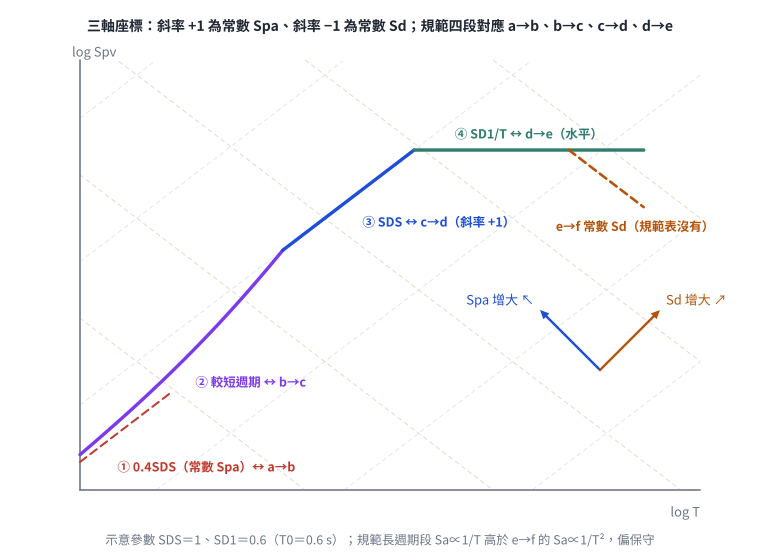

# 考題編號：SD-2018-2

**主分類：** `SD-U2-3` 橋梁耐震設計規範  
**副分類：** `SD-U1-1` 結構動力基本性質及原理  
**分析方法：** 概念題（推導＋規範對照）  
**標籤：** `Newmark三軸反應譜` `Tripartite Spectrum` `偽速度` `偽加速度` `位移反應譜` `對數座標` `加速度控制` `速度控制` `位移控制` `橋梁耐震規範` `設計反應譜` `反應譜形狀`

---

## 1. 題目（考卷原文見題目正本）

> 考卷原文、公式／附表、附圖與判讀清單（已確認）見 [`SD-2018-2-problem.md`](SD-2018-2-problem.md)。本節只列解題時最容易讀錯的地方與本解使用的記號；題意以題目正本為準。

### 常見誤讀

| 項目 | 正確判讀 | 常見誤讀 |
|------|---------|---------|
| 斜軸方向 | $S_{pa}$ 軸往**左上**、$S_d$ 軸往**右上**（箭頭方向為值增大方向；判讀 #2） | 本庫舊解寫「$S_{pa}$ 右上 ↗、$S_d$ 右下 ↘」（2026-11-16 已勘誤） |
| 折線各段 | a→b 45° 上升、b→c 較陡上升、c→d 45° 上升、d→e 水平、e→f 45° 下降（判讀 #1、#3） | 舊解把 b→c 當常數 $S_{pa}$、c→d 當水平、d→e 當常數 $S_d$，整體錯開一段（2026-11-16 已勘誤） |
| 附表 | 公路橋梁耐震設計規範四段式設計譜，照錄於題目正本 §2（判讀 #5、#6） | — |
| 題給關係式 | $S_{pv}=T\cdot S_{pa}/2\pi$、$S_{pv}=2\pi\cdot S_d/T$ | — |

**本解記號：** $S_{pa}$、$S_{pv}$ 擬加速度、擬速度，$S_d$ 譜位移；$T$ 週期；表中 $S_{aD}$、$S_{DS}$、$S_{D1}$、$T_0^D$ 照考卷。

---

## 2. 考題核心精神與出題者意圖 (Core Concepts & Examiner's Intent)

**核心觀念：**
1. 三個反應譜量（$S_{pa}$、$S_{pv}$、$S_d$）之間只差 $\omega=2\pi/T$ 的倍數，在對數座標上變成平移關係，所以可在同一張圖上同時讀三個量。
2. 設計反應譜的折線各段，分別由地表加速度、加速度放大、速度放大、位移放大控制，在三軸圖上各是一條常數線。
3. 規範設計譜可逐段對應到 Newmark 折線；看懂對應，才知道規範哪一段代表哪一種控制，以及規範省略了哪一段。

**出題意圖：**
- 由兩個關係式推導「常數 $S_{pa}$ 線斜率 +1、常數 $S_d$ 線斜率 −1」，並說明斜軸的方向（題目正本判讀 #2：$S_{pa}$ 軸往左上、$S_d$ 軸往右上）。
- 讀懂圖上折線各段的斜率（判讀 #3），對應到規範表的四段。

---

## 3. 解題戰略地圖與陷阱分析 (Strategic Roadmap & Trap Analysis)

**作戰順序：**

子題㈠：
1. 寫出三量的關係（$S_{pv}=\omega S_d$、$S_{pa}=\omega S_{pv}$）
2. 取對數，辨識斜率 ±1 的常數線
3. 說明斜軸方向：$S_{pa}$ 往左上增大、$S_d$ 往右上增大（與考卷圖一致）
4. 說明在圖上如何同時讀三個量

子題㈡：
1. 把規範四段寫成 $S_{pv}$ 對 $T$ 的關係，看各段在對數圖上的斜率
2. 逐段對應 a–b–c–d–e–f
3. 指出規範省略的段（e→f 常數位移段）及其影響

**陷阱清單：**

| # | 陷阱 | 正確做法 |
|---|------|---------|
| ★★★ | 斜軸方向讀反（寫成 $S_{pa}$ 右上、$S_d$ 右下） | 箭頭指向數值增大的方向：$S_{pa}=2\pi S_{pv}/T$ 往左上（$T$ 變小、$S_{pv}$ 變大）增大；$S_d=TS_{pv}/2\pi$ 往右上增大 |
| ★★★ | 折線各段對應錯開一段 | 看斜率：a→b、c→d 為 +1（常數 $S_{pa}$）；b→c 較陡（過渡）；d→e 水平（常數 $S_{pv}$）；e→f 為 −1（常數 $S_d$） |
| ★★ | 混淆偽反應譜與真實反應 | 只有 $S_d$ 是最大相對位移；$S_{pv}$、$S_{pa}$ 是 $\omega S_d$、$\omega^2S_d$ 的「偽」值 |
| ★ | 規範長週期段的保守性說反 | 規範以 $S_{D1}/T$ 延伸（$S_{pv}$ 為常數），比常數位移段（$S_a\propto1/T^2$）大 → 偏保守 |

---

## 3.5 變數層次分析 (Variable Hierarchy Analysis)

### 最終目標
`㈠ 推導三軸座標的建置原理；㈡ 規範設計譜四段與 Newmark 折線 a–f 的對應`

### 本題關鍵公式（依計算順序）

$$\text{Step 1: } S_{pv} = \frac{T}{2\pi} S_{pa} \quad \Rightarrow \quad \log S_{pv} = \log T + \log\frac{S_{pa}}{2\pi}\ \ (\text{常數 }S_{pa}\text{：斜率 }{+1})$$

$$\text{Step 2: } S_{pv} = \frac{2\pi}{T} S_d \quad \Rightarrow \quad \log S_{pv} = -\log T + \log(2\pi S_d)\ \ (\text{常數 }S_d\text{：斜率 }{-1})$$

$$\text{Step 3（軸向）: } \log S_{pa} = \log S_{pv} - \log T + \log2\pi,\quad \log S_d = \log S_{pv} + \log T - \log2\pi$$

$$\text{Step 4（規範段）: } S_{aD}=S_{DS}\Rightarrow S_{pv}\propto T\ (\text{c}\to\text{d});\quad S_{aD}=\frac{S_{D1}}{T}\Rightarrow S_{pv}=\frac{S_{D1}g}{2\pi}\ (\text{d}\to\text{e})$$

### L1：題目直接給定

| 符號 | 意義 |
|------|------|
| $S_{pv} = T S_{pa}/2\pi$ | 偽速度與偽加速度換算 |
| $S_{pv} = 2\pi S_d/T$ | 偽速度與譜位移換算 |
| 規範表 | 零週期、較短週期、短週期、中長週期四段（題目正本 §2） |

### L2：需知識點推導

| 推導步驟 | 說明 | 卡關? |
|---------|------|-------|
| 取 log 得線性關係 | 常數 $S_{pa}$ 線斜率 +1，常數 $S_d$ 線斜率 −1 | |
| 三軸方向 | 縱軸 $S_{pv}$、橫軸 $T$；$S_{pa}$ 軸往左上（垂直於斜率 +1 線族）、$S_d$ 軸往右上（垂直於斜率 −1 線族） | |
| 折線各段 | a→b 常數 $S_{pa}$（=PGA）、b→c 過渡、c→d 常數 $S_{pa}$（加速度放大）、d→e 常數 $S_{pv}$、e→f 常數 $S_d$ | |
| 規範段斜率 | $S_{DS}$ 段斜率 +1、$S_{D1}/T$ 段水平、較短週期段比 +1 陡 | |

### L3：深層知識

| 知識點 | 說明 | 卡關? |
|--------|------|-------|
| 偽速度的物理意義 | $S_{pv}=\omega S_d$，不是真實最大速度；輕阻尼、中週期時接近 | |
| 為何用對數座標 | 週期與反應量跨好幾個數量級，冪律關係在對數圖上變成直線 | |
| 三段放大的物理背景 | 極短週期：結構剛性，跟著地表動，$S_a\to$ PGA；短週期：加速度放大；中週期：速度控制；長週期：位移控制，極長週期 $S_d\to$ PGD | |

---

## 4. 步驟化詳細計算過程 (Step-by-Step Detailed Calculation)

### 子題㈠：$S_{pa}-S_{pv}-S_d-T$ 三軸座標建置原理

#### 4.1 三量的代數關係

阻尼比 $\xi$ 的 SDOF 系統：

$$S_d(T,\xi) = \max|u(t)|,\qquad S_{pv} = \frac{2\pi}{T}S_d = \omega S_d,\qquad S_{pa} = \left(\frac{2\pi}{T}\right)^2S_d = \frac{2\pi}{T}S_{pv}$$

整理即題目兩式：

$$S_{pv} = \frac{T}{2\pi}S_{pa},\qquad S_{pv} = \frac{2\pi}{T}S_d$$

給定 $T$ 與其中一量，另兩量即可求。

#### 4.2 對數座標上的常數線

在 $\log S_{pv}$–$\log T$ 平面：

**（A）常數 $S_{pa}$ 線：** $\log S_{pv} = \log T + \log(S_{pa}/2\pi)$ → 斜率 **+1**（由左下往右上的 45° 線）。

**（B）常數 $S_d$ 線：** $\log S_{pv} = -\log T + \log(2\pi S_d)$ → 斜率 **−1**（由左上往右下的 −45° 線）。

#### 4.3 斜軸的方向與讀值

$$\log S_{pa} = \log S_{pv} - \log T + \log2\pi,\qquad \log S_d = \log S_{pv} + \log T - \log2\pi$$

- $S_{pa}$ 在「$S_{pv}$ 變大、$T$ 變小」時增大 → 沿垂直於 +1 線族的方向**往左上**增大，所以 $S_{pa}$ 軸的箭頭指向左上（與考卷圖一致）。
- $S_d$ 在「$S_{pv}$ 變大、$T$ 變大」時增大 → 沿垂直於 −1 線族的方向**往右上**增大，所以 $S_d$ 軸指向右上。

```
  log Spv
    │  Spa ↖           ↗ Sd
    │      \  斜率+1   /   斜率−1
    │       \ 線族     /   線族
    │        ×（T, Spv）
    └──────────────────────── log T
```

**操作方式：** 給定週期 $T$ 與反應點 $(T,S_{pv})$：
- 讀縱軸 → $S_{pv}$
- 讀通過該點的斜率 +1 線，在左上方斜軸刻度 → $S_{pa}$
- 讀通過該點的斜率 −1 線，在右上方斜軸刻度 → $S_d$

一張圖同時讀出三個量，故稱三軸向（Tripartite）反應譜。

#### 4.4 折線 a–b–c–d–e–f 的物理對應

| 段 | 圖上形狀（題目正本判讀 #3） | 控制量 | 物理意義 |
|----|-------------|--------|---------|
| a→b | 斜率 +1 | $S_{pa}=$ PGA | 極短週期：結構近似剛體，跟著地表動 |
| b→c | 比 +1 陡 | 過渡 | 由地表加速度上升到加速度放大值 |
| c→d | 斜率 +1 | $S_{pa}=\alpha_A\,$PGA | 加速度控制（短週期平台） |
| d→e | 水平 | $S_{pv}=\alpha_V\,$PGV | 速度控制：$S_a\propto1/T$、$S_d\propto T$ |
| e→f | 斜率 −1 | $S_d=\alpha_D\,$PGD | 位移控制：$S_a\propto1/T^2$ |

（f 之後週期再長，$S_d$ 逐漸降到地表位移 PGD，考卷圖未畫。$\alpha_A$、$\alpha_V$、$\alpha_D$ 為 Newmark 的放大係數，考卷未給數值。）

---

### 子題㈡：橋梁規範設計反應譜與 Newmark 三軸譜的關聯性

#### 4.5 規範四段（考卷表，照錄）

| 段 | 週期範圍 | 公式 | 在 $\log S_{pv}$–$\log T$ 上 |
|----|---------|------|------|
| ① 零週期 | $T=0$ | $S_{aD}=0.4S_{DS}$ | 地表加速度（端點值） |
| ② 較短週期 | $0\le T\le0.2T_0^D$ | $S_{aD}=S_{DS}(0.4+3T/T_0^D)$ | 比 +1 陡（線性上升） |
| ③ 短週期 | $0.2T_0^D\le T\le T_0^D$ | $S_{aD}=S_{DS}$ | 斜率 +1 |
| ④ 中長週期 | $T_0^D<T$ | $S_{aD}=S_{D1}/T$ | 水平：$S_{pv}=S_{aD}\,g\,T/2\pi=S_{D1}g/2\pi$ |

兩分界處連續：$T=0.2T_0^D$ 時 $0.4+3(0.2)=1$；$T=T_0^D$ 時 $S_{D1}/T_0^D=S_{DS}$（即 $T_0^D=S_{D1}/S_{DS}$）。

#### 4.6 逐段對應 Newmark 折線

| 規範段 | 對應 Newmark 段 | 控制量 | 說明 |
|--------|----------------|--------|------|
| ① 零週期 $0.4S_{DS}$ | a→b（地表加速度） | PGA | $T\to0$ 時結構跟地表動，$S_{aD}$ 等於設計地表加速度；規範把 a→b 縮成 $T=0$ 一點 |
| ② 較短週期 | b→c（過渡段） | — | 由 $0.4S_{DS}$ 線性升到 $S_{DS}$（放大 2.5 倍） |
| ③ 短週期 $S_{DS}$ | c→d（常數 $S_{pa}$） | $S_{pa}$ | 加速度控制平台，三軸圖上為斜率 +1 線 |
| ④ 中長週期 $S_{D1}/T$ | d→e（常數 $S_{pv}$） | $S_{pv}$ | 速度控制，三軸圖上為水平線 |
| （無） | e→f（常數 $S_d$） | $S_d$ | 規範表沒有位移控制段 |


*圖解：把考卷表列規範譜畫在 log Spv–log T 上（示意參數 SDS＝1、SD1＝0.6，非考卷數據）。本圖攔下的錯誤：斜軸方向讀反（Spa 寫成右上、Sd 寫成右下），以及 a–f 各段對應錯開一段。*

#### 4.7 差異

| 比較面向 | Newmark 三軸譜 | 考卷表列規範譜 |
|---------|---------------|-------------|
| 常數 $S_d$ 段（e→f） | 有：$S_a\propto1/T^2$ | 無：$S_{D1}/T$ 一直延伸 |
| 長週期 $S_a$ | 隨 $1/T^2$ 下降 | 隨 $1/T$ 下降，比 Newmark 大 → 偏保守 |
| 參數 | PGA、PGV、PGD 與 $\alpha_A$、$\alpha_V$、$\alpha_D$ | $S_{DS}$、$S_{D1}$（$T_0^D=S_{D1}/S_{DS}$） |

**核心關聯：** 規範設計譜是 Newmark 三軸譜的簡化：零週期值對應地表加速度（a→b），較短週期線性段對應過渡段（b→c），$S_{DS}$ 平台對應加速度控制段（c→d），$S_{D1}/T$ 對應速度控制段（d→e）。規範只用 $S_{DS}$、$S_{D1}$ 兩個參數描述加速度與速度控制區，省略位移控制段 e→f，長週期設計力偏保守。

---

## 5. 關鍵爭議點與進階探討 (Critical Issues & Advanced Discussion)

### 爭議：$S_{pv}$ 是否等於真實最大相對速度？

$S_{pv}=\omega S_d$ 是偽速度，不是真實最大相對速度 $\dot u_{max}$。輕阻尼、中週期時兩者接近；極短或極長週期、或阻尼較大時差異變大，不宜直接用 $S_{pv}$ 當真實速度（例如計算黏滯阻尼器出力）。

### 進階：為何分段控制？

- **極短週期**：結構近似剛體，最大加速度等於地表加速度（a→b）。
- **短週期**：加速度放大（c→d）。
- **中週期**：速度控制（d→e）。
- **長週期**：位移控制（e→f）；極長週期時結構質量幾乎不動，相對位移趨近地表位移。

Newmark 三軸圖讓這三種控制在同一張圖上各是一條直線。

### 規範省略位移控制段的影響

$T>T_0^D$ 時規範取 $S_{aD}=S_{D1}/T$，對應譜位移 $S_d=S_{aD}gT^2/4\pi^2=S_{D1}gT/4\pi^2$，隨 $T$ 線性增加。Newmark 譜在 e→f 段 $S_d$ 為常數（$S_a\propto1/T^2$），所以規範在長週期的設計加速度與位移都比 Newmark 譜大，**偏保守**。長週期橋梁（長跨橋、隔震橋）的位移需求要另行評估。

### 規範版本

本題的規範表為考卷所附（照錄），子題㈡依考卷表作答。現行公路橋梁耐震設計規範的設計譜在長週期是否另有下限或其他修正，本次未查到條文原文，條文待核；不影響「規範四段與 a–f 的對應」這個答案。

### 舊解對照（2026-11-16 勘誤前）

舊解把斜軸寫成「$S_{pa}$ 右上、$S_d$ 右下」，並把折線各段錯開一段（b→c 當常數 $S_{pa}$、c→d 當水平、d→e 當常數 $S_d$），規範對應因此變成「$S_{DS}$ ↔ b→c、$S_{D1}/T$ ↔ c→d、缺 d→e→f」；另在差異表寫「不偏保守」、在 §5 寫「偏保守」，前後矛盾。正確為本節以上所述。

*修正日期：2026-11-16（§1 改為指向題目正本）*

*修正日期：2026-11-16（勘誤：看圖＋觀念。考卷圖 Spa 軸往左上、Sd 軸往右上（舊寫右上、右下）；折線 a→b 常數 PGA、b→c 過渡、c→d 常數 Spa、d→e 常數 Spv、e→f 常數 Sd（舊錯開一段）；規範對應改為 0.4SDS↔a→b、較短週期↔b→c、SDS↔c→d、SD1/T↔d→e，規範缺 e→f（舊寫缺 d→e→f）；長週期偏保守，刪除矛盾的「不偏保守」。改 §2、§3、§3.5、§4.3–§4.7、§5；子題無數值答案。驗證：scripts/fixes/2026-11-16_verify_SD-2018-2.py 斜率、軸向梯度與規範各段斜率，MISMATCHES: 0）*

*修正日期：2026-11-16（非勘誤）圖解補繪：§4.6 後補三軸座標規範譜對應圖 figs/SD-2018-2-fig-5-tripartite.svg（腳本 gen_SD-2018-2.py，可重跑）*
