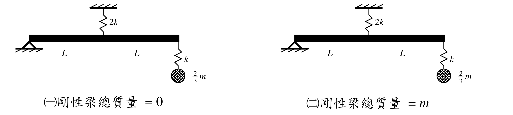

# SD-2019-1 題目正本

> 本檔只記錄考卷上寫了什麼、圖上畫了什麼，不含任何解法。解析見同資料夾 `SD-2019-1.md`。
> 判讀清單經使用者確認前，狀態為「待確認」；確認後本檔原則上不再修改（改動須回考卷原圖並記 log）。

| 項目 | 內容 |
|---|---|
| 考卷 | `raw/exams/SD-2019_結構動力分析與耐震設計.pdf`，第 1 頁（頁次 2－1），第一題 |
| 考年 | 2019（民國108年）專技高考結構工程技師「結構動力分析與耐震設計」 |
| 配分 | 25 分（㈠ 10 分、㈡ 15 分） |
| 附圖 | `SD-2019-1-fig-1.png`（舊擷取，解析度偏低，圓球旁「2/3 m」字小）、`SD-2019-1-fig-2.png`（2026-11-15 由考卷 500 dpi 重擷取） |
| 判讀狀態 | **已確認**（2026-11-15 使用者授權依 Claude 建議確認；影響答案項目定案：#1 圓球質量主解採圖上標示 (2/3)m（兩張圖一致），題文「質量為 m」的結果於解析 §5 對照。原轉錄：2026-11-15 轉錄；PyMuPDF 110 dpi 整頁＋500 dpi 局部放大，PDF 文字層核對原文；盲讀於開啟解析前完成） |

## 1. 考卷原文（逐字）

一、有一均質剛性梁，其一端為鉸接，另一端為自由端，在自由端以彈簧連接一質量為 $m$ 的圓球。分別考慮以下兩種不同狀況：

㈠剛性梁總質量＝0。（10 分）㈡剛性梁總質量＝$m$。（15 分）

針對每一狀況試回答以下問題：

1.求出運動方程式。

2.求出振動頻率及所對應之振態。

## 2. 考卷給的公式、附表與參數

- 考卷沒有給參考公式。
- 圖上給：梁長 $L+L$（彈簧 $2k$ 接在距鉸 $L$ 處、上端接固定面）；自由端以彈簧 $k$ 懸吊圓球，圓球旁標 $\frac{2}{3}m$；圖說㈠「剛性梁總質量 $=0$」、㈡「剛性梁總質量 $=m$」。
- **題文與圖不一致**：題文寫圓球「質量為 $m$」，兩張圖的圓球都標 $\frac{2}{3}m$（見判讀 #1）。
- 考卷沒有給：重力是否計入（未提）、阻尼、圓球尺寸（視為質點）、振態正規化方式。
- 卷首注意事項：㈠可以使用電子計算器。㈡不必抄題，作答時請將試題題號及答案依照順序寫在試卷上，於本試題上作答者，不予計分。㈢本科目除專門名詞或數理公式外，應使用本國文字作答。考試時間：2 小時。

## 3. 附圖

*證據圖 SD-2019-1-fig-2.png（500 dpi 重擷取；舊圖 SD-2019-1-fig-1.png 內容相同、解析度較低）*

圖面文字照錄：2k、L、L、k、2/3 m、㈠剛性梁總質量 =0；2k、L、L、k、2/3 m、㈡剛性梁總質量 =m

## 4. 判讀清單

| # | 項目 | 判讀 | 圖上／題文依據 | 把握 |
|---|---|---|---|---|
| 1 | 圓球質量 | 題文寫 $m$、圖上標 $\frac{2}{3}m$，兩者矛盾；建議以圖上 $\frac{2}{3}m$ 為主解（圖面為特定數值、兩張圖一致），題文 $m$ 的結果另列對照 | 題文「一質量為 $m$ 的圓球」；圖上兩處「2/3 m」（500 dpi） | 不確定（影響答案）；使用者授權依建議確認 |
| 2 | 支承 | 左端鉸支承（梁可繞其轉動）、右端自由 | 圖上三角形＋斜線 | 確定 |
| 3 | 彈簧 $2k$ | 位於距鉸 $L$ 處（梁中點），上端接固定面，鉛直方向 | 圖上 2k 彈簧在兩個 L 標示之間的分界處 | 確定 |
| 4 | 彈簧 $k$ 與圓球 | 彈簧 $k$ 一端接梁自由端（距鉸 $2L$），另一端懸吊圓球；圓球鉛直運動 | 圖上 | 確定 |
| 5 | 梁 | 均質剛性梁，全長 $2L$；㈠ 質量 0、㈡ 總質量 $m$（均布） | 題文「均質剛性梁」＋圖說 | 確定 |
| 6 | 自由度 | 兩個：梁繞鉸的轉角（或自由端鉛直位移）與圓球鉛直位移；小變位 | 題文、圖 | 確定（解讀） |
| 7 | 重力 | 考卷未提；振動量自靜平衡位置量起時重力不入運動方程式 | 題文 | 確定（解讀） |
| 8 | 所求 | ㈠、㈡ 各求運動方程式、頻率與振態 | 題文 | 確定 |
| 9 | 考卷沒有給 | 阻尼、圓球尺寸、振態正規化方式 | 題文 | 確定 |

---
*轉錄：2026-11-15（SD-U1-3 題目正本推廣・批 3）*
*確認：2026-11-15 使用者授權依 Claude 建議確認（SD-U1-3 題目正本推廣・批 3，關卡一）*
