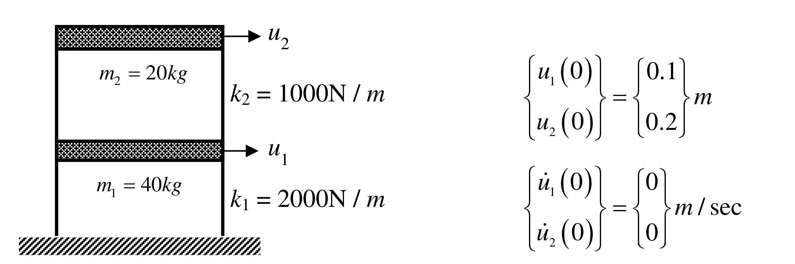

# SD-2019-2 題目正本

> 本檔只記錄考卷上寫了什麼、圖上畫了什麼，不含任何解法。解析見同資料夾 `SD-2019-2.md`。
> 判讀清單經使用者確認前，狀態為「待確認」；確認後本檔原則上不再修改（改動須回考卷原圖並記 log）。

| 項目 | 內容 |
|---|---|
| 考卷 | `raw/exams/SD-2019_結構動力分析與耐震設計.pdf`，第 1 頁（頁次 2－1），第二題 |
| 考年 | 2019（民國108年）專技高考結構工程技師「結構動力分析與耐震設計」 |
| 配分 | 25 分（㈠ 3 分、㈡ 6 分、㈢ 16 分） |
| 附圖 | `SD-2019-2-fig-1.png`（舊擷取，右上方空白處有滑鼠游標）、`SD-2019-2-fig-2.png`（2026-11-15 由考卷 500 dpi 重擷取） |
| 判讀狀態 | **已確認**（2026-11-15 使用者授權依 Claude 建議確認。原轉錄：2026-11-15 轉錄；PyMuPDF 110 dpi 整頁＋450–500 dpi 局部放大，PDF 文字層核對原文；盲讀於開啟解析前完成） |

## 1. 考卷原文（逐字）

二、有一棟兩層樓剪力屋架，如下之左圖所示，試回答以下問題：

㈠求出運動方程式。（3 分）

㈡求出振動頻率及所對應之振態。（6 分）

㈢當此剪力屋架受到如下右圖所示之起始條件，其位移反應為何？請用時間的函數表示。（16 分）

## 2. 考卷給的公式、附表與參數

- 考卷沒有給參考公式。
- 給定（左圖）：$m_1=40\,kg$、$m_2=20\,kg$、$k_1=2000\ \mathrm{N/m}$、$k_2=1000\ \mathrm{N/m}$。
- 給定（右圖，起始條件）：$\begin{Bmatrix}u_1(0)\\u_2(0)\end{Bmatrix}=\begin{Bmatrix}0.1\\0.2\end{Bmatrix}m$，$\begin{Bmatrix}\dot u_1(0)\\\dot u_2(0)\end{Bmatrix}=\begin{Bmatrix}0\\0\end{Bmatrix}m/\sec$。
- 考卷沒有給：阻尼（未提及）、外力（自由振動）、振態正規化方式、樓高。
- 卷首注意事項：㈠可以使用電子計算器。㈡不必抄題，作答時請將試題題號及答案依照順序寫在試卷上，於本試題上作答者，不予計分。㈢本科目除專門名詞或數理公式外，應使用本國文字作答。考試時間：2 小時。

## 3. 附圖

*證據圖 SD-2019-2-fig-2.png（500 dpi 重擷取；舊圖 SD-2019-2-fig-1.png 內容相同，右上方有游標）*

圖面文字照錄：u2、m2 = 20kg、k2 = 1000N / m、u1、m1 = 40kg、k1 = 2000N / m；{u1(0); u2(0)} = {0.1; 0.2} m；{u̇1(0); u̇2(0)} = {0; 0} m / sec

## 4. 判讀清單

| # | 項目 | 判讀 | 圖上／題文依據 | 把握 |
|---|---|---|---|---|
| 1 | 質量、勁度位置 | 下層（一樓）$m_1=40$ kg、層勁度 $k_1=2000$ N/m；上層 $m_2=20$ kg、$k_2=1000$ N/m | 左圖標示位置 | 確定 |
| 2 | 自由度 | $u_1$ 二樓樓版、$u_2$ 屋頂，水平向右 | 左圖箭頭 | 確定 |
| 3 | 剪力屋架 | 樓版剛性、只平移；$k_1$、$k_2$ 為整層側向勁度 | 題文「剪力屋架」；k 只標一次 | 確定（解讀） |
| 4 | 起始條件單位 | 「m」為公尺（位移 0.1、0.2 m；速度 m/sec） | 右圖 | 確定 |
| 5 | 阻尼 | 考卷未提，視為無阻尼自由振動 | 題文 | 確定（解讀） |
| 6 | 所求 | ㈠ 運動方程式；㈡ 兩個頻率與振態；㈢ $u_1(t)$、$u_2(t)$ | 題文 | 確定 |
| 7 | 考卷沒有給 | 阻尼、外力、振態正規化方式、樓高 | 題文 | 確定 |

---
*轉錄：2026-11-15（SD-U1-3 題目正本推廣・批 3）*
*確認：2026-11-15 使用者授權依 Claude 建議確認（SD-U1-3 題目正本推廣・批 3，關卡一）*
