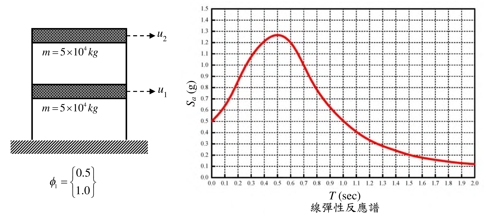

# SD-2019-3 題目正本

> 本檔只記錄考卷上寫了什麼、圖上畫了什麼，不含任何解法。解析見同資料夾 `SD-2019-3.md`。
> 判讀清單經使用者確認前，狀態為「待確認」；確認後本檔原則上不再修改（改動須回考卷原圖並記 log）。

| 項目 | 內容 |
|---|---|
| 考卷 | `raw/exams/SD-2019_結構動力分析與耐震設計.pdf`，第 2 頁（頁次 2－2），第三題 |
| 考年 | 2019（民國108年）專技高考結構工程技師「結構動力分析與耐震設計」 |
| 配分 | 25 分（㈠ 15 分、㈡ 10 分） |
| 附圖 | `SD-2019-3-fig-1.png`（舊擷取，反應譜縱軸 0.8 處與質量標示附近有滑鼠游標）、`SD-2019-3-fig-2.png`（2026-11-15 由考卷 500 dpi 重擷取） |
| 判讀狀態 | **已確認**（2026-11-15 使用者授權依 Claude 建議確認。原轉錄：2026-11-15 轉錄；PyMuPDF 110 dpi 整頁＋450 dpi 局部放大，PDF 文字層核對原文；反應譜為考卷內嵌點陣圖 760×537 px，以格線像素校準讀值；盲讀於開啟解析前完成） |

## 1. 考卷原文（逐字）

三、兩層樓建築物如下左圖所示，自由度之編號如圖中之 $u_1$ 和 $u_2$，經由線彈性分析已得知其振動週期為 1 秒，第一振態為 $\phi_1=\{0.5,1.0\}^{\mathrm T}$。另外，已知在極限狀態下（ultimate state）的彈性反應譜如下右圖所示。基於初步設計的概估需求，請依據位移不變法則及僅考慮基本振態，試回答以下問題：

㈠當位移韌性達 5 時，其基礎剪力為何？（15 分）

㈡在此地震力作用下，分別求上下兩層的層間位移？（10 分）

## 2. 考卷給的公式、附表與參數

- 考卷沒有給參考公式。
- 給定：兩層質量皆 $m=5\times10^4\,kg$（圖上）；振動週期 1 秒；$\phi_1=\{0.5,1.0\}^{\mathrm T}$（$u_1$、$u_2$ 依序）；位移韌性 5；依位移不變法則、僅考慮基本振態。
- 右圖「線彈性反應譜」：縱軸 $S_a$ (g) 0.0–1.5（格距 0.1）、橫軸 $T$ (sec) 0.0–2.0（格距 0.1）；曲線自 $T=0$、$S_a=0.5$ 上升，約 $T=0.5$ s 達峰值約 1.27，之後下降至 $T=2.0$ s 約 0.12。
- 反應譜讀值（考卷內嵌點陣圖依格線像素校準，曲線線寬中心；本次轉錄數位化）：

| $T$ (s) | 0.5 | 0.9 | 0.95 | 1.0 | 1.05 | 1.1 |
|---|---|---|---|---|---|---|
| $S_a$ (g) | 1.26 | 0.63 | 0.56 | 0.51 | 0.45 | 0.41 |

  目視：$T=1.0$ s 時曲線通過 $S_a=0.5$ 格線（數位化 0.506）。
- 考卷沒有給：樓層勁度、樓高、阻尼比、$g$ 值、第二振態；「振動週期為 1 秒」未寫明為第一振態週期（見判讀 #2）。
- 卷首注意事項：㈠可以使用電子計算器。㈡不必抄題，作答時請將試題題號及答案依照順序寫在試卷上，於本試題上作答者，不予計分。㈢本科目除專門名詞或數理公式外，應使用本國文字作答。考試時間：2 小時。

## 3. 附圖

*證據圖 SD-2019-3-fig-2.png（500 dpi 重擷取；舊圖 SD-2019-3-fig-1.png 內容相同，有游標）*

圖面文字照錄：u2、m = 5×10⁴ kg、u1、m = 5×10⁴ kg、φ1 = {0.5; 1.0}；Sa (g)、T (sec)、線彈性反應譜、刻度 0.0–1.5、0.0–2.0

## 4. 判讀清單

| # | 項目 | 判讀 | 圖上／題文依據 | 把握 |
|---|---|---|---|---|
| 1 | $S_a(T=1.0)$ | $0.50g$（格線像素校準 0.506，目視曲線通過 0.5 格線） | 右圖；內嵌點陣圖 760×537 px，$T$ 軸 0→2.0 對應 x＝76→736.5 px、$S_a$ 軸 0→1.5 對應 y＝444.5→21 px | 確定（解讀） |
| 2 | 「振動週期為 1 秒」 | 指基本（第一）振態週期 $T_1=1.0$ s | 題文「僅考慮基本振態」緊接其後 | 確定（解讀） |
| 3 | 振態分量順序 | $\phi_1=\{0.5,1.0\}^{\mathrm T}$ 依序對應 $u_1$（二樓）、$u_2$（屋頂） | 題文「自由度之編號如圖中之 $u_1$ 和 $u_2$」；圖上 $u_1$ 在下 | 確定 |
| 4 | 質量 | 兩層皆 $5\times10^4$ kg | 左圖兩處標示 | 確定 |
| 5 | 位移不變法則 | 非彈性位移＝彈性位移，折減係數 $R=\mu=5$ | 題文「位移不變法則」「位移韌性達 5」 | 確定（解讀） |
| 6 | 反應譜性質 | 線彈性、極限狀態；$S_a$ 以 g 為單位 | 右圖圖名與縱軸、題文 | 確定 |
| 7 | 所求 | ㈠ 基礎剪力；㈡ 上下兩層層間位移 | 題文 | 確定 |
| 8 | 考卷沒有給 | 樓層勁度、樓高、阻尼比、$g$ 值、第二振態 | 題文 | 確定 |

---
*轉錄：2026-11-15（SD-U1-3 題目正本推廣・批 3）*
*確認：2026-11-15 使用者授權依 Claude 建議確認（SD-U1-3 題目正本推廣・批 3，關卡一）*
