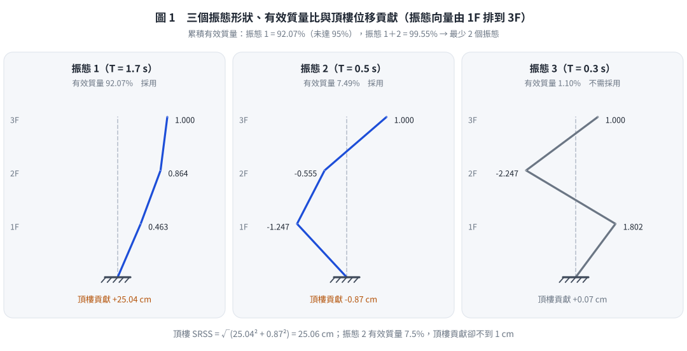

# 考題編號：SD-2020-2

**主分類：** `SD-U1-3` 單自由度、多自由度系統之動態分析及應用
**副分類：** `SD-U2-2` 建築耐震設計規範
**分析方法：** 反應譜分析（SRSS振態疊加）
**標籤：** `MDOF` `3自由度` `剪力建築` `反應譜分析` `有效振態質量` `SRSS` `模態參與因子` `譜位移` `95%質量準則` `樓層位移`

---

## 1. 題目（考卷原文見題目正本）

> 考卷原文、公式／附表、附圖與判讀清單（已確認）見 [`SD-2020-2-problem.md`](SD-2020-2-problem.md)。本節只列解題時最容易讀錯的地方與本解使用的記號；題意以題目正本為準。

### 常見誤讀

| 項目 | 正確判讀 | 常見誤讀 |
|------|---------|---------|
| 振態向量排列 | 由上而下為一樓、二樓、頂樓，第三列 1.00000 為頂樓（判讀 #1） | 第一列當頂樓 |
| 振態數據 | 照錄考卷；振態 1 與振態 2、3 對等質量不精確正交（判讀 #2），有效質量比各振態分別以 $L_n^2/M_n$ 計 | 以為振態已正規化、直接用 $\phi^T\phi=1$ |
| $S_a$ | 以 g 計，乘 $g=9.8$ m/s²（判讀 #3）；$T_1=1.7$ s 落在 $0.5/T$ 段，$T_2$、$T_3$ 落在 0.5 平台（判讀 #4） | 直接當 m/s²；$T_1$ 套平台 |
| 振態數 | 由低頻起累加有效質量比至 ≥95% 的最少振態數（判讀 #6） | 一律取全部振態 |

**本解記號：** $\phi_{n}$ 分量依 (1F, 2F, 3F)；$\Gamma_n=L_n/M_n$、$L_n=\phi_n^T m\{1\}$、$M_n=\phi_n^T m\phi_n$；$S_{d,n}=S_{a,n}g/\omega_n^2$。

---

## 2. 考題核心精神與出題者意圖 (Core Concepts & Examiner's Intent)

**核心觀念：**
1. 計算各振態的「有效振態質量比」，判斷最少需幾個振態達到95%
2. 從反應譜讀取各振態的譜加速度→換算譜位移
3. 用模態參與因子求各振態頂樓位移，SRSS組合

**關鍵陷阱：** 有效質量比計算：分子是 $(\phi_i^T[M]\{1\})^2$，分母是 $(\phi_i^T[M]\phi_i) \times M_{total}$，漏掉任一項都會出錯。

---

## 3. 解題戰略地圖與陷阱分析 (Strategic Roadmap & Trap Analysis)

**作戰計畫：**
1. 設質量矩陣 $[M] = mI_{3\times3}$（均質）
2. 逐振態計算 $L_i = \phi_i^T[M]\{1\}$、$M_i^* = \phi_i^T[M]\phi_i$
3. 有效質量比 $\rho_i = L_i^2/(M_i^* \times 3m)$，累積至 95%
4. 讀取 $Sa(T_i)$，換算 $Sd_i = Sa_i \cdot T_i^2/(4\pi^2)$
5. 各振態頂樓最大位移 = $|\Gamma_i| \times |\phi_{top,i}| \times Sd_i$
6. SRSS 組合

**四大陷阱：**

| # | 陷阱 | 正確處理 |
|---|------|---------|
| 1 | 有效質量比分母忘乘 $M_{total}$ | $\rho_i = L_i^2/(M_i^* \cdot M_{total})$ |
| 2 | 振態1有效質量 > 90%，誤以為只用1個振態 | 92.07% < 95%，需加振態2 |
| 3 | 譜位移用 $Sd = Sa/g \times T^2/(4\pi^2)$ 單位混亂 | $Sd = Sa(\text{m/s}^2) \times T^2/(4\pi^2)$ → 結果單位為 m |
| 4 | 振態2有負分量，SRSS取絕對值 | SRSS = $\sqrt{\Sigma u_i^2}$，各分量先平方（自動消負號） |

---

## 3.5 變數層次分析 (Variable Hierarchy Analysis)

### 最終目標

頂樓（3F）最大位移 $u_{3,max}$（SRSS組合，使用最少振態滿足95%有效質量）

### 本題關鍵公式（依計算順序）

$$\text{Step 1: 激振向量} \quad L_i = \phi_i^T[M]\{1\} = m\sum_{j=1}^{3}\phi_{ji}$$

$$\text{Step 2: 振態質量} \quad M_i^* = \phi_i^T[M]\phi_i = m\sum_{j=1}^{3}\phi_{ji}^2$$

$$\text{Step 3: 有效質量比} \quad \rho_i = \frac{L_i^2}{M_i^* \times 3m}$$

$$\text{Step 4: 模態參與因子} \quad \Gamma_i = \frac{L_i}{M_i^*}$$

$$\text{Step 5: 譜位移} \quad S_{d,i} = \frac{T_i^2}{4\pi^2} \cdot S_{a,i}$$

$$\text{Step 6: 振態頂樓位移} \quad u_{3,i} = \Gamma_i \cdot \phi_{3i} \cdot S_{d,i}$$

$$\text{Step 7: SRSS} \quad u_{3,max} = \sqrt{u_{3,1}^2 + u_{3,2}^2}$$

### L1：題目直接給定

| 符號 | 數值 | 說明 |
|------|------|------|
| $m$ | $m$（各層相等） | 樓層質量 |
| $T_1, T_2, T_3$ | 1.7, 0.5, 0.3 sec | 振態週期 |
| $\phi_i$ | 如題表 | 振態向量（1F→3F） |
| $g$ | 9.8 m/s² | 重力加速度 |

### L2：需知識點推導

| 符號 | 公式／來源 | 卡關? |
|------|-----------|------|
| $L_1$ | $m(0.46346+0.86379+1.00000)=2.32725m$ | |
| $M_1^*$ | $m(0.46346^2+0.86379^2+1.00000^2)=1.96093m$ | |
| $\rho_1$ | $2.32725^2/(1.96093\times3)=5.4161/5.8828=92.07\%$ | |
| $L_2$ | $m(-1.24698-0.55496+1.00000)=-0.80194m$ | |
| $M_2^*$ | $m(1.24698^2+0.55496^2+1.00000^2)=2.86294m$ | |
| $\rho_2$ | $0.80194^2/(2.86294\times3)=0.6431/8.5888=7.49\%$ | |
| 累積（1+2） | $92.07\%+7.49\%=99.56\%>95\%$ ✓ | |

### L3：深層知識（不懂就卡住）

| 知識點 | 說明 | 卡關? |
|--------|------|------|
| 有效振態質量的物理意義 | 第 $i$ 振態對地震基底剪力的貢獻比例；所有振態有效質量之和 = 總質量 | |
| 95%準則的工程依據 | 確保納入的振態能代表結構大部分動力特性，避免漏掉重要模態 | |
| SRSS 適用條件 | 各振態頻率相差超過 10%（不相關），本題 $T_1=1.7$，$T_2=0.5$ sec，差異夠大 ✓ | |

---

## 4. 步驟化詳細計算過程 (Step-by-Step Detailed Calculation)

### Step 1：質量矩陣與激振向量

$$[M] = m\begin{bmatrix}1&0&0\\0&1&0\\0&0&1\end{bmatrix}, \qquad \{1\} = \begin{Bmatrix}1\\1\\1\end{Bmatrix}$$

### Step 2：各振態有效質量比

**振態 1（$T_1 = 1.7$ sec）：**

$$L_1 = m(0.46346 + 0.86379 + 1.00000) = 2.32725\,m$$

$$M_1^* = m(0.46346^2 + 0.86379^2 + 1.00000^2) = m(0.21480 + 0.74613 + 1.00000) = 1.96093\,m$$

$$\rho_1 = \frac{(2.32725m)^2}{1.96093m \times 3m} = \frac{5.4161}{5.8828} = 0.9207 = \mathbf{92.07\%}$$

*→ 92.07% < 95%，單獨振態 1 不足。*

**振態 2（$T_2 = 0.5$ sec）：**

$$L_2 = m(-1.24698 - 0.55496 + 1.00000) = -0.80194\,m$$

$$M_2^* = m(1.24698^2 + 0.55496^2 + 1.00000^2) = m(1.55496 + 0.30798 + 1.00000) = 2.86294\,m$$

$$\rho_2 = \frac{(0.80194m)^2}{2.86294m \times 3m} = \frac{0.64311}{8.58882} = 0.0749 = \mathbf{7.49\%}$$

**累積有效質量比：**

$$\rho_1 + \rho_2 = 92.07\% + 7.49\% = \mathbf{99.56\% > 95\%} \checkmark$$

$$\boxed{\text{最少需採用 2 個振態（振態 1 與振態 2）}}$$

---

### Step 3：讀取譜加速度與計算譜位移

**振態 1（$T_1 = 1.7$ sec，落在 $1 \leq T < 2.5$ 區間）：**

$$S_{a1} = \frac{0.5}{T_1} \times g = \frac{0.5}{1.7} \times 9.8 = 0.29412 \times 9.8 = 2.8824 \text{ m/s}^2$$

$$S_{d1} = \frac{T_1^2}{4\pi^2} \times S_{a1} = \frac{1.7^2}{4\pi^2} \times 2.8824 = \frac{2.89}{39.478} \times 2.8824 = \frac{8.330}{39.478} = 0.21101 \text{ m}$$

**振態 2（$T_2 = 0.5$ sec，落在 $0.2 \leq T < 1$ 區間）：**

$$S_{a2} = 0.5 \times g = 0.5 \times 9.8 = 4.9 \text{ m/s}^2$$

$$S_{d2} = \frac{T_2^2}{4\pi^2} \times S_{a2} = \frac{0.25}{39.478} \times 4.9 = \frac{1.225}{39.478} = 0.031027 \text{ m}$$

---

### Step 4：各振態頂樓（3F）最大位移

**模態參與因子：**

$$\Gamma_1 = \frac{L_1}{M_1^*} = \frac{2.32725m}{1.96093m} = 1.18681$$

$$\Gamma_2 = \frac{L_2}{M_2^*} = \frac{-0.80194m}{2.86294m} = -0.28011$$

**各振態頂樓位移振幅：**（頂樓分量 $\phi_{3,1} = \phi_{3,2} = 1.00000$）

$$u_{3,1} = |\Gamma_1| \times |\phi_{3,1}| \times S_{d1} = 1.18681 \times 1.00000 \times 0.21101 = 0.25043 \text{ m}$$

$$u_{3,2} = |\Gamma_2| \times |\phi_{3,2}| \times S_{d2} = 0.28011 \times 1.00000 \times 0.031027 = 0.008691 \text{ m}$$

---

### Step 5：SRSS 組合

$$u_{3,max} = \sqrt{u_{3,1}^2 + u_{3,2}^2} = \sqrt{(0.25043)^2 + (0.008691)^2}$$

$$= \sqrt{0.062715 + 0.0000755} = \sqrt{0.062791}$$

$$\boxed{u_{3,max} \approx 0.2506 \text{ m} \approx 25.1 \text{ cm}}$$

**振態貢獻比較：**

| 振態 | $u_{3,i}$ (m) | 佔比 |
|------|--------------|------|
| 振態1 | 0.25043 | 99.97% |
| 振態2 | 0.00869 | 0.03% |
| SRSS | **0.25058** | — |

*策略註解：振態2雖為7.49%有效質量，但其譜位移 $Sd_2 = 3.1$ cm 遠小於振態1的 $Sd_1 = 21.1$ cm，加上振態2頂樓分量等於1，最終對頂樓位移的貢獻僅0.87 cm（相比振態1的25 cm微乎其微）。這說明**有效質量比大 ≠ 位移貢獻大**，還需考慮譜位移的大小。*

*圖 1　三個振態形狀、有效質量比與頂樓位移貢獻。考卷振態向量由 1F 排到 3F（頂樓分量都是 1.000），畫反了就會把 0.46346 當頂樓；振態 1 只有 92.07%，未達 95%，必須加振態 2——但振態 2 的頂樓貢獻不到 1 cm，有效質量比大小不等於位移貢獻大小。*

---

## 5. 關鍵爭議點與進階探討 (Critical Issues & Advanced Discussion)

**爭議點：為何振態2有效質量7.49%，但位移貢獻卻不到1%？**

振態2的週期 $T_2 = 0.5$ sec，落在加速度反應譜的平台段（$Sa = 0.5g$），而振態1的 $T_1 = 1.7$ sec 落在長週期衰減段（$Sa = 0.5/1.7g$）。

雖然振態1的加速度譜值更小，但其譜位移：

$$Sd \propto Sa \times T^2 \propto \frac{0.5}{T} \times T^2 = 0.5T$$

即長週期振態的譜位移隨 $T$ 線性增長，而短週期振態的譜位移隨 $T^2$ 增長速度更快但基值（Sa）更小。在本題 $T_1 = 1.7$ sec 的效果使 $Sd_1 = 21.1$ cm，遠超 $Sd_2 = 3.1$ cm。

**工程啟示：** 高樓（長週期結構）的頂樓位移由第一振態主導，且位移反應隨樓高顯著增加。

**進階：是否需考慮振態3？**

振態3有效質量比 = $0.55496^2/(9.29591 \times 3) = 0.30798/27.88 = 1.10\%$，加上振態1+2已達 99.56%，振態3可忽略。且 $T_3 = 0.3$ sec，$Sd_3 = 0.5 \times 9.8 \times 0.09/39.48 = 0.0112$ m（1.12 cm），頂樓位移貢獻更小。

*修正日期：2026-11-15（§1 改為指向題目正本）*

*修正日期：2026-11-15（非勘誤）§4 Step 5 補解題圖解 figs/SD-2020-2-fig-1-modes.svg（圖解補繪，腳本 gen_SD-2020-2.py）*
