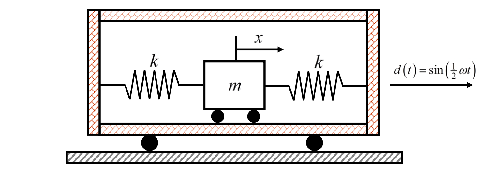

# SD-2021-1 題目正本

> 本檔只記錄考卷上寫了什麼、圖上畫了什麼，不含任何解法。解析見同資料夾 `SD-2021-1.md`。
> 判讀清單經使用者確認前，狀態為「待確認」；確認後本檔原則上不再修改（改動須回考卷原圖並記 log）。

| 項目 | 內容 |
|---|---|
| 考卷 | `raw/exams/SD-2021_結構動力分析與耐震設計.pdf`，第 1 頁（頁次 2－1），第一題 |
| 考年 | 2021（民國110年）專技高考結構工程技師「結構動力分析與耐震設計」 |
| 配分 | 25 分 |
| 附圖 | `SD-2021-1-fig-1.png`（既有擷取，完整、無雜訊） |
| 判讀狀態 | **已確認**（2026-11-15 使用者授權依 Claude 建議確認；影響答案項目定案：#1「系統從靜止開始」取 t=0 時台車位移為 0、台車絕對速度為 0（構架速度 ω/2 屬給定激振）；#2 x 取台車絕對位移。原轉錄：2026-11-15 轉錄；PyMuPDF 110 dpi 整頁＋500 dpi 局部放大，PDF 文字層核對原文；盲讀於開啟解析前完成） |

## 1. 考卷原文（逐字）

一、有一質量為 $m$ 的台車利用彈簧固定在一剛性構架內，如下圖所示。當此剛性構架受到向右位移 $d(t)=\sin\left(\tfrac12\omega t\right)$ 的作用，其中 $\omega$ 為此結構系統的自然振動頻率，假設此系統從靜止開始運動，試回答以下問題：（25 分）

㈠求出此結構系統的運動方程式。

㈡求出此結構系統的自然振動頻率 $\omega$。

㈢求出台車的絕對速度，請以符號來表示。

## 2. 考卷給的公式、附表與參數

- 考卷沒有給參考公式。
- 給定（全符號）：台車質量 $m$、兩側彈簧勁度皆為 $k$、構架位移 $d(t)=\sin(\tfrac12\omega t)$（$\omega$ 為本系統自然振動頻率）、系統由靜止開始運動。
- 考卷沒有給：阻尼（圖上無阻尼器）、$d(t)$ 的振幅單位、彈簧初始是否有預力；「從靜止開始」指台車或構架的哪一個量為零未說明。
- 卷首注意事項：㈠可以使用電子計算器。㈡不必抄題，作答時請將試題題號及答案依照順序寫在試卷上，於本試題上作答者，不予計分。㈢本科目除專門名詞或數理公式外，應使用本國文字作答。考試時間：2 小時。

## 3. 附圖

*證據圖 SD-2021-1-fig-1.png（既有擷取；已與考卷 500 dpi 局部放大比對，內容一致）*

圖面文字照錄：k、k、m、x、d(t) = sin(½ωt)

## 4. 判讀清單

| # | 項目 | 判讀 | 圖上／題文依據 | 把握 |
|---|---|---|---|---|
| 1 | 「此系統從靜止開始運動」的初始條件 | 建議：$t=0$ 時台車位移為 0、台車絕對速度為 0（台車靜止）；構架位移 $d(0)=0$ 由給定函數決定，其速度 $\dot d(0)=\omega/2$ 為給定激振的一部分。另一讀法「台車相對構架的速度為 0」會使台車初始絕對速度為 $\omega/2$，絕對速度答案不同 | 題文只寫「系統從靜止開始」；$d(t)$ 在 $t=0$ 時速度不為零，兩種讀法無法同時成立 | 不確定（影響答案）；使用者授權依建議確認 |
| 2 | $x$ 的量測基準 | 台車的水平位移，向右為正；圖上未標明是絕對位移或相對構架位移（箭頭起點畫在台車上方的短線） | 圖上 x 箭頭起點為台車頂上的垂直短線，無固定參考點 | 不確定（解讀）；使用者授權依建議確認 |
| 3 | 構架 | 剛體，以滾輪置於地面上，水平位移 $d(t)$ 為給定（位移激振），構架本身不是自由度 | 題文「剛性構架受到向右位移 d(t)」；圖上構架下兩個大滾輪 | 確定 |
| 4 | 台車 | 以小輪置於構架底板，水平向可自由滾動（無摩擦），單自由度 | 圖上台車兩個小輪 | 確定（解讀） |
| 5 | 彈簧 | 兩根，勁度皆 $k$，分別連接台車左右兩側與構架左、右內壁 | 圖上兩根彈簧各標 k，端點接構架內壁與台車側面 | 確定 |
| 6 | 激振頻率 | $d(t)$ 的圓頻率為 $\tfrac12\omega$，$\omega$ 即㈡所求的本系統自然振動頻率 | 題文「其中ω為此結構系統的自然振動頻率」 | 確定 |
| 7 | 阻尼 | 無（圖上無阻尼器、題文未提） | 圖、題文 | 確定（解讀） |
| 8 | 所求 | ㈠運動方程式 ㈡自然頻率 $\omega$ ㈢台車絕對速度（符號式，時間函數） | 題文 | 確定 |
| 9 | 考卷沒有給 | $d(t)$ 振幅的單位（寫成無因次 1） | 題文 | 確定 |

---
*轉錄：2026-11-15（SD-U1-3 題目正本推廣・批 3）*
*確認：2026-11-15 使用者授權依 Claude 建議確認（SD-U1-3 題目正本推廣・批 3，關卡一）*
