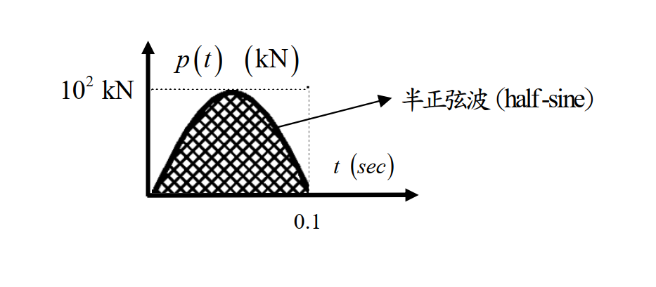

# SD-2021-2 題目正本

> 本檔只記錄考卷上寫了什麼、圖上畫了什麼，不含任何解法。解析見同資料夾 `SD-2021-2.md`。
> 判讀清單經使用者確認前，狀態為「待確認」；確認後本檔原則上不再修改（改動須回考卷原圖並記 log）。

| 項目 | 內容 |
|---|---|
| 考卷 | `raw/exams/SD-2021_結構動力分析與耐震設計.pdf`，第 1 頁（頁次 2－1），第二題 |
| 考年 | 2021（民國110年）專技高考結構工程技師「結構動力分析與耐震設計」 |
| 配分 | 25 分 |
| 附圖 | `SD-2021-2-fig-1.png`（既有擷取，完整、無雜訊） |
| 判讀狀態 | **已確認**（2026-11-15 使用者授權依 Claude 建議確認。原轉錄：2026-11-15 轉錄；PyMuPDF 110 dpi 整頁＋500 dpi 局部放大，PDF 文字層核對原文；盲讀於開啟解析前完成） |

## 1. 考卷原文（逐字）

二、請回答下列問題：（25 分）

㈠有一單自由度結構系統，其自然振動頻率為 10 rad/sec，並且受到簡諧載重 $p(t)=p_0\sin(\bar\omega t)$，已知當 $\bar\omega=0.1$ rad/sec 其最大穩態（steady-state）位移為 2.4 cm，而當 $\bar\omega=10$ rad/sec 其最大穩態位移為 20 cm，試求此單自由度系統的阻尼比。

㈡已知此單自由度結構系統的質量為 $10^4$ kg，其阻尼比可由㈠計算得知，此結構系統如受到下圖所示的載重作用，其最大位移為何，請說明計算原理？

## 2. 考卷給的公式、附表與參數

- 考卷沒有給參考公式。
- 給定：$\omega_n=10$ rad/s；兩組簡諧載重的穩態位移振幅（$\bar\omega=0.1$ rad/s → 2.4 cm；$\bar\omega=10$ rad/s → 20 cm）；㈡ 質量 $10^4$ kg；半正弦波載重，峰值 $10^2$ kN，延時 0.1 s。
- 考卷沒有給：$p_0$ 的數值、勁度 $k$（須由 $m$、$\omega_n$ 推得）；㈡ 載重結束後的觀察時間。
- 卷首注意事項：㈠可以使用電子計算器。㈡不必抄題，作答時請將試題題號及答案依照順序寫在試卷上，於本試題上作答者，不予計分。㈢本科目除專門名詞或數理公式外，應使用本國文字作答。考試時間：2 小時。

## 3. 附圖

*證據圖 SD-2021-2-fig-1.png（既有擷取；已與考卷 500 dpi 局部放大比對，內容一致）*

圖面文字照錄：p(t) (kN)、10² kN、半正弦波 (half-sine)、t (sec)、0.1

## 4. 判讀清單

| # | 項目 | 判讀 | 圖上／題文依據 | 把握 |
|---|---|---|---|---|
| 1 | ㈡ 的系統 | 與㈠為同一系統：$\omega_n=10$ rad/s，阻尼比取㈠的結果，$m=10^4$ kg | 題文「此單自由度結構系統」「其阻尼比可由㈠計算得知」 | 確定（解讀） |
| 2 | 半正弦波 | $p(t)=100\sin(\pi t/0.1)$ kN，$0\le t\le0.1$ s；$t>0.1$ s 時 $p=0$；峰值在 $t=0.05$ s | 圖上峰值虛線標 10² kN、曲線在 0.1 回到零、題圖標「半正弦波」 | 確定 |
| 3 | ㈠ 的兩組數據 | 同一 $p_0$；$\bar\omega=0.1$ rad/s（頻率比 0.01，近乎靜態）、$\bar\omega=10$ rad/s（頻率比 1，共振）的穩態位移振幅 | 題文 | 確定 |
| 4 | 「最大位移」 | ㈡ 為載重期間與載重結束後自由振動全程的位移最大值 | 題文未限定時段 | 確定（解讀） |
| 5 | 初始狀態 | ㈡ 系統由靜止開始（考卷未明寫） | 題文未提，脈衝載重題慣例 | 確定（解讀） |
| 6 | 單位 | 位移 cm、頻率 rad/s、力 kN、時間 s | 題文、圖上座標標示 | 確定 |
| 7 | 所求 | ㈠阻尼比 ㈡最大位移並說明計算原理 | 題文 | 確定 |

---
*轉錄：2026-11-15（SD-U1-3 題目正本推廣・批 3）*
*確認：2026-11-15 使用者授權依 Claude 建議確認（SD-U1-3 題目正本推廣・批 3，關卡一）*
