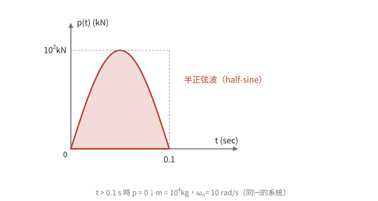
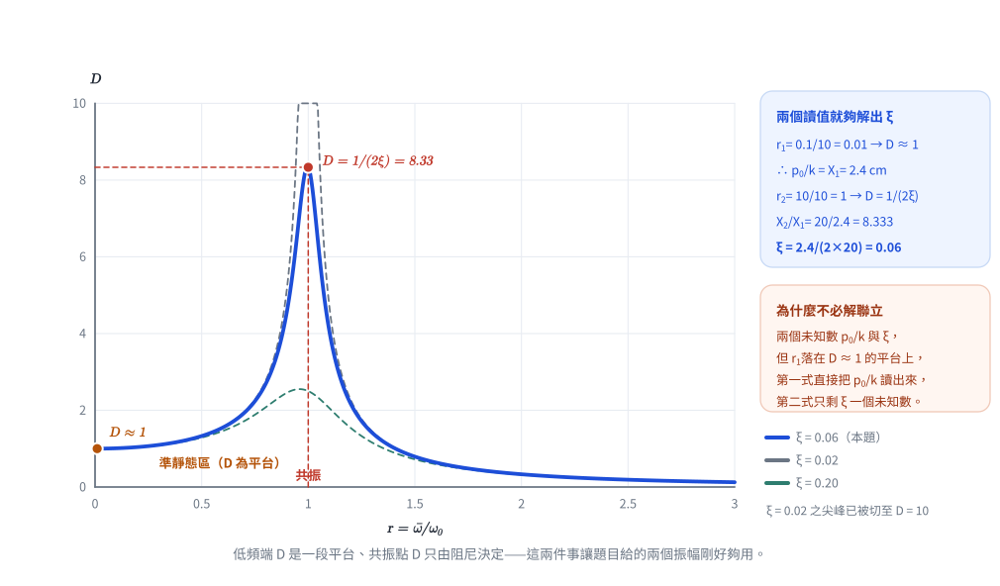
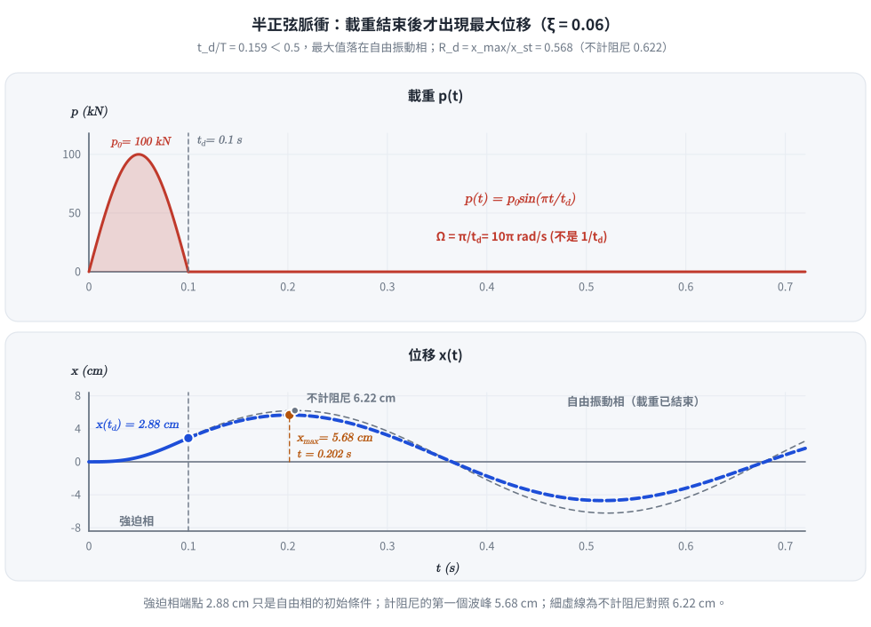
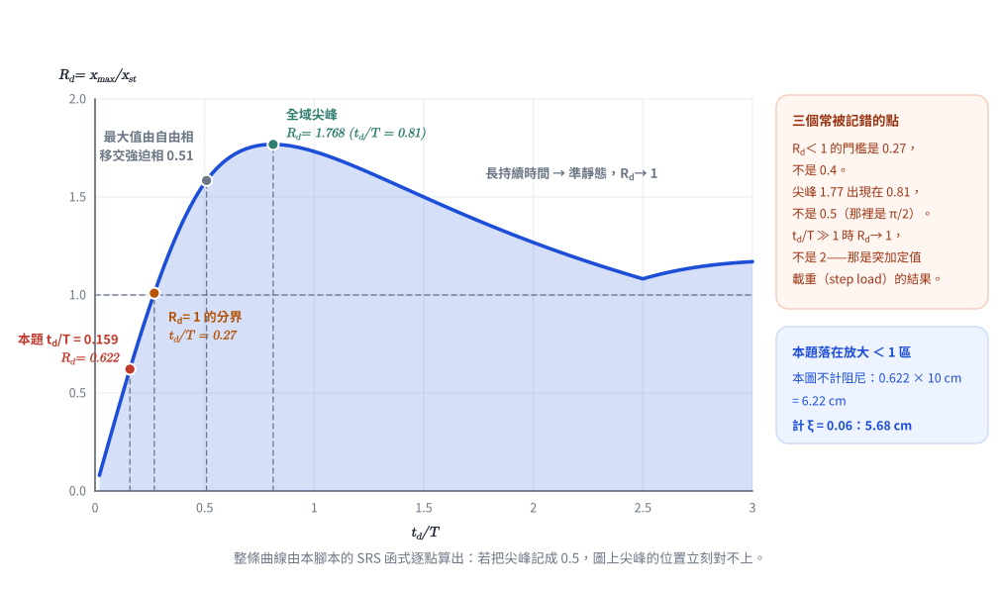

# 考題編號：SD-2021-2

**主分類：** `SD-U1-3` 單自由度、多自由度系統之動態分析及應用
**副分類：** `SD-U1-1` 結構動力基本性質及原理
**分析方法：** SDOF穩態反應（求阻尼比）＋ Duhamel積分（短時載重最大位移）
**標籤：** `SDOF` `阻尼比` `穩態位移` `動力放大係數` `共振` `頻率比` `Duhamel積分` `半正弦波` `衝擊荷載` `自由振動` `兩階段法` `SRS`

---

## 1. 題目（考卷原文見題目正本）

> 考卷原文、公式／附表、附圖與判讀清單（已確認）見 [`SD-2021-2-problem.md`](SD-2021-2-problem.md)。本節只列解題時最容易讀錯的地方與本解使用的記號；題意以題目正本為準。

*重繪自考卷附圖，依題目正本判讀清單；本圖攔下的判讀錯誤：延時 0.1 s 是整個半波（峰值在 0.05 s），不是峰值時刻。*

### 常見誤讀

| 項目 | 正確判讀 | 常見誤讀 |
|------|---------|---------|
| ㈡ 系統 | 與㈠同一系統：$\omega_n=10$ rad/s、阻尼比取㈠結果、$m=10^4$ kg（判讀 #1） | 另設勁度 |
| 半正弦波 | $p(t)=100\sin(\pi t/0.1)$ kN，延時 0.1 s 為整個半波、峰值在 0.05 s（判讀 #2） | 0.1 s 當峰值時刻 |
| ㈠ 兩組數據 | 同一 $p_0$；$\bar\omega=0.1$ rad/s 近乎靜態（頻率比 0.01）、$\bar\omega=10$ rad/s 共振（判讀 #3） | — |
| 最大位移 | 載重期間與結束後自由振動全程的最大值（判讀 #4） | 只看載重期間 |
| ㈡ 阻尼 | 計入㈠求得的 $\xi=0.06$（題文「其阻尼比可由㈠計算得知」）：$x_{max}=5.68$ cm | 用無阻尼公式得 6.22 cm（本庫 2026-11-15 前的舊解） |

**本解記號：** $\omega_0=\omega_n=10$ rad/s；$r=\bar\omega/\omega_0$；$t_d=0.1$ s；$x_{st}=p_0/k$。

---

## 2. 考題核心精神與出題者意圖 (Core Concepts & Examiner's Intent)

**核心觀念：**
- (一) 利用不同頻率比下的穩態振幅比，反推阻尼比——考「動力放大係數 $D$ 的頻率特性」
- (二) 短時衝擊載重（$t_d \ll T$）的最大位移——考「Duhamel 積分兩階段法」及「判斷最大值發生於載重中或結束後」

**出題者測驗能力：**
1. 認識共振條件（$\bar{\omega} = \omega_0$）下的放大係數 $D = 1/(2\xi)$
2. 辨識低頻激振的準靜態特性，直接讀出靜位移
3. 對衝擊載重使用「兩階段（強迫+自由振動）法」求最大位移

**關鍵陷阱：** 計算(一)時，若兩個條件都套完整公式，會有兩個方程式兩個未知數（$p_0/k$ 和 $\xi$），解法複雜。正確辨識 $\bar{\omega} = 0.1$ rad/sec 為準靜態（$r_1 = 0.01$），可直接讀出靜位移。

---

## 3. 解題戰略地圖與陷阱分析 (Strategic Roadmap & Trap Analysis)

**作戰計畫（一）：**
1. 計算兩個頻率比 $r_1 = 0.1/10 = 0.01$，$r_2 = 10/10 = 1$
2. 識別 $r_1 \approx 0$（準靜態）→ $X_1 = p_0/k$（直接讀出靜位移）
3. 識別 $r_2 = 1$（共振）→ $D_2 = 1/(2\xi)$
4. 兩式聯立求 $\xi$

**作戰計畫（二）：**
1. 由 $m, \omega_0$ 求 $k$，再求靜位移 $x_{st} = p_0/k$
2. 求自然週期 $T$，計算 $t_d/T$ 判斷載重型態
3. 分段解（等同 Duhamel 積分）：強迫相 $(0 \leq t \leq t_d)$ 計入 $\xi = 0.06$，求端點 $x(t_d)$、$\dot{x}(t_d)$
4. 自由振動相 $(t > t_d)$ 為有阻尼自由振動：由 $\dot x = 0$ 求第一個波峰時刻與最大位移（無阻尼振幅只作對照）
5. 比較兩相最大值取大者

**五大陷阱：**

| # | 陷阱 | 正確處理 |
|---|------|---------|
| 1 | 以為 $r_1 = 0.01$ 也需套完整公式 | $r_1 \approx 0$ 時 $D \approx 1$，$X_1 \approx p_0/k$ |
| 2 | $r = 1$ 時分母 $1-r^2 = 0$，誤用一般公式 | 共振公式 $D = 1/(2\xi)$（有阻尼） |
| 3 | 半正弦波激振頻率誤設為 $p_0/t_d$ | $\Omega = \pi/t_d$（從 $\sin(\pi t/t_d)$ 讀出） |
| 4 | 最大位移誤以為只在強迫相 | $t_d/T \approx 0.16 < 0.5$：最大值通常在**自由振動相** |
| 5 | 題目已給阻尼比（由㈠求得），㈡ 卻用無阻尼公式 | 計入 $\xi = 0.06$：$5.68$ cm；無阻尼 $6.22$ cm 高估約 9%，只能當對照 |

---

## 3.5 變數層次分析 (Variable Hierarchy Analysis)

> 複習提示：第一次解題後，在每個卡住的知識點旁標記 `⚠`；第二次複習時只看有 `⚠` 的項目。

### 最終目標

(一) 阻尼比 $\xi$；(二) 半正弦波衝擊載重下的最大絕對位移 $x_{max}$

### 本題關鍵公式（依計算順序）

$$\text{Step 1（一）: 頻率比} \quad r_1 = \frac{0.1}{10} = 0.01,\quad r_2 = \frac{10}{10} = 1$$

$$\text{Step 2（一）: 準靜態} \quad X_1 \approx \frac{p_0}{k} = 2.4 \text{ cm}$$

$$\text{Step 3（一）: 共振放大} \quad X_2 = \frac{p_0/k}{2\xi} = 20 \text{ cm} \;\Rightarrow\; \xi = \frac{\boxed{p_0/k}}{2 \times 20}$$

$$\text{Step 4（二）: 系統勁度} \quad k = m\omega_0^2 = 10^4 \times 10^2 = 10^6 \text{ N/m}$$

$$\text{Step 5（二）: 靜位移} \quad x_{st} = \frac{p_0}{k} = \frac{10^5}{10^6} = 0.1 \text{ m}$$

$$\text{Step 6（二）: 激振頻率與頻率比} \quad \Omega = \frac{\pi}{t_d} = 10\pi,\quad r = \frac{\Omega}{\omega_0} = \pi$$

$$\text{Step 7（二）: 強迫相（計阻尼）} \quad x(t) = e^{-\xi\omega_0 t}(A\cos\omega_D t + B\sin\omega_D t) + \boxed{x_{st}}\boxed{R_d}\sin(\Omega t - \phi) \;\Rightarrow\; x(t_d),\ \dot x(t_d)$$

$$\text{Step 8（二）: 自由相（計阻尼）} \quad x(\tau) = e^{-\xi\omega_0 \tau}\left[\boxed{x(t_d)}\cos\omega_D\tau + \frac{\boxed{\dot x(t_d)} + \xi\omega_0 x(t_d)}{\omega_D}\sin\omega_D\tau\right],\ \dot x(\tau_p) = 0 \Rightarrow x_{max}$$

### L1：題目直接給定

| 符號 | 數值 | 說明 |
|------|------|------|
| $\omega_0$ | $10$ rad/sec | 系統自然頻率 |
| $X_1$ | $2.4$ cm | $\bar{\omega} = 0.1$ 時穩態位移 |
| $X_2$ | $20$ cm | $\bar{\omega} = 10$ 時穩態位移 |
| $m$ | $10^4$ kg | 系統質量 |
| $p_0$ | $10^2$ kN $= 10^5$ N | 半正弦波振幅 |
| $t_d$ | $0.1$ sec | 載重持續時間 |

### L2：需知識點推導

**（一）阻尼比**

| 符號 | 公式／來源 | 卡關? |
|------|-----------|------|
| $r_1, r_2$ | $\bar{\omega}/\omega_0$：$0.01$、$1.0$ | |
| $p_0/k$ | $X_1 \approx 2.4$ cm（$r_1 \approx 0$，準靜態） | |
| $\xi$ | $X_2 = (p_0/k)/(2\xi)$ → $\xi = 2.4/(2\times20) = 0.06$ | |

**（二）最大位移**

| 符號 | 公式／來源 | 卡關? |
|------|-----------|------|
| $k$ | $m\omega_0^2 = 10^6$ N/m | |
| $T$ | $2\pi/\omega_0 = 0.6283$ sec | |
| $x_{st}$ | $p_0/k = 0.1$ m | |
| $\Omega$ | $\pi/t_d = 10\pi$ rad/sec | |
| $r$ | $\Omega/\omega_0 = \pi$ | |
| $\omega_D$ | $\omega_0\sqrt{1-\xi^2} = 9.982$ rad/sec | |
| $R_d,\ \phi$ | 穩態放大 $0.1126$、相位角 $177.57^\circ$（$r=\pi$、$\xi=0.06$） | |
| $x(t_d)$ | 強迫相端點（計阻尼）$2.878$ cm | |
| $\dot{x}(t_d)$ | 強迫相端點速度 $0.5134$ m/s | |
| $x_{max}$ | 自由相第一個波峰 $5.68$ cm（$t \approx 0.202$ s）；無阻尼對照 $6.22$ cm | |

### L3：深層知識（不懂就卡住）

| 知識點 | 說明 | 卡關? |
|--------|------|------|
| 共振條件下穩態放大係數 | $r=1$ 時分母 $1-r^2=0$，以阻尼限制：$D = 1/(2\xi)$ | |
| Duhamel積分兩階段法 | 強迫相求解特解+自由振動；自由相用端點初始條件求振幅 | |
| $t_d/T$ 判斷最大值位置 | $t_d/T \ll 1$ 時最大值在自由振動相；$t_d/T \gg 1$ 時在強迫相 | |
| 半正弦波激振頻率 $\Omega = \pi/t_d$ | 由 $\sin(\pi t/t_d)$ 讀出角頻率，非 $1/t_d$ | |

---

## 4. 步驟化詳細計算過程 (Step-by-Step Detailed Calculation)

### (一) 求阻尼比 $\xi$

**Step 1：計算兩個頻率比**

$$r_1 = \frac{\bar{\omega}_1}{\omega_0} = \frac{0.1}{10} = 0.01 \approx 0 \quad \text{（準靜態）}$$

$$r_2 = \frac{\bar{\omega}_2}{\omega_0} = \frac{10}{10} = 1 \quad \text{（共振）}$$

*策略註解：辨識 $r_1 \approx 0$（激振頻率遠低於自然頻率，結構幾乎不動態放大）和 $r_2 = 1$（共振，無阻尼時振幅無限大）是解題關鍵。*

**Step 2：從準靜態條件讀出靜位移**

當 $r_1 \approx 0$，動力放大係數 $D_1 = 1/\sqrt{(1-r_1^2)^2 + (2\xi r_1)^2} \approx 1$

$$\frac{p_0}{k} = X_1 = 2.4 \text{ cm}$$

**Step 3：從共振條件求阻尼比**

當 $r_2 = 1$，$D_2 = \dfrac{1}{2\xi}$（共振放大係數）

$$X_2 = \frac{p_0}{k} \cdot D_2 = 2.4 \times \frac{1}{2\xi} = 20 \text{ cm}$$

$$\boxed{\xi = \frac{2.4}{2 \times 20} = 0.06 = 6\%}$$

*圖 1　動力放大係數 $D(r)$ 曲線。$r_1 = 0.01$ 落在 $D \approx 1$ 的**平台**上，第一個振幅直接就是靜位移；$r_2 = 1$ 的 $D$ 只由阻尼決定——正因如此，題目給的兩個振幅剛好夠解出 $\xi$，不必解聯立。*

---

### (二) 最大位移（半正弦波衝擊載重）

**Step 1：系統參數**

$$k = m\omega_0^2 = 10^4 \times 10^2 = 10^6 \text{ N/m} = 1000 \text{ kN/m}$$

$$T = \frac{2\pi}{\omega_0} = \frac{2\pi}{10} \approx 0.6283 \text{ sec}$$

$$x_{st} = \frac{p_0}{k} = \frac{10^5}{10^6} = 0.1 \text{ m} = 10 \text{ cm}$$

**Step 2：載重特性分析**

$$\Omega = \frac{\pi}{t_d} = \frac{\pi}{0.1} = 10\pi \text{ rad/sec} \approx 31.42 \text{ rad/sec}$$

$$r = \frac{\Omega}{\omega_0} = \frac{10\pi}{10} = \pi \approx 3.14 \quad (r \gg 1 \text{，高頻激振})$$

$$\frac{t_d}{T} = \frac{0.1}{0.6283} \approx 0.159 \quad (< 0.5 \text{，屬短時衝擊載重})$$

*策略註解：$t_d/T < 0.5$ 表示載重作用時間遠短於自然週期，最大響應預期出現在**自由振動相**（載重結束後）。*

**Step 3：計算原理說明（Duhamel 積分兩階段法）**

> **原理：** 衝擊型載重的動力響應需分兩相計算，阻尼比用㈠求得的 $\xi = 0.06$（題文「其阻尼比可由㈠計算得知」）——
> - **強迫相** $0 \leq t \leq t_d$：有阻尼 SDOF 受 $p_0\sin\Omega t$、由靜止開始，解 = 穩態特解＋衰減齊次解（等同 Duhamel 積分 $x(t)=\frac{1}{m\omega_D}\int_0^t p(\tau)e^{-\xi\omega_0(t-\tau)}\sin[\omega_D(t-\tau)]\,d\tau$）
> - **自由振動相** $t > t_d$：以強迫相末端值 $x(t_d)$、$\dot{x}(t_d)$ 為初始條件的有阻尼自由振動，由 $\dot x = 0$ 找第一個波峰

**Step 4：強迫相 $(0 \leq t \leq t_d)$ 的響應（計阻尼）**

$$\omega_D = \omega_0\sqrt{1-\xi^2} = 10\sqrt{1-0.06^2} = 9.982 \text{ rad/sec}$$

穩態特解 $x_p = C\sin\Omega t + D\cos\Omega t$，其中 $r = \pi$：

$$C = x_{st}\frac{1-r^2}{(1-r^2)^2+(2\xi r)^2},\qquad D = -x_{st}\frac{2\xi r}{(1-r^2)^2+(2\xi r)^2}$$

$$(1-r^2)^2 + (2\xi r)^2 = 8.870^2 + 0.3770^2 = 78.81 \;\Rightarrow\; R_d = \frac{1}{\sqrt{78.81}} = 0.1126,\quad \phi = 177.57^\circ$$

齊次解 $e^{-\xi\omega_0 t}(A\cos\omega_D t + B\sin\omega_D t)$，由 $x(0)=0$、$\dot x(0)=0$：$A = -D$，$B = (\xi\omega_0 A - C\Omega)/\omega_D$。

代入 $t = t_d = 0.1$ sec（程式計算，見頁尾驗算腳本）：

$$x(t_d) = 0.02878 \text{ m} = 2.878 \text{ cm},\qquad \dot x(t_d) = 0.5134 \text{ m/sec}$$

強迫相內位移單調增加，最大即端點值 $2.878$ cm。

**Step 5：自由振動相 $(t > t_d)$ 的最大位移（計阻尼）**

令 $\tau = t - t_d$：

$$x(\tau) = e^{-\xi\omega_0\tau}\left[x(t_d)\cos\omega_D\tau + \frac{\dot x(t_d)+\xi\omega_0 x(t_d)}{\omega_D}\sin\omega_D\tau\right]$$

$\dot x(\tau_p) = 0$ 的第一個根：

$$\tan\omega_D\tau_p = \frac{B_f\omega_D - \xi\omega_0 A_f}{A_f\omega_D + \xi\omega_0 B_f},\quad A_f = x(t_d),\ B_f = \frac{\dot x(t_d)+\xi\omega_0 x(t_d)}{\omega_D}\;\Rightarrow\;\tau_p = 0.1016 \text{ s}\ (t \approx 0.202 \text{ s})$$

$$x_{max} = x(\tau_p) = 0.05677 \text{ m}$$

$$\boxed{x_{max} \approx 5.68 \text{ cm} \quad \text{（發生於自由振動相，} t \approx 0.202\text{ s；}R_d = x_{max}/x_{st} = 0.568\text{）}}$$

**對照：不計阻尼**（本庫舊解的算法）：

$$x_1(t) = \frac{x_{st}}{1-r^2}\left[\sin(\Omega t) - r\sin(\omega_0 t)\right],\quad x_1(t_d) = 2.98 \text{ cm},\ \dot x_1(t_d) = 0.5456 \text{ m/sec}$$

$$X_{max}^{(\xi=0)} = \sqrt{x_1(t_d)^2 + \left(\frac{\dot{x}_1(t_d)}{\omega_0}\right)^2} = \sqrt{0.02980^2 + 0.05456^2} = 0.0622 \text{ m} = 6.22 \text{ cm}$$

不計阻尼高估約 9%。題目明說阻尼比由㈠求得，要計入；6.22 cm 只能當上界對照。

驗算：分段閉合解、`solve_ivp` 數值積分、Duhamel 卷積三條路徑都得 $x_{max} = 5.677$ cm。

*圖 2　載重與位移時程（ξ＝0.06）。強迫相在 $t_d$ 之前沒有極值，端點值 $2.88$ cm 只是自由相的初始條件；最大值 $5.68$ cm 發生在載重結束**之後**的第一個波峰。細虛線是不計阻尼的對照（$6.22$ cm），振幅不衰減、也比較大。*

**備驗（衝擊近似法）：**

因 $t_d/T \approx 0.16 < 0.2$，可用脈衝量估算：
$$I = \int_0^{t_d} p_0\sin\!\left(\frac{\pi t}{t_d}\right)dt = \frac{2p_0 t_d}{\pi} = \frac{2 \times 10^5 \times 0.1}{\pi} \approx 6366 \text{ N}\cdot\text{s}$$

$$x_{max} \approx \frac{I}{m\omega_0} = \frac{6366}{10^4 \times 10} = 0.0637 \text{ m} = 6.37 \text{ cm}$$

衝擊近似 6.37 cm 是不計阻尼的近似，與不計阻尼的精確值 6.22 cm 相近 ✓；計入 $\xi = 0.06$ 後為 5.68 cm。

---

## 5. 關鍵爭議點與進階探討 (Critical Issues & Advanced Discussion)

**爭議點 1：阻尼對最大位移的影響**

題文明說「其阻尼比可由㈠計算得知」，表示㈡ 要用 $\xi = 0.06$。計入阻尼得 $5.68$ cm，不計阻尼 $6.22$ cm，差約 9%——已超過一般認定「阻尼影響可忽略」的程度，因為最大值出現在 $t \approx 0.2$ s，阻尼已作用將近三分之一個週期（$e^{-\xi\omega_0 \cdot 0.2} = 0.887$）。考場上可用分段閉合解（Step 4、5）手算；若時間不夠，至少寫出不計阻尼值並說明「計入阻尼後約小 9%」，但主答案應是計阻尼的 5.68 cm。

**爭議點 2：最大值在哪一相？**

判斷法則（無阻尼半正弦脈衝，$R_d = x_{max}/x_{st}$）：

| $t_d/T$ | 最大值位置 | $R_d$ | 備註 |
|---|---|---|---|
| 0.10 | 自由振動相 | 0.396 | 純衝量型 |
| **0.159（本題）** | **自由振動相** | **0.621** | 與 §4 不計阻尼對照值 6.22/10 相符 ✓（計 $\xi=0.06$ 為 0.568） |
| 0.28 | 自由振動相 | ≈ 1.00 | $R_d = 1$ 的**分界**：小於此值才「放大小於 1」 |
| 0.40 | 自由振動相 | 1.373 | 已明顯放大 |
| **0.50** | 兩相相同（交點）| **1.571 $= \pi/2$** | 最大值由自由相移交強迫相的臨界點 |
| **0.81** | 強迫相 | **1.768（全域最大）** | 半正弦脈衝的尖峰放大值 |
| 1.00 | 強迫相 | 1.732 | |
| $\gg 1$ | 強迫相 | $\to 1$ | 準靜態，載重變化遠慢於結構週期 |

**三個常被記錯的點：**

1. **$R_d < 1$ 的門檻是 $t_d/T \lesssim 0.28$，不是 0.4。** 本題 0.159 剛好落在此區間內，所以 $R_d = 0.62 < 1$。
2. **1.77 這個尖峰值出現在 $t_d/T \approx 0.8$，不是 0.5。** $t_d/T = 0.5$ 處的值是 $\pi/2 = 1.571$（恰為兩相交會點）。
3. **$t_d/T \gg 1$ 時 $R_d \to 1$（準靜態），不是 2。** $R_d \to 2$ 是**突加定值載重（step load）**的結果；
   半正弦脈衝在長持續時間下載重本身是緩變的，結構「跟著」載重走，故趨近靜力解。

本題 $t_d/T = 0.159$，故最大值在自由振動相；無阻尼震譜讀得 $R_d = 0.622$，計入 $\xi = 0.06$ 後 $R_d = 5.68/10 = 0.568$ ✓（震譜表與圖三皆為無阻尼）

*圖 3　半正弦脈衝的震動反應譜。整條曲線由腳本逐點算出——若把 $R_d < 1$ 的門檻記成 0.4、把尖峰記成 $t_d/T = 0.5$，圖上的位置立刻對不上。*

**進階探討：震動反應譜（SRS）**

本題計算本質上等同於從 SRS（Shock Response Spectrum）讀取 $t_d/T = 0.159$ 時的放大倍率。SRS 是衝擊設計的核心工具，可快速從圖表讀值而不需逐步積分。上表即為半正弦脈衝 SRS 的關鍵取樣點。

---

| 欄位 | 值 |
|------|----|
| verificationStatus | `unverified` |
| hasSolution | `true` |

> **驗證狀態備註：** 2026-08-22 稽核後重算並改寫 §5 半正弦脈衝 SRS 判斷表（三處數值錯誤）。驗證狀態已重設，待人工重新驗算。

---

*圖解補繪：2026-08-22（向量圖 3 張，腳本 `gen_SD-2021-2.py`，所有數值由解題結果算出，可重跑）*

*修正日期：2026-11-15（§1 改為指向題目正本，重繪附圖 figs/SD-2021-2-fig-1-problem.svg）*

*修正日期：2026-11-15（㈡ 最大位移改計入㈠求得的阻尼比 ξ＝0.06：6.22 cm → 5.68 cm，t≈0.202 s；原解以無阻尼公式計算，與題文「其阻尼比可由㈠計算得知」不符。改 §1 常見誤讀、§3 作戰計畫與陷阱、§3.5、§4 Step 3–5、圖二、§5 爭議點 1 與震譜表註；驗證：scripts/fixes/2026-11-15_verify_SD-2021-2.py 分段閉合解、solve_ivp、Duhamel 三路一致 MISMATCHES: 0）*
