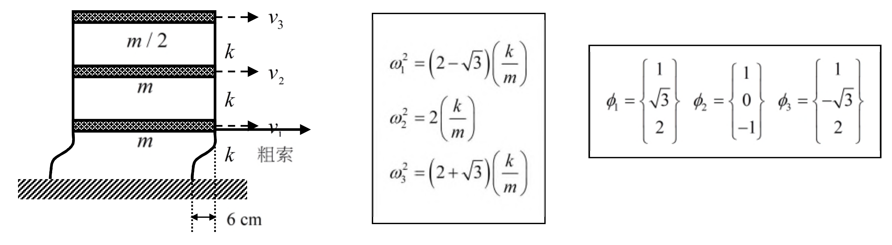

# SD-2021-3 題目正本

> 本檔只記錄考卷上寫了什麼、圖上畫了什麼，不含任何解法。解析見同資料夾 `SD-2021-3.md`。
> 判讀清單經使用者確認前，狀態為「待確認」；確認後本檔原則上不再修改（改動須回考卷原圖並記 log）。

| 項目 | 內容 |
|---|---|
| 考卷 | `raw/exams/SD-2021_結構動力分析與耐震設計.pdf`，第 2 頁（反面），第三題 |
| 考年 | 2021（民國110年）專技高考結構工程技師「結構動力分析與耐震設計」 |
| 配分 | 25 分（採階段性計分） |
| 附圖 | `SD-2021-3-fig-1.png`（舊擷取，圖右側空白處有游標）、`SD-2021-3-fig-2.png`（2026-11-15 由考卷 500 dpi 重擷取） |
| 判讀狀態 | **已確認**（2026-11-15 使用者授權依 Claude 建議確認；影響答案項目定案：#1 初始位移採粗索只拉一樓版、上兩層隨之平移，{v1,v2,v3}＝{6,6,6} cm（本庫舊解採 {6,0,0}，交階段 C）；#2 主解寫頂層層間剪力的時間函數並求其最大值。原轉錄：2026-11-15 轉錄；PyMuPDF 110 dpi 整頁＋500 dpi 局部放大，PDF 文字層核對原文；盲讀於開啟解析前完成） |

## 1. 考卷原文（逐字）

三、有一三層樓建築物進行自由振動實驗，此實驗係利用粗索在一樓向右拉位移 6 cm，隨後突然完全放開。樓地版假設為剛性，結構性質如圖所示，包括每層質量，每層勁度，振動頻率 $\omega_i$ 及振態 $\phi_i$，$i=1,2,3$。試求頂層（三樓）的層間剪力。（25 分）（採階段性計分）

## 2. 考卷給的公式、附表與參數

- 圖中方框照錄（考卷給定，不是解答）：

$$\omega_1^2=\left(2-\sqrt3\right)\left(\frac{k}{m}\right),\qquad \omega_2^2=2\left(\frac{k}{m}\right),\qquad \omega_3^2=\left(2+\sqrt3\right)\left(\frac{k}{m}\right)$$

$$\phi_1=\begin{Bmatrix}1\\ \sqrt3\\ 2\end{Bmatrix},\qquad \phi_2=\begin{Bmatrix}1\\ 0\\ -1\end{Bmatrix},\qquad \phi_3=\begin{Bmatrix}1\\ -\sqrt3\\ 2\end{Bmatrix}$$

- 給定（圖上）：由下往上各層質量 $m$、$m$、$m/2$，各層勁度皆 $k$（符號，無數值）；一樓初始位移 6 cm。
- 考卷沒有給：$m$、$k$ 的數值；阻尼；初始速度（題文「突然完全放開」）；所求是時間函數還是最大值。
- 卷首注意事項：㈠可以使用電子計算器。㈡不必抄題，作答時請將試題題號及答案依照順序寫在試卷上，於本試題上作答者，不予計分。㈢本科目除專門名詞或數理公式外，應使用本國文字作答。考試時間：2 小時。

## 3. 附圖

*證據圖 SD-2021-3-fig-2.png（500 dpi 重擷取；舊圖 SD-2021-3-fig-1.png 內容相同，右側空白處有游標）*

圖面文字照錄：m / 2、m、m、k、k、k、v3、v2、v1、粗索、6 cm、ω1² = (2 − √3)(k/m)、ω2² = 2(k/m)、ω3² = (2 + √3)(k/m)、φ1 = {1, √3, 2}、φ2 = {1, 0, −1}、φ3 = {1, −√3, 2}

## 4. 判讀清單

| # | 項目 | 判讀 | 圖上／題文依據 | 把握 |
|---|---|---|---|---|
| 1 | 初始位移形狀 | 粗索在一樓版拉 6 cm：一樓版相對地面位移 6 cm，二、三樓版隨之平移同樣 6 cm（初始位移 $\{v_1,v_2,v_3\}=\{6,6,6\}$ cm，只有一層柱變形） | 圖上只有一層柱畫成彎曲、上兩層柱為直線且樓版鉛垂對齊；6 cm 尺寸線量一層柱腳至一樓版右緣；粗索只拉一樓版（上兩層層剪力為零） | 確定（解讀）（影響答案） |
| 2 | 所求形式 | 頂層（第三層，$v_2$–$v_3$ 之間）層間剪力 $V_3=k(v_3-v_2)$；題文未說明求時間歷時或最大值 | 題文「試求頂層（三樓）的層間剪力」 | 不確定（解讀）（影響答案）；使用者授權依建議確認 |
| 3 | 阻尼 | 考卷沒有給阻尼 | 題文、附圖 | 確定 |
| 4 | 初始速度 | 0（突然完全放開，自靜止開始自由振動） | 題文「隨後突然完全放開」 | 確定（解讀） |
| 5 | 振態分量順序 | 向量由上而下依序為 $v_1$（一樓）、$v_2$、$v_3$（頂樓）；$\phi_2$ 的 0 在二樓 | 以圖上 $m,m,m/2$、各層 $k$ 組成的 $K$、$M$ 代入：依此順序三組 $(\omega_i^2,\phi_i)$ 皆滿足特徵方程式，反序不滿足 | 確定（解讀） |
| 6 | 樓層命名 | 考卷「一樓」指 $v_1$ 所在樓版（第一層頂）、「三樓／頂層」指 $v_3$ 樓版所在的第三層 | 圖上粗索箭頭與 $v_1$ 同高；題文「頂層（三樓）」 | 確定（解讀） |
| 7 | 質量 | 由下往上 $m$、$m$、$m/2$（質量標在各樓版下方的樓層空間內，代表其上方樓版質量） | 圖面 m（最下）、m、m/2（最上） | 確定 |
| 8 | 勁度 | 三層層側向勁度皆 $k$，標在各層右柱旁 | 圖面 k、k、k | 確定 |
| 9 | 樓版 | 剛性（只平移） | 題文「樓地版假設為剛性」＋網點厚板 | 確定 |
| 10 | 柱底 | 固定於地面 | 圖上斜線地面 | 確定 |
| 11 | 方向 | $v_1$、$v_2$、$v_3$、粗索拉力皆向右為正 | 圖上箭頭 | 確定 |

---
*轉錄：2026-11-15（SD-U1-3 題目正本推廣・批 3）*
*確認：2026-11-15 使用者授權依 Claude 建議確認（SD-U1-3 題目正本推廣・批 3，關卡一）*
