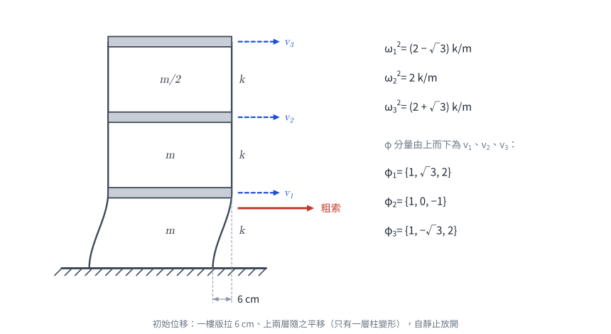
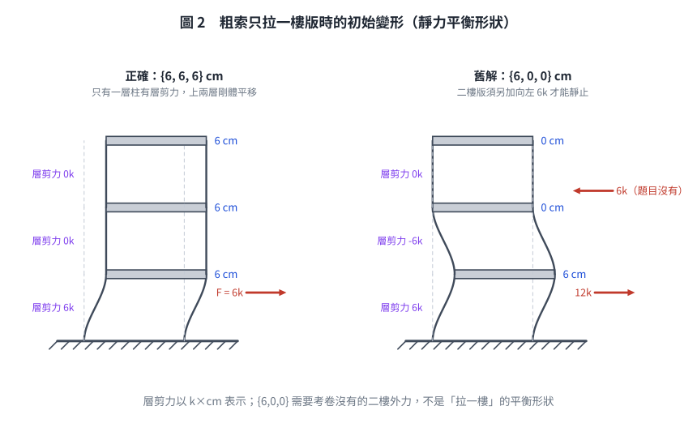
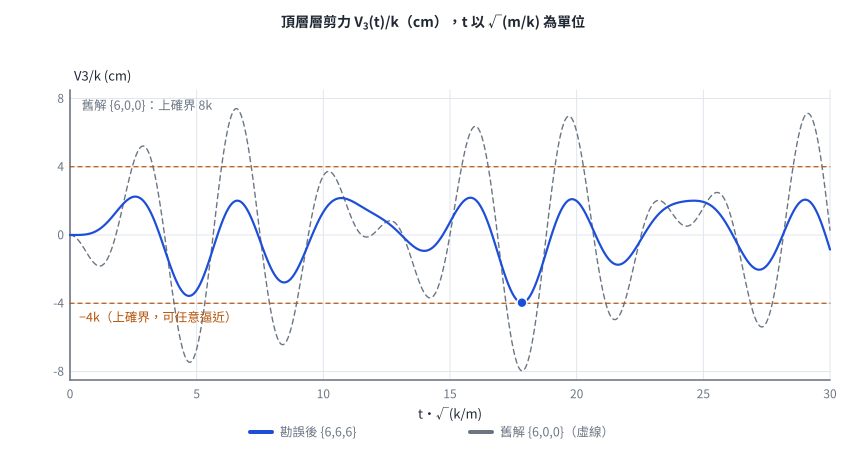

# 考題編號：SD-2021-3

**主分類：** `SD-U1-3` 單自由度、多自由度系統之動態分析及應用
**副分類：** `SD-U1-1` 結構動力基本性質及原理
**分析方法：** MDOF模態疊加法（自由振動初始條件展開）
**標籤：** `MDOF` `3自由度` `剪力建築` `自由振動` `模態疊加` `初始條件` `模態正交性` `層間剪力` `彈返法` `模態展開`

---

## 1. 題目（考卷原文見題目正本）

> 考卷原文、公式／附表、附圖與判讀清單（已確認）見 [`SD-2021-3-problem.md`](SD-2021-3-problem.md)。本節只列解題時最容易讀錯的地方與本解使用的記號；題意以題目正本為準。

*重繪自考卷附圖，依題目正本判讀清單；本圖攔下的判讀錯誤：粗索只拉一樓版、上兩層樓版隨之平移，初始位移不是 {6,0,0}。*

### 常見誤讀

| 項目 | 正確判讀 | 常見誤讀 |
|------|---------|---------|
| 初始位移 | 粗索只拉一樓版：一樓版相對地面 6 cm，上兩層隨之平移，$\{v_1,v_2,v_3\}=\{6,6,6\}$ cm、初速 0（判讀 #1、#4，使用者授權依建議確認） | $\{6,0,0\}$ cm：只有一樓有初始位移、上兩層不動（本庫舊解） |
| 所求 | 頂層（第三層）層間剪力 $V_3=k(v_3-v_2)$；主解寫時間函數並求最大值（判讀 #2，使用者授權依建議確認） | 只寫時間函數，或以 SRSS 估自由振動的最大值 |
| 振態分量順序 | 由上而下依序為 $v_1$（一樓）、$v_2$、$v_3$（頂樓）（判讀 #5） | 反序 |
| $v_i$ | 各樓版側向位移，向右為正（判讀 #11） | 當成速度（本庫舊解 §1 圖說） |
| 阻尼 | 考卷未給，視為無阻尼自由振動（判讀 #3） | — |

**本解記號：** $x_1,x_2,x_3$（即題圖 $v_1,v_2,v_3$）為一、二、三樓版側移；$A_i$ 為振態展開係數；$V_3=k(x_3-x_2)$。

---

## 2. 考題核心精神與出題者意圖 (Core Concepts & Examiner's Intent)

**核心觀念：** 先由「粗索只拉一樓版」判斷初始變形形狀（上兩層沒有外力、層剪力為零 → 隨一樓平移），再以**振態正交性**把初始位移展開為各振態貢獻，最後對頂層層間位移（$x_3 - x_2$）乘以層間勁度得層間剪力。

**出題者測驗能力：**
1. 由施力方式判斷靜態初始變形：只有被拉的那一層以下的柱有層剪力
2. 正確建立質量矩陣（注意三樓質量 $m/2$）
3. 以模態展開係數公式 $A_i = \phi_i^T[M]\mathbf{x}(0) / \phi_i^T[M]\phi_i$ 求各模態振幅
4. 由位移時程差求層間位移，再求層間剪力與其最大值

**關鍵陷阱：** 把初始位移寫成 $\{6,0,0\}$（只有一樓動、上兩層不動）——這個形狀需要在二樓版另加外力才能靜止平衡，與題意及考卷附圖（只有一層柱彎曲、上兩層樓版鉛垂對齊）不符。

---

## 3. 解題戰略地圖與陷阱分析 (Strategic Roadmap & Trap Analysis)

**作戰計畫：**
1. 確認初始條件：粗索只拉一樓版 → $\mathbf{x}(0) = \{6,6,6\}^T$ cm（題目正本判讀 #1），$\dot{\mathbf{x}}(0) = \{0,0,0\}^T$
2. 建立質量矩陣 $[M] = \text{diag}(m, m, m/2)$
3. 對每個振態計算 $\phi_i^T[M]\phi_i$（模態質量）及 $\phi_i^T[M]\mathbf{x}(0)$（模態初始值）
4. 求展開係數 $A_i$，驗算 $\sum A_i\phi_i = \mathbf{x}(0)$
5. 寫出 $x_2(t)$ 和 $x_3(t)$ 的時程
6. $V_3(t) = k[x_3(t) - x_2(t)]$，再討論最大值

**四大陷阱：**

| # | 陷阱 | 正確處理 |
|---|------|---------|
| 1 | 三樓質量誤用 $m$（應為 $m/2$） | $[M] = \text{diag}(m, m, m/2)$ |
| 2 | 初始條件誤設 $\{6,0,0\}$ | 粗索只拉一樓：上兩層層剪力為零、隨一樓平移 → $\{6,6,6\}$ cm |
| 3 | 初始速度 $\dot{\mathbf{x}}(0)$ 忘記設為零 | 突然放開瞬間結構靜止，速度為零 |
| 4 | 層間剪力用 $k \cdot x_3$ 而非 $k(x_3 - x_2)$；或以 SRSS 估自由振動最大值 | 頂層層間剪力 = $k \times$（三樓與二樓的**相對**位移）；自由振動的各振態同時起振（$t=0$ 同相），不適用 SRSS |

---

## 3.5 變數層次分析 (Variable Hierarchy Analysis)

> 複習提示：第一次解題後，在每個卡住的知識點旁標記 `⚠`；第二次複習時只看有 `⚠` 的項目。

### 最終目標

頂層（三樓）層間剪力 $V_3(t)$ 的完整時間歷程及其最大值

### 本題關鍵公式（依計算順序）

$$\text{Step 1: 模態質量} \quad M_i^* = \phi_i^T[M]\phi_i$$

$$\text{Step 2: 模態初始值} \quad c_i = \phi_i^T[M]\mathbf{x}(0)$$

$$\text{Step 3: 展開係數} \quad A_i = \frac{c_i}{\boxed{M_i^*}}$$

$$\text{Step 4: 位移時程} \quad x_j(t) = \sum_{i=1}^{3} A_i\phi_{ji}\cos(\omega_i t)$$

$$\text{Step 5: 層間剪力} \quad V_3(t) = k\left[\boxed{x_3(t)} - \boxed{x_2(t)}\right]$$

### L1：題目直接給定

| 符號 | 數值 | 說明 |
|------|------|------|
| $m_1, m_2$ | $m$ | 一、二樓質量 |
| $m_3$ | $m/2$ | 三樓質量 |
| $k$ | $k$ | 每層層間勁度 |
| 一樓初始位移 | $6$ cm | 粗索在一樓版拉 6 cm |
| $\phi_1,\phi_2,\phi_3$ | 如題 | 三個振態向量 |
| $\omega_1^2, \omega_2^2, \omega_3^2$ | $(2\pm\sqrt{3})k/m$，$2k/m$ | 振動頻率平方 |

### L2：需知識點推導

**初始位移形狀**

| 符號 | 公式／來源 | 卡關? |
|------|-----------|------|
| $\mathbf{x}(0)$ | 只有一樓版受粗索拉力 → 二、三層層剪力 $=0$ → $x_3-x_2=x_2-x_1=0$ → $\{6,6,6\}$ cm | |

**模態質量計算**

| 符號 | 公式／來源 | 卡關? |
|------|-----------|------|
| $M_1^*$ | $1^2m + (\sqrt{3})^2m + 2^2(m/2) = m+3m+2m = 6m$ | |
| $M_2^*$ | $1^2m + 0^2m + (-1)^2(m/2) = m+0+m/2 = 3m/2$ | |
| $M_3^*$ | $1^2m + (-\sqrt{3})^2m + 2^2(m/2) = m+3m+2m = 6m$ | |

**模態初始值**（$[M]\mathbf{x}(0) = \{6m,\,6m,\,3m\}^T$）

| 符號 | 公式／來源 | 卡關? |
|------|-----------|------|
| $c_1$ | $6m + 6\sqrt{3}m + 2\cdot 3m = (12+6\sqrt3)m$ | |
| $c_2$ | $6m + 0 - 3m = 3m$ | |
| $c_3$ | $6m - 6\sqrt{3}m + 6m = (12-6\sqrt3)m$ | |

**展開係數**

| 符號 | 公式／來源 | 卡關? |
|------|-----------|------|
| $A_1$ | $(12+6\sqrt3)m / 6m = 2+\sqrt3 = 3.732$ cm | |
| $A_2$ | $3m / (3m/2) = 2$ cm | |
| $A_3$ | $(12-6\sqrt3)m / 6m = 2-\sqrt3 = 0.268$ cm | |

### L3：深層知識（不懂就卡住）

| 知識點 | 說明 | 卡關? |
|--------|------|------|
| 模態正交性 $\phi_i^T[M]\phi_j = 0\ (i\neq j)$ | 保證模態展開係數可獨立求解 | |
| 靜態拉開的初始形狀 | 初始位移是「拉力作用下的靜力平衡形狀」：只在一樓施力時，一樓以上各層層剪力為零，上部樓層剛體平移 | |
| 層間剪力 = 層間勁度 × 相對位移 | 剪力建築中，柱剪力 = $k_i(x_i - x_{i-1})$ | |
| $\dot{\mathbf{x}}(0) = 0$ 的物理意義 | 靜態拉開後釋放，初速為零，自由振動中無 $\sin$ 項；各振態在 $t=0$ 同相起振 | |
| 自由振動的最大值 | 頻率比為無理數時時程不嚴格週期，$\max|V_3|$ 為各振態係數絕對值和的上確界（可任意逼近），不是 SRSS | |

---

## 4. 步驟化詳細計算過程 (Step-by-Step Detailed Calculation)

### Step 1：建立質量矩陣與初始條件

$$[M] = \begin{bmatrix} m & 0 & 0 \\ 0 & m & 0 \\ 0 & 0 & m/2 \end{bmatrix}$$

**初始條件**（粗索在一樓版拉 6 cm，突然放開）：一樓版受拉力 $F$，二、三樓版沒有外力，靜止平衡時二、三層層剪力為零，上兩層隨一樓平移（考卷附圖只有一層柱畫成彎曲；題目正本判讀 #1）：

$$\mathbf{x}(0) = \begin{Bmatrix} 6 \\ 6 \\ 6 \end{Bmatrix} \text{ cm}, \qquad \dot{\mathbf{x}}(0) = \begin{Bmatrix} 0 \\ 0 \\ 0 \end{Bmatrix}$$

*策略註解：初速為零 → 自由振動解只含 $\cos$ 項：$\mathbf{x}(t) = \sum_{i=1}^3 A_i\phi_i\cos(\omega_i t)$*

*圖 2　初始變形是拉力作用下的靜力平衡形狀。只拉一樓版時上兩層沒有外力、層剪力為零，只能剛體平移；本圖攔下把「拉一樓」讀成上兩層不動 $\{6,0,0\}$ 的錯誤。*

---

### Step 2：計算各振態的模態質量 $M_i^* = \phi_i^T[M]\phi_i$

**振態 1（$\phi_1 = \{1,\sqrt{3},2\}^T$）：**

$$M_1^* = 1^2\cdot m + (\sqrt{3})^2\cdot m + 2^2\cdot\frac{m}{2} = m + 3m + 2m = 6m$$

**振態 2（$\phi_2 = \{1,0,-1\}^T$）：**

$$M_2^* = 1^2\cdot m + 0^2\cdot m + (-1)^2\cdot\frac{m}{2} = m + 0 + \frac{m}{2} = \frac{3m}{2}$$

**振態 3（$\phi_3 = \{1,-\sqrt{3},2\}^T$）：**

$$M_3^* = 1^2\cdot m + (-\sqrt{3})^2\cdot m + 2^2\cdot\frac{m}{2} = m + 3m + 2m = 6m$$

---

### Step 3：計算模態初始值 $c_i = \phi_i^T[M]\mathbf{x}(0)$

$[M]\mathbf{x}(0) = \{6m,\ 6m,\ 3m\}^T$：

$$c_1 = 1\times 6m + \sqrt{3}\times 6m + 2\times 3m = (12+6\sqrt3)m$$

$$c_2 = 1\times 6m + 0\times 6m + (-1)\times 3m = 3m$$

$$c_3 = 1\times 6m + (-\sqrt{3})\times 6m + 2\times 3m = (12-6\sqrt3)m$$

---

### Step 4：求展開係數 $A_i = c_i / M_i^*$

$$A_1 = \frac{(12+6\sqrt3)m}{6m} = 2+\sqrt3 = 3.732 \text{ cm}$$

$$A_2 = \frac{3m}{3m/2} = 2 \text{ cm}$$

$$A_3 = \frac{(12-6\sqrt3)m}{6m} = 2-\sqrt3 = 0.268 \text{ cm}$$

**驗算（必要步驟）：**

$$\sum_{i=1}^3 A_i\phi_i = (2+\sqrt3)\begin{Bmatrix}1\\\sqrt{3}\\2\end{Bmatrix} + 2\begin{Bmatrix}1\\0\\-1\end{Bmatrix} + (2-\sqrt3)\begin{Bmatrix}1\\-\sqrt{3}\\2\end{Bmatrix} = \begin{Bmatrix}4+2\\ \sqrt3(2+\sqrt3-2+\sqrt3)\\ 8-2\end{Bmatrix} = \begin{Bmatrix}6\\6\\6\end{Bmatrix} \checkmark$$

*策略註解：第一振態的展開係數最大（$A_1=3.732$）——均勻平移的初始形狀最接近第一振態。*

---

### Step 5：寫出各樓層位移時程

$$\mathbf{x}(t) = (2+\sqrt3)\begin{Bmatrix}1\\\sqrt{3}\\2\end{Bmatrix}\cos(\omega_1 t) + 2\begin{Bmatrix}1\\0\\-1\end{Bmatrix}\cos(\omega_2 t) + (2-\sqrt3)\begin{Bmatrix}1\\-\sqrt{3}\\2\end{Bmatrix}\cos(\omega_3 t) \quad \text{[cm]}$$

**三樓位移：**

$$x_3(t) = 2(2+\sqrt3)\cos(\omega_1 t) - 2\cos(\omega_2 t) + 2(2-\sqrt3)\cos(\omega_3 t) \text{ [cm]}$$

**二樓位移：**

$$x_2(t) = \sqrt3(2+\sqrt3)\cos(\omega_1 t) + 0 - \sqrt3(2-\sqrt3)\cos(\omega_3 t) \text{ [cm]}$$

---

### Step 6：求頂層（三樓）層間剪力

**三樓層間位移**（三樓相對二樓的水平位移）：振態 $i$ 的層間位移形狀 $\phi_{3i}-\phi_{2i} = 2-\sqrt3,\ -1,\ 2+\sqrt3$，乘上 $A_i$：

$$x_3(t) - x_2(t) = (2+\sqrt3)(2-\sqrt3)\cos(\omega_1 t) - 2\cos(\omega_2 t) + (2-\sqrt3)(2+\sqrt3)\cos(\omega_3 t)$$

$$= \cos(\omega_1 t) - 2\cos(\omega_2 t) + \cos(\omega_3 t) \text{ [cm]}$$

**頂層層間剪力：**

$$\boxed{V_3(t) = k\left[\cos(\omega_1 t) - 2\cos(\omega_2 t) + \cos(\omega_3 t)\right]\ \text{（cm）}}$$

其中 $\omega_1=0.5176\sqrt{k/m}$、$\omega_2=1.4142\sqrt{k/m}$、$\omega_3=1.9319\sqrt{k/m}$；$k$ 的單位為 [力/長度]，$V_3$ 的單位為 [力]（$k$ 以 N/m 計時，係數 cm 換成 0.01 m）。$t=0$ 時 $V_3=0$ ✓（初始上兩層無層剪力）。

---

**等價表達（用慣性力驗算）：**

三樓方程式：$m_3\ddot{x}_3 = -k(x_3 - x_2)$ → $V_3 = -m_3\ddot{x}_3$

$$\ddot{x}_3 = -2(2+\sqrt3)\omega_1^2\cos(\omega_1 t) + 2\omega_2^2\cos(\omega_2 t) - 2(2-\sqrt3)\omega_3^2\cos(\omega_3 t)$$

$$V_3 = -\frac{m}{2}\ddot{x}_3 = m\left[(2+\sqrt3)\omega_1^2\cos(\omega_1 t) - \omega_2^2\cos(\omega_2 t) + (2-\sqrt3)\omega_3^2\cos(\omega_3 t)\right]$$

代入 $\omega_1^2=(2-\sqrt3)k/m$、$\omega_2^2=2k/m$、$\omega_3^2=(2+\sqrt3)k/m$：

$$= k\left[\cos(\omega_1 t) - 2\cos(\omega_2 t) + \cos(\omega_3 t)\right] \checkmark$$

---

### Step 7：最大頂層層間剪力

- 各振態貢獻 $k$、$2k$、$k$（cm）。恰有 $\omega_3-\omega_1=\omega_2$（$(\omega_3-\omega_1)^2 = 4-2\sqrt{(2+\sqrt3)(2-\sqrt3)} = 2$），令 $a=\omega_2t/2$、$b=(\omega_1+\omega_3)t/2$：
$$\frac{V_3}{k} = 2\cos a\cos b - 2(2\cos^2 a - 1)$$
  $b/a=\sqrt3$ 為無理數，$\cos b$ 可任意接近 $\pm1$，所以 $V_3/k$ 的範圍是 $[-4,\ 2.25]$ cm。

$$\boxed{|V_3|_{\max} = 4k\ \text{（cm）}=0.04k\ \text{（N，}k\text{ 以 N/m 計）}}$$

  為三振態係數絕對值和（$1+2+1$），可任意逼近（數值掃描 $t\sqrt{k/m}\le3000$ 得 $3.99999k$）；正向最大 $+2.25k$。

*圖 3　頂層層剪力時間歷時。三個振態在 $t=0$ 同相起振，最大值由絕對值和 $4k$ 給出上確界；本圖攔下以 SRSS 估自由振動最大值，以及初始形狀讀錯使層剪力加倍。*
- 若以 SRSS 估：$k\sqrt{1+4+1}=2.45k$——自由振動各振態在 $t=0$ 同相起振，不是反應譜的隨機峰值組合，SRSS 不適用，僅供對照。

---

## 5. 關鍵爭議點與進階探討 (Critical Issues & Advanced Discussion)

**爭議點：初始位移是 $\{6,6,6\}$ 還是 $\{6,0,0\}$**

以粗索靜態拉一樓版，初始條件是「拉力作用下的靜力平衡位移」。只有一樓版受力時，二、三樓版沒有外力，二、三層層剪力為零，上兩層隨一樓平移，初始位移為 $\{6,6,6\}$ cm；考卷附圖也只把一層柱畫成彎曲、上兩層樓版鉛垂對齊（題目正本判讀 #1）。

$\{6,0,0\}$（本庫 2026-11-15 前的舊解）要讓二樓版維持不動，必須在二樓版另加一個向左的力 $6k$，與題意不符。對照其結果：$A_i=1,4,1$，$V_3=k[(2-\sqrt3)\cos\omega_1t-4\cos\omega_2t+(2+\sqrt3)\cos\omega_3t]$，最大值趨近 $8k$（cm），是正確答案的 2 倍。

**進階：均勻平移的初始形狀以第一振態為主**

$A_1=3.732$、$A_2=2$、$A_3=0.268$ cm：初始形狀 $\{1,1,1\}$ 與第一振態 $\{1,\sqrt3,2\}$ 同號，第一振態貢獻最大。但頂層層間剪力看的是 $\phi_{3i}-\phi_{2i}$，第一振態的頂層層間位移形狀很小（$2-\sqrt3$），第三振態很大（$2+\sqrt3$），兩者相乘後三振態對 $V_3$ 的貢獻為 $1:2:1$——**高振態對上部樓層的層剪力貢獻不可忽略**。

**進階：最大層間剪力**

三個振態頻率比 $\omega_3/\omega_1 = 2+\sqrt3$ 為無理數，時程不嚴格週期；最大值由絕對值和 $4k$ 給出上確界（見 Step 7）。SRSS（$2.45k$）只適用於反應譜分析中各振態峰值不同時發生的情形，不適用於本題自由振動。

*修正日期：2026-11-15（§1 改為指向題目正本，重繪附圖 figs/SD-2021-3-fig-1-problem.svg；§1 舊重述的初始位移 {6,0,0} 與考卷不符、圖說把 v 寫成速度，改列常見誤讀（正文勘誤見階段 C））*
*修正日期：2026-11-15（初始位移 {6,0,0} → {6,6,6} cm（考卷粗索只拉一樓版，上兩層隨之平移；題目正本判讀 #1），頂層層剪力 V3 改為 k[cos ω1t − 2cos ω2t + cos ω3t]，補最大值 4k（cm）；舊解 SRSS 5.48k 刪除。改 §2、§3、§3.5、§4、§5；驗證：scripts/fixes/2026-11-15_verify_SD-2021-3.py 振態閉合解、solve_ivp 數值積分、長時間掃描三路一致 MISMATCHES: 0）*
*修正日期：2026-11-15（非勘誤）§4 Step 1、Step 7 補解題圖解 figs/SD-2021-3-fig-2-initial.svg、fig-3-v3.svg（圖解補繪，腳本 gen_SD-2021-3.py，可重跑）*
