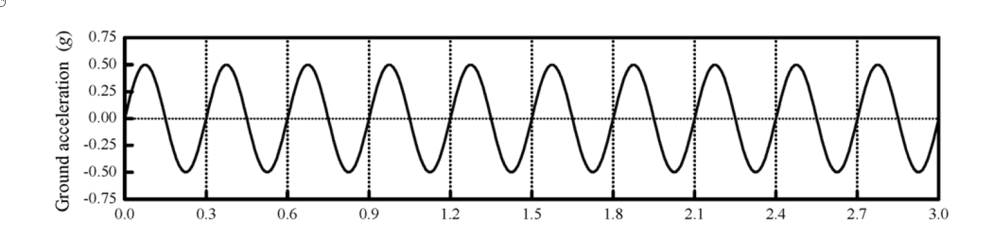

# SD-2021-4 題目正本

> 本檔只記錄考卷上寫了什麼、圖上畫了什麼，不含任何解法。解析見同資料夾 `SD-2021-4.md`。
> 判讀清單經使用者確認前，狀態為「待確認」；確認後本檔原則上不再修改（改動須回考卷原圖並記 log）。

| 項目 | 內容 |
|---|---|
| 考卷 | `raw/exams/SD-2021_結構動力分析與耐震設計.pdf`，第 2 頁（反面），第四題 |
| 考年 | 2021（民國110年）專技高考結構工程技師「結構動力分析與耐震設計」 |
| 配分 | 25 分（採階段性計分） |
| 附圖 | `SD-2021-4-fig-1.png`（地表加速度歷時曲線圖，舊擷取，清晰無雜訊，沿用） |
| 判讀狀態 | **已確認**（2026-11-15 使用者授權依 Claude 建議確認；影響答案項目定案：#1 取週期 0.1–0.3 s 範圍內的最不利值；#2 ㈠ 主解先求線彈性穩態反應，結構降伏時說明所用的近似法則及其限制。原轉錄：2026-11-15 轉錄；PyMuPDF 110 dpi 整頁＋300 dpi 局部放大，PDF 文字層核對原文；盲讀於開啟解析前完成） |

## 1. 考卷原文（逐字）

四、有一棟建築物其結構系統可簡單模擬成一單自由度系統，其動力特性估計為：

總質量：$m=2\times10^6$ kg

振動週期：$T=0.1\sim0.3$ sec。由於基礎以及結構勁度的不確定性，因此預估結構振動週期介於 0.1 秒和 0.3 秒之間。

黏滯性阻尼比：$\xi=7.5\%$

降伏強度：$R_y=2.5\times10^4$ kN

假設此棟建築物受到下列地表加速度的作用，共 9 秒，此處僅繪出前 3 秒的示意圖。其中 $1g=980\ \mathrm{cm/sec^2}$。

（附圖）

試回答以下的問題：（請逐步說明取得此結果的原因，採階段性計分，共 25 分）

㈠最大側向位移？

㈡抵抗此地表加速度所需的位移韌性強度（displacement ductility ratio）？

## 2. 考卷給的公式、附表與參數

- 考卷沒有給參考公式。
- 給定：$m=2\times10^6$ kg；$T=0.1\sim0.3$ s；$\xi=7.5\%$；$R_y=2.5\times10^4$ kN；$1g=980$ cm/s²；地表加速度歷時共 9 秒（圖只畫前 3 秒）。
- 考卷沒有給：勁度數值（只給週期範圍）；降伏後勁度（遲滯模型）；初始條件（視為靜止）；地表加速度的解析式（只有圖）。
- 卷首注意事項：㈠可以使用電子計算器。㈡不必抄題，作答時請將試題題號及答案依照順序寫在試卷上，於本試題上作答者，不予計分。㈢本科目除專門名詞或數理公式外，應使用本國文字作答。考試時間：2 小時。

## 3. 附圖

*證據圖 SD-2021-4-fig-1.png（舊擷取，與考卷 300 dpi 局部放大核對一致）*

圖面文字照錄：Ground acceleration (g)、0.75、0.50、0.25、0.00、−0.25、−0.50、−0.75、0.0、0.3、0.6、0.9、1.2、1.5、1.8、2.1、2.4、2.7、3.0

## 4. 判讀清單

| # | 項目 | 判讀 | 圖上／題文依據 | 把握 |
|---|---|---|---|---|
| 1 | 週期不確定的處理 | 所求最大側向位移、韌性需求是週期在 0.1–0.3 s 範圍內的最不利值（題文說明週期因不確定性介於此範圍） | 題文「預估結構振動週期介於 0.1 秒和 0.3 秒之間」 | 確定（解讀）（影響答案） |
| 2 | ㈠ 的反應型態 | 考卷未說明 ㈠ 是線彈性反應或已降伏的非彈性反應；㈡ 要求位移韌性比，表示結構會超過 $R_y$ | 題文 ㈠、㈡ | 不確定（解讀）（影響答案）；使用者授權依建議確認 |
| 3 | 地表加速度型式 | 正弦波 $\ddot u_g(t)=0.5g\sin(2\pi t/0.3)$：振幅 0.50 g、週期 0.3 s、$t=0$ 自零以正斜率起始 | 圖上峰谷對齊 ±0.50 刻度；零交點落在每 0.3 s 點線上（0.15 s 處由正轉負）；300 dpi 目視 | 確定 |
| 4 | 延時 | 共 9 秒（30 個週期），圖只畫前 3 秒；9 秒後停止 | 題文「共 9 秒，此處僅繪出前 3 秒的示意圖」 | 確定 |
| 5 | 初始狀態 | 靜止（考卷未寫，視為 $u(0)=\dot u(0)=0$） | 題文未給 | 確定（解讀） |
| 6 | 單位 | $1g=980$ cm/s²（題給）；$R_y$ 單位 kN | 題文 | 確定 |
| 7 | 考卷沒有給 | 降伏後勁度、遲滯模型；勁度數值；所求位移是相對地表位移（「側向位移」） | 題文 | 確定（解讀） |

---
*轉錄：2026-11-15（SD-U1-3 題目正本推廣・批 3）*
*確認：2026-11-15 使用者授權依 Claude 建議確認（SD-U1-3 題目正本推廣・批 3，關卡一）*
