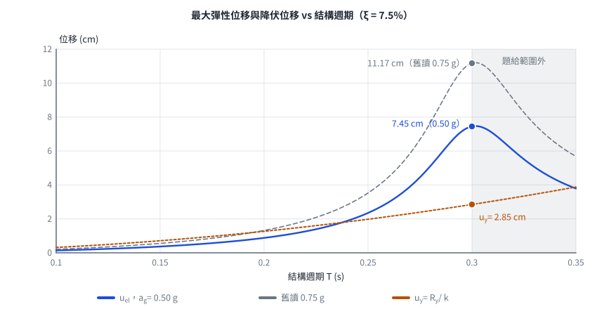
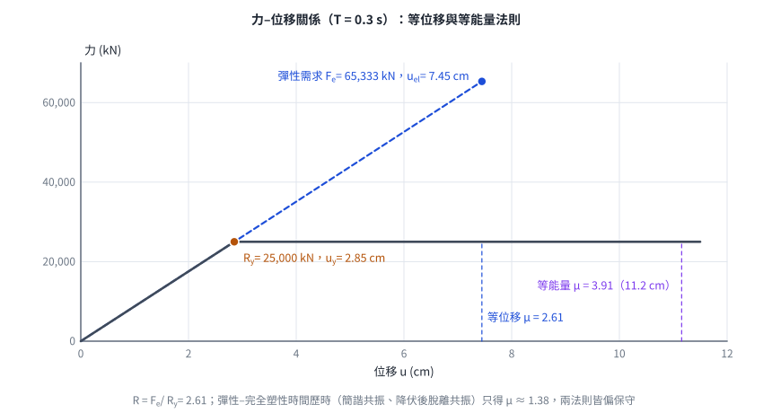

# 考題編號：SD-2021-4

**主分類：** `SD-U1-3` 單自由度、多自由度系統之動態分析及應用
**副分類：** `SD-U2-2` 建築耐震設計規範
**分析方法：** SDOF簡諧激振反應（共振判斷）＋等位移法則（彈塑性韌性需求）
**標籤：** `SDOF` `簡諧地震` `共振` `週期不確定性` `最大側向位移` `位移韌性` `等位移法則` `等能量法則` `強度折減係數` `彈塑性` `降伏強度` `穩態響應`

---

## 1. 題目（考卷原文見題目正本）

> 考卷原文、公式／附表、附圖與判讀清單（已確認）見 [`SD-2021-4-problem.md`](SD-2021-4-problem.md)。本節只列解題時最容易讀錯的地方與本解使用的記號；題意以題目正本為準。

### 常見誤讀

| 項目 | 正確判讀 | 常見誤讀 |
|------|---------|---------|
| 地表加速度振幅 | 0.50 g（圖上峰谷對齊 ±0.50 刻度；判讀 #3） | 0.75 g（本庫舊解 §1，把縱軸上限當振幅） |
| 地動波形 | 正弦波、週期 0.3 s、自零以正斜率起始，共 9 秒（30 個週期）（判讀 #3、#4） | — |
| 週期不確定 | 取 0.1–0.3 s 範圍內的最不利值（判讀 #1，使用者授權依建議確認） | 取平均週期 0.2 s |
| ㈠ 反應型態 | 主解先求線彈性穩態反應；結構降伏時說明所用近似法則及其限制（判讀 #2，使用者授權依建議確認） | 未說明是彈性或非彈性位移 |
| 單位 | $1g=980$ cm/s²（題給）；$R_y$ 單位 kN | 改用 9.81 m/s² |

**本解記號：** $a_g$ 地表加速度振幅、$T_g$ 地動週期；$u_{el}$ 彈性位移、$u_y=R_y/k$ 降伏位移、$\mu$ 位移韌性比。

---

## 2. 考題核心精神與出題者意圖 (Core Concepts & Examiner's Intent)

**核心觀念：**
- (一) 在週期不確定的情況下，辨識**最危險週期**（共振條件 $T = T_g$），以穩態響應公式計算最大彈性位移；若降伏則用等位移法則取近似
- (二) 比較彈性需求與降伏強度，求「強度折減係數 $R$」，再由適當法則（等位移或等能量）換算「韌性需求 $\mu$」

**出題者測驗能力：**
1. 辨識簡諧地動中的共振條件（$T = T_g$，最大放大）
2. 計算穩態相對位移（$u_{el} = a_g/(\omega_0^2 \cdot 2\xi)$）
3. 判斷結構是否降伏（比較 $u_{el}$ 與 $u_y = R_y/k$）
4. 正確選用**等位移法則**（中長週期）或**等能量法則**（短週期）

**關鍵陷阱：** 週期不確定時要考慮**最不利情況**（共振），而非用平均週期；等位移 vs 等能量法則的適用條件容易混淆。

---

## 3. 解題戰略地圖與陷阱分析 (Strategic Roadmap & Trap Analysis)

**作戰計畫：**
1. 讀取地動：週期 $T_g = 0.3$ sec，振幅 $a_g = 0.50g$（圖上峰谷對齊 ±0.50 刻度），持續 9 sec
2. 確認最不利週期：在 $T \in [0.1, 0.3]$ sec 中找最大響應（$T = 0.3$ sec 共振）
3. 計算共振穩態彈性位移（由反應譜或放大係數公式）
4. 計算降伏位移 $u_y = R_y/(m\omega_0^2)$
5. 比較 $u_{el}$ 與 $u_y$ → 判斷結構是否降伏
6. 若降伏：用等位移法則求最大位移及韌性需求

**四大陷阱：**

| # | 陷阱 | 正確處理 |
|---|------|---------|
| 1 | 以「平均週期」$T = 0.2$ sec 計算，非最不利 | $T = T_g = 0.3$ sec 為共振最大值 |
| 2 | 穩態位移公式用錯（忘記 $2\xi$ 在分母） | 共振 $D = 1/(2\xi)$；$u_{el} = a_g/(\omega_0^2 \cdot 2\xi)$ |
| 3 | 未檢查是否降伏，直接以彈性最大值答題 | 必須比較 $u_{el}$ 與 $u_y$ |
| 4 | 近似法則的適用條件說錯 | 等位移／等能量法則的分界是**反應譜轉角週期**（約 0.5 s），不是地動週期 $T_g$；本題 $T=0.3$ s 屬短週期，依 Newmark–Hall 應用等能量法則，但本題為窄頻簡諧共振，兩法則都偏保守，答題要寫明所用法則與假設 |

---

## 3.5 變數層次分析 (Variable Hierarchy Analysis)

> 複習提示：第一次解題後，在每個卡住的知識點旁標記 `⚠`；第二次複習時只看有 `⚠` 的項目。

### 最終目標

(一) 最大側向位移 $u_{max}$；(二) 位移韌性需求 $\mu$

### 本題關鍵公式（依計算順序）

$$\text{Step 1: 最不利週期} \quad T_{worst} = T_g = 0.3 \text{ sec} \Rightarrow r = 1 \text{（共振）}$$

$$\text{Step 2: 彈性穩態位移} \quad u_{el} = \frac{a_g}{\omega_0^2 \cdot 2\xi}$$

$$\text{Step 3: 結構勁度} \quad k = m\omega_0^2$$

$$\text{Step 4: 降伏位移} \quad u_y = \frac{R_y}{\boxed{k}}$$

$$\text{Step 5: 降伏判斷} \quad u_{el} \gtrless u_y$$

$$\text{Step 6: 強度折減係數} \quad R = \frac{u_{el}}{u_y} = \frac{F_{el,max}}{R_y}$$

$$\text{Step 7: 等位移法則（與 ㈠ 連貫）} \quad \mu = R, \quad u_{max} = u_{el}；\quad \text{等能量法則對照：} \mu = \frac{R^2+1}{2}$$

### L1：題目直接給定

| 符號 | 數值 | 說明 |
|------|------|------|
| $m$ | $2\times10^6$ kg | 總質量 |
| $T$ | $0.1\sim0.3$ sec | 振動週期範圍（不確定） |
| $\xi$ | $7.5\%$ | 黏滯性阻尼比 |
| $R_y$ | $2.5\times10^4$ kN | 降伏強度 |
| $a_g$ | $0.50g = 490$ cm/s² | 地表加速度振幅（圖上峰谷對齊 ±0.50） |
| $T_g$ | $\approx 0.3$ sec | 地動週期（由圖讀取） |
| 持續時間 | 9 sec | 遠大於自然週期，可達穩態 |

### L2：需知識點推導

**最不利週期判斷**

| 符號 | 公式／來源 | 卡關? |
|------|-----------|------|
| $T_{worst}$ | $T = T_g = 0.3$ sec（$r=1$，共振最大 $D$）| |
| 說明 | 在 $T$ 越接近 $T_g$ 時，$D$ 越大；$T=0.3$ sec 在範圍內且與 $T_g$ 相同 | |

**彈性最大位移（$T = 0.3$ sec）**

| 符號 | 公式／來源 | 卡關? |
|------|-----------|------|
| $\omega_0$ | $2\pi/T = 20.94$ rad/s | |
| $\omega_0^2$ | $4\pi^2/T^2 = 438.7$ rad²/s² | |
| $D$（共振） | $1/(2\xi) = 1/0.15 = 6.667$ | |
| $u_{el}$ | $a_g/(\omega_0^2 \times 2\xi) = 490/65.81 = 7.447$ cm | |

**降伏位移與韌性**

| 符號 | 公式／來源 | 卡關? |
|------|-----------|------|
| $k$ | $m\omega_0^2 = 8.774\times10^8$ N/m | |
| $u_y$ | $R_y/k = 2.5\times10^7/8.774\times10^8 = 2.850$ cm | |
| $R$ | $u_{el}/u_y = 7.447/2.850 = 2.613$ | |
| $\mu$ | $= R = 2.61$（等位移法則；等能量法則對照 3.91） | |

### L3：深層知識（不懂就卡住）

| 知識點 | 說明 | 卡關? |
|--------|------|------|
| 等位移法則適用條件 | 中長週期（$T$ 大於反應譜轉角週期 $T_c$，約 0.5 s）：$u_{max,inelastic} \approx u_{max,elastic}$；此處的 $T_c$ 是設計譜的特性，不是本題地動週期 $T_g$ | |
| 等能量法則適用條件 | 短週期（約 0.1–0.5 s，Newmark–Hall）：$\mu = (R^2+1)/2$ | |
| 簡諧共振下的非彈性反應 | 結構一降伏等效週期變長、脫離共振，實際韌性需求遠小於兩法則（彈性–完全塑性時間歷時 $\mu\approx1.4$），兩法則皆偏保守 | |
| 強度折減係數 $R$ 的物理意義 | $R = F_{el}/R_y$：若結構具足夠強度（$R \leq 1$），則無需韌性；$R > 1$ 表示結構強度不足，需韌性來消散能量 | |
| 持續 9 sec 的重要性 | 9 sec ≫ $T$，確保達到穩態；對短週期結構，穩態在 2~3 sec 內已達到（$t_{settle} \approx T/(2\pi\xi)$） | |

---

## 4. 步驟化詳細計算過程 (Step-by-Step Detailed Calculation)

### Step 1：讀取地動特性

從圖中判斷地表加速度為簡諧激振：

$$\ddot{u}_g(t) = 0.50g \cdot \sin\!\left(\frac{2\pi}{T_g}t\right), \quad T_g = 0.3 \text{ sec（由圖時間軸判斷；峰谷對齊 ±0.50 刻度）}$$

$$a_g = 0.50 \times 980 = 490 \text{ cm/s}^2$$

**穩態確認：** 地動持續 9 sec，對 $T = 0.3$ sec 的結構：
$$t_{settle} \approx \frac{T}{2\pi\xi} = \frac{0.3}{2\pi \times 0.075} \approx 0.64 \text{ sec} \ll 9 \text{ sec}$$

∴ 9 sec 之後已充分達到穩態。

---

### Step 2：確認最不利週期

在 $T \in [0.1, 0.3]$ sec 範圍內，地動頻率比：

$$r = \frac{T_{\text{structure}}}{T_g} = \frac{\omega_g}{\omega_0}$$

| $T$ (sec) | $r = T/T_g$ | 動力放大係數 $D$ |
|-----------|------------|----------------|
| $0.1$ | $0.1/0.3 = 0.333$ | $1/\sqrt{(1-0.111)^2+(0.05)^2} \approx 1.12$ |
| $0.2$ | $0.2/0.3 = 0.667$ | $1/\sqrt{(1-0.444)^2+(0.10)^2} \approx 1.79$ |
| **$0.3$** | **$0.3/0.3 = 1.0$**（共振） | **$1/(2\xi) = 6.67$（最大）** |

*策略註解：$r = 1$（$T = T_g = 0.3$ sec）時，動力放大係數最大（$D = 6.67$），為**最不利週期**。以下以 $T = 0.3$ sec 計算。*

---

### (一) 最大側向位移

**彈性穩態相對位移（$T = 0.3$ sec，$r = 1$）：**

$$\omega_0 = \frac{2\pi}{T} = \frac{2\pi}{0.3} = 20.94 \text{ rad/s}$$

$$\omega_0^2 = \frac{4\pi^2}{T^2} = \frac{4\pi^2}{0.09} = 438.7 \text{ rad}^2/\text{s}^2$$

共振穩態位移（相對位移）：

$$u_{el} = \frac{a_g}{\omega_0^2 \cdot 2\xi} = \frac{490}{438.7 \times 0.15} = \frac{490}{65.81} = \mathbf{7.447 \text{ cm}}$$

（彈性需求力 $F_e = k\,u_{el} = m a_g/(2\xi) = 2\times10^6 \times 4.90/0.15 = 65{,}333$ kN $> R_y = 25{,}000$ kN。）

**降伏位移計算：**

$$k = m\omega_0^2 = 2\times10^6 \times 438.7 = 8.774\times10^8 \text{ N/m} = 8.774\times10^5 \text{ kN/m}$$

$$u_y = \frac{R_y}{k} = \frac{2.5\times10^4}{8.774\times10^5} = 0.02850 \text{ m} = \mathbf{2.850 \text{ cm}}$$

**降伏判斷：**

$$u_{el} = 7.447 \text{ cm} > u_y = 2.85 \text{ cm} \;\Rightarrow\; \text{結構降伏（非線性）}$$

等效強度折減係數：

$$R = \frac{u_{el}}{u_y} = \frac{7.447}{2.850} = 2.613 \quad \text{（彈性需求為降伏強度的 2.61 倍）}$$

**等位移法則（Equal Displacement Rule）：**

採用理由：題目 ㈠ 只能由線彈性穩態反應求得，等位移法則把非彈性最大位移近似為彈性最大位移，與 ㈠ 直接連貫。須注意 $T=0.3$ s 依 Newmark–Hall 屬短週期（等能量區），且本題為窄頻簡諧共振，兩法則都偏保守（見下方比較表）。

$$u_{max,inelastic} \approx u_{max,elastic} = u_{el}$$

$$\boxed{u_{max} \approx 7.45 \text{ cm}}$$

*（發生於 $T = 0.3$ sec，共振最不利情況）*

*圖 2　週期不確定時的最不利週期。題給範圍內位移隨 $T$ 單調增加，最大在 $T=0.3$ s（與地動共振）；本圖攔下把縱軸上限 0.75 g 當成振幅，以及取平均週期 0.2 s 作答。*

---

**補充驗算（$T = 0.1$ sec，最有利情況）：**

$$r = 0.333, \quad D \approx 1.12, \quad u_{el} = \frac{490}{3948} \times 1.12 = 0.139 \text{ cm}$$

$$k = 2\times10^6 \times 3948 = 7.896\times10^9 \text{ N/m}, \quad u_y = \frac{2.5\times10^7}{7.896\times10^9} = 0.317 \text{ cm}$$

$$u_{el} = 0.139 \text{ cm} < u_y = 0.317 \text{ cm} \;\Rightarrow\; \text{結構維持彈性，} u_{max} = 0.139 \text{ cm}$$

∴ $T = 0.3$ sec 確實為最不利週期（位移差 50 倍以上）。

---

### (二) 位移韌性強度（Displacement Ductility Ratio）

韌性需求（ductility demand）定義：

$$\mu = \frac{u_{max}}{u_y}$$

由等位移法則（與 ㈠ 連貫）：

$$\mu = R = \frac{u_{el}}{u_y} = \frac{7.447}{2.850} = \boxed{2.61}$$

**物理意義：** 結構必須具有至少 $\mu = 2.61$ 的位移韌性能力，才能在不倒塌的前提下通過此地表加速度的作用。

---

**不同法則比較（供參考）：**

| 法則 | 適用條件 | 計算結果 |
|------|---------|---------|
| **等位移法則** | 中長週期（$T > T_c \approx 0.5$ s）；本題取之與 ㈠ 連貫 | $\mu = R = 2.61$ |
| 等能量法則 | 短週期（約 0.1–0.5 s，Newmark–Hall） | $\mu = (R^2+1)/2 = (2.613^2+1)/2 = 3.91$ |
| 彈性–完全塑性時間歷時（對照） | 本題簡諧地動直接積分（Newmark 平均加速度法） | $u_{max}=3.94$ cm，$\mu \approx 1.38$（降伏後脫離共振） |
| 本題選用 | **等位移（寫明假設）** | **$\mu = 2.61$** |

*圖 3　韌性比的兩種近似。先比較 $F_e$ 與 $R_y$ 判定降伏，再依所採法則求 $\mu$；本圖攔下等位移與等能量法則混用，以及未先判定是否降伏。*

*策略註解：依 Newmark–Hall，$T=0.3$ s 屬短週期，寬頻地震下等能量法則較合理（3.91）；本題主解採等位移是為了與 ㈠ 的彈性位移連貫，答題時兩者都寫並說明假設最穩。窄頻簡諧共振下結構一降伏就脫離共振，兩法則都高估（時間歷時約 1.4）。*

---

## 5. 關鍵爭議點與進階探討 (Critical Issues & Advanced Discussion)

**爭議點 1：最不利週期的選取**

本題明確說明週期不確定，因此必須考慮**最不利情況（worst case）**。$T = 0.3$ sec 落在不確定範圍末端且等於地動週期，導致共振，產生最大響應。工程實務上，對週期不確定的結構通常進行**敏感性分析**，確認設計足以抵抗所有可能週期下的地震需求。

**爭議點 2：簡諧地動 vs 真實地震**

本題用**持續 9 秒的簡諧加速度**模擬地震，是一種理想化（真實地震是非定常過程）。簡諧模型在共振條件下會高估結構響應（真實地震持時通常較短，不會完全達到穩態），因此本題結果偏保守。

**爭議點 3：等位移法則的適用邊界**

等位移／等能量法則的分界是設計反應譜的轉角週期（約 0.5 s），與本題地動週期 $T_g$ 無關。$T=0.3$ s 依 Newmark–Hall 屬短週期，寬頻地震下韌性需求會大於等位移法則的 $\mu=R$（等能量 3.91）；但本題是窄頻簡諧共振，降伏後等效週期變長、離開共振，彈性–完全塑性時間歷時只得 $\mu\approx1.38$。考試以等位移法則作答時須寫明假設。

**進階探討：韌性與強度的取捨**

- 若提高 $R_y$（增加強度，例如翻倍為 5×10⁴ kN），則 $R = 1.31$，韌性需求降為 $\mu = 1.31$（更容易設計）；$R_y \ge 65{,}333$ kN 時結構保持彈性
- 若採用隔震（$T \to 2$ sec），共振消失，可大幅降低韌性需求
- **「強度 vs 韌性」的平衡**是耐震設計的核心哲學（韌性設計 vs 強度設計）

*修正日期：2026-11-15（§1 改為指向題目正本；§1 舊重述的地表加速度振幅 0.75 g 與考卷圖 0.50 g 不符，改列常見誤讀（正文勘誤見階段 C））*
*修正日期：2026-11-15（地表加速度振幅 0.75 g → 0.50 g（考卷圖峰谷對齊 ±0.50 刻度；題目正本判讀 #3）：u_el 11.17 → 7.447 cm、R＝μ 3.92 → 2.61（等位移法則），等能量對照 8.18 → 3.91，T＝0.1 s 補驗算 0.209 → 0.139 cm，延伸思考 R 1.96 → 1.31；更正等位移／等能量法則分界說明（是反應譜轉角週期，不是地動週期 T_g），補彈性–完全塑性時間歷時對照 μ≈1.38。改 §3、§3.5、§4、§5；驗證：scripts/fixes/2026-11-15_verify_SD-2021-4.py 閉合式與 Newmark 時間歷時一致 MISMATCHES: 0）*
*修正日期：2026-11-15（非勘誤）§4 ㈠、㈡ 補解題圖解 figs/SD-2021-4-fig-2-resonance.svg、fig-3-ductility.svg（圖解補繪，腳本 gen_SD-2021-4.py，可重跑）*
