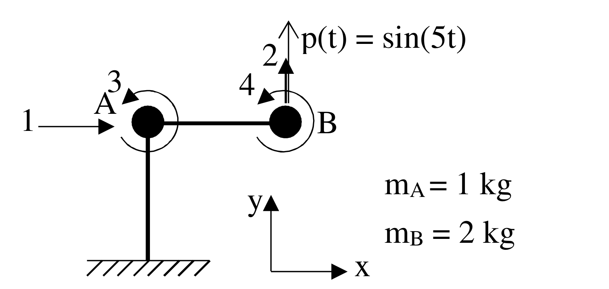

# SD-2022-1 題目正本

> 本檔只記錄考卷上寫了什麼、圖上畫了什麼，不含任何解法。解析見同資料夾 `SD-2022-1.md`。
> 判讀清單經使用者確認前，狀態為「待確認」；確認後本檔原則上不再修改（改動須回考卷原圖並記 log）。

| 項目 | 內容 |
|---|---|
| 考卷 | `raw/exams/SD-2022_結構動力分析與耐震設計.pdf`，第 1 頁（正面），第一題 |
| 考年 | 2022（民國111年）專技高考結構工程技師「結構動力分析與耐震設計」 |
| 配分 | 25 分（㈠10、㈡10、㈢5） |
| 附圖 | `SD-2022-1-fig-1.png`（舊擷取，解析度低，p(t) 標籤上壓有游標）、`SD-2022-1-fig-2.png`（2026-11-15 由考卷 500 dpi 重擷取） |
| 判讀狀態 | **已確認**（2026-11-15 使用者授權依 Claude 建議確認；影響答案項目定案：#1 忽略軸向變形，B 點質量同時隨自由度 1（水平）與自由度 2（垂直）運動。原轉錄：2026-11-15 轉錄；PyMuPDF 110 dpi 整頁＋500／900 dpi 局部放大，PDF 文字層與向量座標核對；盲讀於開啟解析前完成） |

## 1. 考卷原文（逐字）

一、剛構架受動態載重如下圖，忽略軸向變形、構架質量以及節點 A、B 集中質量的旋轉慣量，假設柱以及梁的長度 L 均為 3 m、撓曲剛度 EI 值均為 2000 N/m²，在第 2 自由度上受向上為正的簡諧外力作用。回答下列問題：

㈠請依圖上所示自由度編號以直接勁度法建立四自由度的勁度矩陣以及質量矩陣後利用靜態濃縮方法將勁度矩陣以及質量矩陣濃縮為 2 自由度（1 以及 2）矩陣。（10 分）

㈡假設沒有阻尼力，根據子題㈠結果建立第一及第二振態運動方程式。（10 分）

㈢假設各振態阻尼比皆為 0.03，求自由度 2 的穩態位移振幅。（5 分）

（EI 單位「N/m²」照考卷原文；撓曲剛度的因次應為 N·m²。）

## 2. 考卷給的公式、附表與參數

- 考卷沒有給參考公式。
- 給定：柱長＝梁長＝$L=3$ m；$EI=2000$（考卷寫 N/m²）；$m_A=1$ kg、$m_B=2$ kg；外力 $p(t)=\sin(5t)$ 作用於第 2 自由度，向上為正；㈢ 各振態阻尼比 0.03。
- 考卷沒有給：$p(t)$ 的單位（未寫 N）、時間單位（未寫 s）；構架質量與旋轉慣量（題文明言忽略）。
- 卷首注意事項：㈠可以使用電子計算器。㈡不必抄題，作答時請將試題題號及答案依照順序寫在試卷上，於本試題上作答者，不予計分。㈢本科目除專門名詞或數理公式外，應使用本國文字作答。考試時間：2 小時。

## 3. 附圖

*證據圖 SD-2022-1-fig-2.png（500 dpi 重擷取；舊圖 SD-2022-1-fig-1.png 內容相同、解析度低，p(t) 標籤上有游標）*

圖面文字照錄：p(t) = sin(5t)、1、2、3、4、A、B、mA = 1 kg、mB = 2 kg、x、y

## 4. 判讀清單

| # | 項目 | 判讀 | 圖上／題文依據 | 把握 |
|---|---|---|---|---|
| 1 | B 點質量的水平向慣性 | 忽略軸向變形 → B 點水平位移等於 A 點水平位移（自由度 1），$m_B$ 也隨自由度 1 水平運動；$m_B$ 同時隨自由度 2 垂直運動；A 點垂直位移為 0（柱軸向不變形），$m_A$ 只有水平向 | 題文「忽略軸向變形」；圖上只定義 4 個自由度（無 A 垂直、B 水平） | 確定（解讀）（影響答案） |
| 2 | 構架幾何 | 倒 L 形：柱鉛垂長 $L$（固定支承至 A），梁水平長 $L$（A 至 B），B 為懸臂自由端；A 為剛接 | 圖上柱與梁在 A 連續、B 無支承；題文「柱以及梁的長度 L 均為 3 m」 | 確定 |
| 3 | 支承 | 柱底固定 | 圖上柱底斜線地面 | 確定 |
| 4 | 自由度 1 | A 點水平位移，向右為正 | 圖上 A 左側箭頭 1 指向右 | 確定 |
| 5 | 自由度 2 | B 點垂直位移，向上為正 | 圖上 B 上方雙線箭頭 2 向上 | 確定 |
| 6 | 自由度 3、4 | A、B 點旋轉，逆時針為正 | 900 dpi：弧線由節點下方繞右側、上方到左上端，箭頭在左上端指向左下（PDF 向量：弧線端點 (233.5, 498.2)、(283.7, 498.2)，箭頭三角形在弧線左上端） | 確定 |
| 7 | 外力 | $p(t)=\sin(5t)$ 作用於 B 點自由度 2，向上為正；激振圓頻率 5（rad/s） | 題文＋圖上細線箭頭與 p(t) 標籤 | 確定（解讀） |
| 8 | EI 單位 | 考卷寫 N/m²，應為 N·m²（筆誤）；數值 2000 照用 | 題文 | 確定（解讀） |
| 9 | 質量 | $m_A=1$ kg、$m_B=2$ kg，集中於節點；旋轉慣量與構架質量忽略 | 圖面文字＋題文 | 確定 |
| 10 | 靜態濃縮 | 保留自由度 1、2，濃縮掉旋轉自由度 3、4 | 題文「濃縮為 2 自由度（1 以及 2）」 | 確定 |
| 11 | 考卷沒有給 | 外力單位（N）、時間單位（s） | 題文 | 確定 |

---
*轉錄：2026-11-15（SD-U1-3 題目正本推廣・批 3）*
*確認：2026-11-15 使用者授權依 Claude 建議確認（SD-U1-3 題目正本推廣・批 3，關卡一）*
