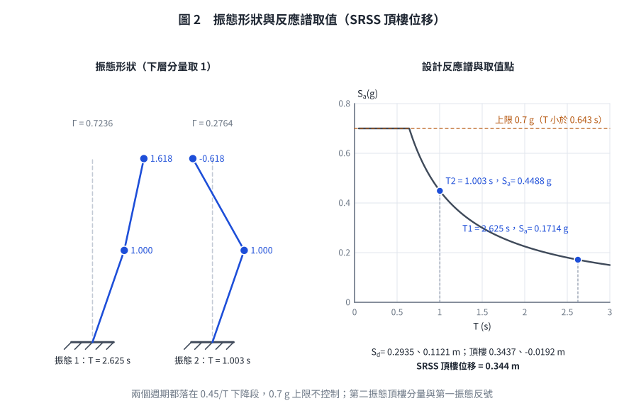

# 考題編號：SD-2022-3

**主分類：** `SD-U2-2` 建築耐震設計規範
**副分類：** `SD-U1-3` 單自由度、多自由度系統之動態分析及應用
**分析方法：** 反應譜分析（SRSS 振態疊加）
**標籤：** `MDOF` `2自由度` `剪力建築` `特徵值問題` `自然頻率` `振態向量` `模態參與因子` `SRSS組合` `反應譜分析` `動力分析條件` `黃金比例`

---

## 1. 題目（考卷原文見題目正本）

> 考卷原文、公式／附表、附圖與判讀清單（已確認）見 [`SD-2022-3-problem.md`](SD-2022-3-problem.md)。本節只列解題時最容易讀錯的地方與本解使用的記號；題意以題目正本為準。

### 常見誤讀

| 項目 | 正確判讀 | 常見誤讀 |
|------|---------|---------|
| 自由度順序 | 第 1 列為下層、第 2 列為頂樓（$K_{22}=k_2$；判讀 #1） | 顛倒 |
| 反應譜 | $S_a=\min(0.45/T,\ 0.7)\,g$（判讀 #2） | 忘了 0.7 g 上限，或把它當下限 |
| 質量單位 | kN·s²/m（＝t），不是重量（判讀 #4） | 當成 kN 重量再除以 g |
| ㈠ | 依現行建築物耐震設計規範作答（判讀 #5） | 照考試當年的規範版本 |

**本解記號：** $\Gamma_i$ 振態參與因子、$S_{di}=S_a(T_i)/\omega_i^2$、$X_{2i}$ 第 $i$ 振態頂樓位移。

---

## 2. 考題核心精神與出題者意圖（Core Concepts & Examiner's Intent）

**核心觀念：** 子題(一)考規範記憶，子題(二)考完整的反應譜模態疊加流程：

$$\text{特徵值求解} \rightarrow \text{振態向量} \rightarrow \text{模態參與因子} \rightarrow \text{各模態} S_d \rightarrow \text{模態位移} \rightarrow \text{SRSS}$$

**出題者意圖：**
- 子題(一)：測驗考生是否清楚台灣耐震規範對**何時必須做動力分析**的判斷門檻
- 子題(二)：測驗完整的 MDOF 反應譜分析流程；本題勁度矩陣的特徵解會出現**黃金比例（Golden Ratio）**，數字優雅，是典型考題

---

## 3. 解題戰略地圖與陷阱分析（Strategic Roadmap & Trap Analysis）

**作戰計畫：**

1. 子題(一)：直接記憶規範條文
2. 子題(二)：依序執行：
   - Step A：解特徵值問題（4×4行列式→二次方程→兩根）
   - Step B：代入求振態向量
   - Step C：計算模態參與因子 $\Gamma_i$
   - Step D：查反應譜（代入 $T_i$），注意 $S_a \leq 0.7g$ 上限
   - Step E：計算各模態頂樓位移
   - Step F：SRSS 組合

**關鍵陷阱：**

1. **$S_a$ 上限忘記檢核**：$S_a = 0.45g/T$ 在短週期時可能超過 0.7g，必須取 min(0.45g/T, 0.7g)。本題兩個模態均在長週期側，不受上限控制——但仍要驗算才能確定，否則丟分。

2. **模態參與因子的分子分母搞混**：$\Gamma_i = \dfrac{\{φ\}_i^T [M] \{1\}}{\{φ\}_i^T [M] \{φ\}_i}$，分子是地震激振向量 $\{1\}$，分母是模態質量。

3. **SRSS 是「各模態最大反應的平方根」**，不是直接疊加或代數疊加：
$$X_{SRSS} = \sqrt{\sum_i X_{i,max}^2}$$

4. **頂樓是第 2 自由度（DOF 2）**：題目問頂樓位移，對應振態向量第 2 分量，勿用第 1 分量。

---

## 3.5 變數層次分析（Variable Hierarchy Analysis）

> 複習提示：第一次解題後，在每個卡住的知識點旁標記 `⚠`；第二次複習時只看有 `⚠` 的項目。

### 最終目標

`以 SRSS 法求 2DOF 剪力屋架頂樓最大側向位移 X₂`

### 本題關鍵公式（依計算順序）

$$\text{Step 1: } \det(\mathbf{K} - \omega^2 \mathbf{M}) = 0 \quad \Rightarrow \quad \omega_1^2,\; \omega_2^2$$

$$\text{Step 2: } (\mathbf{K} - \omega_i^2 \mathbf{M})\{φ\}_i = \{0\} \quad \Rightarrow \quad \{φ\}_1,\; \{φ\}_2$$

$$\text{Step 3: } \Gamma_i = \frac{\{φ\}_i^T \mathbf{M} \{1\}}{\{φ\}_i^T \mathbf{M} \{φ\}_i}$$

$$\text{Step 4: } S_{di} = \frac{S_a(T_i)}{\boxed{\omega_i^2}} = \frac{S_a(T_i) \cdot T_i^2}{4\pi^2}$$

$$\text{Step 5: } X_{2i} = \boxed{\Gamma_i} \cdot \boxed{S_{di}} \cdot \phi_{2i} \quad \text{（各模態頂樓位移）}$$

$$\text{Step 6: } X_2 = \sqrt{X_{21}^2 + X_{22}^2} \quad \text{（SRSS）}$$

### L1：題目直接給定

| 符號 | 數值 | 說明 |
|------|------|------|
| $m_1 = m_2$ | 100 kN·s²/m | 各樓層質量 |
| $k_1, k_2$ | 各層剛度（由 K 矩陣讀出，見 §4） | 故事剛度 |
| $\xi_i$ | 0.05（5%） | 各模態阻尼比 |
| $S_a$ | $0.45g/T$，上限 $0.7g$ | 設計加速度反應譜 |

### L2：需知識點推導

**Step A：特徵值**

| 符號 | 公式/來源 | 卡關? |
|------|----------|:-----:|
| $\omega_1^2, \omega_2^2$ | $\det(\mathbf{K}-\omega^2\mathbf{M})=0$ → 二次方程 | |
| $T_1, T_2$ | $T_i = 2\pi/\omega_i$ | |

**Step B：振態向量**

| 符號 | 公式/來源 | 卡關? |
|------|----------|:-----:|
| $\phi_{21}/\phi_{11}$ | 由 $(K_{11}-\omega_i^2 m_1)\phi_{1i} = K_{12}\phi_{2i}$ 求比值 | |

**Step C：模態參與因子**

| 符號 | 公式/來源 | 卡關? |
|------|----------|:-----:|
| $\Gamma_1, \Gamma_2$ | $\{φ\}_i^T [M] \{1\} / (\{φ\}_i^T [M] \{φ\}_i)$ | |

**Step D：反應譜位移**

| 符號 | 公式/來源 | 卡關? |
|------|----------|:-----:|
| $S_{di}$ | $S_a(T_i)/\omega_i^2 = S_a(T_i) \cdot T_i^2/(4\pi^2)$ | |

**Step E-F：模態位移與 SRSS**

| 符號 | 公式/來源 | 卡關? |
|------|----------|:-----:|
| $X_{2i}$ | $\Gamma_i \cdot S_{di} \cdot \phi_{2i}$ | |
| $X_2$ | $\sqrt{X_{21}^2 + X_{22}^2}$ | |

### L3：深層知識（不懂就卡住）

| 知識點 | 說明 | 卡關? |
|--------|------|:-----:|
| 振態正交性 | $\{φ\}_i^T [M] \{φ\}_j = 0$（$i \neq j$），這是模態解耦的基礎，使各振態可獨立計算 | |
| SRSS 的統計假設 | 各模態最大反應不同時發生，假設其為獨立隨機過程，SRSS 為其均方根組合（機率 84%的上界） | |
| 黃金比例與剪力建築 | 等質量等剛度兩層剪力建築的特徵解恰為黃金比例；辨識後可快速計算 | |
| 偽加速度 vs 偽速度 | $PSa = \omega^2 S_d$（偽加速度）；$PSv = \omega S_d$（偽速度）；兩者均為「偽」（pseudo），因未精確考慮阻尼對 Sd 的修正 | |

---

## 4. 步驟化詳細計算過程（Step-by-Step Detailed Calculation）

---

### 子題(一)：規則性結構進行動力分析的條件（8 分）

依現行《建築物耐震設計規範及解說》第 3.1 節（動力分析之適用），規則性建築物「高度等於或超過 50 公尺或 15 層以上」者須以動力分析方法（振態反應譜分析或歷時分析）設計：

$$\boxed{\text{建築物高度} \ge 50\,\text{m} \quad \text{或} \quad \text{樓層數} \ge 15 \text{ 層}}$$

滿足任一條件即需進行動力分析；高度小於 50 m 且未達 15 層的規則性建築物，可採用第二章**靜力分析方法**（第 2.1 節適用範圍「高度小於 50 公尺且未達 15 層」）。邊界值 50 m、15 層本身即須做動力分析，不可寫成「超過 50 m／超過 15 層」。

**補充說明（加分）：**

- 「高度」指從地面（基礎頂面）至屋頂的結構高度（不含屋突）
- 不規則建築物門檻較低（第 3.1 節）：超過 20 m 或 5 層以上，且具立面不規則（表 1-1 第 1～3 種）或平面扭轉不規則（表 1-2）者；超過 5 層或 20 m、非全高度同一種結構系統者，亦須動力分析
- 規則性的判斷標準（平面、立面不規則性）見規範第一章表 1-1、表 1-2

---

### 子題(二)：SRSS 反應譜分析（17 分）

#### Step A：建立特徵值方程並求解

行列式條件：

$$\det(\mathbf{K} - \omega^2 \mathbf{M}) = 0$$

$$\begin{vmatrix} 3000 - 100\omega^2 & -1500 \\ -1500 & 1500 - 100\omega^2 \end{vmatrix} = 0$$

展開：

$$(3000-100\omega^2)(1500-100\omega^2) - (-1500)^2 = 0$$

$$4{,}500{,}000 - 450{,}000\omega^2 + 10{,}000\omega^4 - 2{,}250{,}000 = 0$$

$$10{,}000\omega^4 - 450{,}000\omega^2 + 2{,}250{,}000 = 0$$

除以 10,000：

$$\omega^4 - 45\omega^2 + 225 = 0$$

令 $u = \omega^2$，以求根公式解：

$$u = \frac{45 \pm \sqrt{45^2 - 4 \times 225}}{2} = \frac{45 \pm \sqrt{2025 - 900}}{2} = \frac{45 \pm \sqrt{1125}}{2} = \frac{45 \pm 15\sqrt{5}}{2}$$

**第一振態（低頻）：**

$$\omega_1^2 = \frac{45 - 15\sqrt{5}}{2} = \frac{45 - 33.541}{2} = \frac{11.459}{2} = 5.730 \text{ rad}^2/\text{s}^2$$

$$\omega_1 = 2.394 \text{ rad/s}, \quad T_1 = \frac{2\pi}{2.394} = \boxed{2.625 \text{ s}}$$

**第二振態（高頻）：**

$$\omega_2^2 = \frac{45 + 15\sqrt{5}}{2} = \frac{45 + 33.541}{2} = \frac{78.541}{2} = 39.271 \text{ rad}^2/\text{s}^2$$

$$\omega_2 = 6.267 \text{ rad/s}, \quad T_2 = \frac{2\pi}{6.267} = \boxed{1.003 \text{ s}}$$

> 驗算（Vieta's 公式）：$\omega_1^2 + \omega_2^2 = 5.730 + 39.271 = 45.001 \approx 45$ ✓；$\omega_1^2 \times \omega_2^2 = 5.730 \times 39.271 = 225.0 \approx 225$ ✓

---

#### Step B：求振態向量

**第一振態** $(\omega_1^2 = 5.730)$：

代入第一行方程：

$$(3000 - 100 \times 5.730)\phi_{11} - 1500\phi_{21} = 0$$

$$2427\phi_{11} = 1500\phi_{21} \quad \Rightarrow \quad \frac{\phi_{21}}{\phi_{11}} = \frac{2427}{1500} = 1.618 = \frac{1+\sqrt{5}}{2} \equiv \varphi \text{ （黃金比例）}$$

$$\boxed{\{φ\}_1 = \begin{Bmatrix} 1 \\ 1.618 \end{Bmatrix}}$$

**第二振態** $(\omega_2^2 = 39.271)$：

$$(3000 - 100 \times 39.271)\phi_{12} - 1500\phi_{22} = 0$$

$$-927.1\phi_{12} = 1500\phi_{22} \quad \Rightarrow \quad \frac{\phi_{22}}{\phi_{12}} = \frac{-927.1}{1500} = -0.618 = \frac{1-\sqrt{5}}{2}$$

$$\boxed{\{φ\}_2 = \begin{Bmatrix} 1 \\ -0.618 \end{Bmatrix}}$$

> 物理意義：
> - 第一振態：兩層同向運動，頂樓位移 1.618 倍於底樓（黃金比例）
> - 第二振態：兩層反向運動，頂樓振幅較小（反節點在 1 與 2 之間）

---

#### Step C：模態參與因子

$$\Gamma_i = \frac{\{φ\}_i^T \mathbf{M} \{1\}}{\{φ\}_i^T \mathbf{M} \{φ\}_i}$$

**模態 1：**

$$\{φ\}_1^T \mathbf{M} \{1\} = \begin{bmatrix} 1 & 1.618 \end{bmatrix} \begin{bmatrix} 100 & 0 \\ 0 & 100 \end{bmatrix} \begin{Bmatrix} 1 \\ 1 \end{Bmatrix} = 100(1) + 100(1.618) = 261.8 \text{ kN}\cdot\text{s}^2/\text{m}$$

$$\{φ\}_1^T \mathbf{M} \{φ\}_1 = 100(1)^2 + 100(1.618)^2 = 100 + 100(2.618) = 361.8 \text{ kN}\cdot\text{s}^2/\text{m}$$

$$\boxed{\Gamma_1 = \frac{261.8}{361.8} = 0.7236}$$

**模態 2：**

$$\{φ\}_2^T \mathbf{M} \{1\} = 100(1) + 100(-0.618) = 100 - 61.8 = 38.2 \text{ kN}\cdot\text{s}^2/\text{m}$$

$$\{φ\}_2^T \mathbf{M} \{φ\}_2 = 100(1)^2 + 100(0.618)^2 = 100 + 100(0.382) = 138.2 \text{ kN}\cdot\text{s}^2/\text{m}$$

$$\boxed{\Gamma_2 = \frac{38.2}{138.2} = 0.2764}$$

> 有效質量驗算：
> $M_1^{eff} = (261.8)^2/361.8 = 189.4$ kN·s²/m；$M_2^{eff} = (38.2)^2/138.2 = 10.56$ kN·s²/m
> 合計 $189.4 + 10.56 = 200.0$ kN·s²/m = 總質量 $100 + 100 = 200$ ✓

---

#### Step D：反應譜加速度與位移

取 $g = 9.81$ m/s²：

**模態 1** $(T_1 = 2.625$ s)：

$$S_a(T_1) = \frac{0.45 \times 9.81}{2.625} = \frac{4.415}{2.625} = 1.682 \text{ m/s}^2$$

上限檢核：$0.7g = 6.867$ m/s²，$1.682 < 6.867$ ✓（不受上限控制）

$$S_{d1} = \frac{S_a(T_1)}{\omega_1^2} = \frac{1.682}{5.730} = \boxed{0.2936 \text{ m}}$$

**模態 2** $(T_2 = 1.003$ s)：

$$S_a(T_2) = \frac{0.45 \times 9.81}{1.003} = \frac{4.415}{1.003} = 4.402 \text{ m/s}^2$$

上限檢核：$4.402 < 6.867$ ✓（不受上限控制）

$$S_{d2} = \frac{S_a(T_2)}{\omega_2^2} = \frac{4.402}{39.271} = \boxed{0.1121 \text{ m}}$$

---

*圖 2　振態形狀與反應譜取值。兩個週期都在 $0.45g/T$ 下降段，0.7 g 上限不控制；本圖攔下頂樓取錯振態分量、漏查上限，以及 $S_a$ 以 g 計卻未乘 $g$。*

#### Step E：各模態最大頂樓位移（DOF 2）

**模態 1 頂樓位移：**

$$X_{21} = \Gamma_1 \cdot S_{d1} \cdot \phi_{21} = 0.7236 \times 0.2936 \times 1.618 = \boxed{0.3438 \text{ m}}$$

**模態 2 頂樓位移：**

$$X_{22} = \Gamma_2 \cdot S_{d2} \cdot \phi_{22} = 0.2764 \times 0.1121 \times (-0.618) = \boxed{-0.01915 \text{ m}}$$

（取絕對值 $|X_{22}| = 0.01915$ m）

---

#### Step F：SRSS 組合

$$X_2^{SRSS} = \sqrt{X_{21}^2 + X_{22}^2} = \sqrt{(0.3438)^2 + (0.01915)^2}$$

$$= \sqrt{0.11820 + 0.000367}$$

$$= \sqrt{0.11857}$$

$$\boxed{X_2 \approx 0.344 \text{ m}}$$

**頂樓最大側向位移為 0.344 m（約 344 mm）。**

> 結果解讀：第一模態貢獻 $X_{21} = 0.3438$ m，佔 SRSS 結果的 99.9%；第二模態貢獻僅 0.1%，因其有效質量僅佔 5.3%，幾乎可忽略。這印證了「長週期第一模態主導結構反應」的規律。

---

#### 結果總整理

| 項目 | 模態 1 | 模態 2 |
|------|--------|--------|
| $\omega_i^2$ (rad²/s²) | 5.730 | 39.271 |
| $T_i$ (s) | 2.625 | 1.003 |
| 振態向量 $\{φ\}_i$ | $\{1,\ 1.618\}^T$ | $\{1,\ {-0.618}\}^T$ |
| 模態參與因子 $\Gamma_i$ | 0.7236 | 0.2764 |
| $S_a(T_i)$ (m/s²) | 1.682 | 4.402 |
| $S_{di}$ (m) | 0.2936 | 0.1121 |
| 頂樓模態位移 $X_{2i}$ (m) | 0.3438 | −0.01915 |
| **SRSS 頂樓位移** (m) | **0.344** | — |

---

## 5. 關鍵爭議點與進階探討（Critical Issues & Advanced Discussion）

### 5.1 黃金比例的出現與物理意義

等質量（$m_1 = m_2$）等層剛度（$k_1 = k_2$）的兩層剪力建築，其特徵向量恰好含黃金比例 $\varphi = (1+\sqrt{5})/2 \approx 1.618$。其物理意義為：在第一（長週期）振態中，頂樓的振幅是底樓的 1.618 倍，且兩者同向；在第二振態中，頂樓振幅是底樓的 0.618 倍，且兩者反向。

### 5.2 $S_a$ 上限 0.7g 的物理意義

反應譜在短週期端通常有一平台段（常數加速度區）。本題給定的 $S_a = 0.45g/T$ 是長週期下降段；$S_a \leq 0.7g$ 是短週期平台段的上限。本題兩個週期（2.625 s 和 1.003 s）都在長週期降落段，故無需切換。

考場常見錯誤：未做上限檢核就直接代入 $0.45g/T$，若週期很短（如 $T = 0.3$ s），$S_a = 1.5g > 0.7g$，此時應取 $S_a = 0.7g$，否則高估了高頻模態的貢獻。

### 5.3 SRSS vs CQC

SRSS 適用於各模態頻率**相差超過 10%** 的情況：

$$\frac{\omega_2 - \omega_1}{\omega_1} = \frac{6.267 - 2.394}{2.394} = 161.7\% >> 10\% \quad \checkmark$$

若兩模態頻率相近（如 $\omega_2/\omega_1 < 1.1$），應改用 CQC 法，否則 SRSS 會低估組合結果。

### 5.4 考場最安全的計算路徑

$$\omega_i^2 \xrightarrow{T=2\pi/\omega} T_i \xrightarrow{代入S_a(T)公式} S_a(T_i) \xrightarrow{\div\omega_i^2} S_{di} \xrightarrow{\times\Gamma_i\phi_{2i}} X_{2i} \xrightarrow{SRSS} X_2$$

每步驟都帶單位，確認無量綱一致性，最後 SRSS 的 0.344 m 量級合理（週期長、質量大的結構位移大是正常現象）。

*修正日期：2026-11-15（§1 改為指向題目正本）*
*修正日期：2026-11-15（㈠ 動力分析門檻由「高度 >50 m 或 >15 層」更正為規範原文「高度等於或超過 50 公尺或 15 層以上」，補不規則建築物門檻；㈡ 數值不變。驗證：查國土管理署公布之建築物耐震設計規範及解說第 3.1 節、第 2.1 節條文；㈡ 由獨立盲解與舊解兩路一致 0.344 m）*
*修正日期：2026-11-15（非勘誤）§4 ㈡ Step D 後補解題圖解 figs/SD-2022-3-fig-2-spectrum.svg（圖解補繪，腳本 gen_SD-2022-3.py，可重跑）*
