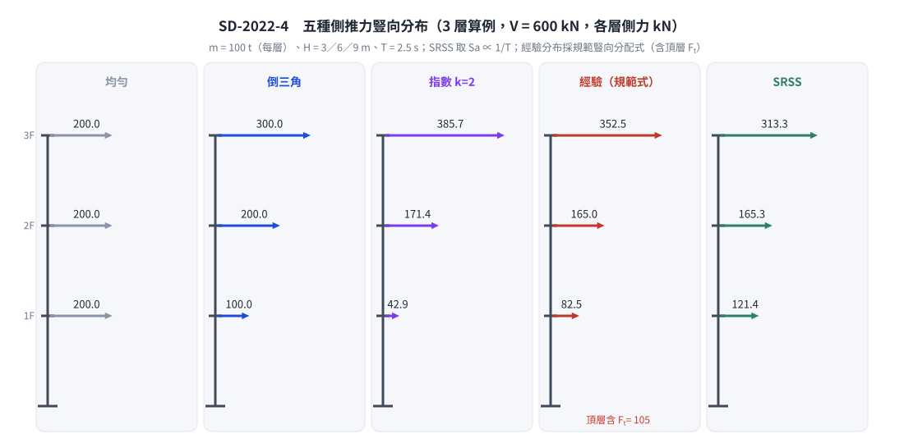

# 考題編號：SD-2022-4

**主分類：** `SD-U3-1` 結構耐震設計（含 RC 結構與鋼結構）
**副分類：** `SD-U2-2` 建築耐震設計規範
**分析方法：** 概念題（含計算）
**標籤：** `Pushover分析` `靜力彈塑性` `側力分布` `均勻分布` `倒三角分布` `指數分布` `經驗分布` `SRSS組合` `性能設計`

---

## 1. 題目（考卷原文見題目正本）

> 考卷原文、公式／附表、附圖與判讀清單（已確認）見 [`SD-2022-4-problem.md`](SD-2022-4-problem.md)。本節只列解題時最容易讀錯的地方與本解使用的記號；題意以題目正本為準。

本題為純文字題，考卷無附圖。

### 常見誤讀

| 項目 | 正確判讀 | 常見誤讀 |
|------|---------|---------|
| 計算例數據 | 考卷**沒有給**任何數據，3 層平面結構的質量、樓高、週期、振態、基底剪力全由考生自行假設並寫明（判讀 #3） | 以為漏印數據，或只寫公式不算例 |
| 「經驗分布」 | 考卷未定義；題目正本定案解讀為規範等值靜力法豎向分配式（含頂層集中力 $F_t$）；作答須先寫明所採定義（判讀 #1） | 不寫定義直接套用一階振態分布（本庫舊解） |
| 「指數分布」 | $F_x\propto W_xh_x^{\,k}$，$k$ 隨週期 1→2（判讀 #2） | $k$ 任意取值不說明依據 |
| 振態組合法（SRSS） | 是**一種側力豎向分布**：各振態層剪力以 SRSS 組合後差分成單一分布再側推（判讀 #4） | 每個振態各做一次 Pushover 再組合需求量（MPA，本庫舊解）；或與其他方法結果再做 SRSS 組合 |
| 振態形狀 | 等質量等勁度 3 層：$\phi_1=\{0.445,\ 0.802,\ 1\}$ | 粗估 $\{0.3,\ 0.7,\ 1\}$（與第二振態不正交，本庫舊解） |
| 適用前提 | 規則、可簡化為平面結構；分配的是 Pushover 側推力（判讀 #5） | 當成設計地震力的規範分配 |

**本解記號：** $V$ 基底剪力、$m_i$ 第 $i$ 層質量、$H_i$ 第 $i$ 層離地高度、$k$ 指數分布的指數、$\phi_{ji}$ 第 $j$ 振態第 $i$ 層振態值、$\Gamma_j$ 參與因子、$S_a(T_j)$ 譜加速度。

---

## 2. 考題核心精神與出題者意圖（Core Concepts & Examiner's Intent）

**核心觀念：** Pushover 分析的側推力是對地震慣性力的「靜力替代」；不同豎向分布對應不同的慣性力形狀假設。能說清楚五種方法的物理假設與計算方式、以同一組 3 層算例算出各層側力，並指出各自的適用範圍，是本題拿分關鍵。

**出題者意圖：**
- 測驗考生對 Pushover 分析流程的熟悉程度（ATC-40、FEMA 356、現行建築物耐震設計規範的豎向分配式）
- 要求配合數值例印證公式——**五種方法都要算出數值**，不只是背公式
- 「局限性」要求考生做**批判性思考**，而非照單全收

---

## 3. 解題戰略地圖與陷阱分析（Strategic Roadmap & Trap Analysis）

**作答策略：**

子題(一)：先寫明算例假設（考卷沒給，判讀 #3），每種方法先寫**公式**，再代入同一組**3 層算例**，最後給出**各樓層力值彙整表**。

子題(二)：每種方法指出 1～2 個核心局限性，最後補充所有 Pushover 方法的**共同限制**。

**關鍵陷阱：**

1. **振態組合法（SRSS）是一種側力分布**（判讀 #4）：先求各振態的樓層剪力，以 SRSS 組合成各層剪力，再由相鄰層剪力差得到**單一組**側力分布，用它做一次 Pushover。它不是「每個振態各做一次 Pushover 再組合需求量」（那是多振態側推分析 MPA，屬另一種方法，見 §5.7）。
2. **「經驗分布」考卷沒有定義**（判讀 #1）：本解採規範等值靜力法的豎向分配式（頂層集中力 $F_t$＋其餘依 $W_xh_x$ 分配）；作答時先寫明採用的定義。
3. **指數分布的 $k$ 值**：$k$ 隨基本週期 $T$ 決定（不是隨意設的），$k=1$ 退化為倒三角，$k=2$ 為拋物線分布。
4. **振態要用正確的振態形狀**：等質量、等層勁度 3 層剪力屋架的振態可解析求得（$\phi_1=\{0.445,\ 0.802,\ 1\}$），不要用粗估值，否則各振態不正交、參與因子失真。
5. **均勻分布不等於每層相同位移**：均勻分布是「每層相同力」。

---

## 3.5 變數層次分析（Variable Hierarchy Analysis）

> 複習提示：第一次解題後，在每個卡住的知識點旁標記 `⚠`；第二次複習時只看有 `⚠` 的項目。

### 最終目標

`說明 5 種 Pushover 側力分布公式，以 3 層算例計算各樓層力，並評論局限性`

### 本題關鍵公式（依計算順序）

$$\text{均勻：} F_i = \frac{V}{n}$$

$$\text{倒三角：} F_i = V \cdot \frac{m_i H_i}{\sum_j m_j H_j}$$

$$\text{指數：} F_i = V \cdot \frac{m_i H_i^k}{\sum_j m_j H_j^k}, \quad k = \begin{cases} 1 & T \leq 0.5\,\text{s} \\ 1+\frac{T-0.5}{2} & 0.5 < T < 2.5\,\text{s} \\ 2 & T \geq 2.5\,\text{s} \end{cases}$$

$$\text{經驗（規範式）：} F_t = 0.07TV\le0.25V\ (T\le0.7\text{ s 時 }F_t=0),\quad F_i=(V-F_t)\frac{W_iH_i}{\sum_j W_jH_j}\ (+F_t\text{ 於頂層})$$

$$\text{振態組合（SRSS）：} V_{in}=\Gamma_n S_{an}\sum_{j\ge i}m_j\phi_{jn},\quad V_i=\sqrt{\textstyle\sum_n V_{in}^2},\quad F_i=V_i-V_{i+1}$$

### L1：算例假設（考卷沒給，由解題者自設）

| 符號 | 數值 | 說明 |
|------|------|------|
| n | 3 | 樓層數 |
| $m_1 = m_2 = m_3$ | 100 t（= kN·s²/m） | 各樓層質量（相等；重量比例同質量比例） |
| $H_1, H_2, H_3$ | 3, 6, 9 m | 各樓層離地高度 |
| V | 600 kN | 側推基底剪力（各方法統一，用來比較形狀） |
| $T$ | 2.5 s | 基本週期（指數法、經驗法使用） |
| 層勁度 $k$ | 3189 kN/m（三層相同） | 為使 $T_1=2.5$ s 反推（SRSS 法使用） |
| 反應譜 | $S_a\propto 1/T$ | 假設三個週期都落在等速度段（SRSS 法使用；只影響形狀） |

### L2：需知識點推導

| 步驟 | 公式/來源 | 卡關? |
|------|----------|:-----:|
| 均勻分布 | $V/n$ | |
| 倒三角 $\sum m_j H_j$ | 質量×高度加權 | |
| 指數 $k$ 判斷 | $T\ge2.5$ s → $k=2$ | |
| 經驗分布 $F_t$ | $0.07(2.5)(600)=105\le150$ kN | |
| 振態 | $(K-\omega^2M)\phi=0$：$T=\{2.500,\ 0.892,\ 0.617\}$ s | |
| 參與因子 | $\Gamma=\{1.220,\ 0.349,\ -0.134\}$（$\phi$ 以最大分量為 1 正規化） | |
| SRSS 層剪力 | 各振態層剪力 SRSS 後差分 | |

### L3：深層知識（不懂就卡住）

| 知識點 | 說明 | 卡關? |
|--------|------|:-----:|
| Pushover 的物理假設 | 用靜力替代動力——假設結構從彈性逐步推至非彈性，忽略地震動態的交替正負效應 | |
| 為何要多種側力分布 | 無法預知地震時真實側力分布；不同分布捕捉不同破壞機制，FEMA 356 建議至少用兩種分布包絡 | |
| 模態參與因子 Γ | 振態側力 $= \Gamma_n m_i\phi_{in}S_{an}$，Γ 與有效質量決定各振態貢獻比例 | |
| SRSS 組合的對象 | 組合**層剪力**（反應量）而非直接組合各層力；組合後的值皆為正，差分得到的分布隱含高振態使上部側力加大 | |

---

## 4. 步驟化詳細計算過程（Step-by-Step Detailed Calculation）

---

### 算例設定（考卷未給，自設；判讀 #3）

```
3層剪力屋架（平面）：
  樓層質量：m₁ = m₂ = m₃ = 100 t（各層重量相同）
  樓層高度：H₁ = 3 m, H₂ = 6 m, H₃ = 9 m（每層 3 m）
  側推基底剪力：V = 600 kN（各方法統一使用，以比較分布形狀）
  基本週期：T = 2.5 s（層勁度 k = 3189 kN/m，三層相同）
  反應譜形狀：Sa ∝ 1/T（SRSS 法用）
```

---

### 方法一：均勻分布（Uniform Distribution）

**原理：** 各樓層承受與質量成正比的側力（等質量時各層相等），相當於全高等加速度，強調下部樓層剪力。

$$F_i = V\frac{m_i}{\sum m_j}=\frac{V}{n}\quad(\text{等質量})$$

**算例：**

$$\boxed{F_1 = F_2 = F_3 = \frac{600}{3} = 200 \text{ kN}}$$

---

### 方法二：倒三角分布（Inverted Triangular Distribution）

**原理：** 側力與樓高成線性比例，相當於假設一階振態為直線。

$$F_i = V \cdot \frac{m_i H_i}{\displaystyle\sum_{j=1}^{n} m_j H_j}$$

**算例：**

$$\sum m_j H_j = 100(3) + 100(6) + 100(9) = 1800 \text{ t·m}$$

$$\boxed{F_1 = 600 \times \frac{300}{1800} = 100 \text{ kN}, \quad F_2 = 200 \text{ kN}, \quad F_3 = 300 \text{ kN}}$$

---

### 方法三：指數分布（Power Law Distribution）

**原理：** 以指數 $k$ 修正高度權重，週期愈長側力愈集中於上部，間接反映高振態（FEMA 356／ASCE 7 型式）。

$$F_i = V \cdot \frac{m_i H_i^k}{\displaystyle\sum_{j=1}^{n} m_j H_j^k}$$

$$k = \begin{cases} 1.0 & T \leq 0.5 \text{ s（退化為倒三角）} \\ 1 + \dfrac{T - 0.5}{2} & 0.5 < T < 2.5 \text{ s} \\ 2.0 & T \geq 2.5 \text{ s（拋物線分布）} \end{cases}$$

**算例（T = 2.5 s → k = 2）：**

$$\sum m_j H_j^2 = 100(9 + 36 + 81) = 12{,}600 \text{ t·m}^2$$

$$F_1 = 600 \times \frac{900}{12{,}600} = \boxed{42.9 \text{ kN}},\quad F_2 = 600 \times \frac{3{,}600}{12{,}600} = \boxed{171.4 \text{ kN}},\quad F_3 = 600 \times \frac{8{,}100}{12{,}600} = \boxed{385.7 \text{ kN}}$$

---

### 方法四：經驗分布（規範豎向分配式；判讀 #1）

**原理：** 採建築物耐震設計規範第 2.11 節的豎向分配經驗式：頂層加集中力 $F_t$ 以近似高振態，其餘依 $W_xh_x$（倒三角）分配。

$$F_t = 0.07TV\ \ (\le 0.25V;\ T\le0.7\text{ s 時 }F_t=0),\qquad F_x=(V-F_t)\frac{W_xh_x}{\sum W_ih_i}$$

**算例：**

$$F_t=0.07(2.5)(600)=105\ \text{kN}\ \le\ 0.25(600)=150\ \text{kN}$$

$$V-F_t=495\ \text{kN}:\quad 495\times\frac{1}{6}=82.5,\ \ 495\times\frac{2}{6}=165.0,\ \ 495\times\frac{3}{6}=247.5\ \text{kN}$$

$$\boxed{F_1=82.5\ \text{kN},\quad F_2=165.0\ \text{kN},\quad F_3=247.5+105=352.5\ \text{kN}}$$

> 另一種常見的「經驗」寫法是依第一振態形狀分配 $F_i\propto m_i\phi_{1i}$。以本例精確振態 $\phi_1=\{0.445,\ 0.802,\ 1\}$ 得 118.8／214.1／267.0 kN（見方法五的振態）。考卷未定義時，作答須寫明所採定義。

---

### 方法五：振態組合法（SRSS 分布；判讀 #4）

**原理：** 以振態疊加求各振態的樓層剪力，依 SRSS 組合成各層剪力，再以相鄰層剪力差得到**單一組**側力分布，用來做 Pushover。因 SRSS 會把高振態的貢獻計入，上部側力通常比一階分布大。

**Step 1 振態分析**（$K=k\begin{bmatrix}2&-1&0\\-1&2&-1\\0&-1&1\end{bmatrix}$，$M=100I$）：

| 振態 | $T_n$ (s) | $\phi_n$（1F, 2F, 3F） | $\Gamma_n$ | 有效質量比 |
|:---:|:---:|:---:|:---:|:---:|
| 1 | 2.500 | {0.445, 0.802, 1.000} | 1.220 | 91.4% |
| 2 | 0.892 | {1.000, 0.445, −0.802} | 0.349 | 7.5% |
| 3 | 0.617 | {−0.802, 1.000, −0.445} | −0.134 | 1.1% |

**Step 2 振態層剪力**：$V_{in}=\Gamma_n S_{an}\sum_{j\ge i}m_j\phi_{jn}$，取 $S_{an}\propto1/T_n$（只需相對值）。各層 SRSS 層剪力比為 $V_1:V_2:V_3=112.7:89.9:58.8$。

**Step 3 差分並縮放至 $V=600$ kN：**

$$F_3=V_3,\quad F_2=V_2-V_3,\quad F_1=V_1-V_2$$

$$\boxed{F_1=121.4\ \text{kN},\quad F_2=165.3\ \text{kN},\quad F_3=313.3\ \text{kN}}$$

> 反應譜形狀會影響結果：若改用平坦譜（各振態 $S_a$ 相同），高振態權重更大，上部側力更集中。

---

### 算例結果彙整表

| 樓層 | 均勻 (kN) | 倒三角 (kN) | 指數 k=2 (kN) | 經驗（規範式）(kN) | SRSS (kN) |
|:----:|:---------:|:----------:|:-------------:|:---------:|:-------:|
| 3F（頂） | 200 | 300 | **385.7** | 352.5 | 313.3 |
| 2F | 200 | 200 | 171.4 | 165.0 | 165.3 |
| 1F | 200 | 100 | 42.9 | 82.5 | 121.4 |
| **合計** | **600** | **600** | **600** | **600** | **600** |




*圖 1　同一組算例假設（$V=600$ kN）下五種分布的各層側力，箭頭長度與力成正比。經驗分布用規範式（頂層含 $F_t=105$ kN），SRSS 為振態層剪力組合後差分的單一分布。本圖攔下「經驗分布＝一階振態」「SRSS 沒有側力數值（多次側推）」兩種舊解誤讀。*

---

## 5. 各方法應用局限性（子題二）

### 5.1 均勻分布

- **局限：** 假設各層加速度相同，忽略高度效應，**高估下部、低估上部需求**；推出的破壞機制偏向底層
- **適用條件：** 作為包絡分析的一端（FEMA 356 建議與振態型分布併用），檢驗軟弱底層機制

### 5.2 倒三角分布

- **局限：** 等同假設一階振態為直線，只適合**短週期、一階振態主導**的規則低矮建築；高振態明顯時低估上部需求
- **適用條件：** 低矮、規則、短週期結構

### 5.3 指數分布

- **局限：** $k$ 值為經驗式，只用基本週期粗略代表高振態，無法反映特定結構的質量、勁度分布；塑化後實際分布改變
- **適用條件：** 中長週期規則建築，比倒三角更合理

### 5.4 經驗分布（規範式）

- **局限：** 規範式是為**彈性設計地震力**訂定的，$F_t$ 只是以單一集中力近似高振態；用於非線性側推時，與實際慣性力形狀可能不符，且對不規則或軟弱層結構誤差大
- **適用條件：** 規則、中低層、與規範設計一致的評估；若改採一階振態分布，則只適用一階振態主導的結構

### 5.5 振態組合法（SRSS）

- **局限：**
  1. 振態與 $\Gamma$ 是**彈性**性質，塑化後振態改變但分布仍固定
  2. SRSS 組合後的值都是正值，**喪失各振態的正負號**，差分得到的分布不對應任一真實瞬間的慣性力
  3. 結果受反應譜形狀影響，須先做振態分析與選定設計譜
- **適用條件：** 高層、高振態效應顯著的規則結構

### 5.6 所有 Pushover 方法的共同局限性

> **最根本的限制：** Pushover 是**靜力**分析，無法完全替代**動力時程分析**。

1. **側力分布固定不變：** 推覆過程中分布不隨塑化調整（適應性側推可改善）
2. **忽略往返效應：** 單向推覆無法模擬反覆加載的強度、勁度退化
3. **不適用於非規則結構：** 扭轉、軟弱層、立面不規則難以用平面固定分布呈現
4. **目標位移的不確定性：** 需配合能力譜法或位移係數法求目標位移，本身有近似誤差

### 5.7 延伸：多振態側推分析（MPA）與舊解對照

另有一種做法是**每個振態各做一次 Pushover**，各自求目標位移下的反應，再以 SRSS 組合需求量（Chopra 與 Goel 的 MPA）。它組合的是「各次側推的反應量」，與題目所列「振態組合法（SRSS）」這種**側力豎向分布**不同。

舊解（2026-11-16 勘誤前）把方法五寫成 MPA、無側力數值；把「經驗分布」定義成一階振態分布，並採粗估振態 $\{0.3,\ 0.7,\ 1.0\}$、$\{1.0,\ 0.3,\ -0.7\}$（兩者 $\phi_1^TM\phi_2=-19\ne0$，不正交），得 90／210／300 kN。現依題目正本判讀 #1、#4 改寫，經驗分布改為 82.5／165.0／352.5 kN，SRSS 補算 121.4／165.3／313.3 kN。

---

## 補充：五種方法比較一覽

| 方法 | 公式形式 | 計算複雜度 | 適用結構 | 高振態效應 |
|------|---------|:---------:|---------|:---------:|
| 均勻 | $\propto m_i$ | ★ | 包絡下限、底層機制 | ✗ 未考慮 |
| 倒三角 | $\propto m_i H_i$ | ★ | 短週期規則結構 | ✗ 未考慮 |
| 指數 | $\propto m_i H_i^k$ | ★★ | 中長週期規則結構 | △ 以 $k$ 間接考慮 |
| 經驗（規範式） | $F_t$＋$\propto W_iH_i$ | ★★ | 規則中低層 | △ 以 $F_t$ 近似 |
| SRSS | 振態層剪力 SRSS 後差分 | ★★★ | 高層、高振態顯著 | ✓ 直接考慮（彈性振態） |

*修正日期：2026-11-16（§1 改為指向題目正本；本題無附圖，不重繪）*
*修正日期：2026-11-16（勘誤：依題目正本判讀 #1、#4 改寫——經驗分布由一階振態分布 90／210／300 kN 改為規範豎向分配式（Ft＝0.07TV＝105 kN）82.5／165.0／352.5 kN；振態組合法（SRSS）由多次側推組合需求量（無數值）改為振態層剪力 SRSS 後差分的單一分布 121.4／165.3／313.3 kN；粗估振態 {0.3, 0.7, 1.0}／{1.0, 0.3, −0.7}（不正交）改為精確振態；刪除自我更正亂句、修正 Σm·H 單位；改寫 §2–§5 與比較表，舊答降為 §5.7 對照。錯誤類型：L1 讀題（未依已確認題目正本）＋觀念模型（振態）。證據：2022 年考卷第 2 頁第四題；Ft 式依建築物耐震設計規範第 2.11 節。驗證：scripts/fixes/2026-11-16_verify_SD-2022-4.py（numpy 特徵值、兩路層剪力）MISMATCHES: 0）*
*修正日期：2026-11-16（非勘誤）圖解補繪：§4 彙整表後加 figs/SD-2022-4-fig-1-distributions.svg（腳本 gen_SD-2022-4.py，可重跑）*
