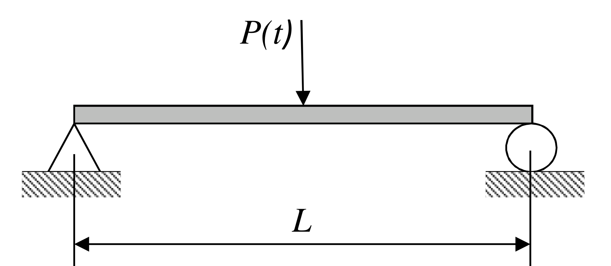

# SD-2023-1 題目正本

> 本檔只記錄考卷上寫了什麼、圖上畫了什麼，不含任何解法。解析見同資料夾 `SD-2023-1.md`。
> 判讀清單經使用者確認前，狀態為「待確認」；確認後本檔原則上不再修改（改動須回考卷原圖並記 log）。

| 項目 | 內容 |
|---|---|
| 考卷 | `raw/exams/SD-2023_結構動力分析與耐震設計.pdf`，第 1 頁（頁次 2－1），第一題 |
| 考年 | 2023（民國112年）專技高考結構工程技師「結構動力分析與耐震設計」 |
| 配分 | 25 分（㈠8 分、㈡12 分、㈢5 分） |
| 附圖 | `SD-2023-1-fig-1.png`（舊擷取，左上角有游標、下方切到下一行文字）、`SD-2023-1-fig-2.png`（2026-11-16 由考卷 500 dpi 重擷取） |
| 判讀狀態 | **已確認**（2026-11-16，使用者授權依 Claude 建議。原轉錄：2026-11-16；PyMuPDF 110 dpi 整頁＋250–500 dpi 局部放大，PDF 文字層核對原文（$\omega_n$、$\phi_n$ 兩式為影像，目視照錄）；判讀於開啟解析前完成） |

## 1. 考卷原文（逐字）

一、長度為 $L$ 的均質等斷面簡支梁如圖。假設其斷面慣性矩為 $I$、彈性模數為 $E$、單位長度質量為 $\overline{m}$ 。在梁中點受鉛垂向下的集中力 $P(t)$ 作用。回答下列問題：

㈠推導運動方程式。（8 分）

㈡證明第 n 個模態之模態頻率為 $\omega_n=\dfrac{n^2\pi^2}{L^2}\sqrt{\dfrac{EI}{\overline{m}}}$ ，且模態函數為 $\phi_n(x)=\sin\!\left(\dfrac{n\pi x}{L}\right)$。（12 分）

㈢求第 n 個模態的模態載重函數。（5 分）

## 2. 考卷給的公式、附表與參數

- 考卷給的式子（㈡要證明的結果）：$\omega_n=\dfrac{n^2\pi^2}{L^2}\sqrt{\dfrac{EI}{\overline m}}$、$\phi_n(x)=\sin(n\pi x/L)$。
- 給定：$L$、$E$、$I$、$\overline m$（單位長度質量）、中點集中力 $P(t)$（向下）。
- 考卷沒有給：阻尼；$P(t)$ 的時間函數形式；座標 $x$ 的原點（$\phi_n$ 的形式隱含 $x$ 由一端支承量起）；初始條件。
- 卷首注意事項：㈠可以使用電子計算器。㈡不必抄題，作答時請將試題題號及答案依照順序寫在試卷上，於本試題上作答者，不予計分。㈢本科目除專門名詞或數理公式外，應使用本國文字作答。考試時間：2 小時。

## 3. 附圖

*證據圖 SD-2023-1-fig-2.png（500 dpi 重擷取；舊圖 SD-2023-1-fig-1.png 內容相同，左上角有手形游標）*

圖面文字照錄：P(t)、L

## 4. 判讀清單

| # | 項目 | 判讀 | 圖上／題文依據 | 把握 |
|---|---|---|---|---|
| 1 | 阻尼 | 考卷未提，按無阻尼處理。**定案（使用者授權依建議）**：主解無阻尼 | 題文、圖上皆無阻尼 | 不確定（解讀，已依建議定案） |
| 2 | 支承 | 左端鉸支承（三角形）、右端滾支承（圓），即簡支 | 500 dpi 目視；題文「簡支梁」 | 確定 |
| 3 | 跨度 | $L$，支承中心到支承中心 | 尺寸線延伸線對齊三角形頂點與圓心 | 確定 |
| 4 | 載重位置與方向 | 梁中點 $x=L/2$，鉛垂向下 | 題文「中點…鉛垂向下」；圖上箭頭位於梁中央（500 dpi 量測與跨中重合） | 確定 |
| 5 | 斷面與質量 | 均質等斷面，$EI$、$\overline m$ 沿梁長為常數 | 題文 | 確定 |
| 6 | 梁理論 | 細長梁（Euler–Bernoulli），不計剪切變形與轉動慣量 | 題文未提；㈡給的 $\omega_n$ 為 Euler–Bernoulli 梁結果 | 確定（解讀） |
| 7 | ㈢「模態載重函數」 | 第 $n$ 模態的廣義（模態）力，為 $P(t)$ 的函數 | 題文 | 確定（解讀） |
| 8 | 考卷沒有給 | $P(t)$ 形式、初始條件、數值 | — | 確定 |

---
*轉錄：2026-11-16（SD-U1-2 題目正本推廣・組 U1-2-G3）*
*確認：2026-11-16 使用者授權依 Claude 建議確認（SD-U1-2 組 U1-2-G3，關卡一）*
